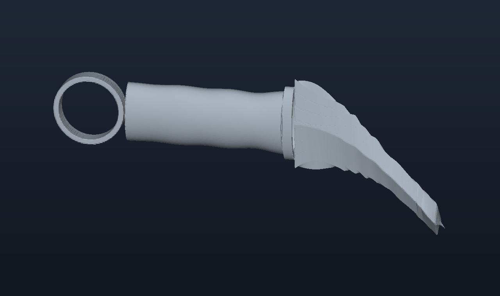
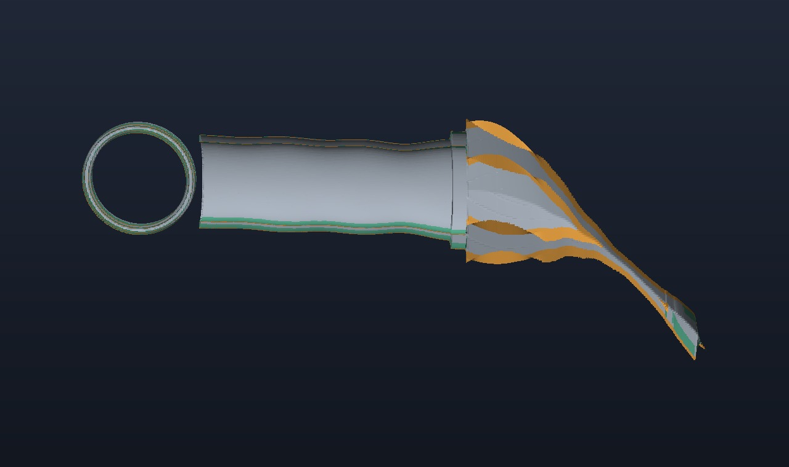

# Jarambit 4.1.0 (G4): an evolved sub-50 g titanium karambit for laser powder-bed fusion

[](https://github.com/neverhuman/jarambit/releases/tag/v4.1.0) [](docs/g4/paper/g4-v4.1.0.pdf) [-2f56d6)](cad/)    

Every computed number on this page describes **`g4v410_s042_a19374a8`**, the winning individual of the **G4 (`v4.1.0`)** Sobol-initialized cohort ([`evidence/g4/v4.1.0/release.json`](evidence/g4/v4.1.0/release.json), schema [`genome/G4.0.toml`](genome/G4.0.toml) `cfbe4e9348fc`, decoder `8300db0c518b`, requirement set [`requirements/RS-karambit-v4.toml`](requirements/RS-karambit-v4.toml)). Status: computational design; not built, printed or physically tested; not qualified for use as a knife.

**3D printing & CAD upload kit ([`cad/`](cad/)):** ready-to-upload 6-file bundle (each under 50 MiB, generated directly from the native G4 3D SDF with zero G3 bridge and zero post-hoc z-scaling) — primary print mesh [`cad/g4v410_s042_a19374a8_AMbuild_mm.stl`](cad/g4v410_s042_a19374a8_AMbuild_mm.stl) (Binary STL, mm, `37.49 g`), unit-embedded [`cad/g4v410_s042_a19374a8_AMbuild_mm.3mf`](cad/g4v410_s042_a19374a8_AMbuild_mm.3mf) (3MF, mm), outer envelope [`cad/g4v410_s042_a19374a8_envelope_mm.stl`](cad/g4v410_s042_a19374a8_envelope_mm.stl), 1:1 2D drawing [`cad/g4v410_s042_a19374a8_drawing_mm.dxf`](cad/g4v410_s042_a19374a8_drawing_mm.dxf) (DXF, mm), engineering spec [`cad/g4v410_s042_a19374a8_spec_paper.pdf`](cad/g4v410_s042_a19374a8_spec_paper.pdf) (PDF), and internal cutaway [`cad/g4v410_s042_a19374a8_xray_cutaway.jpg`](cad/g4v410_s042_a19374a8_xray_cutaway.jpg) (JPG). See [`cad/README.md`](cad/README.md) for copy-paste order notes; the archived `v3.0.0` (`hz4i013_g00995_d206e3c9`) kit is preserved in [`cad/v3.0.0/`](cad/v3.0.0/).

**Papers:** [`docs/g4/paper/g4-v4.1.0.pdf`](docs/g4/paper/g4-v4.1.0.pdf) (4-page G4 engineering & verification paper) and [`docs/g3/paper/g3-v4.1.0.pdf`](docs/g3/paper/g3-v4.1.0.pdf) (7-page G3 v3.0.0 cohort paper and diagnostics).



## The best individual (`g4v410_s042_a19374a8`)

Ti-6Al-4V for laser powder-bed fusion (stress-relieved, yield `828 MPa`, endurance limit `300 MPa` at 10⁷ cycles): a `65.6 mm` flange-graded hollow grip with a `24.9 mm` drained hollow finger ring, a perforated Warren internal web and spatially stress-graded Sheet-TPMS core, and a curvilinear double-edged, double-serrated claw blade with a distal tip-bisector diamond crown.

| Measure | Value | Target (`RS-karambit-v4`) | Reading |
|---|---:|---:|---|
| `W_ERGOLIGHT_v2` (continuous objective, `hard_gates = false`) | **94.49** | higher is better | legacy `W_ERGOLIGHT_v1` 98.15, ergonomic multiplier `E` 0.991 |
| Finished mass / with `+0.30 mm` bevel grind stock | **37.87 g** / **38.15 g** | ≤ 50.0 g | meets target (`37.49 g` on `0.45 mm` print mesh, `0.05 %` grid drift) |
| Solid outer envelope mass / total hollowness | 104.58 g / **63.8 %** | ≥ 42.0 % hollow | ring 4.40 g, grip 20.03 g, guard 2.09 g, blade 11.34 g |
| Inner / spine primary bevel angle per side | 19.68° / 18.74° | 17.5–22.5° | apex flat 0.105 / 0.091 mm |
| Planform point angle at 3.0 mm from tip (`Gate S4`) | **37.90°** | ≤ 55.0° | decoupled linear point wedge + `+0.49 mm` tip-bisector crown |
| Serration teeth checked, inner / spine (`T6` FE + Peterson $K_f$) | `6/6` / `5/5` (SF_LCB **7.50**) | ≥ 1.25 | all teeth checked including end teeth (180 N snag + 60 N pry) |
| Solid tip, 1.82 N·m twist about tip bisector (`TET10`, 16,476 tets, 77,382 DOFs) | SF **8.56** (SF_LCB **8.26**) | ≥ 1.25 | meets target under full `RS-karambit-v3` 1.82 N·m tip twist |
| Solid tip, 60 N lateral tip pry (`LC-TIP-2`) | SF 49.67 (SF_LCB **47.93**) | ≥ 1.20 | meets target |
| Hiker lateral 180 N / Hunter lateral 260 N (hole-aware plate FE) | SF_LCB **17.75** / **12.29** (3311.7 N cap.) | ≥ 1.35 / ≥ 1.15 | 3-level Roache `GCI_21 = 0.27 %` (≤ 5.0 %, order $p = 1.72$) |
| Body twist 1.82 N·m / Heavy two-hand twist 16.2 N·m | SF_LCB **18.31** / **2.06** | ≥ 1.25 / ≥ 1.10 | meets target |
| Spine push 500 N / Spine load 3,427 N on first yield (`828 MPa`, `HM-1`) | SF_LCB **22.92** / **3.34** | ≥ 1.50 / ≥ 1.10 | 4-finger Winkler equilibrium (`HM-1`, force residual `1.9e-12 N`) |
| Ring bearing 300 N / Ring back 30 N / Grip squeeze 250 N | SF_LCB **18.76** / **62.55** / **3.08** | ≥ 2.00 / ≥ 2.00 / ≥ 1.50 | meets target (`5846 N` bearing, `1949 N` back) |
| Per-load-case blade-before-grip yield sequence (lat / twist / spine) | **1.71** / **6.74** / **2.48** (SF_LCB **1.68**) | ≥ 1.10 | meets target in every load case independently |
| Goodman high-cycle fatigue (180 N, $R=0$, `300 MPa` endurance, single $k_t$) | SF 8.70 (SF_LCB **8.39**) | ≥ 1.10 | meets target |
| Lateral-torsional buckling $\lambda$ / TPMS face-sheet wrinkling | $\lambda_{\text{LCB}}$ **21.42** / SF_LCB **55.21** | ≥ 2.00 / ≥ 1.35 | meets target |
| Powder drainability (`r_esc = 0.50 mm` morphological erosion) | $\beta_0 = 1$, $\beta_2 = 0$ sealed voids, `0.0 mm³` trapped | 0 sealed voids | min port `3.08 mm`, min throat `3.01 mm` |

<table><tr><td width="50%"><br>Hero view of `g4v410_s042_a19374a8` (`37.87 g` finished, `163.25 × 63.04 × 14.26 mm`).</td><td width="50%"><br>Lengthwise cutaway: flange-graded skin, perforated web, Sheet-TPMS core, and drained ring gallery.</td></tr></table>

## How Sobol-initialized evolution produced it

Every initial population across all five experimental arms (`E0`–`E5`, `17` runs × `928` evaluations = `15,776` evaluations in all) starts **100 % from scrambled Joe-Kuo Sobol samples** (`G4Genome::from_sobol` in [`crates/g4/src/genome.rs`](crates/g4/src/genome.rs)). No hand-authored default genome enters any initial population, and no named-gene repair rule exists in [`crates/g4/src/search.rs`](crates/g4/src/search.rs). Offspring batches are generated by four gene-agnostic black-box continuous variation operators scheduled by a UCB1 bandit over a 64-niche Lloyd-relaxed 6D archive: `Sep-CMA-MAE`, `DE/current-to-pbest/1/bin`, `SBX+PM`, and `Iso+LineDD`. The winning genome `g4v410_s042_a19374a8` has a median normalised gene distance of `0.2355` from `genome/G4.0.toml` defaults (`17/130` genes within `0.05` of defaults).

Multi-seed cohort and five-arm ablation study ([`evidence/g4/v4.1.0/evolution_summary.json`](evidence/g4/v4.1.0/evolution_summary.json)):

| Arm | Description | Seeds | Median `W_ERGOLIGHT_v2` | IQR | Median finished mass |
|---|---|---:|---:|---:|---:|
| **`E3`** | **G4 Full (Continuous QD + 4-emitter bandit + Module T)** | 5 | **94.15** | 0.18 | **39.27 g** |
| `E5` | G4 Core (`114` core genes, Module T frozen off) | 3 | 94.09 | 0.39 | 39.16 g |
| `E2` | Single-population `Sep-CMA-ES` (no archive) | 3 | 94.08 | 1.63 | 39.46 g |
| `E1` | Legacy `W_ERGOLIGHT_v1` objective search | 3 | 92.95 | 1.01 | 42.23 g |
| `E0` | Pure scrambled Joe-Kuo Sobol random search | 3 | 91.36 | 1.05 | 43.04 g |

Eight-lever mass waterfall ([`evidence/g4/studies/e05_mass_levers.json`](evidence/g4/studies/e05_mass_levers.json); every step `L-0..L-8` meets all 29 targets):

| Step | Lever | Finished mass | $\Delta m$ | `W_ERGOLIGHT_v2` | Min safety margin |
|---|---|---:|---:|---:|---:|
| `L-0` | Uniform-skin unperforated v3-equivalent baseline | 56.53 g | +0.00 g | 81.96 | `+0.109` |
| `L-1` | Flange-graded grip skin (0.78 mm flanks, +0.42 mm dorsal/ventral chords) | 53.40 g | -3.13 g | 83.12 | `+0.056` |
| `L-2` | Perforated Warren web (62% central circular cutouts) | 51.64 g | -1.76 g | 83.92 | `+0.056` |
| `L-3` | Spatially stress-graded Sheet-TPMS core | 47.99 g | -3.65 g | 85.46 | `+0.031` |
| `L-4` | Drained hollow ring gallery + compact 32.0 mm ring OD | 47.86 g | -0.13 g | 85.56 | `+0.031` |
| `L-5` | Bi-concave blade fuller + lean 73.5 mm chord reach | 45.57 g | -2.29 g | 84.85 | `+0.025` |
| `L-6` | Decoupled hollow blade core with low-density TPMS | 44.27 g | -1.30 g | 84.03 | `+0.025` |
| `L-7` | Lean anthropometric grip envelope + zero-mean texture + Module T windows | 44.41 g | +0.14 g | 83.97 | `+0.025` |
| `L-8` | Distal tip-bisector diamond crown (+0.52 mm over a in [1.5, 13.5] mm) | 44.29 g | -0.13 g | 83.80 | `+0.025` |

<table><tr><td width="33%"><br>8-lever mass waterfall (`56.53 g → 44.29 g`).</td><td width="33%"><br>Winner convergence (`90.82 → 94.49`).</td><td width="33%"><br>All 17 structural LCB safety factors vs floor `1.0`.</td></tr></table>

## Limits of this result

- It is a computational result: nothing has been printed, stress-relieved, ground or physically tested, and it is not qualified for use as a knife.
- Because the in-git print mesh (`g4v410_s042_a19374a8_AMbuild_mm.stl` / `g4v410_s042_a19374a8_AMbuild_mm.3mf`) is extracted on a `0.45 mm` grid (the finest pitch under 50 MiB, `37.49 g` vs `37.87 g` scored), cutting edges on any physical print would be finished by post-build grinding of the `+0.30 mm` bevel stock to the `17.5–22.5°` per-side bevel angle.
- The continuous objective `W_ERGOLIGHT_v2` uses an anthropometric geometric mean `E(x)` and smooth deficit decay (`hard_gates = false`); physical comfort and grip traction on textured Ti-6Al-4V require human-factors testing.

## Download the CAD & 3D-printing upload kit (`cad/`, millimetres)

The top-level [`cad/`](cad/) folder contains the ready-to-upload **6-file manufacturing bundle** (every file under 50 MiB, generated automatically from the winning individual by `g4-export`):

| # | File in `cad/` | Format | Size | Purpose on a 3D-printing / manufacturing quote form |
|---:|---|---|---:|---|
| 1 | [`cad/g4v410_s042_a19374a8_AMbuild_mm.stl`](cad/g4v410_s042_a19374a8_AMbuild_mm.stl) | Binary STL (`mm`) | 30.72 MiB | **Primary 3D print file in git** (`0.45 mm` grid, `37.49 g`, `644,288` triangles, watertight) |
| 2 | [`cad/g4v410_s042_a19374a8_AMbuild_mm.3mf`](cad/g4v410_s042_a19374a8_AMbuild_mm.3mf) | 3MF (`unit="millimeter"`) | 5.90 MiB | **Modern 3D print package** with `millimeter` units and `Ti-6Al-4V (L-PBF stress-relieved, yield 828 MPa)` metadata |
| 3 | [`cad/g4v410_s042_a19374a8_envelope_mm.stl`](cad/g4v410_s042_a19374a8_envelope_mm.stl) | Binary STL (`mm`) | 24.34 MiB | **Solid outer envelope companion** (`0.4 mm` grid, `103.69 g` if printed solid, `510,548` triangles) |
| 4 | [`cad/g4v410_s042_a19374a8_drawing_mm.dxf`](cad/g4v410_s042_a19374a8_drawing_mm.dxf) | AutoCAD R12 DXF (`mm`) | 605 KiB | **1:1 2D engineering drawing** (`UNITS: MILLIMETERS`, `1 drawing unit = 1 mm`, 24.9 mm ring bore at `x = -5.97 mm`, `z = 0` outline & `z`-extent envelope) |
| 5 | [`cad/g4v410_s042_a19374a8_spec_paper.pdf`](cad/g4v410_s042_a19374a8_spec_paper.pdf) | PDF | 139 KiB | **4-page G4 engineering specification & FE paper** (`docs/g4/paper/g4-v4.1.0.pdf`) |
| 6 | [`cad/g4v410_s042_a19374a8_xray_cutaway.jpg`](cad/g4v410_s042_a19374a8_xray_cutaway.jpg) | JPG image | 55 KiB | **Lengthwise cutaway render** showing outer skin, internal lattice, and drainage ports |

## Reproduce

```bash
cargo test --release --manifest-path crates/g4/Cargo.toml
cargo build --release --manifest-path crates/g4/Cargo.toml --bins
./crates/g4/target/release/g4-studies       # E-01..E-06 study receipts in evidence/g4/studies/
./crates/g4/target/release/g4-evolve        # 17 Sobol-initialized runs -> evidence/g4/v4.1.0/
./crates/g4/target/release/g4-release-tex   # LaTeX macros + SVG figures -> docs/g4/
make -C docs/g4/paper                       # build docs/g4/paper/g4-v4.1.0.pdf
./crates/g4/target/release/g4-export        # 6-file CAD bundle in cad/ and docs/g4/v4.1.0/cad/
```

The v1 command-line pipeline (`cargo run -p jarambit`) is still in the repository; its plate level is opt-in with `JARAMBIT_FEM=1`.

## Repository

**G4 (`v4.1.0`, current)**

- [`cad/`](cad/): 6-file 3D-printing & manufacturing upload kit (`STL`, `3MF`, `DXF`, `PDF`, `JPG`, millimetres) and [`cad/g4v410_s042_a19374a8_print_spec.json`](cad/g4v410_s042_a19374a8_print_spec.json) for `g4v410_s042_a19374a8`.
- [`crates/g4/`](crates/g4/): the declarative `G4.0` genome, curvilinear 3D SDF decoder, `HM-1` hand mechanics, 3-level Roache plate FE, `TET10` solid-tip FE, Sobol-initialized QD search, and release binaries (`g4-studies`, `g4-evolve`, `g4-release-tex`, `g4-export`).
- [`genome/G4.0.toml`](genome/G4.0.toml) and [`requirements/RS-karambit-v4.toml`](requirements/RS-karambit-v4.toml): 130-gene schema and requirement set with [`PROVENANCE.md`](requirements/PROVENANCE.md).
- [`evidence/g4/v4.1.0/`](evidence/g4/v4.1.0/) and [`evidence/g4/studies/`](evidence/g4/studies/): release receipt, winner genome CSV, multi-seed cohort summary, and `E-01..E-06` study receipts (the withdrawn `v4.0.0` prototype notice is preserved in [`evidence/g4/v4.0.0/WITHDRAWN.md`](evidence/g4/v4.0.0/WITHDRAWN.md)).
- [`docs/g4/paper/g4-v4.1.0.pdf`](docs/g4/paper/g4-v4.1.0.pdf): the G4 paper (`make -C docs/g4/paper` rebuilds it from the receipt).

**G3 (`v3.0.0` cohort of record & `v4.0.1` diagnostics)**

- [`cad/v3.0.0/`](cad/v3.0.0/): archived 6-file upload kit for the G3 v3.0.0 winner `hz4i013_g00995_d206e3c9`.
- [`crates/g3/`](crates/g3/README.md), [`evidence/g3/v3.0.0/`](evidence/g3/v3.0.0/), and [`docs/g3/paper/g3-v4.1.0.pdf`](docs/g3/paper/g3-v4.1.0.pdf): G3 codebase, receipt, `diagnostics/`, and paper.

**The v1/v2 study (kept as its own record)**

- [`docs/paper/`](docs/paper/) (Paper B), [`docs/WHITEPAPER.md`](docs/WHITEPAPER.md), [`crates/`](crates/), and [`evidence/`](evidence/): the v1/v2 study, recorded runs, battery records, and receipts.
- [`AGENTS.md`](AGENTS.md), [`PYTHON_EXCEPTIONS.md`](PYTHON_EXCEPTIONS.md), [`STATUS.md`](STATUS.md), [`docs/RELEASES.md`](docs/RELEASES.md), and [`LICENSE`](LICENSE) (MIT).
