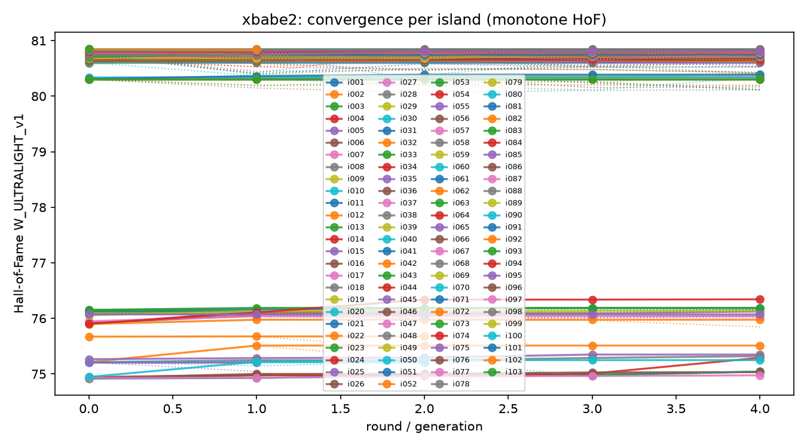
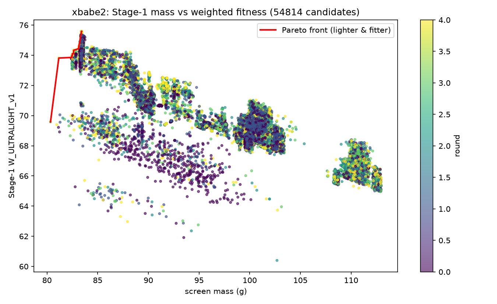
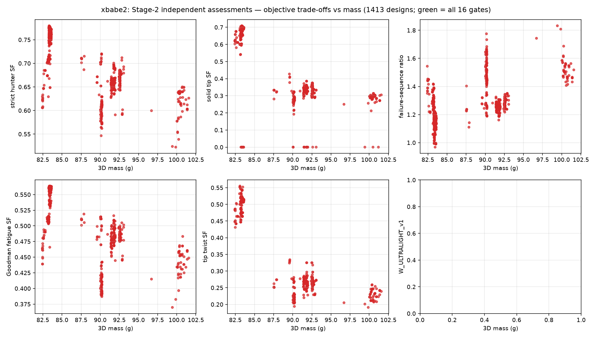
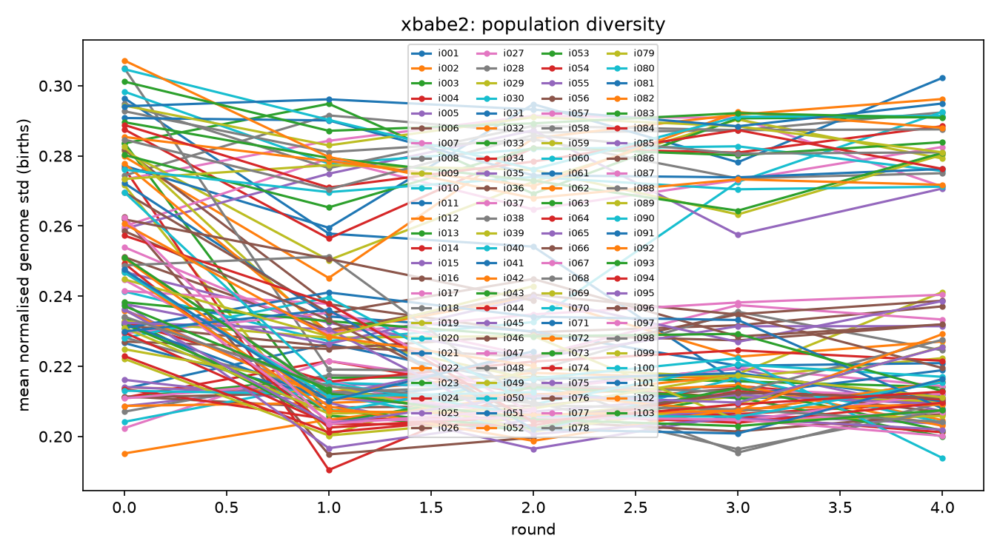
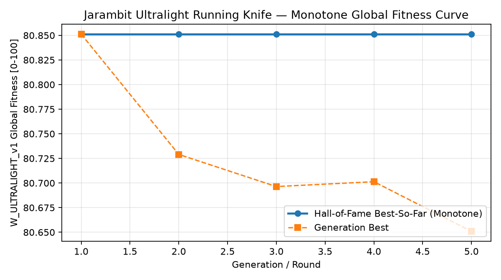

# jarambit v7.0.0 — latest continuous evolution run

**Research result, not a certified product.** The best observed design, `ec2i089_r01_p10_c68` (island i089), scored **80.851214 / 100** at **83.409 g** (3D estimate **83.3333 g**). It passed **13 of the 26 legacy hard gates**. It is not certified and must not be treated as safe or qualified for use.

No render of the winning candidate was present in the retained run package. The first figure below is the island convergence plot.

## Run summary

- Continuous island evolution on host xbabe2; 103 islands, i001–i103; run stopped 2026-10-29 08:52 EDT.
- 54,814 Stage 1 candidates and 1,413 Stage 2 assessments (MANIFEST.json).
- Best candidate `ec2i089_r01_p10_c68`; fitness 80.851214; masses 83.409 g and 83.3333 g (3D).
- Top five scores lie within 0.01 points (80.84–80.85), indicating a narrow plateau rather than a clear score separation.
- The saved best candidate had all 26 hard gate results recorded: 13 pass and 13 fail. Failures overlap across legacy and supplemental criteria.

## Gate results

The measurements below are copied from island i089’s `best_so_far_26_gates.json`. JSON values are shown as recorded.

| Gate | Result | Observed | Requirement |
|---|---|---:|---:|
| CAD watertight and single solid | PASS | True | True |
| Geometric and holder gates | PASS | True | True |
| Karambit ring and curved claw | PASS | True | True |
| C6 aesthetic floor | PASS | True | True |
| Certified hiker 180 N | PASS | 201.0 | 180.0 |
| Certified hunter 260 N | FAIL | 201.0 | 260.0 |
| Strict hunter 260 N | FAIL | 202.0 | 260.0 |
| Certified ring pull 1500 N | PASS | 26297.0 | 1500.0 |
| Body twist at 1.82 N·m | PASS | 2.416 | 1.0 |
| Tip only twist at 1.82 N·m | FAIL | 0.52 | 1.0 |
| Strict tip submodel twist | FAIL | 0.572 | 1.0 |
| Solid tip 3D P2 | FAIL | 0.7054 | 1.0 |
| Side A4 buckling and support | PASS | 3.9531 | 1.0 |
| Failure sequence 1.2 | PASS | 1.2 | 1.2 |
| Three level plate GCI | PASS | True | True |
| Dolfinx cross check ≤2% | PASS | 0.000567 | 0.02 |
| Aesthetic and geometric | PASS | pass | pass |
| Joint floors (828) | FAIL | 201.0 | 260.0 |
| Body and strict tip twist floor | FAIL | 0.572 | 1.0 |
| Solid tip safety factor | FAIL | 0.7054 | 1.0 |
| Strict hunter lateral | FAIL | 202.0 | 260.0 |
| Hard sequence | PASS | 1.2 | 1.2 |
| Human maximum | FAIL | {"hm_spine_sf": 0.35, "hm_twist_sf": 0.1, "ring_edge_r_mm": 1.125} | {"hm_spine_sf": 1.0, "hm_twist_sf": 1.0, "ring_edge_r_mm": 1.5} |
| Fatigue (Goodman L7) | FAIL | 0.5613 | 1.0 |
| Sharpness law | FAIL | {"apex_max_mm": 0.25, "half_angle_max_deg": 28.0} | {"apex_max_mm": 0.2, "half_angle_max_deg": 25.0} |
| Tip point B-rep profile | FAIL | {"monotone": false, "t_0p25_mm": 0.45, "t_1p0_mm": 0.85, "t_2p0_mm": 1.4} | {"monotone": true, "t_0p25_mm": 0.3, "t_1p0_mm": 0.6, "t_2p0_mm": 1.0} |

## Run plots

## Reproduce and inspect

The archived run is `/home/ubuntu/jarambit_runs/evo_continuous/xbabe2`. Inspect `MANIFEST.json`, `aggregate.log`, `leaders/fitness.json`, and `islands/i089/best_so_far_26_gates.json`. The manifest records 103 islands, candidate counts, binary hashes, seeds and run configuration. Its source binary came from the v6.0.0 worktree; preserve that run identity when reproducing. Replaying an island requires its recorded seed inputs and matching binary; it does not reproduce the whole asynchronous run by itself. No new evolution was started for this documentation.

Historical runs and design families are omitted here; consult git history and `docs/RELEASES.md`.
