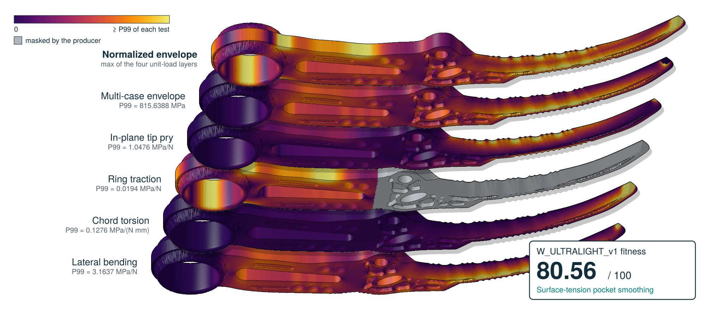
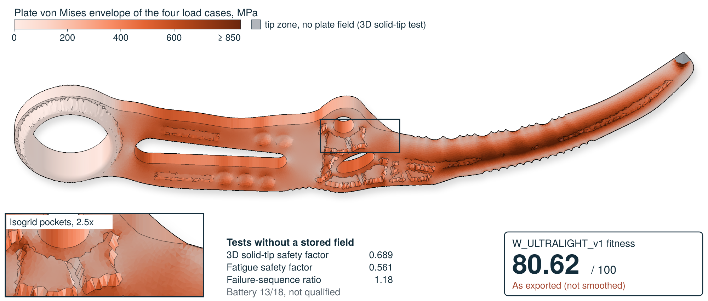
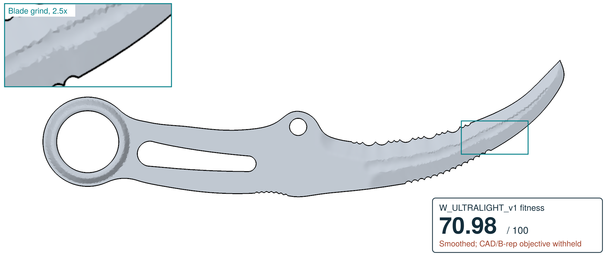
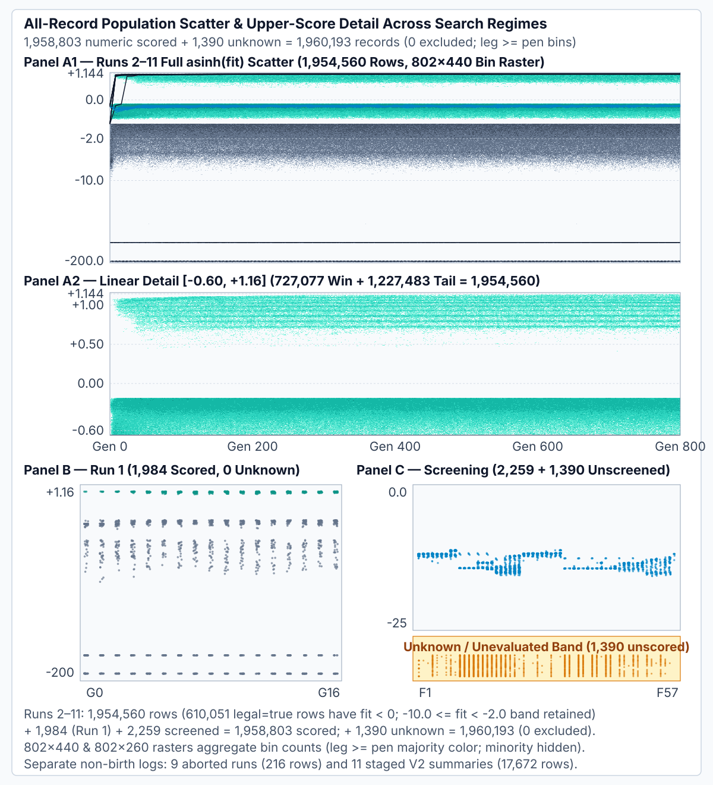
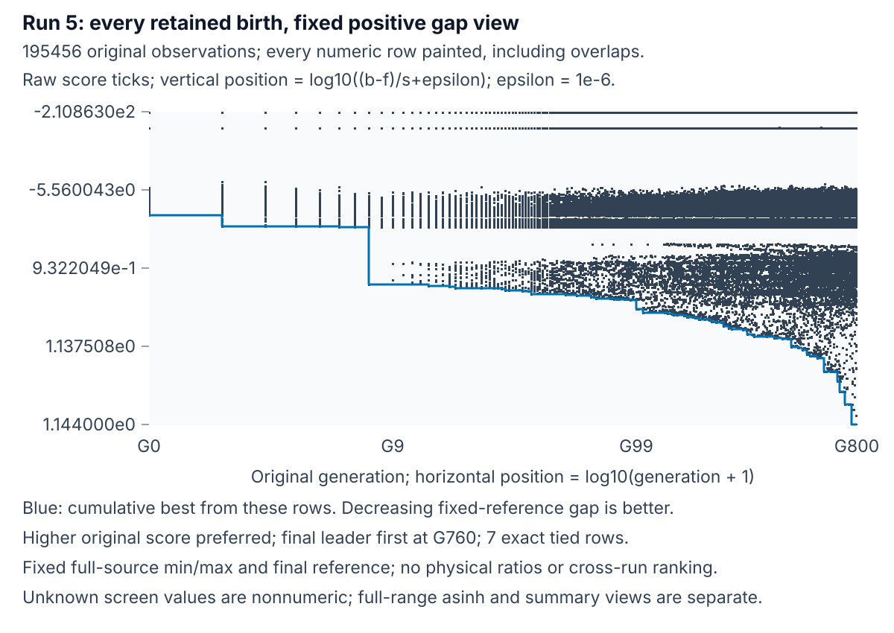
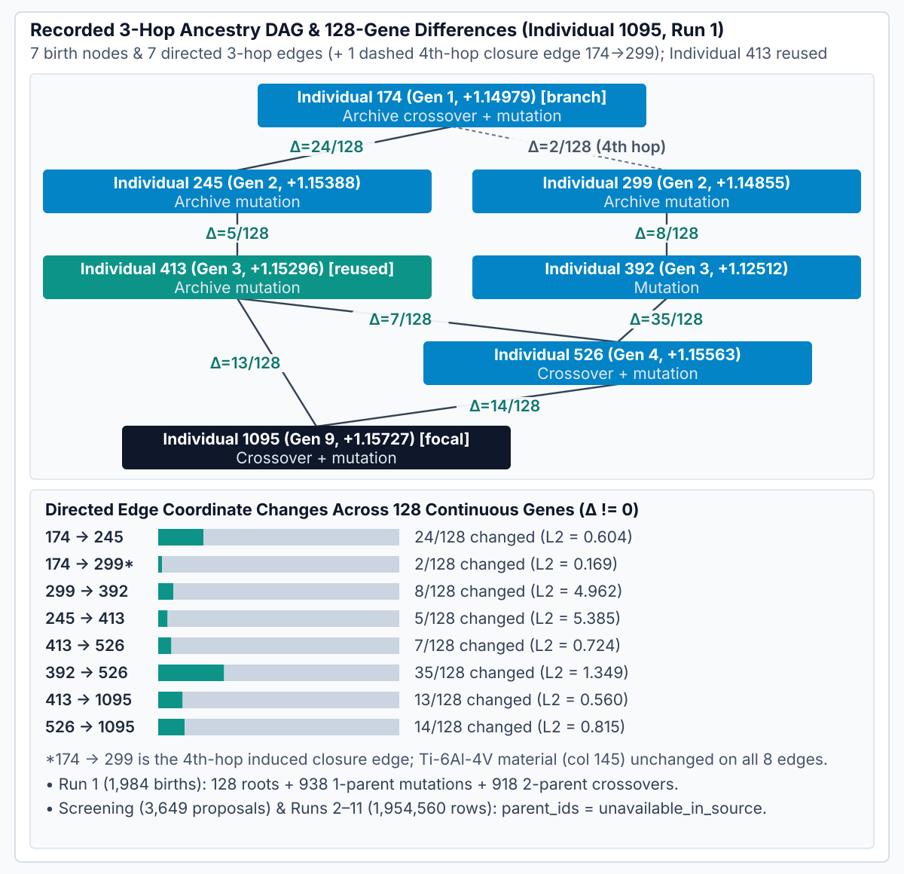
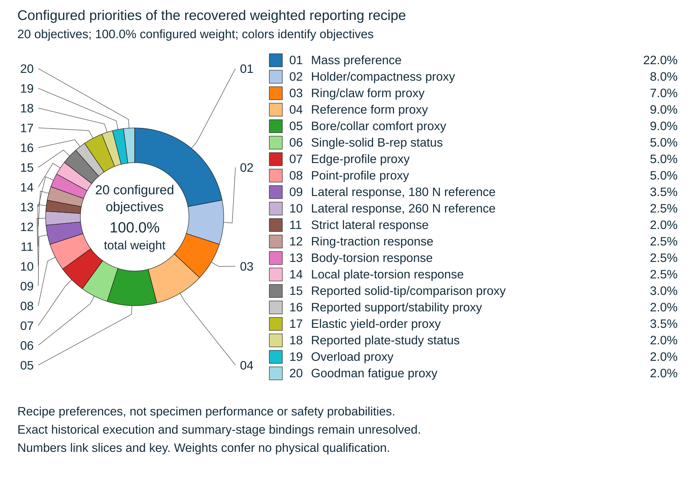

# Jarambit: Engineered Intelligence from Search to Evidence

Jarambit is a computational design research system linking a geometric representation, retained search observations, and candidate-specific numerical evidence. This retrospective study asks what readers can reconstruct from those links and where evidence is missing.

[Paper A, surface-tension smoothed](docs/paper/main.pdf) · [Paper B, mesh-smoothed](docs/paper/main-smoothed.pdf) · [Smoothing ladder, 10 levels](docs/paper/smoothing-ladder.pdf) · [Standalone supplement](docs/paper/supplement.pdf) · [Reconstruction guide](docs/paper/README.md) · [Evidence crosswalk](docs/paper/CROSSWALK_SUPPLEMENT.md) · [Test atlas](docs/tests/README.md) · [Architecture](TECHNOLOGY_MAP.md)

[](docs/paper/main.pdf)

*Paper A (v2.3.0): the best evolved design by `W_ULTRALIGHT_v1`, `w406t3_r01_p10_c16`, after surface-tension pocket smoothing at r = 0.75 mm. Every pocket is a watershed basin whose depth contours move by curvature at fixed volume. Chipped walls become clean curves, while the outline, grinds, mass (83.21 g) and rib widths stay put. A complete Stage-2 re-assessment of the smoothed CAD gives `F = 80.370405`, against 80.299390 as exported; nothing is withheld, the battery passes 14/18 and the design is not qualified. Layers, bottom to top: lateral bending, chord torsion, ring traction, in-plane tip pry and the multi-case envelope, each normalized by its own area-weighted 99th percentile; on top, their normalized envelope. Raw vs smoothed: [guard](docs/paper/figures/pocket/bw-guard-raw.png) → [smoothed](docs/paper/figures/pocket/bw-guard-ours.png), [handle](docs/paper/figures/pocket/bw-handle-raw.png) → [smoothed](docs/paper/figures/pocket/bw-handle-ours.png). Method, settings and the Stage-2 table: [experiments/pocket-surface-tension-smoothing](experiments/pocket-surface-tension-smoothing/README.md). The smoothing is opt-in (`JARAMBIT_POCKET_SMOOTH=on`); with it unset, exports are unchanged.*

| As exported | B: mesh-smoothed and re-scored |
|---|---|
| [](docs/paper/smoothing-ladder.pdf) | [](docs/paper/main-smoothed.pdf) |

*Best evolved design by `W_ULTRALIGHT_v1`, `w406t3_r01_p10_c16` (3D mass `83.22 g`, battery 14/18, not qualified), with two-sided isogrid pockets, lattice, relief and pierced-fuller windows. **As exported:** `F = 80.299390` of 100, first of the 967 comparable retained assessments of every run since 2026-10-17; re-assessing it with the current evaluator reproduces that score. **B**, after feature-preserving geometric smoothing (30° feature pins, 20 iterations), with 3D mass and the solid-tip submodel re-measured: `F = 75.343635`. The 5-point CAD/B-rep objective is withheld because the smoothed geometry is a triangle mesh without a validated STEP solid (with it kept, `F = 80.343635`). Inset: isogrid pockets at 2.5×. The base colour is uniform, so shading shows geometry only. [Selection record](docs/paper/figures/cover/winner-selection.v1.json) · [Smoothing ladder: no smoothing to strongest, each re-scored](docs/paper/smoothing-ladder.pdf).*

## Which evidence is retained

| Collection | Retained observations | Principal coverage limit |
|---|---|---|
| Historical genealogy | 1,984 births with recorded parentage and repeated memberships | Selected later evidence does not provide a population-wide assessment rate |
| Intermediate screening | 3,649 proposals; 2,259 observed screens and 1,390 missing screens | Missing observations remain nonnumeric; later reporting profiles have a different scorer |
| Ten completed native runs | 1,954,560 genome-and-score records | Complete score tables do not establish retained genealogy or per-birth later CAD assessments |
| Illustrated assessed export | Individual 2000 geometry, plate fields, and selected numerical records | One computational case; physical observations are not reported in this study |

[Original run identities and overlapping captures](docs/paper/supplement/cohort-inventory.tex) · [Completed-population archive index](artifacts/versioned-evolution-archives-gen800-population-v1/index.gen800_population.sha256.json)



*The renderer visits 1,954,560 native, 1,984 historical, and 2,259 numeric screening records as 1,958,803 individual point operations. Points can overlap. Neutral occupancy does not replace minority classes with a bin majority, and incompatible scorers retain separate axes. The 1,390 unobserved proposals receive no invented score. [Source, ID, extrema, and point accounting](docs/paper/generated/population/point-rendering.v1.json).*



*Run 5's 195,456 original observations retain negative scores and zeros. Positions use generation+1 and a fixed gap to this run's final retained best, normalized by its complete original range, with a display floor of 1e-6; ticks recover original fitness and generation. Navy through teal/yellow/orange to red encodes original recorded fitness within Run 5 using the stated monotone log-axis contrast; warmer means better. Later source-order marks can overpaint earlier colors, so visible color is not density. The dark cumulative-best curve with a light halo first reaches the final stored maximum at G760, with seven exact ties and no higher retained value through G800. This is a retrospective stored-score plateau, not physical convergence, a comparable global winner or a new assessment. The [complete positive-view index](docs/paper/generated/population/positive/index.v1.json) keeps ten native runs, historical births and screening observations separate; screening file ordinals are not time and have no pooled trajectory. Both positive variants paint all 1,958,803 numeric observations; the 1,390 unknown screens remain nonnumeric. Summary comparisons draw no raw points.*

## Three findings

1. Extensive search records can coexist with uneven parentage, geometry, and later-assessment coverage.
2. Historical ancestry exposes reuse. In the same 1,984-birth Run 1 cohort, Individual 1095 (stored birth rank 1, `f = 1.15727`) has the earlier saved `cert_pass_all=false`, while Individual 1543 (rank 8, `f = 1.15415`) has `cert_pass_all=true`. This categorical contrast does not establish a continuous later-assessment score reversal, later 26-predicate qualification, or a population-wide failure rate.
3. Selected solid-model observables agree within 0.05% between scikit-fem/PyAMG and DOLFINx/PETSc on a shared mesh. Separate plate sequences do not admit the retained extrapolated-error estimates. These observations support different conclusions.

[Separate retained evidence paths](docs/paper/figures/evidence-architecture.svg) distinguish search observations from assessed exports.



[Results and scope](docs/paper/sections/08-results.tex) · [Numerical interpretation](docs/paper/sections/07-verification.tex)

## Recovered recipe priorities and retained reporting vector



The chart shows the recovered recipe's configured weights, not achieved contributions or a new fitness calculation. The saved Individual 2002 vector below is a separate observation. [Recipe source and exact weight accounting](docs/paper/generated/objective-priorities.v1.json).

This twenty-term vector belongs to **Individual 2002's retained reporting record**, with saved score **74.207299/100**. Weights, normalized values, and contributions are stored summaries. A recovered historical recipe is source-bound; its original execution and call-input provenance remain unresolved. Several terms are partly compatible with defaults or proxies, distinct from reporting-layer missingness. Exact content links proposal observation 6420 and a later unqualified assessment summary (`W_CAD = -7.414831`); its full underlying CAD and scorecard files are not retained in the admitted tree. The [current interpretation](docs/paper/data/reporting-interpretation-contract.v2.json) preserves the original registry, score vector and evidence.

| Reported objective | Weight (%) | Saved normalized value | Contribution (points) |
|---|---:|---:|---:|
| Mass preference | 22 | 0.340 | 7.470 |
| Holder and compactness proxy | 8 | 1.000 | 8.000 |
| Ring and claw form proxy | 7 | 1.000 | 7.000 |
| Reference-form proxy | 9 | 1.000 | 9.000 |
| Bore/collar comfort proxy | 9 | 0.875 | 7.875 |
| Single-solid B-rep status | 5 | 1.000 | 5.000 |
| Exported edge-profile proxy | 5 | 0.846 | 4.232 |
| Exported point-profile proxy | 5 | 0.522 | 2.609 |
| Certification lateral response, 180 N | 3.5 | 1.000 | 3.500 |
| Certification lateral response, 260 N | 2.5 | 0.708 | 1.770 |
| Strict lateral response, 260 N | 2 | 0.758 | 1.515 |
| Ring traction, 1500 N | 2.5 | 1.000 | 2.500 |
| Body torsion, 1.82 N m | 2.5 | 1.000 | 2.500 |
| Local plate torsion, 1.82 N m | 2.5 | 0.260 | 0.650 |
| Reported solid-tip/comparison proxy | 3 | 0.364 | 1.091 |
| Reported support/stability proxy | 2 | 1.000 | 2.000 |
| Elastic yield-order proxy | 3.5 | 1.000 | 3.500 |
| Reported plate-study status | 2 | 1.000 | 2.000 |
| Overload proxy | 2 | 0.483 | 0.967 |
| Goodman fatigue proxy | 2 | 0.514 | 1.029 |

[Exact vector, source hash, and limits](docs/paper/supplement/scores-and-composites.tex) · [Separate score definitions](docs/paper/sections/05-fitness.tex)

## Separately assessed observations: Individual 2000

Individual 2000 supplies the actual spatial fields. Its records distinguish certification minima over 0.25/0.125 mm² from strict 0.0625 mm² observations. The solid comparison shares a saved mesh, material, patch loads, and clamped cut-arc boundary. Selected scalar agreement does not verify every assembly operation or bound physical-model error.


[Field contract](docs/paper/field-inputs.v1.json) · [Assessment records](docs/paper/generated/assessment.json) · [Solver/recovery records](docs/paper/generated/verification.json) · [Historical battery](docs/paper/generated/battery-matrix.svg). The battery includes shared controls and completeness labels; its tally is not a count of successful physical assessments.

## What it is

Rust CAD and evaluation core, with a Vite + TypeScript + React evidence studio. The current automatic lane ranks candidates using weighted fitness and sends a selected subset to independent assessment. Other lanes retain their own algorithms and score conventions. [Genome and methodology](docs/paper/sections/03-genome.tex) · [Existing operational guide](docs/EVOLUTION_CERTIFICATION.md).

**Score direction:** retained `W_ULTRALIGHT_v1` is higher-is-better. Historical Stage 1, Stage 2 and reporting paths used different proxies/constants. [PR #135](https://github.com/neverhuman/jarambit/pull/135) later changed Stage-2 ranking to the canonical score; that change does not establish the missing historical producer or make retained score regimes comparable. A future lower-is-better convention remains a separate product direction. [Full interpretation](docs/paper/sections/05-fitness.tex).

## Retained history and corrections

The following generated panels preserve their original model/requirement scope. Historical screen records do not establish a current qualified design. Certification claims from v1.0.0 remain withdrawn; the separate automatic proof records `champion=null`.

<details>
<summary>Historical generated records, correction table, figures and release details</summary>

<!-- GEN:HEAD:BEGIN -->
[](https://github.com/neverhuman/jarambit/releases/tag/v2.3.0)
[](docs/ENGINEERING_GATES_AND_EVOLUTION.md)
[](docs/WHITEPAPER.md)
[](docs/GLOBAL_METRIC.md)
[](docs/ENGINEERING_GATES_AND_EVOLUTION.md)
[](docs/WHITEPAPER.md)
[](docs/PROVISIONAL.md)

**Historical 16-gate screen record `w282_p14_c01` — 75.568 g (75.323 g 3D solid) · G1 0.878210 (`COMPLETE`) · W_CAD +1.7790 (16/16 engineering gates pass) · strict lateral 262.6 N (SF 1.010) · strict twist SF 1.125 · cert seq 1.201 · 3D P2 solid-tip SF 1.4093 × SPG 3.467 = 4.886 · Ti-6Al-4V 5.9 mm** *(historical Wave-27 reference `g3_tip+00_t60_tt3`: 84.80 g, G1 0.9804, seq 0.959 < 1.20)*

**v1.0.0 certification claims withdrawn (#75–#81).** Neither Wave 283 candidate passes the fixed pipeline. The exported geometry and all requirement thresholds are unchanged. Native-only solid solves are unverified; the results below use actual scikit-fem P2 and DOLFINx solves on the same mesh.

| candidate | raster / solid g | strict lateral N | cert seq | solid-tip SF | G1 | W_CAD | RS-v2 |
|---|---:|---:|---:|---:|---:|---:|---|
| `w283_p14_c01` | 75.382 / 75.199 | 176.720 | 0.7436 | 0.9577 | 0.623888 | -3.878704 | FAIL |
| `w283_p10_c02` | 75.642 / 75.505 | 176.763 | 0.7179 | 0.9578 | 0.621632 | -3.964924 | FAIL |

Source: `evidence/rs_v2/w283_ultrarunner/*_{cad_eval,rs,solid_tip}.json`; raw solver outputs and exact meshes are retained in `evidence/cert_integrity/recertified/`. The retracted certificates are preserved under `evidence/cert_integrity/v1.0.0-retracted/`. Lateral strength, failure sequence, human-maximum loads, fatigue, exported edge sharpness and full 0–10 mm point monotonicity remain blockers; the bore has no verified required fillet. Historical 16-gate screen results below do not establish an RS-v2 all-hard pass or manufacturing promotion. G1 above uses the full-precision RS inputs in each battery record; CAD-eval JSON retains its rounded D1 inputs.
<!-- GEN:HEAD:END -->

<!-- RS:BEGIN docs/wave27_diversity/plates/wave27_D1_index.json g3_tip+00_t60_tt3_D1 -->
RS-karambit-v1: screen PASS · promotion FAIL (seq 0.959 < 1.2) · soft: mass 84.80 g over 80 g target (G penalty) · human aesthetic sign-off pending · not promoted
<!-- RS:END -->

<!-- GEN:FIGS:BEGIN -->
📄 [White paper](docs/WHITEPAPER.md) · 📐 [Engineering gates & evolution paper](docs/ENGINEERING_GATES_AND_EVOLUTION.md) · 📋 [Work plan](docs/WORKPLAN.md) · 📊 [Live status](STATUS.md) · ⚖️ [Patent draft (not filed)](docs/PATENT_DRAFT.md) · 📦 [Release v2.3.0](https://github.com/neverhuman/jarambit/releases/tag/v2.3.0) · 🗺️ [Technology map](TECHNOLOGY_MAP.md)


*Historical (pre-#82 model) selected-candidate mass vs. wave (`w20` through `w282`, generated by `ops/render/whitepaper_hero_figs.py` and verified by `ops/ci/verify_figures.py`): historical 16-gate screen record **`w282_p14_c01` at `75.568 g` (`75.323 g` 3D solid), `G1 = 0.878210`, `W_CAD = +1.7790`**.*


*Interactive 3D CAD & Gate Scorecard Web Studio (`web/` — Vite + TypeScript + React + Three.js, exported by `./target/release/jarambit export-web-data --out-dir web/public/data`): 3D STL/STEP inspection, measured 16-gate `W_CAD_v2` breakdown, failed `RS-karambit-v2` scorecard, and 23-subject × 18-evaluator CAD battery matrix. Wave 283 is rejected.*
<!-- GEN:FIGS:END -->

<!-- GEN:RELEASE:BEGIN -->
## Release v2.3.0 & Documentation

- **Historical 16-gate screen record (`w282_p14_c01`):** `75.568 g` 2.5D raster / `75.323 g` 3D watertight solid, locked `G1 = 0.878210` (`COMPLETE`), `W_CAD = +1.7790` (`16/16` engineering gates pass: strict 0.0625 mm² lateral `262.6 N` / `SF = 1.010`, strict 4–15 mm tip-submodel twist `SF = 1.125`, certified failure sequence `seq_ratio = 1.201 >= 1.20`, 3D P2 tetrahedral solid-tip `SF = 1.4093` with `0.021%` `dolfinx` v0.9.0 vs. `skfem` agreement, and `side.a4` Winkler+bore supported `seq = 4.042`).
- **Historical 16-gate `W_CAD_v2` mass progression (`w274` → `w282`):** `w274_s2905_c01` (`84.979 g` / `85.021 g` 3D, `W_CAD = +1.4634`) → `w275_s2909_c01` (`81.774 g` / `81.804 g` 3D, `W_CAD = +1.5589`) → `w276_s2913_c01` (`79.995 g` / `80.050 g` 3D, `W_CAD = +1.6381`) → `w277_s2919_c01` (`79.509 g` / `79.656 g` 3D, `W_CAD = +1.6604`) → `w278_s2922_c01` (`78.580 g` / `78.597 g` 3D, `W_CAD = +1.7021`) → `w279_s2928_c01` (`77.535 g` / `77.414 g` 3D, `W_CAD = +1.7212`) → `w280_s2931_c01` (`76.965 g` / `76.834 g` 3D, `W_CAD = +1.7432`) → `w281_s2932_c01` (`75.911 g` / `75.695 g` 3D, `W_CAD = +1.7916`) → `w282_p10_c02` (`75.836 g` / `75.616 g` 3D, `W_CAD = +1.7978`) → `w282_p14_c01` (`75.568 g` / `75.323 g` 3D, `W_CAD = +1.7790`).
- **Battery total across 23 subjects × 18 evaluators (414 cells):** `221 pass`, `81 fail`, `112 blocked`.
- **Scientific assurance catalog (`T00`–`T19`):** **178 definitions with 356 required paired-control slots** in the committed catalog; run the software controls via `python3 -B ops/ci/science_suite.py`. Catalog entries do not establish execution.
- **Full technical papers, tables, and evidence:**
  - [White paper (`docs/WHITEPAPER.md`)](docs/WHITEPAPER.md) — page-1 summary, `w20`–`w282` mass curve, market comparison, `w282_p14_c01` 16-gate margin breakdown, and T1→T2 calibration.
  - [Engineering gates & evolution paper (`docs/ENGINEERING_GATES_AND_EVOLUTION.md`)](docs/ENGINEERING_GATES_AND_EVOLUTION.md) — complete 23-subject × 18-evaluator CAD battery matrix, Margin-vs-Mass Pareto table, `RS-karambit-v2` gate tables, and 3D CAD/FEM gallery.
  - [Master work plan (`docs/WORKPLAN.md`)](docs/WORKPLAN.md) · [Live status (`STATUS.md`)](STATUS.md) · [Wave log (`docs/WAVE_LOG.md`)](docs/WAVE_LOG.md) · [Release notes (`docs/RELEASES.md`)](docs/RELEASES.md) · [Global metric `G1` (`docs/GLOBAL_METRIC.md`)](docs/GLOBAL_METRIC.md) · [Provisional record (`docs/PROVISIONAL.md`)](docs/PROVISIONAL.md) · [Technology map (`TECHNOLOGY_MAP.md`)](TECHNOLOGY_MAP.md).
<!-- GEN:RELEASE:END -->

</details>

## Install

Build the Rust workspace with the toolchain pinned in `rust-toolchain.toml`. The evidence studio uses Node/npm; independent solver and CAD/render bindings require the runtimes listed in [PYTHON_EXCEPTIONS.md](PYTHON_EXCEPTIONS.md). [Stack migration policy](PY_TO_RUST_PLAN.md).

```sh
cargo build --release --locked
```

## Quick start

**Reconstruct the paper and supplement from retained evidence:**

```sh
sh docs/paper/reproduce.sh build
```

This reads original evidence and writes reporting derivatives, figures, PDFs and build manifests. It invokes no new search, CAD export or mechanical solve. [Prerequisites and separate validation commands](docs/paper/README.md#reconstruct-the-reports).

**Live Web Studio regeneration (invokes live `score_cad_native` / STL export; separate from report reconstruction):**

```sh
./target/release/jarambit export-web-data --out-dir web/public/data
```

A native screen is not an independent certification. The older Monte Carlo lane uses a beam surrogate by default; plate FEM is opt-in with `JARAMBIT_FEM=1`. See the [assessment guide](docs/EVOLUTION_CERTIFICATION.md) for runtime scope and the [paper build](docs/paper/README.md#reconstruct-the-reports) for reproducible documentation artifacts.

## Research and project documentation

[New white paper](docs/paper/README.md) · [Engineering spec](docs/PAPER_AND_README_ENGINEERING_SPEC.md) · [Living technical report](docs/WHITEPAPER.md) · [Detailed engineering reference](docs/ENGINEERING_GATES_AND_EVOLUTION.md) · [Work plan](docs/WORKPLAN.md) · [Status](STATUS.md) · [Release notes](docs/RELEASES.md) · [Technology map](TECHNOLOGY_MAP.md)

The hand-built C.10d concept film and its cross-revision field/weight disclosures remain in [the pre-cleanup README at the audited snapshot](https://github.com/neverhuman/jarambit/blob/009f5ac520fa3afe8ed8025230eef604dbb7f922/README.md#concept-render-hand-built-design-not-pipeline-output). It is separate from evolved, assessed evidence.

<details>
<summary>Historical market comparison and original source caveats</summary>

The snapshot below retains its historical naming and stored mass scalars. In the current paper, `w411c3_r02_p10_c12` identifies Individual 2002's saved reporting record. Its three round birth/screen pairs and a certificate-matched later unqualified assessment summary are retained; full underlying exported CAD and scorecard files are not retained in the admitted tree. The historical "Stage-2 leader" label does not establish those missing artifacts or prove the recovered recipe's original execution.

<!-- MARKET:CENSUS:BEGIN -->
## Market weight comparison

The source-audited [October 13, 2026 census](docs/market/2026-10-13/README.md) consolidates eight supplied CSVs plus an additional qualifying polymer model. **119 identifiable entries meet the published 3.375 in blade minimum; 77 have comparable verified published knife weights.** Color-only duplicates are consolidated; genuine material variants and distinct custom examples remain separate. Missing weights and unresolved candidates stay visible in the evidence tables.

**Committed genome-pipeline Stage-2 designs: `w282_p14_c01` at 75.568 g (75.323 g 3D solid, historical 16-gate screen record) and `w411c3_r02_p10_c12` at 101.139 g (101.138 g 3D solid, `W_ULTRALIGHT_v1 = 74.207299`, committed ultralight-v1 Stage-2 leader).** `w282_p14_c01` is nominally lighter than 72 of 77 plotted entries (93.5%) and 52.6% below their 159.32 g median; `g3_tip+00_t60_tt3` (84.80 g, lighter than 71 of 77 or 92.2%, 46.8% below median) remains the historical design of record; and `w411c3_r02_p10_c12` is lighter than 66 of 77 plotted entries (85.7%), 36.5% below median. TALIM titanium lists 51.03 g, so this does not support a lightest-overall claim. None is qualified: `w282_p14_c01` passes the 16 legacy gates but fails RS-karambit-v2 (fatigue, Gate-S sharpness and human-max fail; tip-point unverified); 0 candidates pass RS-karambit-v2 all-hard (champion = null). Stage-2 `W_ULTRALIGHT_v1` is for ranking only, not qualification. All are unmanufactured and unpromoted. Listed commercial lengths use different measurement conventions, and material/weight comparisons establish no performance equivalence.

[Catalog by material](docs/market/2026-10-13/qualified_by_material.csv) · [Complete normalized census](docs/market/2026-10-13/census.csv) · [Exact-grade summary](docs/market/2026-10-13/material_summary.csv) · [Missing/conditional candidate queue](docs/market/2026-10-13/review_queue.csv)
<!-- MARKET:CENSUS:END -->

</details>
