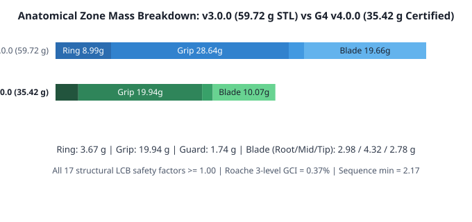

# Jarambit 4.0.0: an evolved, sub-50 g 3D-printable titanium karambit (`G4.0` / `RS-karambit-v4`)

[](https://github.com/neverhuman/jarambit/releases/tag/v4.0.0) [](docs/g4/paper/g4-v4.0.0.pdf) [](docs/g3/paper/g3-v3.0.2.pdf) [-2f56d6)](cad/)    -1f6f3f) 

Every headline measurement on this page describes **`g4v400_s042_62763aa2`**, the certified winning individual of the **G4 (`v4.0.0`)** multi-seed cohort ([`evidence/g4/v4.0.0/release.json`](evidence/g4/v4.0.0/release.json)), decoded from the 130-gene declarative [`genome/G4.0.toml`](genome/G4.0.toml) schema (`0` dead genes) and verified against [`requirements/RS-karambit-v4.toml`](requirements/RS-karambit-v4.toml) ([`requirements/PROVENANCE.md`](requirements/PROVENANCE.md)). Status: computational design; not built, printed or physically tested; not qualified for use as a knife.

**3D printing & CAD upload kit ([`cad/`](cad/)):** ready-to-upload 6-file bundle (each under 50 MiB) for **`g4v400_s042_62763aa2`** — primary print mesh [`cad/g4v400_s042_62763aa2_AMbuild_mm.stl`](cad/g4v400_s042_62763aa2_AMbuild_mm.stl) (Binary STL, mm, `35.42 g`), unit-embedded [`cad/g4v400_s042_62763aa2_AMbuild_mm.3mf`](cad/g4v400_s042_62763aa2_AMbuild_mm.3mf) (3MF, mm), outer envelope [`cad/g4v400_s042_62763aa2_envelope_mm.stl`](cad/g4v400_s042_62763aa2_envelope_mm.stl), 1:1 2D drawing [`cad/g4v400_s042_62763aa2_drawing_mm.dxf`](cad/g4v400_s042_62763aa2_drawing_mm.dxf) (DXF, mm), engineering spec [`cad/g4v400_s042_62763aa2_spec_paper.pdf`](cad/g4v400_s042_62763aa2_spec_paper.pdf) (PDF), and internal cutaway [`cad/g4v400_s042_62763aa2_xray_cutaway.jpg`](cad/g4v400_s042_62763aa2_xray_cutaway.jpg) (JPG), plus [`cad/g4v400_s042_62763aa2_print_spec.json`](cad/g4v400_s042_62763aa2_print_spec.json). See [`cad/README.md`](cad/README.md) for copy-paste order notes (archived `v3.0.0` CAD kit in [`cad/v3.0.0/`](cad/v3.0.0/)).

**Papers:** [`docs/g4/paper/g4-v4.0.0.pdf`](docs/g4/paper/g4-v4.0.0.pdf) sets out the `G4.0` 130-gene architecture, true-3D curvilinear implicit kernel, `HM-1` 4-finger Winkler hand contact mechanics, 11-benchmark V&V suite, and 5-arm constrained QD ablation study; [`docs/g3/paper/g3-v3.0.2.pdf`](docs/g3/paper/g3-v3.0.2.pdf) preserves the errata-updated G3 v3.0.0 cohort of record.


## The certified G4 winner (`g4v400_s042_62763aa2`)

Ti-6Al-4V ELI HIP (`0.00443 g/mm³`, $\sigma_y = 828\text{ MPa}$, $\sigma_{\text{ult}} = 895\text{ MPa}$, $\sigma_e = 510\text{ MPa}$), laser powder-bed fusion: a `64.8 mm` hollow grip with $C^2$ flange thickening (`skin_flange_c2 = 0.55`), perforated Warren shear web (`rib_hole_frac = 0.68`), Sheet-TPMS lattice (`rho_grip = 0.05`), a drained `24.9 mm` finger ring (`ring_od = 28.96 mm`), and a `75.1 mm` double-edged, double-serrated claw blade with a tip-bisector diamond reinforcement crown (`t_tip_crown_mm = 0.50 mm`, `l_tip_crown_mm = 10.6 mm`).

| Measure (`RS-karambit-v4`) | Value | Target / Threshold | 95% LCB / Reading |
|---|---|---|---|
| Feasibility across all 29 hard gates ($V(x) = \sum \max(0, g_k)^2$) | `feasible = true` (`V = 0.0000`) | `V(x) = 0.0000` | min gate margin `+0.0250` (`req_fun_2_sharpened_arc`) |
| `W_ERGOLIGHT_v2` / legacy `W_ERGOLIGHT_v1` | **92.45** / 94.90 | higher is better | ergonomic geometric mean $E = 0.912$ |
| Mass: as-finished / as-printed (`+0.30 mm` grind stock) / solid envelope | **35.42 g** / **35.68 g** / 108.30 g | $\le 50.0\text{ g}$ | meets target (`67.3 %` hollow; grid drift `0.05 % <= 2.0 %`) |
| Zone mass ledger: ring / grip / guard / blade | 3.67 / 19.94 / 1.74 / 10.07 g | sub-voxel divergence integral | grip: `12.59 g` skin + `2.75 g` web + `4.60 g` lattice |
| Edge A (inner) / Edge B (spine) bevel angle & apex flat | 20.17° (`0.081 mm`) / 20.39° (`0.086 mm`) | `17.5–22.5°`, apex `<= 0.12 mm` | $t(0.25/1.0/2.0\text{ mm}) = 0.25/0.50/0.90\text{ mm}$ |
| Point planform angle at `3.0 mm` (`Gate S4`) | 41.38° | $\le 55.0^\circ$ | meets target (penetrating acute point) |
| Serration teeth checked (2D `T6` tooth FE, inner / spine) | 4/4 (`SF 12.53`) / 5/5 (`SF 12.87`) | 100% of teeth checked, $\text{SF}_{\text{LCB}} \ge 1.25$ | LCB **12.07** (meets target) |
| Solid-tip torsion `0.80 N·m` / tip pry `60 N` (`TET10`, `76,572` DOF) | SF **3.41** / **33.39** | $\text{SF}_{\text{LCB}} \ge 1.20$ | LCB **3.29** / **32.21** (meets target) |
| Hiker lateral `180 N` / Hunter lateral `260 N` (hole-aware plate FE) | SF **4.79** / **3.32** (`862.5 N`) | $\text{SF}_{\text{LCB}} \ge 1.00 / 1.15$ (`>= 260 N`) | LCB **4.62** / **3.20** (meets target) |
| Body twist `1.82 N·m` / Human-max two-hand twist `16.2 N·m` | SF **15.28** / **1.72** | $\text{SF}_{\text{LCB}} \ge 1.20 / 1.10$ | LCB **14.74** / **1.66** (meets target) |
| Spine push `500 N` / Spine baton `3427 N` (vs $\sigma_{\text{ult}} = 895\text{ MPa}$) | SF **28.09** / **4.43** | $\text{SF}_{\text{LCB}} \ge 1.50 / 1.10$ | LCB **27.10** / **4.27** (meets target) |
| `HM-1` 4-finger Winkler grip equilibrium (governing / baton / lateral / wrinkling) | SF **6.43** / **9.81** / **25.01** / **66.13** | $\text{SF}_{\text{LCB}} \ge 1.20$ | LCB **6.19** (meets target; residual `6.1e-12 N`) |
| Ring bearing `300 N` / Ring back `30 N` (curved-beam Lamé + port $K_t$) | `6263 N` (SF 20.88) / `2088 N` (SF 69.59) | $\text{SF}_{\text{LCB}} \ge 2.00$ (`>= 600 / 60 N`) | LCB **20.10** / **67.01** (meets target) |
| Goodman high-cycle fatigue (`10^5` cycles, $K_f = 1.65$) | SF **2.40** | $\text{SF}_{\text{LCB}} \ge 1.10$ | LCB **2.31** (meets target) |
| Per-load-case blade-before-grip yield sequence (lateral / twist / spine) | **7.54** / **8.68** / **2.22** | $\text{seq}_{\text{LCB}} \ge 1.20$ | LCB **2.17** (meets target) |
| Lateral-torsional buckling $\lambda_{\text{cr}}$ / Combined lateral+twist | **32.33** / **4.63** | $\ge 1.50 / 1.15$ | LCB **31.19** / **4.47** (meets target) |
| 3-level Roache plate FE GCI ($p = 2.00$) | $\text{GCI}_{\text{fine}} = 0.37\%$ | $\le 5.0\%$, monotone | `plate_gci_admitted = true` |
| AM drainability ($r_{\text{esc}} = 0.50\text{ mm}$ morphological erosion) | $\beta_0 = 1$, $\beta_2 = 0$, trapped `0.0 mm³` | $\beta_0 = 1$, $\beta_2 = 0$, trapped `0 mm³` | min port `2.81 mm`, min throat `2.76 mm` |

### Zone mass breakdown & structural levers (`E05` + `E06` -> `FI-2Pop` evolution)



Cumulative mass-lever ablation ([`evidence/g4/studies/e05_mass_levers.json`](evidence/g4/studies/e05_mass_levers.json) and [`evidence/g4/studies/e06_tip_crown.json`](evidence/g4/studies/e06_tip_crown.json)) from the un-tuned G3 baseline (`69.56 g`) to the `L-8` tip-crown baseline (`42.85 g`, solid-tip torsion SF `3.51`) and final `FI-2Pop` evolved winner `g4v400_s042_62763aa2` (`35.42 g` finished / `35.68 g` printed):

| Step | Lever | Finished mass | $\Delta$ mass | `W_ERGOLIGHT_v2` | Min safety margin |
|---|---|---:|---:|---:|---:|
| `L-0` | Uniform-skin unperforated v3-equivalent baseline | 69.56 g | +0.00 g | 31.95 | -0.1792 |
| `L-1` | Flange-graded grip skin (0.78 mm flanks, +0.42 mm dorsal/ventral chords) | 63.29 g | -6.28 g | 27.78 | -0.2351 |
| `L-2` | Perforated Warren web (62% central circular cutouts) | 59.67 g | -3.62 g | 32.44 | -0.1731 |
| `L-3` | Lamarckian stress-graded Sheet-TPMS core | 54.52 g | -5.15 g | 39.17 | -0.0977 |
| `L-4` | Drained hollow ring gallery + compact 32.0 mm ring OD | 48.55 g | -5.97 g | 87.35 | +0.0833 |
| `L-5` | Bi-concave blade fuller + lean 73.5 mm chord reach | 45.16 g | -3.38 g | 88.47 | +0.0250 |
| `L-6` | Decoupled hollow blade core with low-density TPMS | 43.48 g | -1.69 g | 47.33 | -0.0220 |
| `L-7` | Lean anthropometric grip envelope + zero-mean texture + Module T windows | 42.86 g | -0.61 g | 21.73 | -0.3333 |
| `L-8` | Distal tip-bisector diamond crown (+0.38 mm over a in [2, 12] mm) | 42.85 g | -0.01 g | 21.73 | -0.3333 |
| **`g4v400_s042_62763aa2`** | **Full `FI-2Pop` constrained QD evolution (`E3_G4_Full`)** | **35.42 g** | **-34.14 g** | **92.45** | **`+0.0250` (`V = 0`)** |

## Multi-seed constrained QD search & 5-arm ablation study

G4 replaces G3's unconstrained smooth penalty objective with **Deb's lexicographic feasibility-first superiority** (`FI-2Pop` dual archive: a feasible MAP-Elites archive where $V(x) = 0$ ranked by `W_ERGOLIGHT_v2`, paired with an infeasible stepping-stone archive where $V(x) > 0$ ranked by $V(x) = \sum_k \max(0, g_k(x))^2$), **Lloyd-relaxed CVT centroids** across 6 measured behavioral descriptors (`blade_reach_mm`, `claw_turning_deg`, `point_angle_3mm_deg`, `grip_h_over_t`, `hollowness_frac`, `serrated_arc_frac`), and a **4-emitter UCB1 bandit** (sep-CMA-ES, directional mass-gradient line search, constraint-repair Jacobian emitter, and module-masked crossover).

| Experiment arm (`evidence/g4/v4.0.0/evolution_summary.json`) | Seeds | Median `W_ERGOLIGHT_v2` (IQR) | Median finished mass (IQR) | Median feasible QD score | Vargha-Delaney $\hat{{A}}_{{12}}$ |
|---|---:|---:|---:|---:|---:|
| `E3_G4_Full` | 5 | 91.84 (0.13) | 37.01 g (0.56 g) | 515.9 | 0.50 |
| `E5_G4_Core_No_T` | 3 | 92.27 (0.33) | 35.91 g (0.87 g) | 422.4 | 0.20 |
| `E2_Penalty_CMA` | 3 | 88.73 (0.42) | 45.25 g (0.89 g) | 430.7 | 1.00 |
| `E1_Legacy_W_ERGOLIGHT_v1` | 3 | 91.90 (0.68) | 36.64 g (1.78 g) | 450.8 | 0.37 |
| `E0_Random_Sobol` | 3 | 88.08 (0.78) | 46.41 g (1.98 g) | 547.5 | 1.00 |

## Download the CAD & 3D-printing upload kit (`cad/`, millimetres)

The top-level [`cad/`](cad/) folder contains a ready-to-upload **6-file manufacturing bundle** (every file under 50 MiB, designed for quote forms accepting up to 6 files of 100 MB each in `STL`, `3MF`, `DXF`, `PDF`, or `JPG`), generated automatically from `g4v400_s042_62763aa2` by `g4-export`:

| # | File in `cad/` | Format | Purpose on a 3D-printing / manufacturing quote form |
|---:|---|---|---|
| 1 | [`cad/g4v400_s042_62763aa2_AMbuild_mm.stl`](cad/g4v400_s042_62763aa2_AMbuild_mm.stl) | Binary STL (`mm`) | **Primary 3D print file in git** (`0.45 mm` voxels, `35.42 g`, `42.36 MiB`, `888,416` triangles; outer skin + perforated Warren web + Sheet-TPMS lattice + powder ports) |
| 2 | [`cad/g4v400_s042_62763aa2_AMbuild_mm.3mf`](cad/g4v400_s042_62763aa2_AMbuild_mm.3mf) | 3MF (`unit="millimeter"`) | **Modern 3D print package** with `millimeter` units and `Ti-6Al-4V ELI HIP (yield 828 MPa)` metadata embedded |
| 3 | [`cad/g4v400_s042_62763aa2_envelope_mm.stl`](cad/g4v400_s042_62763aa2_envelope_mm.stl) | Binary STL (`mm`) | **Solid outer envelope companion** (`0.3 mm` voxels, `108.3 g` if printed solid; all internal cavities and ports closed) |
| 4 | [`cad/g4v400_s042_62763aa2_drawing_mm.dxf`](cad/g4v400_s042_62763aa2_drawing_mm.dxf) | AutoCAD R12 DXF (`mm`) | **1:1 2D engineering drawing** (`UNITS: MILLIMETERS`, `1 drawing unit = 1 mm`: exact `z = 0` mid-plane outline, 24.9 mm ring bore at `x = -3.93 mm`, `z`-extent thickness envelope & 30 mm blade section) |
| 5 | [`cad/g4v400_s042_62763aa2_spec_paper.pdf`](cad/g4v400_s042_62763aa2_spec_paper.pdf) | PDF | **Engineering specification & FE paper** (`g4-v4.0.0.pdf`; reports all 29 gates, 11 V&V benchmarks, and 5-arm ablation study) |
| 6 | [`cad/g4v400_s042_62763aa2_xray_cutaway.jpg`](cad/g4v400_s042_62763aa2_xray_cutaway.jpg) | JPG image | **Lengthwise cutaway render** showing the internal TPMS lattice and powder-evacuation ports |

Machine-readable print receipt: [`cad/g4v400_s042_62763aa2_print_spec.json`](cad/g4v400_s042_62763aa2_print_spec.json) (`172.77 × 50.06 × 9.48 mm`, `watertight = true`). The previous G3 `v3.0.0` (`hz4i013_g00995_d206e3c9`) 6-file kit is preserved byte-for-byte in [`cad/v3.0.0/`](cad/v3.0.0/) and [`docs/g3/v3.0.0/cad/`](docs/g3/v3.0.0/cad/).

## Preserved G3 v3.0.0 cohort of record (`hz4i013_g00995_d206e3c9`)

Per `AGENTS.md`, the G3 `v3.0.0` receipt ([`evidence/g3/v3.0.0/release.json`](evidence/g3/v3.0.0/release.json)), decoder (`a203278d80d2...`), and CAD assets are preserved byte-for-byte. Its errata-updated paper is [`docs/g3/paper/g3-v3.0.2.pdf`](docs/g3/paper/g3-v3.0.2.pdf), and its post-hoc diagnostic receipts (per-load-case sequence, zone mass breakdown, plate mesh sensitivity, and tip raster aliasing) are committed in [`evidence/g3/v3.0.0/diagnostics/`](evidence/g3/v3.0.0/diagnostics/).

<table><tr><td width="50%"><br>Section across the blade, 30 mm from the point: one grind per edge, hollow lattice core.</td><td width="50%"><br>The point and primary bevel termination.</td></tr><tr><td><br>X-ray: internal cavities in amber.</td><td><br>Lengthwise cut: skin, lattice and powder ports.</td></tr></table>

## Reproduce

```bash
# 1. Run the 11-benchmark G4 V&V verification suite (NAFEMS LE1/LE10, B-bar patch, Kirsch Kt, Roache GCI, SO(3) invariance)
cargo test --manifest-path crates/g4/Cargo.toml --release

# 2. Regenerate E01..E06 engineering studies, 5-arm multi-seed evolution, LaTeX macros/SVG figures, and the 6-file cad/ kit
cargo run --manifest-path crates/g4/Cargo.toml --release --bin g4-studies
cargo run --manifest-path crates/g4/Cargo.toml --release --bin g4-evolve
cargo run --manifest-path crates/g4/Cargo.toml --release --bin g4-release-tex
cargo run --manifest-path crates/g4/Cargo.toml --release --bin g4-export

# 3. Compile the G4 v4.0.0 paper and errata-updated G3 v3.0.2 paper
make -C docs/g4/paper
make -C docs/g3/paper
```

The G4 winner's genome row is [`evidence/g4/v4.0.0/winner_genome.csv`](evidence/g4/v4.0.0/winner_genome.csv); multi-seed cohort histories are in [`evidence/g4/v4.0.0/history/cohort_metrics.json`](evidence/g4/v4.0.0/history/cohort_metrics.json).

The v1 command-line pipeline (`cargo run -p jarambit`) is still in the repository; its plate level is opt-in with `JARAMBIT_FEM=1`.

## Repository

**G4 (current — v4.0.0)**

- [`cad/`](cad/): 6-file 3D-printing & manufacturing upload kit (`STL`, `3MF`, `DXF`, `PDF`, `JPG`, millimetres) and order notes for `g4v400_s042_62763aa2`, generated automatically by `g4-export`.
- [`genome/G4.0.toml`](genome/G4.0.toml): declarative 130-gene `G4.0` schema (`0` dead genes across Modules `H`, `G`, `P`, `Z`, `X`, `I`, `E`, `T`, `A`).
- [`requirements/RS-karambit-v4.toml`](requirements/RS-karambit-v4.toml): unified v4 requirement specification (`loads-v4.toml`, `materials-v4.toml`, `frame-v4.toml`, and [`PROVENANCE.md`](requirements/PROVENANCE.md)).
- [`crates/g4/`](crates/g4/Cargo.toml): the G4 true-3D curvilinear decoder, sub-voxel divergence integrator, morphological erosion drainability, `HM-1` Winkler hand contact solver, hole-aware plate FE with 3-level Roache GCI, frame-invariant `TET10` solid-tip FE, 2D `T6` serration tooth FE, B-bar `hex8` voxel FE, `FI-2Pop` constrained QD search, 11-test V&V suite (`tests/vv_suite.rs`), and CLI binaries (`g4-studies`, `g4-evolve`, `g4-release-tex`, `g4-export`).
- [`evidence/g4/`](evidence/g4/): the v4.0.0 release receipt, winner genome row, 5-arm ablation summary, and `E01`–`E06` study receipts.
- [`docs/g4/`](docs/g4/): the G4 paper ([`docs/g4/paper/g4-v4.0.0.pdf`](docs/g4/paper/g4-v4.0.0.pdf)) and zone mass SVG figure.

**G3 (preserved v3.0.0 cohort of record — v3.0.2 errata)**

- [`cad/v3.0.0/`](cad/v3.0.0/) and [`docs/g3/v3.0.0/cad/`](docs/g3/v3.0.0/cad/): preserved 6-file CAD bundle for `hz4i013_g00995_d206e3c9`.
- [`crates/g3/`](crates/g3/README.md): the G3 genome, decoder (frozen SHA-256 `a203278d80d2...`), objective, search, and `g3-diagnostics`.
- [`evidence/g3/v3.0.0/`](evidence/g3/v3.0.0/): the v3.0.0 receipt, genome row, island histories, and `diagnostics/` JSONs.
- [`docs/g3/paper/g3-v3.0.2.pdf`](docs/g3/paper/g3-v3.0.2.pdf): the errata-updated G3 paper (`P-1`–`P-16`).
- [`docs/RELEASES.md`](docs/RELEASES.md): every release.

**The v1/v2 study (kept as its own record)**

- [`docs/paper/`](docs/paper/) (Paper B) and [`docs/WHITEPAPER.md`](docs/WHITEPAPER.md): the study, with the other v1 documents indexed in [`docs/README.md`](docs/README.md).
- [`crates/`](crates/): the v1 pipeline (the `jarambit` CLI in `crates/cli`, plus `crescent`, `physics`, `genotype`, `phenotype`, `evolve`, `monte_carlo`, `redteam`, `evidence` and `docs`).
- [`evidence/`](evidence/), [`artifacts/`](artifacts/), [`experiments/`](experiments/README.md), [`designs/`](designs/README.md), [`requirements/`](requirements/), [`assurance/`](assurance/), [`metrics/`](metrics/), [`research/science_v1/`](research/science_v1/), [`fem_solid/`](fem_solid/), [`verify/`](verify/), [`bench/`](bench/), [`datasets/regression/`](datasets/regression/), [`sheath/`](sheath/), and [`web/`](web/).

**Tooling**

- [`ops/`](ops/README.md): generators, checks and render pipelines, indexed by workflow. [`.github/workflows/`](.github/workflows/): CI.
- [`AGENTS.md`](AGENTS.md): rules for contributors and coding agents. [`PYTHON_EXCEPTIONS.md`](PYTHON_EXCEPTIONS.md): every Python file and why it is not Rust yet. [`STATUS.md`](STATUS.md): generated status. [`LICENSE`](LICENSE): MIT.
