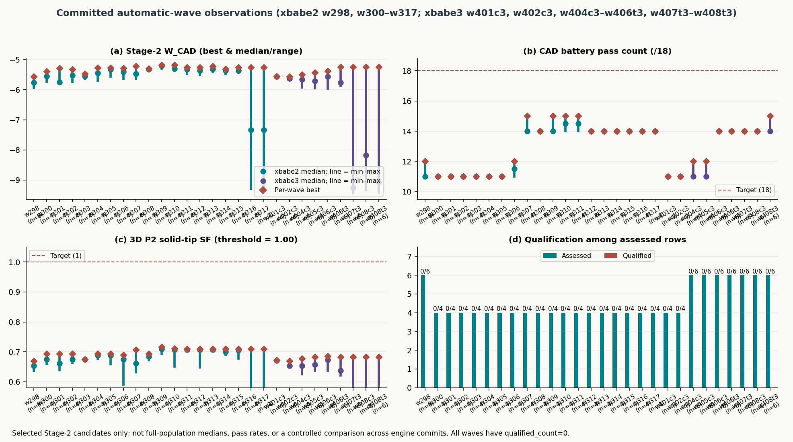

# Intelligence-Designed Titanium Utility Karambits via Monte-Carlo-Robust Evolutionary Search

**Jepson Taylor**

**Version 1.0.0 — 2026-10-16** (living document; version from `docs/VERSION`, checked by CI). **Certification erratum:** the Wave 283 all-hard and 16-gate pass claims are withdrawn. Neither committed candidate qualifies under the repaired pipeline. The generated tables below contain the corrected results. Historical screens remain historical evidence; no design is promoted.

**Abstract** — *jarambit* is a Rust-native pipeline that evolves fixed-blade titanium hiking/utility karambits (SWITCHBACK class) under hard manufacturability and safety constraints, verified by a plate FEM screen plus a solid tip submodel, made robust by Monte Carlo over tolerances, temperature (−10…100 °C) and cut media, and ranked across waves by a single GLOBAL metric **G** that combines solid-tip safety factor, strength-per-gram, aesthetics, mass and failure sequence. Hard limits reject qualification; search may rank infeasible candidates by negative fitness, and G never overrides a gate.

<!-- GEN:WP_STATUS:BEGIN -->
**Honest status (v1.0.0, generated from `evidence/rs_v2/*.json`).** 0 of 6 named designs meet every RS-karambit-v2 hard gate; the v1.0.0 certification claims are withdrawn; no design is promoted. The v1 gate set (RS-karambit-v2) adds human-maximum loads, seq ≥ 1.2 as a hard gate, fatigue and ring handling to the v1 screen; Table IV-A lists every shortfall.

**v1.0.0 certification claims withdrawn (#75–#81).** Neither Wave 283 candidate passes the fixed pipeline. The exported geometry and all requirement thresholds are unchanged. Native-only solid solves are unverified; the results below use actual scikit-fem P2 and DOLFINx solves on the same mesh.

| candidate | raster / solid g | strict lateral N | cert seq | solid-tip SF | G1 | W_CAD | RS-v2 |
|---|---:|---:|---:|---:|---:|---:|---|
| `w283_p14_c01` | 75.382 / 75.199 | 176.720 | 0.7436 | 0.9577 | 0.623888 | -3.878704 | FAIL |
| `w283_p10_c02` | 75.642 / 75.505 | 176.763 | 0.7179 | 0.9578 | 0.621632 | -3.964924 | FAIL |

Source: `evidence/rs_v2/w283_ultrarunner/*_{cad_eval,rs,solid_tip}.json`; raw solver outputs and exact meshes are retained in `evidence/cert_integrity/recertified/`. The retracted certificates are preserved under `evidence/cert_integrity/v1.0.0-retracted/`. Lateral strength, failure sequence, human-maximum loads, fatigue, exported edge sharpness and full 0–10 mm point monotonicity remain blockers; the bore has no verified required fillet. Historical 16-gate screen results below do not establish an RS-v2 all-hard pass or manufacturing promotion. G1 above uses the full-precision RS inputs in each battery record; CAD-eval JSON retains its rounded D1 inputs.
<!-- GEN:WP_STATUS:END -->

**Current battery scope:** 0/23 CAD subjects establish an RS-karambit-v2 all-hard pass. The six top-level named-genome records above are a subset. There is no currently certified all-gates winner; historical 16-gate scorecards remain tied to their original model and GCI predicate. This revision is dated 2026-10-17 and extends the existing paper without changing any requirement or evidence file. The #82 erratum records re-certification of unchanged w283 exports at `4cd0f994e803`; #84 subsequently changed the export law and preserves those catalog observations as historical records.

*Index Terms* — evolutionary design, finite element analysis, Monte Carlo robustness, titanium, karambit, NSGA-II, design-for-manufacture.

*Studio geometry plate. Actual committed `cert_pipeline_r01_p14_c02.stl` from the #84 automatic-assessment proof, with illustrative titanium finish and lighting. This candidate passes 10/16 engineering predicates, fails RS-v2 and is not a winner. The committed leaderboard has `qualified_count=0` and `champion=null`. See the companion for all 16 load/geometry renderings, reverse face and ring/section views; the certified-winner re-render slot in §IV-E is empty.*

<!-- GEN:WP_HERO:BEGIN -->
### Page-1 Hero Figures — Why This Matters & Historical Screen Record (`w282_p14_c01`) Gate Margins

*Fig. 0a — Historical (pre-#82 model): Why this matters (`ops/render/whitepaper_hero_figs.py`, manifest `docs/figures/whitepaper/fig_why_this_matters.png.manifest.json`, verified by `ops/ci/verify_figures.py`): (a) mass vs. wave across every wave winner from Wave 20 (`c11_fit_D1`, `83.429 g`, `seq = 0.926 < 1.20`) and first historical all-16-gates `W_CAD_v2` screen record `w274_s2905_c01` (`84.979 g`, `seq = 1.273 >= 1.20`) down to the historical 16-gate screen record **`w282_p14_c01` at `75.568 g` (`75.323 g` 3D solid), `G1 = 0.878210`, `W_CAD = +1.7790`**; (b) comparison against the source-audited 77-entry commercial karambit census (`docs/market/2026-10-13/census.json`, `docs/market/2026-10-13/summary.json`, median `159.32 g`, range `51.03–411.07 g`), where `w282_p14_c01` (`75.568 g`) is `52.6 %` below the commercial median and lighter than `72 / 77` (`93.5 %`) plotted knives.*

*Fig. 0b — Historical (pre-#82 model): All 16 engineering gates (`16/16` pass) for `w282_p14_c01` (`evidence/rs_v2/w282_ultrarunner/w282_p14_c01_cad_eval.json`, `evidence/cad_battery/w282_p14_c01.json`, manifest `docs/figures/whitepaper/fig_w279_gate_margins.png.manifest.json`): (a) normalized structural safety ratios ($\text{value}/\text{threshold} \ge 1.0$) and reserve percentages (`strict_lat = 262.6 N` / `SF = 1.0100` `+1.00 %`, `twist_strict SF = 1.125` `+12.50 %`, `twist_tip SF = 1.141` `+14.10 %`, `solid_tip_3d P2 SF = 1.4093` `+40.93 %`, `seq_ratio_cert = 1.201 >= 1.20` `+0.08 %`, `side.a4 supported seq = 4.042`, `buckling P_cr = 1521.6 N`, `dolfinx vs skfem = 0.0213 % <= 2.0 %`); (b) exact metrics and thresholds for all 16 `W_CAD_v2` gates (historical Wave-27 `g3_tip+00_t60_tt3` 3D CAD and FEM plates remain in §III-G and §III-H).*

*Fig. 0c — Committed corrected CAD and certificate scorecard (`web/` companion, manifest `docs/figures/whitepaper/fig_web_studio.png.manifest.json`, generated from saved independent re-certification): corrected Wave 283 geometry and measured gate failures. The historical all-hard pass has been withdrawn.*
<!-- GEN:WP_HERO:END -->

## I. Introduction
Utility cutting (cord, webbing, packaging) with a ring-retained hooked blade. Contributions: (1) constrained genotype with validators; (2) genome-generated STEP/STL CAD, with post-#84 analytic bore rolls and an independently inspected OCC solid (earlier faceted exports retain their historical limitations); (3) two-level FEM (plate screen + solid tip submodel); (4) MC robustness; (5) island/novelty evolution; (6) a locked global metric and versioned, figure-backed wave reporting; (7) an evidence layer where structured status and plotted numbers trace to committed data and are CI-checked; (8) a v1 requirement set (RS-karambit-v2) with human-maximum loads, evaluated honestly per design. Code map: `TECHNOLOGY_MAP.md`; implementation-derived 16-gate atlas, 18-evaluator / 23-subject battery, scoped 178-entry (`T00`–`T19`) assurance inventory, and committed population analysis: [`docs/ENGINEERING_GATES_AND_EVOLUTION.md`](ENGINEERING_GATES_AND_EVOLUTION.md).

## I-A. Related work
Multi-objective evolutionary design (NSGA-II [1]), DKT plate elements [2], topology/shape optimisation, robust design under tolerance, and knife-edge mechanics in Ti alloys. jarambit differs by treating legal/manufacturing limits as hard rejections and by ranking across waves with one locked metric.

## II. Methods
### II-A. Pipeline
genotype (validate/reject) → phenotype (outline, STEP, mass) → Monte Carlo × FEM (capacities, SF, SPG, seq) → evolve → plates → G → this paper + `docs/WAVE_LOG.md`.

### II-B. GLOBAL metric G (definition, locked G1 — `docs/GLOBAL_METRIC.md`)
$$G = 0.35\,\min(SF_{tip},2) + 0.35\,\frac{SPG}{4.0} + 0.20\,aes - 0.05\,\frac{\max(0,m-77)}{10} - 0.05\,\frac{\max(0,1.2-seq)}{1.2}$$
SF_tip = solid tip submodel SF at the max-stress node (828 MPa); SPG = certified strength-per-gram (N/g); aes = C.6 automated aesthetic score (0…1); m = finished mass (g); seq = hand/blade failure-sequence ratio, soft until ≥ 1.2. `G*` marks a provisional value where the solid submodel is missing and the plate tip-submodel screen SF is substituted. Every wave FEM plate title shows G, mass (g) and the software version.

### II-C. Requirement sets (RS-karambit-v1, `requirements/RS-karambit-v1.toml`)
Every PASS/FAIL names a requirement set (here RS-karambit-v1) and group. **Screen** (plate field `w20_hard_pass`): ring ID 25.4 ± 0.5 mm; blade ≥ 3.375 in on tip-to-heel, horizontal reach and sharpened arc; sharpened edge ≤ 4.0 in; grip 60–80 mm; connected solid; Ti only; 0.1 mm stock; C.6 aesthetic floor; 828 MPa joint thin+hot (provisional); hiker 180 N / hunter 260 N; ring pull 1500 N; chord torsion 1.82 N·m (body and tip submodel); solid tip SF ≥ 1.0. **Promotion** (`promote_eligible`, owner lock) adds: strict hunter lateral ≥ 260 N and seq ≥ 1.2, plus human aesthetic sign-off. **Mass is soft** (owner decision 2026-10-12, RS-karambit-v1 version 2): it is a strong penalty in G and a ranking target (< 80 g first, then < 70 g), never a screen or promotion gate; the 74–77 g band is reported only. **Search legality** (crescent, P1 on) makes seq ≥ 1.2 hard and treats mass as a ranking target. A screen PASS at 84.8 g is therefore consistent; that design currently fails promotion on seq, not on mass.

### II-D. Versioning
Major wave N ⇒ version 0.N.0 + tag `v0.N.0` + `docs/RELEASES.md` entry + this header. Sub-experiments (Wave N.1, …) ⇒ `docs/WAVE_LOG.md` only. Earlier versions in the callouts are retro-assigned by wave (wave N ↔ 0.N.0); only `v0.1.0-g3neckrail` exists as a tag before v0.27.0.

### II-E. Methods added in v0.28–v0.32 (evidence layer, solid FEM, faer, RS-karambit-v2, 18-case CAD battery & W_CAD_v2)
**Evidence layer (v0.28).** Structured status and data-bearing blocks are generated from committed evidence: README and the data blocks of this paper are produced by `ops/ci/gen_readme.py` and `ops/ci/gen_whitepaper.py` and checked in CI (`--check`); `ops/ci/check_claims.py` rejects any pass verdict that does not name its requirement set; figure and media manifests carry input and output sha256 (`verify_figures.py`, `verify_media.py`).
**Solid FEM (v0.30).** A quadratic-tetrahedron solid model (DOLFINx, cross-checked against scikit-fem on the same mesh) certifies the tip submodel and meshes the whole part; three-level grid-convergence (GCI, Roache [3]) studies provide conditional estimates only for admissible mesh/observable sequences (§IV-C).
**Sparse direct solver (v0.31).** The plate tier can factor with faer's sparse Cholesky [4] (symbolic + numeric $LL^{\mathsf{T}}$ with a pivot sentinel at the same threshold as the skyline criterion, pivot ≤ 1e-13·max|diag K|). Equal thresholds do not give identical rejection: elimination orders differ, and a refined T6 fixture with one clamped node is rejected by faer but accepted by skyline (a known skyline limitation, not fixed here). The regression `both_backends_reject_partially_constrained_rotation` covers the tested plate/T6 cases only. faer is several times faster at the certification tier but drifts above the 1e-9 parity bar, so skyline stays the default.
**RS-karambit-v2 (v0.31).** Human-maximum static loads (twist about the ring→tip chord, in-plane tip, spine, ring-back impact as DAF 2 × ring pull, provisional), seq ≥ 1.2 as a hard gate, L7 fatigue (Marin-corrected endurance limit, modified Goodman [5]) and finger-bearing width (bore length along the finger axis). `jarambit rs-v2-eval` writes one verdict file per named design (`evidence/rs_v2/`).
**18-evaluator CAD battery and re-certification.** The battery records software contracts, geometry, plate loads/sequence/fatigue, GCI, side reports and the independent solid solve separately. Historical Wave 283 all-hard claims were invalid. The corrected generated tables distinguish measured failures from unverified solver checks; neither an evolutionary score nor a coarse native solve supplies certification.

The following generated method table preserves archived numerical observations and historical GCI arithmetic. Its old GCI percentages and intervals are not newly admitted error bounds; admissible mesh/observable identity and convergence status are discussed in §IV-C and the companion.

<!-- GEN:WP_METHODS:BEGIN -->
| method (version) | evidence | result |
|---|---|---|
| Solid FEM cross-check (v0.30) | `evidence/fem_solid/verify_0.30.2.json` | ghcr.io/fenics/dolfinx/dolfinx:v0.9.0 vs scikit-fem on the g3_tip+00_t60_tt3 tip submodel (422955 DOF): SF nodal max 1.5341 vs 1.5340 (rel. err 6.5e-05) |
| Whole-part solid mesh (v0.30) | same | 35972 TET10, 195312 DOF at h = 2.0 mm; mass 84.86 g vs 84.8 g reference |
| GCI mesh study (v0.30) | `evidence/fem_solid/gci/a0_tip+00_t60_tt3_gci.json` | a0_tip+00_t60_tt3: 3 levels to 3192243 DOF; GCI_fine (vM max) 0.4 %, p = 3.15; SF nodal max 1.5925 [1.5856, 1.5994] |
| GCI mesh study (v0.30) | `evidence/fem_solid/gci/g3_tip+00_t58_tt3_gci.json` | g3_tip+00_t58_tt3: 3 levels to 3169395 DOF; GCI_fine (vM max) 1.6 %, p = 2.06; SF nodal max 1.5984 [1.5727, 1.6250] |
| GCI mesh study (v0.30) | `evidence/fem_solid/gci/g3_tip+00_t60_tt0_gci.json` | g3_tip+00_t60_tt0: 3 levels to 3169395 DOF; GCI_fine (vM max) 1.2 %, p = 2.31; SF nodal max 1.5840 [1.5649, 1.6036] |
| GCI mesh study (v0.30) | `evidence/fem_solid/gci/g3_tip+00_t60_tt3_gci.json` | g3_tip+00_t60_tt3: 3 levels to 3169395 DOF; GCI_fine (vM max) 1.8 %, p = 2.00; SF nodal max 1.6002 [1.5719, 1.6296] |
| GCI mesh study (v0.30) | `evidence/fem_solid/gci/w271b_11772_gci.json` | w271b_11772: 3 levels to 2590443 DOF; GCI_fine (vM max) 0.5 %, p = n/a; SF nodal max 0.8337 [0.8297, 0.8378] |
| faer sparse Cholesky (v0.31) | `evidence/bench/faer_0.31.2_xbabe3.json` | cert tier 26.31 → 6.74 core-s/design (3.90×) on `bench/fixed_1k` (xbabe3) |
| faer vs skyline parity (v0.31, issue #32) | `evidence/bench/issue32_drift.json` | max drift 2.6e-08 per design > 1e-09 bar → default solver skyline, faer opt-in |
<!-- GEN:WP_METHODS:END -->

**Wave w283 correction (v1.0.0).** Both original genomes are unchanged. Their old pass certificates are retracted; the current `*_cad_eval.json` and `*_rs.json` files report actual exported thickness, uncredited human-maximum/fatigue loads, measured sharpness/point profiles and the independently observed fine-mesh solid response. See the generated page-1 correction and §IV-A. Neither candidate qualifies for promotion.

## III. Core technologies (callouts)
Each callout: (a) 3D CAD/STEP figure, (b) FEM colormap/mesh figure, (c) metrics table including G, (d) version that introduced it. Figures are the best-G design of the cited wave that passes the RS-karambit-v1 screen (`docs/figures/whitepaper/`). These callouts retain their cited historical model and requirements; they are not post-#84 re-certifications.

### III-A. Constrained genotype + validators (genotype/)
20-gene + Ti grade genotype; red-team rejects (never penalises) ring ID 25.4 ± 0.5 mm, blade ≥ 3.375 in on all three measures, edge ≤ 4.0 in, grip 60–80 mm, connected solid, double serrated.

**(a) 3D CAD/STEP** — 

**(b) FEM colormap/mesh** — 

**(c) Metrics**
| design | G | SF_tip | SPG N/g | aes | mass g | seq | RS-karambit-v1 screen |
|---|---|---|---|---|---|---|---|
| wave20 c11_fit_D1 | **0.848** | 1.164 | 3.994 | 0.673 | 83.4 | 0.926 | PASS |

**(d) Introduced in:** v0.1.0 (wave1); crescent C.4/C.6 anchor v0.6.0→v0.13.0 (no stick-figure priors)

### III-B. Phenotype → faceted STEP/STL CAD, grinds, tip outline/stock (phenotype/)
Historical export path: outline → watertight extrusion → faceted MANIFOLD_SOLID_BREP STEP + STL (the archived OCC import was an unsewable shell; solid meshing used the STL, `evidence/fem_solid/verify_0.30.2.json`); 0.1 mm stock; grind law per edge; holder envelope +1 mm. The post-#84 export adds analytic bore rolls and independent OCC solid validation; its current predicate, surface law and verification scope are given in §IV-B and the companion §IV-E.

**(a) 3D CAD/STEP** — 

**(b) FEM colormap/mesh** — 

**(c) Metrics**
| design | G | SF_tip | SPG N/g | aes | mass g | seq | RS-karambit-v1 screen |
|---|---|---|---|---|---|---|---|
| wave25 c01_fit_D1 | **0.952** | 1.527 | 3.726 | 0.648 | 82.0 | 0.879 | PASS |

**(d) Introduced in:** v0.1.0 (STEP/STL); grind law + tip outline v0.26.0 (wave26 grind_law)

### III-C. Plate FEM screen, D1 rules: 828 MPa joint thin+hot, lateral/pry/ring, chord torsion 1.82 N·m (fem/)
DKT + membrane plate on the outline; certification min(0.25,0.125 mm²) + strict 0.0625 mm²; twist both modes; 4 mm tip-load zone excluded on the plate and handed to the solid submodel.

**(a) 3D CAD/STEP** — 

**(b) FEM colormap/mesh** — 

**(c) Metrics**
| design | G | SF_tip | SPG N/g | aes | mass g | seq | RS-karambit-v1 screen |
|---|---|---|---|---|---|---|---|
| wave22 c03_fit_D1 | **0.885** | 1.345 | 3.853 | 0.636 | 83.9 | 0.831 | PASS |

**(d) Introduced in:** v0.13.0 (D1 rules; CI d1-gates)

### III-D. Solid tip submodel (fem/)
C3D solid submodel of the tip region at 828 MPa; nodal max/avg SF; hard gate SF ≥ 1.0. Supplies the tip term of G.

**(a) 3D CAD/STEP** — 

**(b) FEM colormap/mesh** — 

**(c) Metrics**
| design | G | SF_tip | SPG N/g | aes | mass g | seq | RS-karambit-v1 screen |
|---|---|---|---|---|---|---|---|
| wave24 c02_fit_D1 | **0.966** | 1.527 | 4.070 | 0.645 | 85.6 | 0.952 | PASS |

**(d) Introduced in:** v0.20.0 (W20 lock: SOLID tip gate, seq soft, holder +1 mm)

### III-E. Monte Carlo over tolerances, −10…100 °C, heterogeneous media (monte_carlo/)
Exact-n tolerance cloud, thread-stable seeds, cut-media mix; SF maps at 100 °C yield; SPG = p05 (search) / certified (plate).

**(a) 3D CAD/STEP** — 

**(b) FEM colormap/mesh** — 

**(c) Metrics**
| design | G | SF_tip | SPG N/g | aes | mass g | seq | RS-karambit-v1 screen |
|---|---|---|---|---|---|---|---|
| wave23 c02_fit_D1 | **0.925** | 1.425 | 3.996 | 0.629 | 84.6 | 0.916 | PASS |

**(d) Introduced in:** v0.1.0

### III-F. Evolution: islands, fitness, novelty, diversity (evolve/)
Legacy NSGA-II and the crescent scalar-fitness island GA are distinct implementations; the crescent lane uses tournaments, migration, MAP-Elites/QD (machining fraction × mass), and novelty (§IV-D).

**(a) 3D CAD/STEP** — 

**(b) FEM colormap/mesh** — 

**(c) Metrics**
| design | G | SF_tip | SPG N/g | aes | mass g | seq | RS-karambit-v1 screen |
|---|---|---|---|---|---|---|---|
| wave21 c08_fit_D1 | **0.808** | 1.107 | 3.839 | 0.710 | 85.9 | 0.891 | PASS |

**(d) Introduced in:** v0.1.0 NSGA-II islands; novelty/QD v0.6.0; novelty lane v0.25.0

### III-G. GLOBAL metric G + versioned wave plates (metrics/)
G (Methods §II-B) printed in every new plate title with mass and version; ranks plated designs per wave.

**(a) 3D CAD/STEP** —  *(extruded phenotype solid from `out/wave27/g3_tip+00_t60_tt3_D1.json`, t = 6.0 mm; render script `ops/wave_figures/render_step3d_w27.py`)*

**(b) FEM colormap/mesh** — 

**(c) Metrics**
| design | G | SF_tip | SPG N/g | aes | mass g | seq | RS-karambit-v1 screen |
|---|---|---|---|---|---|---|---|
| wave27 g3_tip+00_t60_tt3_D1 | **0.980** | 1.534 | 4.147 | 0.649 | 84.8 | 0.959 | PASS |
| wave27e g3t58_S05_rw-05_D1 (prior w27 provisional) | 0.977 | 1.594 | 3.859 | 0.593 | 81.8 | 0.888 | PASS |

tip×SPG = 1.534 × 4.147 = **6.362**; ring ID 25.46 mm; seq soft. Engineering provisional (not promoted); `g3_tip+00_t60_tt0` (= g3_neckrail, 6.340 @ 84.59 g, G 0.979) is history.

**(d) Introduced in:** v0.27.0

### III-H. Key components of the provisional design — 3D CAD + FEM + metrics (v0.32)
Each key component (reference numerals as in `docs/PATENT_DRAFT.md`) is shown as (a) a 3D CAD view with the component highlighted and (b) the plan FEM colormap zoomed to it, with its metrics. Generated by `ops/render/components.py`; data in `docs/figures/components/components.json`.

<!-- GEN:WP_COMPONENTS:BEGIN -->
Design `g3_tip+00_t60_tt3` (84.80 g). Plan partition (`ops/render/components.py`): ring = within bore radius + 1.6 × ring band (12.40 + 1.6 × 5.74 mm) of the ring centre; grip/spine = next 61 mm; tip = within 12 mm of the tip; blade = rest. (b) panels show the D1 certified envelope SF (100 C, joint), plate tier; that field is the RS-karambit-v1 screen field. The last column lists the design's RS-karambit-v2 gate values from `evidence/rs_v2/` (tip: strict 0.0625 mm² tip-submodel twist SF and the genome-bound solid tip SF, which are the locked gate values; the plate min element SF is the screen field only).

*Fig. C1. Finger ring (10): (a) 3D CAD view (faceted STL, component highlighted); (b) plan FEM colormap.*

*Fig. C2. Grip / spine (20): (a) 3D CAD view (faceted STL, component highlighted); (b) plan FEM colormap.*

*Fig. C3. Blade, sharpened + serrated edges (30, 32): (a) 3D CAD view (faceted STL, component highlighted); (b) plan FEM colormap.*

*Fig. C4. Tip zone (40): (a) 3D CAD view (faceted STL, component highlighted); (b) plan FEM colormap.*

| component | elements | area share | min element SF (D1, 100 °C) | median element SF | area SF < 1 | RS-karambit-v2 gate values |
|---|---|---|---|---|---|---|
| Finger ring (10) | 4135 | 17.1 % | 1.362 | 21.347 | 0.0 % | `hm_ringback_sf` 2.660; `ring_band_mm` 5.739; `ring_bearing_w_mm` 5.879; `ring_rob_n` 17463.976 |
| Grip / spine (20) | 8963 | 34.8 % | 1.425 | 2.333 | 0.0 % | `fat_sf` 0.982; `hm_spine_sf` 0.419; `twist_body_sf` 4.400 |
| Blade, sharpened + serrated edges (30, 32) | 12305 | 45.1 % | 1.395 | 2.605 | 0.0 % | `hm_twist_sf` 0.132; `lat_rob_n` 351.663; `seq_ratio` 0.959 |
| Tip zone (40) | 734 | 3.0 % | 1.176 | 4.009 | 0.0 % | `hm_tip_inplane_sf` 0.565; `solid_tip_sf` 1.600; `twist_tipzone_sf_strict` 1.224 |
<!-- GEN:WP_COMPONENTS:END -->

The plate-tier envelope SF is ≥ 1 in every component, yet the same design fails the RS-karambit-v2 human-maximum cases: those loads are several times the v1 screen loads, and they are what blocks v1.0.0 (§IV-A).

## IV. Results — waves 20–27 (best G per wave, RS-karambit-v1 screen PASS designs)
| design | G | SF_tip | SPG N/g | aes | mass g | seq | RS-karambit-v1 screen |
|---|---|---|---|---|---|---|---|
| wave20 c11_fit_D1 | **0.848** | 1.164 | 3.994 | 0.673 | 83.4 | 0.926 | PASS |
| wave21 c08_fit_D1 | **0.808** | 1.107 | 3.839 | 0.710 | 85.9 | 0.891 | PASS |
| wave22 c03_fit_D1 | **0.885** | 1.345 | 3.853 | 0.636 | 83.9 | 0.831 | PASS |
| wave23 c02_fit_D1 | **0.925** | 1.425 | 3.996 | 0.629 | 84.6 | 0.916 | PASS |
| wave24 c02_fit_D1 | **0.966** | 1.527 | 4.070 | 0.645 | 85.6 | 0.952 | PASS |
| wave25 c01_fit_D1 | **0.952** | 1.527 | 3.726 | 0.648 | 82.0 | 0.879 | PASS |
| wave26 ctl_g3_ref (solid table; plates PENDING — `jarambit_w26_resume` live) | pending | 1.525 | 4.158 | — | 84.6 | 0.959 | PASS (table) |
| wave27 g3_tip+00_t60_tt3_D1 | **0.980** | 1.534 | 4.147 | 0.649 | 84.8 | 0.959 | PASS |
| wave27e g3t58_S05_rw-05_D1 | 0.977 | 1.594 | 3.859 | 0.593 | 81.8 | 0.888 | PASS |
| wave27b a0_S08_dr+05_D1 | **0.979*** | screen 1.636 | 3.747 | 0.591 | 81.9 | 0.842 | FAIL |

**Trend (historical, RS-karambit-v1 screen, waves 20–27).** Solid tip SF rose from 1.16 (wave20) to 1.53–1.59 (waves24–27) while SPG held near 3.7–4.1 N/g; G rose 0.85 → 0.97. No design reached seq ≥ 1.2 (a hard gate). Mass is soft (G penalty, target < 80 g then < 70 g), so the 74–77 g band is reported only and never stops promotion. The current v1 status is §IV-A.

*Wave26 figure: PLACEHOLDER (plates pending). Wave27 figures: final pack in `docs/wave27_diversity/plates/` + `plates_e/`; the engineering provisional g3_tip+00_t60_tt3 is shown in III-G.*

**Pareto note (v0.27.0).** No wave27 tip arm reaches an RS-karambit-v1 screen PASS at ≤ 82 g with tip×SPG ≥ 6 (the ≤ 82 g, ≥ 6 points a0_tip+10_t58_tt3/tt0 fail the screen). The mass king remains the a0_c02fit_ref class (~81.4 g, tip×SPG ~5.58). seq < 1.2 everywhere (a promotion requirement). The next major wave (v0.28.0) starts only after a hard-PASS design beats G1 0.9804, or reaches ≤ 82 g at tip×SPG ≥ 6 with an RS-karambit-v1 screen PASS. (Superseded for versioning by the v1 roadmap; see docs/RELEASES.md.)

### IV-A. Honest status under RS-karambit-v2 (v1 gate set)
<!-- GEN:WP_RSV2:BEGIN -->
| design (RS-karambit-v2) | mass g | v1 screen | strict lateral N (≥ 260) | strict tip-sub twist SF | solid tip SF | seq (≥ 1.2) | twist SF | tip SF | spine SF | ring-back SF | fatigue SF | bearing mm (≥ 10) | all hard gates |
|---|---|---|---|---|---|---|---|---|---|---|---|---|---|
| g3_tip+00_t60_tt3 | 84.80 | FAIL | 340.8 | 1.224 | 1.600 (PASS) | 0.959 | 0.132 | 0.565 | 0.419 | 2.660 | 0.982 | 5.88 | **FAIL** |
| w271b_11772 | 78.55 | FAIL | 277.7 | 0.668 | 0.834 (FAIL) | 0.882 | 0.076 | 0.597 | 0.418 | 2.419 | 0.856 | 5.11 | **FAIL** |
| w271b_11860 | 73.33 | FAIL | 264.5 | 0.716 | — (unverified) | 0.892 | 0.075 | 0.528 | 0.384 | 1.911 | 0.756 | 4.75 | **FAIL** |
| w271c_11522 | 79.96 | FAIL | 266.4 | 0.842 | — (unverified) | 0.778 | 0.097 | 0.574 | 0.419 | 1.992 | 0.767 | 4.79 | **FAIL** |
| w283_p10_c02 | 75.64 | FAIL | 176.8 | 1.002 | 0.958 (FAIL) | 0.718 | 0.111 | 0.556 | 0.432 | 2.860 | 0.543 | 10.20 | **FAIL** |
| w283_p14_c01 | 75.38 | FAIL | 176.7 | 1.002 | 0.958 (FAIL) | 0.744 | 0.111 | 0.555 | 0.431 | 2.860 | 0.544 | 10.20 | **FAIL** |

**0 of 6 designs pass every RS-karambit-v2 hard gate.** An unverified gate (no evidence) never counts as met. Screen rejects: `g3_tip+00_t60_tt3`: Holder envelope: best oriented box 200.9 x 100.4 > 200 x 100
<!-- GEN:WP_RSV2:END -->

The six top-level named-genome records above are a subset of the **23-subject CAD battery**; both denominators have zero RS-v2 all-hard passes. Historical pre-w283 load and sequence observations remain tied to their original models. W283's apparent closure was invalid and has been withdrawn. G1 completeness means required inputs exist; it does not indicate qualification. The actual exported candidate must be re-certified on fixed main before any new all-gates record is claimed.

### IV-B. Engineering gates: implementation-derived atlas

The engineering companion [ENGINEERING_GATES_AND_EVOLUTION.md](ENGINEERING_GATES_AND_EVOLUTION.md) extends this paper with the exact predicates, units, load models, file:function paths, fidelity and verification evidence for every gate. **16 W_CAD gates, 10 RS-v2 groups and 18×23=414 battery cells are different denominators.** The gates are grouped by the property they test; a missing result never establishes a pass. The common plate model is linear isotropic CST/DKT bending plus T6 in-plane response. Ti-6Al-4V uses provisional yield 828 MPa, $E=113.8$ GPa, $\nu=0.34$, density 4.43 g/cm³, linear temperature knockdown to 100 °C and joint −0.1 mm stock tolerance. Capacities use $k_p=[(t-0.1)/t]^p\sigma_y(100)/\sigma_y(20)$, with $p=2$ in bending/torsion and $p=1$ in membrane ring pull. Certification combines 0.25/0.125 mm² meshes; strict checks use 0.0625 mm², without search bias. PR #82 binds every solve to the post-removal export thickness law. All gate plates below use the same committed failed assessment, `cert_pipeline_r01_p14_c02`, and display its recorded verdict. Load arrows, gauges and fixtures are illustrations; any color field is the saved multi-load D1 plate envelope, not a load-specific strict or solid field. These plates do not fill the certified-winner slot.

#### IV-B.1. Geometry and manufacturability

##### 1. `cad_watertight_and_single_solid`

- **Test & threshold:** `cad_info.cad_valid` requires a valid ISO-10303-21 STEP header declaring millimetre length units (`has_mm_decl`), exactly **1** `MANIFOLD_SOLID_BREP` and $\ge 1$ `CLOSED_SHELL` in the stripped `DATA;` section, STL with **0** boundary edges, **0** non-manifold edges, maximum directed-edge multiplicity **1**, relative 3D-solid vs. 2D-raster mass discrepancy $|m_{3\text{D}} - m_{\text{raster}}| / m_{\text{raster}} \le 0.01$ (**1 %** at Ti-6Al-4V density $\rho = 4.43\text{ g/cm}^3$, $m_{3\text{D}} = 0.00443\,V$ g for signed-tetrahedron volume $V = |\sum \mathbf{a}\cdot(\mathbf{b}\times\mathbf{c})|/6\text{ mm}^3$), byte-identical deterministic regeneration across `.step`, `.stl`, and `_surface.json` (`regeneration_deterministic`), and (in the post-#84 independent evaluator) **1** transferred solid valid under OpenCascade `BRepCheck_Analyzer`.
- **Science verification:** Signed divergence-theorem volume integration over oriented surface triangles cross-checked against 2D planform thickness integration and independent OpenCascade B-rep topological/geometric validity (`BRepCheck_Analyzer`). Mesh census and volume agreement alone do not prove absence of every triangle self-intersection or valid B-rep sewing; the independent OCC inspection tests the actual STEP entity graph rather than trusting entity names.
- **Enforcing code & tests:** [`export.rs::solid, census, volume`](../crates/crescent/src/export.rs), [`step_export.rs::write`](../crates/crescent/src/step_export.rs), [`cad_ingest.rs::mesh_census_and_volume`](../crates/crescent/src/cad_ingest.rs), [`evaluate_cad_candidate.py::verify_step_and_stl, evaluate_candidate`](../ops/ci/evaluate_cad_candidate.py), [`verify_genome_export.py::inspect_step`](../ops/ci/verify_genome_export.py), and battery bindings in [`cad_battery.py`](../ops/ci/cad_battery.py) / [`battery.rs`](../crates/crescent/src/battery.rs); verified by [`test_cad_battery.py`](../ops/ci/tests/test_cad_battery.py) (`test_evaluated_genome_spec_binds_step_stl_surface_and_fails_closed`) and [`cert_integrity.rs`](../crates/crescent/tests/cert_integrity.rs) (`plate_and_export_use_actual_thickness_not_the_thicker_machining_base`, `previous_model_certificates_never_bind_to_the_new_surface_model`).

##### 2. `geometric_and_holder_gates`

- **Test & threshold:** `len(rs_doc.rejects) == 0` requires an empty geometric/red-team reject list: all three blade-length measures (tip-to-heel straight chord, horizontal reach perpendicular to the grip axis, and sharpened-edge arc) $\ge 85.725\text{ mm}$ ($3.375\text{ in}$, with $86.225\text{ mm}$ design guard band), each cutting-edge arc $\le 101.6\text{ mm}$ ($4.0\text{ in}$), grip length $60\text{--}80\text{ mm}$, finger-ring ID $25.4 \pm 0.5\text{ mm}$, ring-wall ligament $\ge 4.5\text{ mm}$, other structural ligaments $\ge 3.0\text{ mm}$, stock $5.3\text{--}6.0\text{ mm}$ in $0.1\text{ mm}$ increments, $\ge 3$ serration teeth per edge with ripple $\ge 0.05\text{ mm}$, primary edge half-angle $\ge 14^\circ/\text{side}$, flat brand pad, non-self-intersecting connected genus-1 outline, sanity mass $20 < m < 200\text{ g}$, and oriented holder fit within $200 \times 100\text{ mm}$ (scanned over $-30^\circ\dots 30^\circ$ in $0.5^\circ$ steps), stack $t + 2w + 2c \le 9.0\text{ mm}$ ($c = 0.2\text{ mm}$), cairn retention seat $\ge 4.0\text{ mm}$, friction land $\ge 40\text{ mm}^2$, insertion force $F_{\text{in}} \in [3, 80]\text{ N}$, and draw force $F_{\text{draw}} \in [1.5, 45]\text{ N}$.
- **Science verification:** Exact planar polygon containment, chord/arc metrology, and Euler-Bernoulli cantilever snap-beam retention proxy $F_{\text{in}} = 6.6\,w^3\delta\text{ N}$ ($E_{\text{shell}} \approx 2.2\text{ GPa}$), $F_{\text{draw}} = 0.55\,F_{\text{in}}$ [5]. The stack check uses nominal body stock $t$, not the maximum height of #84's locally raised bore collar; a passing flag does not establish physical sheath clearance for the raised collar or blank-stock machinability.
- **Enforcing code & tests:** [`gates.rs::check, holder_fit`](../crates/crescent/src/gates.rs), [`redteam/src/lib.rs::check, holder_forces`](../crates/redteam/src/lib.rs), and [`crescent/src/tests.rs`](../crates/crescent/src/tests.rs); bound to battery `geom.unit`, `geom.one_solid`, `geom.mass`, and `geom.pin` records in [`battery.rs`](../crates/crescent/src/battery.rs) and [`cad_battery.py`](../ops/ci/cad_battery.py).

#### IV-B.2. Ergonomics and appearance

##### 3. `karambit_ring_and_curved_claw`

- **Test & threshold:** Conjunction in `evaluate_candidate` requiring finger-ring ID $25.4 \pm 0.5\text{ mm}$ ($+10^{-6}\text{ mm}$ numerical comparison allowance; `gates::check` uses $10^{-9}\text{ mm}$), radial ring wall $\ge 4.5\text{ mm}$, C.6 dual-face ring-groove width $\ge 2.0\text{ mm}$, claw hook drop $\ge 25.0\text{ mm}$, minimum of the three blade-length measures $\ge 85.725\text{ mm}$ ($-10^{-6}\text{ mm}$ allowance), $\ge 3$ serration teeth on both inside and spine edges, and aesthetic floor acceptance (`aes_pass == true`).
- **Science verification:** Deterministic planar/B-rep archetype and retention-ring geometry audit over the decoded spline phenotype and exported solid measurements. Inside-concave and spine-convex curvature fractions are evaluated against the SWITCHBACK reference profile; this geometric screen does not supply an anthropometric comfort or contact-pressure study, nor does groove width establish the $\ge 1.5\text{ mm}$ bore-edge fillet radius required by `RS-karambit-v2`.
- **Enforcing code & tests:** [`pheno.rs::build`](../crates/crescent/src/pheno.rs), [`aesthetic.rs::evaluate, continuity`](../crates/crescent/src/aesthetic.rs), [`certification.rs::measure`](../crates/crescent/src/certification.rs), and [`evaluate_cad_candidate.py::evaluate_candidate`](../ops/ci/evaluate_cad_candidate.py) (`/karambit_archetype` in `*_cad_eval.json`), tested in [`crescent/src/tests.rs`](../crates/crescent/src/tests.rs).

##### 4. `c6_aesthetic_floor`

- **Test & threshold:** `mt.aes_pass` requires symmetric Hausdorff distance $H \le 6.0\text{ mm}$ to the SWITCHBACK Rev C.6 reference exterior, 32-bin normalized curvature-histogram Earth Mover's Distance $\text{EMD} \le 0.06$, longest nearly straight run ($|\kappa| < 1/250\text{ mm}^{-1}$) $\le L_{\text{ref}} + 8.0\text{ mm}$, minimum concave blend radius $\ge \min(2.0\text{ mm}, 0.8\,r_{\text{ref,min}})$, convex-spine and concave-inside sample fractions $\ge f_{\text{ref}} - 0.03$, thumb-seat depth $\ge 0.4\text{ mm}$, guard-lobe prominence $\ge 5.0\text{ mm}$, hook drop $\ge 25.0\text{ mm}$, neck-fillet gene $\ge 8.0\text{ mm}$, cord-wrap zone length $\ge 45.0\text{ mm}$ with texture condition, clear flat brand pad, jimping scale $0.8\text{--}1.2$ ($0.36\text{--}0.54\text{ mm}$ nominal depth), and active C.6 ring-face groove width $\ge 2.0\text{ mm}$ with groove area $> 50.0\text{ mm}^2$.
- **Science verification:** Arc-length-parameterized outline resampling, discrete Frenet curvature $\kappa(s)$, and 1D Wasserstein ($\text{EMD}$) shape-distribution comparison against the C.6 anchor. The continuous ranking score $A = e^{-H/6} e^{-\text{EMD}/0.05}[1 - 0.5\min(\Delta L/8, 1)]$ is separate from the Boolean predicate (`A >= 0.50` is not the hard gate; a design near $A = 0.408$ can satisfy every sub-check). Automated geometry acceptance does not replace human aesthetic sign-off.
- **Enforcing code & tests:** [`aesthetic.rs::evaluate`](../crates/crescent/src/aesthetic.rs) and [`pheno.rs`](../crates/crescent/src/pheno.rs), recording `metrics.aes_fails`, `hausdorff`, and `emd` in `*_D1.json`; verified by C.6 reference-seed and feature regressions in [`crescent/src/tests.rs`](../crates/crescent/src/tests.rs).

#### IV-B.3. Structural strength

##### 5. `cert_hiker_180n`

- **Test & threshold:** `lat_rob_cert_n >= 180.0` N (equivalently hiker safety factor $\text{SF}_{\text{hiker}} = C_{\text{lat,rob}} / 180\text{ N} \ge 1.0$), where $C_{\text{lat,rob}}$ is the conservative minimum over the **0.25 and 0.125 mm²** certification meshes with bore nodes clamped in all 5 plate DOFs, a unit out-of-plane transverse tip load distributed over a $2\text{ mm}$ tip patch, a $4\text{ mm}$ tip singularity exclusion, and joint thin/hot knockdown $k_2(t) = [(t - 0.1\text{ mm})/t]^2\,\sigma_y(100\,^\circ\text{C})/\sigma_y(20\,^\circ\text{C})$.
- **Science verification:** Linear isotropic Discrete Kirchhoff Triangle (DKT) plate bending [2] coupled with CST/T6 membrane elasticity (`Ku = f`, flexural rigidity $D = Et^3/[12(1-\nu^2)]$) on the post-removal exported thickness field $t(x,y)$ [5]. This predicts linear-elastic first-yield capacity under static transverse loading, not dynamic impact or plastic collapse; physical coupon testing is absent.
- **Enforcing code & tests:** [`fem.rs::run_b, certify`](../crates/crescent/src/fem.rs) and [`physics/src/fine.rs`](../crates/physics/src/fine.rs); verified by [`physics/tests/solver_parity.rs`](../crates/physics/tests/solver_parity.rs) [4], #75's `plate_and_export_use_actual_thickness_not_the_thicker_machining_base` in [`cert_integrity.rs`](../crates/crescent/tests/cert_integrity.rs), and T01/T05 numerical contracts.

##### 6. `cert_hunter_260n`

- **Test & threshold:** `lat_rob_cert_n >= 260.0` N ($\text{SF}_{\text{hunter}} = C_{\text{lat,rob}} / 260\text{ N} \ge 1.0$) on the same **0.25 / 0.125 mm²** unbiased certification mesh pair, ring-clamped fixture, $2\text{ mm}$ tip load patch, $4\text{ mm}$ exclusion, and $k_2(t)$ joint knockdown as Gate 5.
- **Science verification:** Same Batoz DKT plate bending formulation [2] and first-yield scaling $C_{20} = \sigma_y(20\,^\circ\text{C}) / \hat{\sigma}_{\text{vm}}$ at the higher 260 N utility-load threshold [5]. In the archived 40-design T1$\to$T2 calibration ([`docs/calibration/t1_t2.json`](calibration/t1_t2.json)), the lateral search-to-certification residual standard deviation is **6.5 %** ($\le 7\%$ bar), motivating two-mesh unbiased certification rather than search-tier acceptance; that historical calibration residual is not a per-design physical error bound.
- **Enforcing code & tests:** [`fem.rs::run_b, certify`](../crates/crescent/src/fem.rs), [`evaluate_cad_candidate.py`](../ops/ci/evaluate_cad_candidate.py) (`lat_rob_cert_n`, `sf_hunter_cert`), [`test_t1_t2_calibration.py`](../ops/ci/tests/test_t1_t2_calibration.py), and [`cert_integrity.rs`](../crates/crescent/tests/cert_integrity.rs).

##### 7. `strict_hunter_260n`

- **Test & threshold:** `strict_lat_rob_0p0625_n >= 260.0` N ($\text{SF}_{\text{hunter,strict}} \ge 1.0$) evaluated by an unbiased solve on the strict **0.0625 mm²** maximum-triangle-area plate mesh under the identical ring-clamped 260 N transverse load case and $k_2(t)$ knockdown.
- **Science verification:** $h$-refinement verification of the DKT bending solution [2, 3] at $2\times$ finer area than the finest certification mesh ($0.0625\text{ mm}^2$ vs. $0.125\text{ mm}^2$) to guard against under-resolved stress peaks at the grip-ring neck and through-perforation ligaments. On the corrected post-#82 thickness field (#75), `w283_p14_c01` drops to **176.720 N** (`w283_p10_c02`: **176.763 N**), failing the unchanged 260 N floor despite passing independent 3D solver agreement.
- **Enforcing code & tests:** [`fem.rs::run_unbiased`](../crates/crescent/src/fem.rs), [`bench.rs::rs_v2_eval`](../crates/cli/src/bench.rs), [`evaluate_cad_candidate.py`](../ops/ci/evaluate_cad_candidate.py), and [`cert_integrity.rs`](../crates/crescent/tests/cert_integrity.rs) (`plate_and_export_use_actual_thickness_not_the_thicker_machining_base`).

##### 8. `cert_ring_pull_1500n`

- **Test & threshold:** `ring_rob_cert_n >= 1500.0` N ($\text{SF}_{\text{ring}} = C_{\text{ring,rob}} / 1500\text{ N} \ge 1.0$) over the **0.25 / 0.125 mm²** certification mesh pair, seating the guard/ricasso band $x \in [76, 100] + \Delta x\text{ mm}$ and integrating a unit $-x$ traction along the finger-ring bore, with membrane thin/hot knockdown $k_1(t) = [(t - 0.1\text{ mm})/t]\,\sigma_y(100\,^\circ\text{C})/\sigma_y(20\,^\circ\text{C})$ ($p = 1$).
- **Science verification:** Quadratic 6-node triangle (T6) in-plane plane-stress elasticity with consistent boundary-edge traction integration and hand-side von Mises peak recovery outside the seated support band [5]. This static 1500 N axial ring-pull floor is distinct from the provisional 3000 N `RS-karambit-v2` ring-back static equivalent and does not model dynamic finger-impact or soft-tissue bearing comfort.
- **Enforcing code & tests:** [`fem.rs::run_b, certify`](../crates/crescent/src/fem.rs) and [`physics/src/fine.rs`](../crates/physics/src/fine.rs); verified by solver/traction unit tests in [`physics/src/fine.rs`](../crates/physics/src/fine.rs), [`solver_parity.rs`](../crates/physics/tests/solver_parity.rs), and #76's `rs_mode_does_not_create_ring_width_strength_or_fatigue_credits` in [`cert_integrity.rs`](../crates/crescent/tests/cert_integrity.rs).

##### 9. `twist_body_1p82nm`

- **Test & threshold:** `twist_body_sf >= 1.0` under a **1.82 N·m** ($1820\text{ N}\cdot\text{mm}$) tip torque applied about the ring-center-to-tip chord $\mathbf{d}$, evaluated on the **0.25 / 0.125 mm²** certification mesh pair over the body region excluding the inner **15 mm** tip zone (`excl15`), with local rectangular-section correction $k_c$ and $k_2(t)$ knockdown.
- **Science verification:** DKT plate torsion loaded via slope DOFs along $\mathbf{n} = (-d_y, d_x) \perp \mathbf{d}$ [2], corrected by the exact Saint-Venant rectangular-section factor $k_c = (1/3)/\alpha(b/t)$ [5] (`alpha_rect` / `torsion_3d_factor` from local chord-normal width $b$ and thickness $t$). Because the archived 40-design T1$\to$T2 torsion calibration residual is **10.8 %** ($> 7\%$ bar in [`docs/calibration/t1_t2.md`](calibration/t1_t2.md)), torsion is gated strictly at the certification/strict tiers rather than calibrated search.
- **Enforcing code & tests:** [`fem.rs::run_b, certify, alpha_rect, torsion_3d_factor`](../crates/crescent/src/fem.rs), [`test_t1_t2_calibration.py`](../ops/ci/tests/test_t1_t2_calibration.py), and #76's `rs_mode_does_not_create_ring_width_strength_or_fatigue_credits` in [`cert_integrity.rs`](../crates/crescent/tests/cert_integrity.rs).

##### 10. `twist_tip_only_1p82nm`

- **Test & threshold:** `twist_tip_sf >= 1.0` at **1.82 N·m** ($1820\text{ N}\cdot\text{mm}$) chord torque on the **0.25 / 0.125 mm²** certification mesh pair, evaluating the corrected plate torsional stress peak everywhere outside the **4 mm** tip load-singularity exclusion (`excl4`) with local section-walked $b/t$ correction $k_c$ and $k_2(t)$ knockdown.
- **Science verification:** Full-blade DKT chord-torsion peak check [2, 5] walking the local cross-section in $0.05\text{ mm}$ steps to evaluate $b/t$ and $k_c = (1/3)/\alpha(b/t)$. Despite the historical `twist_tip_only` scorecard key, this is a 2D plate-model observable outside the $4\text{ mm}$ singularity zone, not a 3D point solve; a candidate can pass this plate metric while failing 3D solid-tip SF (Gate 12) or measured B-rep edge/point geometry.
- **Enforcing code & tests:** [`fem.rs::run_b, certify`](../crates/crescent/src/fem.rs), [`evaluate_cad_candidate.py`](../ops/ci/evaluate_cad_candidate.py), and [`cert_integrity.rs`](../crates/crescent/tests/cert_integrity.rs) (#75/#76 regressions preventing pre-removal thickness or bore-width credits from inflating torsional SF).

##### 11. `twist_tip_submodel_strict_1p82nm`

- **Test & threshold:** `twist_tipzone_sf_strict >= 1.0` at **1.82 N·m** ($1820\text{ N}\cdot\text{mm}$) chord torque evaluated on the strict **0.0625 mm²** unbiased plate mesh over the restricted tip annulus **$4\text{ mm} \le r_{\text{tip}} < 15\text{ mm}$** (`tipzone_ex`), using that annulus's local section factor $k_{c,\text{tz}}$ and $k_2(t)$ knockdown.
- **Science verification:** Strict-mesh ($0.0625\text{ mm}^2$) plate torsion localization in the $4\text{--}15\text{ mm}$ distal blade zone [2, 5] where bevel grinds and taper narrow the cross-section. Despite the historical "submodel" label, this gate is a restricted-domain plate observable; Gate 12 provides the actual 3D continuum submodel. Missing strict data fails closed as `unverified`.
- **Enforcing code & tests:** [`fem.rs::run_unbiased, run_b`](../crates/crescent/src/fem.rs), [`bench.rs::rs_v2_eval`](../crates/cli/src/bench.rs), [`evaluate_cad_candidate.py`](../ops/ci/evaluate_cad_candidate.py), and T01/T05 region/observable identity controls in [`cert_integrity.rs`](../crates/crescent/tests/cert_integrity.rs).

##### 12. `solid_tip_3d_p2_1p82nm`

- **Test & threshold:** `solid_tip_sf_nodal_max >= 1.0` under **1.82 N·m** ($1820\text{ N}\cdot\text{mm}$) chord torque on the 30 mm local 3D quadratic-tetrahedron ($P_2$, 10-node TET10, standard refinement `NL=4, NSUB=1`) tip submodel, where $\text{SF}$ is the joint thin/hot allowable divided by the recovered nodal-maximum von Mises stress in the ROI **$4\text{ mm} \le r_{\text{tip}} < 15\text{ mm}$** with **cut-boundary distance $> 3\text{ mm}$** (`tip_roi_mask`).
- **Science verification:** 3D small-strain isotropic linear elasticity $\boldsymbol{\sigma} = 2\mu\boldsymbol{\varepsilon} + \lambda\operatorname{tr}(\boldsymbol{\varepsilon})\mathbf{I}$ solved on the post-#84 full-precision exported top-surface facets ([`export_surface.py::load_surface, refine`](../fem_solid/export_surface.py)) with all cut-face displacement DOFs clamped ($\mathbf{u}=\mathbf{0}$) and a minimum-norm vertex $z$-force distribution over the $2\text{ mm}$ tip patch satisfying $\sum F_z = 0$, $\sum s F_z = 1820\text{ N}\cdot\text{mm}$, and $\sum q F_z = 0$ [5, 6]. Benchmarked within **1 %** against analytical Saint-Venant square-bar torsion $\theta' = T/(0.140577\,Ga^4)$ and Heywood/Kirsch finite-width plate-with-hole $K_t = [2 + (1 - d/W)^3]/(1 - d/W)$ in [`verify_0.30.2.json`](../evidence/fem_solid/verify_0.30.2.json). On fixed `main`, `w283_p14_c01` and `w283_p10_c02` score **0.9577** and **0.9578** (91,008 TET10 / 416,583 DOFs), and the #84 proof `cert_pipeline_r01_p14_c02` scores **0.6690** (scikit-fem) / **0.6693** (DOLFINx); all fail `< 1.0`.
- **Enforcing code & tests:** [`tip_solid.py`](../fem_solid/tip_solid.py), [`solve_dolfinx.py::tip_roi_mask`](../fem_solid/solve_dolfinx.py), [`export_surface.py`](../fem_solid/export_surface.py), [`verify_analytic.py`](../fem_solid/tests/verify_analytic.py), [`test_tip_regression.py`](../fem_solid/tests/test_tip_regression.py), [`test_field_semantics.py`](../fem_solid/tests/test_field_semantics.py), [`test_evolve_certifiable.py`](../ops/ci/tests/test_evolve_certifiable.py), and [`test_evolve_committed_evidence.py`](../ops/ci/tests/test_evolve_committed_evidence.py).

#### IV-B.4. Stiffness and stability

##### 13. `side_a4_buckling_and_support`

- **Test & threshold:** `status == "pass"` **and** `buckling_eigenvalue >= 1.0` ($P_{\text{cr}} = 260\,\lambda_{\text{cr}} \ge 260\text{ N}$), where `status == "pass"` additionally requires $\lambda_{\text{cr}} > 0$ and compliant-supported failure-sequence ratio $\text{seq}_{\text{A4}} \ge \text{seq}_{\text{cert}}$ under bore radial/tangential boundary-node springs of **50,000 / 5,000 N/mm**, bore axial flange stiffness **100,000 N/mm**, and grip Winkler foundation stiffness **200 N/mm³** times nodal tributary area.
- **Science verification:** Linearized elastic bifurcation eigenproblem $K_{\text{support}}\boldsymbol{\phi} = \lambda_{\text{cr}} G\boldsymbol{\phi}$ with compression-positive membrane geometric stiffness matrix $G$ assembled at the 260 N hunter lateral reference load (solved via sparse factorization/eigensolver in Python and sparse Cholesky + $K$-orthogonal Lanczos in Rust) [2, 5]. This is a linearized elastic stability and compliant-fixture sensitivity diagnostic, not a nonlinear post-buckling or calibrated hand-compliance model, and it cannot override the clamped failure-sequence gate (Gate 14).
- **Enforcing code & tests:** [`side_a4.py::evaluate_subject`](../ops/ci/side_a4.py), [`physics/src/side_a4.rs::solve_side_a4`](../crates/physics/src/side_a4.rs), and native/Python parity checks in [`battery.rs`](../crates/crescent/src/battery.rs) and [`test_cad_battery.py`](../ops/ci/tests/test_cad_battery.py).

#### IV-B.5. Failure sequence

##### 14. `failure_sequence_1p2`

- **Test & threshold:** `seq_ratio_cert >= 1.20` (dimensionless), defined as the conservative minimum over the **0.25 / 0.125 mm²** certification meshes and across all three load cases (transverse lateral, chord torsion, and in-plane tip pry) of the hand-to-blade first-yield capacity ratio $C_{\text{hand}} / C_{\text{blade}} = \hat{\sigma}_{\text{blade}} / \hat{\sigma}_{\text{hand}}$, partitioning blade ($x \ge x_{\text{heel}}$, excluding the $4\text{ mm}$ tip load patch) vs. hand ($x < x_{\text{heel}} - 3\text{ mm}$).
- **Science verification:** Fail-safe elastic yield-ordering requirement ensuring the blade reaches first yield with at least a **20 %** margin before the finger-ring/grip region yields under lateral, torsional, or in-plane prying overload [5]. This ratio is a linear-elastic first-yield proxy rather than an elastoplastic fracture-mechanics simulation; on fixed `main`, `w283_p14_c01` (`0.7436`) and `w283_p10_c02` (`0.7179`) fail below `1.20`.
- **Enforcing code & tests:** [`fem.rs::run_b, certify`](../crates/crescent/src/fem.rs), [`bench.rs::rs_v2_eval`](../crates/cli/src/bench.rs), [`evaluate_cad_candidate.py`](../ops/ci/evaluate_cad_candidate.py), and [`cert_integrity.rs`](../crates/crescent/tests/cert_integrity.rs).

#### IV-B.6. Numerical verification

##### 15. `plate_gci_valid_3level`

- **Test & threshold:** Exact scorecard predicate `bool(gci.get("sequence_valid") and gci.get("observable_valid"))` on the 3-level (**4.0, 1.0, 0.25 mm²** maximum triangle area, effective linear grid refinement ratio $r = 2$) failure-sequence ratio mesh study, where each level's mesh identity is bound to the actual solved `fem::report_fields` triangulation via `mesh_hash(&fl.xy, &fl.tris, &fl.te)`.
- **Science verification:** Roache 3-grid Richardson extrapolation [3], $p = \ln|(\phi_3 - \phi_2)/(\phi_2 - \phi_1)|/\ln r$ and $\text{GCI}_{\text{fine}} = F_s\,|\phi_1 - \phi_2|/[|\phi_1|(r^p - 1)]$ ($F_s = 1.25$), with explicit state classification (`monotone_convergent`, `oscillatory`, `nonpositive_order`, `unresolved_or_precision_limited`) in [`fem_solid/gci.py`](../fem_solid/gci.py). Because the `W_CAD_v2` Boolean checks only `sequence_valid && observable_valid` (and does not require `fit_status == "admissible_estimate"` or a maximum GCI percentage), a true gate flag verifies mesh/observable contract metadata rather than asymptotic convergence; the battery's `plate.gci` evaluator reports the full convergence classification separately.
- **Enforcing code & tests:** [`plate_gci_probe.rs`](../crates/crescent/examples/plate_gci_probe.rs), [`gci.rs::run_plate_gci_3level, mesh_hash`](../crates/crescent/src/gci.rs), [`fem_solid/gci.py::compute_gci`](../fem_solid/gci.py), [`test_gci.py`](../fem_solid/tests/test_gci.py), [`test_gci_evidence.py`](../fem_solid/tests/test_gci_evidence.py), and [`test_cad_battery.py`](../ops/ci/tests/test_cad_battery.py) (`test_plate_gci_hashes_the_solved_mesh_not_a_separate_remesh`).

##### 16. `dolfinx_cross_check_2pct`

- **Test & threshold:** Recomputed `within_2pct == true`, requiring independent primary (scikit-fem $P_2$) and comparison (pinned DOLFINx v0.9.0 $P_2$ [6]) solves on the **identical saved fine TET10 mesh** (`NL=4, NSUB=1`, matching `mesh_sha256`, `certificate_identity`, `d1_sha256`, and `primary_converged == true`) to agree within relative error $e = |\text{SF}_{\text{skfem}} - \text{SF}_{\text{DOLFINx}}| / \text{SF}_{\text{DOLFINx}} \le 0.02$ (**2.0 %**) for **both** nodal-maximum and nodal-average von Mises SF in the $4\text{--}15\text{ mm}$ tip ROI.
- **Science verification:** Same-mesh, dual-assembly finite-element verification across independent symbolic/quadrature stacks (scikit-fem vs. FEniCSx/DOLFINx v0.9.0 + Basix + PETSc [6]). Cross-solver agreement verifies numerical assembly and stress recovery for the specified boundary-value problem; it does not imply that the candidate passes strength ($\text{SF} \ge 1.0$). Native-only TET10 screening or copied solver records are rejected (`unverified` / `fail`).
- **Enforcing code & tests:** [`cross_check.py`](../fem_solid/cross_check.py), [`solve_dolfinx.py`](../fem_solid/solve_dolfinx.py), [`certification.rs::independent_pass`](../crates/crescent/src/certification.rs), [`test_dolfinx_verification_record.py`](../fem_solid/tests/test_dolfinx_verification_record.py), [`test_evolve_certifiable.py`](../ops/ci/tests/test_evolve_certifiable.py), and #79/#80 regressions (`native_or_missing_independent_solver_never_becomes_a_pass`, `edited_genome_with_reused_label_is_rejected_by_content_identity`) in [`cert_integrity.rs`](../crates/crescent/tests/cert_integrity.rs).

#### IV-B.7. Ten RS-karambit-v2 hard-gate groups and the 23 × 18 = 414 CAD battery

Whereas the 16 `W_CAD_v2` gates above form the engineering scorecard (`evaluate_cad_candidate.py`), promotion additionally requires `all_hard == true` across the **10 hard-gate groups** specified in [`requirements/RS-karambit-v2.toml`](../requirements/RS-karambit-v2.toml) and evaluated by [`bench.rs::rs_v2_eval`](../crates/cli/src/bench.rs). Missing observations enter `unverified` and prevent qualification.

| Hard-gate group | Requirement, threshold & governing model | Enforcing code & tests |
|---|---|---|
| 1. `aesthetic_and_geometric` | `aes_pass == true` (Gate 4) and `gates::check` empty reject list (Gate 2). | [`aesthetic.rs`](../crates/crescent/src/aesthetic.rs), [`gates.rs`](../crates/crescent/src/gates.rs), [`crescent/src/tests.rs`](../crates/crescent/src/tests.rs) |
| 2. `floors_828_joint` | Certification-mesh robust lateral capacity $\ge 180\text{ N}$ (hiker) and $\ge 260\text{ N}$ (hunter), and ring pull $\ge 1500\text{ N}$ (`Fem.floors_ok`, Gates 5, 6, 8). | [`fem.rs::certify`](../crates/crescent/src/fem.rs), [`bench.rs::rs_v2_eval`](../crates/cli/src/bench.rs) |
| 3. `twist_floor_body_and_tipsub_strict` | Body chord-torsion $\text{SF} \ge 1.0$ (Gate 9) and strict $0.0625\text{ mm}^2$ $4\text{--}15\text{ mm}$ tip-annulus torsion $\text{SF} \ge 1.0$ (Gate 11) at $1.82\text{ N}\cdot\text{m}$. | [`fem.rs::run_b, run_unbiased`](../crates/crescent/src/fem.rs), [`bench.rs::rs_v2_eval`](../crates/cli/src/bench.rs) |
| 4. `solid_tip_sf` | Content-bound, independently cross-checked 3D $P_2$ solid-tip nodal-maximum $\text{SF} \ge 1.0$ at $1.82\text{ N}\cdot\text{m}$ and $\le 2\%$ solver agreement (Gates 12, 16). | [`certification.rs::independent_pass`](../crates/crescent/src/certification.rs), [`tip_solid.py`](../fem_solid/tip_solid.py), [`cert_integrity.rs`](../crates/crescent/tests/cert_integrity.rs) (#79, #80) |
| 5. `strict_hunter_lateral` | Unbiased strict $0.0625\text{ mm}^2$ transverse lateral capacity $\ge 260.0\text{ N}$ (Gate 7). | [`fem.rs::run_unbiased`](../crates/crescent/src/fem.rs), [`cert_integrity.rs`](../crates/crescent/tests/cert_integrity.rs) (#75) |
| 6. `seq_hard` | Certified blade-before-hand elastic yield-sequence ratio $C_{\text{hand}}/C_{\text{blade}} \ge 1.20$ across lateral, torsion, and pry (Gate 14). | [`fem.rs::certify`](../crates/crescent/src/fem.rs), [`bench.rs::rs_v2_eval`](../crates/cli/src/bench.rs) |
| 7. `human_max` | Human-maximum static overload $\text{SF} \ge 1.0$ for chord twist (**16.2 N·m**), distributed spine load (**3427 N**), and ring-back (**3000 N** provisional $2\times$ static equivalent), plus exported-mesh axial ring-bearing width $\ge 10.0\text{ mm}$ and bore-edge fillet radius $\ge 1.5\text{ mm}$ on both faces (`hm_inplane_tip_n = 1000 N` is solved and recorded as `record_only`). | [`fem.rs::HumanMax`](../crates/crescent/src/fem.rs), [`certification.rs::bore_radius`](../crates/crescent/src/certification.rs), [`cert_integrity.rs`](../crates/crescent/tests/cert_integrity.rs) (#76, #81) |
| 8. `fatigue` | Modified Goodman L7 fatigue $\text{SF} = [\sigma_a/S_e + \sigma_m/S_{ut}]^{-1} \ge 1.0$ for $10^7$ lateral cycles $0\dots 180\text{ N}$ ($R=0$, $\sigma_a = \sigma_m = \sigma_{\max}/2$), with Marin endurance $S_e = k_a k_b k_e (0.5\,S_{ut})$ ($S_{ut}=895\text{ MPa}$, $k_a = 4.51\,S_{ut}^{-0.265}$, $k_b = \min(1, 1.24\max(t,2.79)^{-0.107})$, $k_e = 0.814$) [5]. | [`fem.rs::fatigue::goodman_sf`](../crates/crescent/src/fem.rs), [`cert_integrity.rs`](../crates/crescent/tests/cert_integrity.rs) (#76) |
| 9. `gate_s_sharp_law` | Measured on exported STL triangle intersections across cutting stations within $0.031\text{ mm}$ of declared edges: apex thickness $\le 0.20\text{ mm}$ and local bevel half-angle $\arctan(|\Delta t|/(2\Delta s)) \le 25.0^\circ$ over the first $0.4\text{ mm}$. | [`certification.rs::sharpness`](../crates/crescent/src/certification.rs), [`cert_integrity.rs`](../crates/crescent/tests/cert_integrity.rs) (#77) |
| 10. `gate_s_tip_point_brep` | Measured on exported triangles along the point bisector: thickness at $0.25 / 1.0 / 2.0\text{ mm}$ aft of tip $\le 0.30 / 0.60 / 1.00\text{ mm}$, interpolated $95\%$-of-core taper length $\ge 5.0\text{ mm}$, and strict monotone non-decreasing thickness at every surface breakpoint over **$0\text{--}10\text{ mm}$**. | [`certification.rs::point_profile`](../crates/crescent/src/certification.rs), [`cert_integrity.rs`](../crates/crescent/tests/cert_integrity.rs) (#78) |

Each gate above includes its Blender load/geometry plate, with input/output manifests and the actual verdict for the committed #84 assessed example; the companion §II and §III supply full derivations. Its three studio views (`hero_oblique.webp`, `hero_reverse.webp`, `hero_section.webp`, embedded in §IV-E below) preserve the actual exported mesh. Retained multi-load plate fields and illustrative fixtures are explicitly distinguished; no missing solid field is invented. This assessed failure does not occupy the certified-winner slot.

### IV-C. Science verification and certificate integrity

Analytic verification includes square-bar Saint-Venant torsion and the finite-width Kirsch/Heywood plate-with-hole problem, archived in [verify_0.30.2.json](../evidence/fem_solid/verify_0.30.2.json). [verify_analytic.py](../fem_solid/tests/verify_analytic.py) implements the reference problems, and the saved results meet their 1% bar. Reading that archived JSON is not a fresh FEM execution. Roache GCI [3] requires a consistent mesh sequence, observable and admissible convergence behavior; three points alone do not prove asymptotic validity. Historical [T1/T2 calibration](calibration/t1_t2.md) fails its 7% torsion residual bar (10.8%), supporting certification-tier torsion checks rather than calibrated search approval.

[Monte Carlo](../crates/monte_carlo/src/lib.rs) uses sample-index seeds, explicit manufacturing/environment assumptions and checked finite reductions. [Joint scenarios](../crates/monte_carlo/src/scenario.rs) preserve paired outcomes instead of multiplying marginal rates. Deterministic D1 thin/hot factors are distinct from Monte Carlo reliability estimates. Neither numerical repeatability nor a p05 statistic supplies physical validation without representative distributions, material data and specimen tests.

The frozen [T00–T19 catalog](v1/science/tests/TEST_CASE_CATALOG.json) has **178 required entries**, not a receipt proving 356 controls executed. Its actual family map and status metadata appear in companion §IV-C and [assurance_inventory.json](figures/engineering_gates/assurance_inventory.json). T01 concerns GCI, T02 claim honesty, T03 stochastic reductions, T04 search contracts and T05 field semantics; later families include broader research/observation contracts. The former blanket all-pass and knife-specific family mapping are withdrawn. Tests, admitted runtime executions, physical findings and historical evidence reuse have different scopes.

The [#75](https://github.com/neverhuman/jarambit/issues/75)–[#81](https://github.com/neverhuman/jarambit/issues/81) audit found: solved/exported thickness mismatch; unsupported global ring-width strength/fatigue credits; gene-based sharpness substituted for exported edge measurement; incomplete raster-based point monotonicity; fabricated independent-solver comparison; stale evidence accepted by label; and unmeasured bore radius. [Merged PR #82](https://github.com/neverhuman/jarambit/pull/82) removes these paths without relaxing requirements or changing the two input genomes. It measures actual exported sharpness/point/bore geometry, restores honest native/independent status, and binds evidence by exact genome/model content plus D1, mesh, raw-output and payload hashes. [cert_integrity.rs](../crates/crescent/tests/cert_integrity.rs) provides adverse and positive regression controls.

The final independent w283 fine meshes have 91,008 P2 tetrahedra / 416,583 DOFs. The distinct solvers agree to less than 0.04% in reported SF observations, yet both candidates fail. The [audit archive](../evidence/cert_integrity/v1.0.0-retracted/) preserves invalid certificates for traceability; corrected observations remain under [recertified](../evidence/cert_integrity/recertified/). The final identity migration explicitly reports `solve_rerun=false`, retaining prior real observations rather than claiming another solve. There is **no currently certified all-gates winner; 0/23 CAD subjects pass RS-v2 all-hard**. Any w284–w29x rejected-pipeline output is **PROVISIONAL** until re-certified on fixed main.

The post-#84 export constructs cutting faces from existing edge genes and analytic bore rolls from the existing radial ring-wall gene $w$: roll radius $r=w/4$, axial straight bearing $b=2w$. Following [PR #91](https://github.com/neverhuman/jarambit/pull/91), the evaluator strips STEP comments/strings before inspecting `DATA;`, requires an explicit millimetre unit declaration, verifies deterministic export regeneration across `.step`/`.stl`/`_surface.json`, binds genome STEP/STL/surface checks directly to battery `geom.unit`, `geom.one_solid`, `geom.mass`, and `geom.pin`, and hashes the actual solved `fem::report_fields` triangulation in the 3-level plate GCI probe. Its independently retained [automatic-assessment proof](../evidence/evolve_certifiable/manifest.json) passes 10/16 W_CAD predicates and fails RS-v2; the bore radius is 1.3002 mm, below the unchanged 1.5 mm floor. A valid OCC solid and actual independent solves establish their stated observations, not qualification. The new geometry does not reissue historical certificates. This separate assessment does not expand the catalog: **23 subjects×18 evaluators remain 414 cells, with 0/23 RS-v2 all-hard passes**.

*Figure V1. The current **23-subject ×18-evaluator** battery contains 19 genomes and four hand-built SWITCHBACK reference CADs (`c10a`, `c93`, `c92`, `c10c`), labeled above the separator; these four are not genome or Jarambit pipeline results. In `solid.tip`, P means record complete, not SF ≥1 or independent validation. c10a's stored copy-identical solver comparison is not an independent cross-check. `blocked` and `incomplete` cannot be silently counted as physical acceptance. [battery_points.json](figures/engineering_gates/battery_points.json) traces every cell to its committed source and JSON pointer.*

RS-v2's ten groups (§IV-B.7 and companion §III) add human-maximum static loads (16.2 N·m twist, 3427 N spine, provisional 3000 N ring-back), Goodman fatigue for 0…180 N at $R=0$, $10^7$ cycles, measured bearing ≥10 mm and bore radius ≥1.5 mm, measured apex ≤0.20 mm and half-angle ≤25°, and point-section/monotonicity requirements. The 1000 N in-plane tip case remains record-only. The 18 battery evaluators (`build.analytic`, `build.gci_contracts`, `build.claims`, `build.dolfinx`, `geom.unit`, `geom.one_solid`, `geom.mass`, `geom.pin`, `plate.loads`, `plate.seq`, `plate.l7`, `plate.gci`, `side.a1`, `side.a2`, `side.a3`, `side.a4`, `solid.tip`, `gate.rs_v2`) include software contracts, geometry, plate/side diagnostics, the solid record and RS-v2; they are not 18 additional strength gates.

*Verification plate. Archived analytic benchmark errors and g3 refinement observations are separated from the corrected w283 measurements. The independent solvers agree on tip SF below 1, while strict lateral capacities are below 260 N. These are saved observations, not fresh solves or a new GCI admission. [verification.py](../ops/render/paper/verification.py) regenerates the plot; [verification_points.json](figures/engineering_gates/verification_points.json) traces every plotted observation.*

### IV-D. Evolution mechanics and measured population history

[auto_evolve.rs](../crates/cli/src/auto_evolve.rs), invoked by `./evolve.sh`, generates family-centered proposals. Following merged [PR #84](https://github.com/neverhuman/jarambit/pull/84), Stage 1 retains aesthetic/geometry-valid candidates with a 2 mm² FEM result and ranks normalized structural shortfalls, then mass. Failed physical screens remain eligible for improvement. Stage 2 automatically calls the standard Python evaluator for selected top-k candidates, including actual same-mesh scikit-fem/DOLFINx solves. Completed assessments, unverified attempts and qualified designs are recorded separately; qualification requires both all 16 engineering gates and RS-v2 `all_hard`. Merged [PR #86](https://github.com/neverhuman/jarambit/pull/86) preserves qualified genomes during replacement. Following [PR #87](https://github.com/neverhuman/jarambit/pull/87), it next takes one distinct rankable parent per available seed family, then fills provisional slots to four where possible, deduplicating before counting. More than four available families retain their representatives, increasing the possible next-round budget; an empty replacement set retains the previous parents. Filename-derived family labels do not establish phenotypic diversity, and provisional parents are not qualified. Its local proposal rounds differ from the [crescent island GA](../crates/crescent/src/qd.rs), which uses tournaments, three elites/island, mutation/crossover, archive parents, machining kicks, ring migration, 16-dimensional novelty descriptors and MAP-Elites niches. Search W_CAD fitness uses plate/novelty proxies; it does not execute every independent gate for each birth. The companion §V records defaults, exact operators, flags and seeds, and identifies stale `evolve.sh` prose constants without editing the owner's pipeline.

The [retained w282 provenance](../evidence/rs_v2/w282_ultrarunner/provenance.json) specifies seed 2934, 4 islands×32 individuals, 16 generations, 4 mm² search meshes, migration every four generations, environment, parent hashes and numerical source/binary/container identities. Its **1,984 fresh evaluations** consist of 128 initial births and 16×116 new offspring, with retained elites distinguished from new evaluations. The legacy engine has manifest-bound exact-bit checkpoints; the crescent run retains framed parent/operator event logs and its provenance. A crescent checkpoint/resume capability is not inferred from the legacy implementation, and a seed alone does not reproduce changed code.

*Figure V2. W282 minimum/median mass and maximum/median fitness use every retained fresh evaluation, including rejected candidates. Earlier curves use the highest-fitness island champion's paired mass/fitness from committed histories; medians are unavailable there. Fitness scales from different objectives are shown with that limitation.*

*Figure V3. Per-gate rates for the retained w274–w283 selected candidates, with each column's actual n. These are selected-sample rates; full-population certification rates are unavailable. W283 uses corrected failures. [Birth-level screening rates](figures/engineering_gates/fig_population_screen_rates.png) separately cover only conditions observed for every retained w282 birth, treating missing solves as not demonstrated.*

*Figure V4. W282 pairwise genotype RMS distance uses each varying gene's observed-run range; relief IQR and saved novelty supply descriptor projections. The complete descriptor vector is not retained for every birth. This normalization supports within-run comparison, without inventing cross-wave distances.*

*Figure V4b. Retained archive mass/relief median, IQR and range across historical runs, with actual n. These are selected MAP-Elites niches under different objectives, not full-population distributions. Missing descriptor columns are not imputed.*

*Figure V5. Actual search parent/operator records and the separately documented w282 named winners. The light p14 and reserve p10 candidates are controlled probes of w281 parents; they are not falsely attributed to the GA champion's ancestry.*

*Figure V6. Historical selected mass versus the minimum normalized margin of strict lateral, sequence, strict tip twist and solid SF, plus G1. This four-metric projection does not establish all-gates feasibility or an exhaustive Pareto optimum. Red corrected w283 points show failures rather than an asserted record.*

All plotted values come from committed files checked by `git ls-files`. [populations.py](../ops/render/paper/populations.py) regenerates the seven population figures and [population_points.json](figures/engineering_gates/population_points.json), recording exact sources, JSON pointers/CSV lines, denominators and reductions. Waves with selected genomes only cannot supply population medians, ancestry gaps or full-population gate rates. Missing full-population telemetry is left missing; the separately scoped w298/w300 diagnostic captures below do not reconstruct absent populations. Historical w274→w282 mass reduction remains a selected-candidate observation under its recorded model; no current all-gates record is inferred.

*Figure V7. One pre-merge proof committed with #84: seven birth/screen instances, six distinct genome identities, one completed independent assessment, zero unverified attempts and zero qualified designs. The candidate passes 10/16 engineering predicates; its strict lateral capacity is 168.2 N, solid SF 0.6693, strict tip-twist SF 0.529 and L7 fatigue SF 0.4718. The comparison of rounded raw solid observations is 0.6690 (scikit-fem) versus 0.6693 (DOLFINx). The plotted shortfall is a screen rank, not G1; no multi-generation fitness history is invented. [certifiable.py](../ops/render/paper/certifiable.py) regenerates the plot and [certifiable_points.json](figures/engineering_gates/certifiable_points.json) traces every observation. The retained execution predates a later search-only broad mutation; it is not a new post-merge wave.*

#### Retained plateau behavior after independent assessment

Merged [PR #87](https://github.com/neverhuman/jarambit/pull/87), on main at `7cb952e`, retains [hashed diagnostic snapshots](../evidence/evolution_plateau/2026-10-17/README.md) captured at 08:02 UTC on 17 October 2026. These files document historical failures; they omit exported CAD, meshes and raw solver sidecars and cannot independently re-certify any design. W298 scorecards identify source `ae86f188`; xbabe3 scorecards identify `6438f077`. The samples retain their own source/model identities and are not a matched-code experiment.

| Wave / retained scope | Births / rankable, by proposal round | Completed assessments in capture |
|---|---|---:|
| w298, final leaderboard | 68/53; 64/63; 64/63 | 6 |
| w401c3, final leaderboard | 52/45; 48/47 | 4 |
| w300, partial first-screen capture | 100/64 | 0 |
| w402c3, partial first-round capture | 52/44 | 1 |

The w300 row describes only the committed capture, **not the later completed wave**. Subsequent runtime results remain outside these plots until committed. Neither retained final leaderboard has a qualified design; all eleven captured assessments fail the same six W_CAD predicates: hiker, hunter, strict hunter, tip-only twist, strict tip-annulus twist and solid tip. Recorded solid SF spans 0.6361–0.6716, human-twist SF 0.05748–0.05906, spine SF 0.22312–0.23345 and fatigue SF 0.45737–0.48302. These are selected failures, not a population certification rate or a new mass record. The battery catalog remains 23×18=414 cells, with 0/23 RS-v2 all-hard passes.

*Figure V8. (a) Best coarse shortfall D over retained rounds; partial captures supply single points only. (b) Actual selected-assessment solid SF versus raster mass, below the unchanged SF=1 floor. (c) Birth instances by filename-derived family, with distinct CSV rows / total births above each bar; an asterisk marks partial captures. (d) Individual SF observations for six binding metrics across the eleven captured assessments; vertical offsets are layout. [plateau.py](../ops/render/paper/plateau.py) checks committed bytes and original host hashes, then regenerates the figure and [plateau_points.json](figures/engineering_gates/plateau_points.json), which records every observation, JSON pointer and reduction. No fresh solve or current certificate is inferred.*

W298's best coarse shortfall falls from 3.104828 to 3.068820 over three rounds without producing a qualified candidate. Its initial 68 birth instances contain 56 distinct CSV rows. All four leading first-round parents are p14, and later births lose p10; w401c3 exhibits the opposite family loss. The retained [geometry-only replay](../evidence/evolution_plateau/2026-10-17/rejection_probe.json), with [input/source/output hashes](../evidence/evolution_plateau/2026-10-17/probe_manifest.json), finds all 25 w300 control-family births rejected by the assumed holder envelope, despite aesthetic acceptance. Family preservation addresses one measured selection failure. It supplies neither a physical-feasibility proof nor measured improvement under the new selection rule; no matched post-fix run is retained here.

#### Completed automatic-wave observations

The following observations come from committed automatic-wave leaderboards and [`wave_summary.json`](../evidence/evolution_waves/2026-10-17/wave_summary.json) (verified by [`summarize.py`](../evidence/evolution_waves/2026-10-17/summarize.py)), reduced by [`wave_history.py`](../ops/render/paper/wave_history.py) into [`wave_history_points.json`](figures/engineering_gates/wave_history_points.json). Across all 31 committed wave records (`w298` and `w300`–`w317` on `xbabe2`; `w400c3`–`w408t3` on `xbabe3`), Stage-2 completed 138 independent assessments (`0` qualified, `6` unverified across `w400c3`, `w403c3`, and `w407c3`), all verified directly from committed `leaderboard.json` files. For Stage-1 (`5,368` births / `4,191` survivors across all 31 waves; `4,979` births / `3,931` survivors across the 28 plotted waves), 34 of the 72 rounds (68 `round_*_births.json` / `round_*_screen.json` files under `evidence/evolution_plateau/2026-10-17/` and `evidence/evolution_waves/2026-10-17/`: `w298` rounds 0–2, `w300` round 0, `w315`–`w317` rounds 0–1, `w401c3` rounds 0–1, `w402c3` round 0, and `w405c3`–`w408t3` rounds 0–2; `2,096` births / `1,254` survivors) are verified against committed raw JSON in Git, while the remaining 38 rounds (76 birth/screen digests; `3,272` births / `2,937` survivors across all 31 waves, or `3,036` births / `2,729` survivors across the 28 plotted waves, marked `*` below) are unverified producer-reported host metadata whose raw `round_*.json` files remain outside Git. The 28 zero-unverified completed waves (`4,979` births, `3,931` survivors, `128` assessments) are tabulated and plotted below:

| Wave (host / commit) | Stage-1 screens | Assessed | Qualified | Mass min / med (g) | W_CAD best / med | Battery best / med (/18) | Solid-tip SF best / med |
|---|---|---:|---:|---:|---:|---:|---:|
| `w298` (`xbabe2` / `ae86f18`) | 53/68, 63/64, 63/64 | 6 | 0 | 83.047 / 83.059 | -5.565306 / -5.765577 | 12 / 11 | 0.6694 / 0.6527 |
| `w300` (`xbabe2` / `9d64160`) | 64/100, 92/96* | 4 | 0 | 83.324 / 86.927 | -5.389172 / -5.557408 | 11 / 11 | 0.6932 / 0.6747 |
| `w301` (`xbabe2` / `7cb952e/9d64160`) | 83/100*, 95/96* | 4 | 0 | 83.364 / 85.708 | -5.287856 / -5.754633 | 11 / 11 | 0.6932 / 0.6613 |
| `w302` (`xbabe2` / `edc0f40`) | 81/100*, 92/96* | 4 | 0 | 88.015 / 89.720 | -5.321724 / -5.529497 | 11 / 11 | 0.6932 / 0.6747 |
| `w303` (`xbabe2` / `edc0f40`) | 82/100*, 94/96* | 4 | 0 | 86.854 / 89.144 | -5.473826 / -5.558305 | 11 / 11 | 0.6746 / 0.6740 |
| `w304` (`xbabe2` / `805faaa`) | 80/100*, 91/96* | 4 | 0 | 86.841 / 89.162 | -5.280962 / -5.453326 | 11 / 11 | 0.6934 / 0.6885 |
| `w305` (`xbabe2` / `805faaa`) | 82/100*, 93/96* | 4 | 0 | 86.888 / 91.307 | -5.276352 / -5.326866 | 11 / 11 | 0.6934 / 0.6885 |
| `w306` (`xbabe2` / `805faaa`) | 83/100*, 94/96* | 4 | 0 | 91.408 / 92.118 | -5.286892 / -5.402706 | 12 / 11.5 | 0.6892 / 0.6741 |
| `w307` (`xbabe2` / `2539448`) | 84/100*, 92/96* | 4 | 0 | 91.491 / 92.165 | -5.226954 / -5.470097 | 15 / 14 | 0.7068 / 0.6607 |
| `w308` (`xbabe2` / `a8a7de4`) | 83/100*, 94/96* | 4 | 0 | 91.437 / 92.141 | -5.306115 / -5.323521 | 14 / 14 | 0.6938 / 0.6841 |
| `w309` (`xbabe2` / `0c8d169`) | 86/100*, 92/96* | 4 | 0 | 91.420 / 92.143 | -5.183108 / -5.211783 | 15 / 14 | 0.7163 / 0.7090 |
| `w310` (`xbabe2` / `dae0222`) | 82/100*, 94/96* | 4 | 0 | 87.531 / 91.412 | -5.183108 / -5.297277 | 15 / 14.5 | 0.7113 / 0.7067 |
| `w311` (`xbabe2` / `1927687`) | 84/100*, 93/96* | 4 | 0 | 87.530 / 89.477 | -5.262728 / -5.324286 | 15 / 14.5 | 0.7090 / 0.7067 |
| `w312` (`xbabe2` / `1927687`) | 84/100*, 96/96* | 4 | 0 | 87.567 / 89.493 | -5.262717 / -5.372534 | 14 / 14 | 0.7090 / 0.7067 |
| `w313` (`xbabe2` / `1eee4d1`) | 82/100*, 96/96* | 4 | 0 | 87.588 / 90.507 | -5.224336 / -5.315769 | 14 / 14 | 0.7100 / 0.7067 |
| `w314` (`xbabe2` / `1eee4d1`) | 82/100*, 93/96* | 4 | 0 | 87.589 / 89.519 | -5.320623 / -5.367266 | 14 / 14 | 0.7090 / 0.7001 |
| `w315` (`xbabe2` / `21425fe/f1b2671`) | 83/100, 93/96 | 4 | 0 | 87.595 / 89.528 | -5.258458 / -5.367665 | 14 / 14 | 0.7091 / 0.7060 |
| `w316` (`xbabe2` / `f1b2671`) | 20/104, 14/96 | 4 | 0 | 87.600 / 96.508 | -5.258458 / -7.333562 | 14 / 14 | 0.7091 / 0.4605 |
| `w317` (`xbabe2` / `0a6aa94`) | 20/104, 13/96 | 4 | 0 | 87.600 / 96.508 | -5.258458 / -7.333562 | 14 / 14 | 0.7091 / 0.4605 |
| `w401c3` (`xbabe3` / `6438f07`) | 45/52, 47/48 | 4 | 0 | 82.861 / 82.869 | -5.556243 / -5.569637 | 11 / 11 | 0.6716 / 0.6701 |
| `w402c3` (`xbabe3` / `6438f07`) | 44/52, 46/48* | 4 | 0 | 83.072 / 83.292 | -5.570458 / -5.640241 | 11 / 11 | 0.6693 / 0.6535 |
| `w404c3` (`xbabe3` / `7cb952e`) | 32/52*, 45/48*, 47/48* | 6 | 0 | 82.865 / 82.971 | -5.496513 / -5.664944 | 12 / 11 | 0.6777 / 0.6534 |
| `w405c3` (`xbabe3` / `7cb952e`) | 34/52, 48/48, 47/48 | 6 | 0 | 82.897 / 82.980 | -5.433651 / -5.718887 | 12 / 11 | 0.6822 / 0.6571 |
| `w406c3` (`xbabe3` / `1eee4d1`) | 33/52, 46/48, 48/48 | 6 | 0 | 82.904 / 82.996 | -5.384448 / -5.563714 | 14 / 14 | 0.6849 / 0.6730 |
| `w406t3` (`xbabe3` / `1eee4d1`) | 33/52, 48/48, 47/48 | 6 | 0 | 83.274 / 84.517 | -5.252210 / -5.772613 | 14 / 14 | 0.6823 / 0.6372 |
| `w407t3` (`xbabe3` / `d046093`) | 12/69, 4/48, 36/36 | 6 | 0 | 83.047 / 98.561 | -5.252210 / -9.253661 | 14 / 14 | 0.6823 / 0.2187 |
| `w408c3` (`xbabe3` / `f1b2671`) | 9/55, 16/48, 47/48 | 6 | 0 | 83.047 / 96.733 | -5.252210 / -8.179430 | 14 / 14 | 0.6823 / 0.2960 |
| `w408t3` (`xbabe3` / `f1b2671`) | 9/55, 15/48, 48/48 | 6 | 0 | 83.047 / 98.563 | -5.252210 / -9.071262 | 15 / 14 | 0.6823 / 0.2493 |

*Figure V8b. Script-generated from the named leaderboards: dots show selected-assessment medians, lines their ranges, and diamonds the best per-wave W_CAD, battery pass count (/18), or 3D P2 solid-tip safety factor (`solid_tip_SF`). These are not full-population statistics. Different wave source/model identities are not a controlled comparison of the search rule.*

On `xbabe2`, adding ~8.5 g of stock/tip mass across `w300`–`w317` raised the best Stage-2 `W_CAD` from `-5.565306` (`w298`) to `-5.183108` (`w309`, `w310`; `-5.224336` in `w313`, `-5.320623` in `w314`, `-5.258458` in `w315` on `w315_r01_p14_c50`, in `w316` on `w316_r01_p14_c27`, and in `w317` on `w317_r01_p14_c27`) and lifted the 3D P2 solid-tip safety factor `solid_tip_SF` from `0.6694` to `0.7163` (`w309_r02_p14_c35`; `0.7100` in `w313`, `0.7090` in `w314`, `0.7091` in `w315` on `w315_r01_p10_c03`, in `w316` on `w316_r01_p10_c01`, and in `w317` on `w317_r01_p10_c01`), while PR #91 (`2539448`, `w307` onward) resolved the STEP unit/regeneration evaluator blockers so battery pass counts rose from `11–12/18` to `14–15/18`. On `xbabe3` (`w401c3`–`w405c3` on pre-#91 engine commits and the paired `w406c3`/`w406t3` (`1eee4d1`), `w407c3`/`w407t3` (`d046093`), and `w408c3`/`w408t3` (`f1b2671`) tip-band A/B waves), battery pass counts rose from `11–12/18` to `14–15/18` (`w408t3_r03_p14_c17` reaching `15/18` on `xbabe3`) and best `W_CAD` reached `-5.252210` (`w406t3_r01_p10_c16`, `w407t3_r01_p10_c29`, `w408c3_r01_p10_c15`, and `w408t3_r01_p10_c15`, `G1 = 0.479637`, `solid_tip_SF = 0.6823`; best `solid_tip_SF = 0.6849` on `w406c3_r03_p10_c15`; best `strict_hunter_SF = 0.7288` on `w408c3_r03_p10_c30`; best `fat_sf = 0.5092` on `w406t3_r02_p10_c23`). Both lanes remain limited by the 4–15 mm tip bending/torsion band (`solid_tip_SF < 1.0`, `strict_hunter_SF < 1.0`). Completed independent solves do not imply physical qualification. All listed leaderboards retain `qualified_count=0` and `champion=null`. No certified winner is established.

Three additional `xbabe3` runs recorded in [`wave_summary.json`](../evidence/evolution_waves/2026-10-17/wave_summary.json) contain non-empty `unverified` lists (`w400c3`: `assessed_count=0`, `unverified_count=4`; `w403c3`: `assessed_count=5`, `unverified_count=1`, best `W_CAD = -5.556243`, best `solid_tip_SF = 0.6708`, battery `11/18`; `w407c3`: `assessed_count=5`, `unverified_count=1`, best `W_CAD = -5.252210`, best `solid_tip_SF = 0.6823`, battery `14/18`) and are excluded from the plotted completed-wave series by `read_board` while retained in committed evidence. Later waves enter only after an actual leaderboard exists and the cited evidence is committed on main. No missing wave or unfinished assessment is imputed. The catalog remains 23 subjects × 18 evaluators (414 cells); wave assessments are a separate denominator.

Sources: `evidence/evolution_plateau/2026-10-17/xbabe2/out/w298/leaderboard.json` (SHA256 `4ae79eda014772848816063e3f157d8899fa3968385700d7d600b2527d9aa748`); `evidence/evolution_waves/2026-10-17/xbabe2/out/w300/leaderboard.json` (SHA256 `b4407ecb0cdbefca10b0b57e2cdefa714b76c3202a7d0ee9b187fd7c549ff53b`); `evidence/evolution_waves/2026-10-17/xbabe2/out/w301/leaderboard.json` (SHA256 `a2c1c871b7e8a502f0ce62d417ff9973f8f1409facf1280fb2e2d817d7f409b8`); `evidence/evolution_waves/2026-10-17/xbabe2/out/w302/leaderboard.json` (SHA256 `bd297cc3eaefc1dae187d96f3c9f81f74272f8c14be1f1a226df0222eff1f940`); `evidence/evolution_waves/2026-10-17/xbabe2/out/w303/leaderboard.json` (SHA256 `4c23836204a44097fe90c341c8726b0c5090678b568ff94e7cc130c265cea239`); `evidence/evolution_waves/2026-10-17/xbabe2/out/w304/leaderboard.json` (SHA256 `64b64de83a7b6a56ea8429633e986824a859ca113b2586ba5dd494367e26a502`); `evidence/evolution_waves/2026-10-17/xbabe2/out/w305/leaderboard.json` (SHA256 `be2a7cbaa38bb8107185f794b46e0a2c2c0297769792fe11185391e2a7e3306c`); `evidence/evolution_waves/2026-10-17/xbabe2/out/w306/leaderboard.json` (SHA256 `a9a73105f1fc3e97d5698c8a708e637c4e930a0d34dd7de3b44154da1142d321`); `evidence/evolution_waves/2026-10-17/xbabe2/out/w307/leaderboard.json` (SHA256 `f886d2296288de1fb81a4324a0d5c81dac91913485222a47a56b1eaa9de20bb9`); `evidence/evolution_waves/2026-10-17/xbabe2/out/w308/leaderboard.json` (SHA256 `37a154315d53e6b652a2153df388ca45bc612804d1556a89438f5deaa1700113`); `evidence/evolution_waves/2026-10-17/xbabe2/out/w309/leaderboard.json` (SHA256 `1462fe6feff41a59da9e53d2362c3e425da691b49e08ea3037e97b85f0b1c818`); `evidence/evolution_waves/2026-10-17/xbabe2/out/w310/leaderboard.json` (SHA256 `517e3bb0292b3edf1e41a5d3d943dfe70b047f684d7201a5694d6aae2de915f9`); `evidence/evolution_waves/2026-10-17/xbabe2/out/w311/leaderboard.json` (SHA256 `77e9f339e73fcb9f11e90248d71ccca0fc98518a990276e26ba3e40ef0eb7ea4`); `evidence/evolution_waves/2026-10-17/xbabe2/out/w312/leaderboard.json` (SHA256 `5c418e8eb65d2948b65c5a2711cd4b3cd53146ea61587aa975e7ee0e9e9efe2a`); `evidence/evolution_waves/2026-10-17/xbabe2/out/w313/leaderboard.json` (SHA256 `b01a9f23e8d35d9078048fd29a2056e4dceaf632abba25113aefc9984f1fc885`); `evidence/evolution_waves/2026-10-17/xbabe2/out/w314/leaderboard.json` (SHA256 `cee1a486e921cb3631e7b7de6f14fb37af806bfb3c887b2238e6aa30740e140b`); `evidence/evolution_waves/2026-10-17/xbabe2/out/w315/leaderboard.json` (SHA256 `49f9dcc245b9a2d81518ccbd992fe9b9c445d521a25080baf9b0eb98a611924d`); `evidence/evolution_waves/2026-10-17/xbabe2/out/w316/leaderboard.json` (SHA256 `63df2d7b2c3613a4411b619b48200ec227ca9ef03515bc53e5e5dacb7405f8f5`); `evidence/evolution_waves/2026-10-17/xbabe2/out/w317/leaderboard.json` (SHA256 `429efbe4be1db44befc662ed5fe7a4a1de8ebe3cb53beaa0902a88179b72bb0e`); `evidence/evolution_plateau/2026-10-17/xbabe3/out/w401c3/leaderboard.json` (SHA256 `1c2916610a51bb5a1114210e29e587791ad5d2849ccf1f9f206e1c5c276a80fe`); `evidence/evolution_waves/2026-10-17/xbabe3/out/w402c3/leaderboard.json` (SHA256 `0f39500ad3c785589a2e124309e9f32862a4c011c99c31b26a51e448a7124ca6`); `evidence/evolution_waves/2026-10-17/xbabe3/out/w404c3/leaderboard.json` (SHA256 `01340fd0a2948b9d3807d967f1de5c7048efcbabf53ed9129a14c10aba111ed2`); `evidence/evolution_waves/2026-10-17/xbabe3/out/w405c3/leaderboard.json` (SHA256 `faf231f9b2c96dfc3665750303f6d18c00bf41ba43c40df94054c5db7b75cb50`); `evidence/evolution_waves/2026-10-17/xbabe3/out/w406c3/leaderboard.json` (SHA256 `56915cfc513a27e7e17a3a87ad3788e84cb65c23f5009472d3ca3def7c271af9`); `evidence/evolution_waves/2026-10-17/xbabe3/out/w406t3/leaderboard.json` (SHA256 `376f268e74c7de5abb5af1e74c96098b5cb43ab6afddad9e2a02a8660bdd62eb`); `evidence/evolution_waves/2026-10-17/xbabe3/out/w407t3/leaderboard.json` (SHA256 `a57a19ee420f859d96c870f977ded1e3def391926fc03d3e17a54719d4e063e6`); `evidence/evolution_waves/2026-10-17/xbabe3/out/w408c3/leaderboard.json` (SHA256 `5928d01586e72e8d315359a3c63adc570693ea732098add8808fea2811370a41`); `evidence/evolution_waves/2026-10-17/xbabe3/out/w408t3/leaderboard.json` (SHA256 `e9b69682cf090106083d7db4f3bcdb5610d8849fb1e5b98ce873466e6f43f036`).

#### History source availability

The earlier [main snapshot `0c8d169`](https://github.com/neverhuman/jarambit/tree/0c8d1692a2f113726f8a74aa796f2dea959b7094) contained no `out/w301/leaderboard.json` through `out/w308/leaderboard.json` (and retained only the partial first-screen capture for `w300`). The completed Stage-2 `leaderboard.json`, `RESULT.md`/`leaderboard.md`, and representative top `master_scorecard.md` outputs for `xbabe2` `w300`–`w317` and `xbabe3` `w400c3`–`w408t3` are now committed under [`evidence/evolution_waves/2026-10-17/`](../evidence/evolution_waves/2026-10-17/wave_summary.json) while keeping the `08:02 UTC` plateau snapshot under `evidence/evolution_plateau/2026-10-17/` immutable. Raw Stage-1 `round_*_births.json` and `round_*_screen.json` files are committed in Git for 34 of the 72 rounds (68 files under `evidence/evolution_plateau/2026-10-17/` and `evidence/evolution_waves/2026-10-17/`); the remaining 38 Stage-1 rounds (76 birth/screen digests) are recorded in `wave_summary.json` as `unverified_producer_reported` host metadata because their raw `round_*.json` files and per-candidate large binary exports (`.step`, `.stl`, `_D1.json`, `_surface.json`) remain in host `out/` directories rather than Git. Any subsequent waves (`w318+`, `w409+`) remain excluded until their completed leaderboards are committed on `main`; no missing-wave statistics are inferred.

### IV-E. Certified-winner re-render slot and assessed-candidate studio views

**EMPTY — no certified all-16 winner exists yet.** The committed [automatic leaderboard](../evidence/evolve_certifiable/automatic/leaderboard.json) has **`qualified_count=0`, `champion=null`**. There is no final-design render in the certified-winner slot. The three Cycles studio views below (`hero_oblique.webp`, `hero_reverse.webp`, `hero_section.webp`) and the 16 gate plates in §IV-B depict the committed failed assessment `cert_pipeline_r01_p14_c02` (`10/16` `W_CAD_v2` gates, `RS-karambit-v2` `all_hard=false`) with its real pass/fail verdicts, generated reproducibly by [`render_paper.py`](../ops/render/blender/render_paper.py) and prepared for future winner re-rendering via [`rerender.py`](../ops/render/blender/rerender.py).

*Figure V9a. Cycles CPU oblique studio rendering of the exact committed `cert_pipeline_r01_p14_c02.stl` named by the #84 proof manifest (`qualified_count=0`, `champion=null`). Faceted exported geometry—including the post-#84 cutting faces and raised bore collar—is preserved without smoothing or synthesized features.*

*Figure V9b. Reverse-face studio rendering of the same unchanged `cert_pipeline_r01_p14_c02.stl` mesh with an illustrative anodized-titanium shader (`NOT A WINNER`). Visual appearance supplies no coating or material-strength evidence.*

*Figure V9c. Mid-plane section cut ($z=0$) through the actual `cert_pipeline_r01_p14_c02.stl` mesh alongside a declared **22 mm cylindrical sizing gauge**. The gauge illustrates ring context only; it is not a human-factors study or validated finger-bearing model.*

A future fill of the certified-winner slot requires an evolved export and compatible all-16 plus RS-v2 verdicts committed on fixed main, source commit and exact genome/model identity, bound STEP/STL/D1/mesh/raw-solver hashes, and a fresh render (`python3 ops/render/blender/rerender.py CERTIFIED_GENOME_ID`) from that admitted export. Replace the example atlas only through a reviewed figure/manifests update. Neither hand-built reference CADs nor the historical pre-#82 screen record can fill this slot.

The companion extends these methods, measurements and limitations; [build_pdf.py](../ops/render/paper/build_pdf.py) builds both existing documents into this lane's `target/paper/` with their figure/source manifests. Generated full-paper PDF binaries remain build artifacts, while compact rendered figures and reproduction sources are committed.

## V. Limitations and ethics

Material yield, linear temperature dependence, joint knockdowns, ring-back's static equivalent, holder stiffness and fatigue endurance are screening assumptions with the limits described in the companion. Plate regions, local solid submodels, mesh studies and cross-solver agreement do not establish whole-part physical qualification. Automated appearance and illustrative ring fit do not replace human sign-off. The audit correction shows why a content-bound certificate must also identify the actual geometry, equations, observations and execution scope. No design is promoted. The tool covers utility/hiking load cases; no tissue-damage, penetration or strike-effect objectives are present.

## VI. Conclusion

The retained paper and companion connect the actual gate predicates to their physics, numerical implementation, validation evidence and remaining gaps. Historical selected-candidate mass reduction is supported by committed records; population statistics are limited to runs that retain the required observations. PR #82 withdraws the v1.0.0 w283 qualification claims: independently agreeing fine solves give SF 0.9577/0.9578 and both candidates fail. There is no currently certified all-gates winner, and 0/23 CAD subjects meet RS-v2 all-hard. The merged #84 automatic proof retains one completed failed assessment and `champion=null`. A future record requires actual exported-geometry re-certification on fixed main and the applicable independent evidence, followed by the normal review and promotion process.

## References
[1] K. Deb, A. Pratap, S. Agarwal, and T. Meyarivan, "A fast and elitist multiobjective genetic algorithm: NSGA-II," *IEEE Trans. Evol. Comput.*, vol. 6, no. 2, pp. 182–197, 2002.

[2] J.-L. Batoz, K.-J. Bathe, and L.-W. Ho, "A study of three-node triangular plate bending elements," *Int. J. Numer. Methods Eng.*, vol. 15, no. 12, pp. 1771–1812, 1980.

[3] P. J. Roache, "Perspective: A method for uniform reporting of grid refinement studies," *J. Fluids Eng.*, vol. 116, no. 3, pp. 405–413, 1994.

[4] S. El Kazdadi, "faer: a linear algebra library for the Rust programming language," https://github.com/sarah-quinones/faer-rs.

[5] R. G. Budynas and J. K. Nisbett, *Shigley's Mechanical Engineering Design*, 10th ed. New York, NY, USA: McGraw-Hill, 2015.

[6] I. A. Baratta *et al.*, "DOLFINx: The next generation FEniCS problem solving environment," Zenodo, 2023, doi:10.5281/zenodo.10447666.

---
## Appendix A — prior draft v0.3 body (retained verbatim for traceability)

**Jepson Taylor**

*Draft v0.3 — target IEEE conference format, 6–8 pages. Search snapshot is mh1 in progress, not a finished optimum.*

**Abstract** — We present *jarambit*, a Rust-native pipeline that evolves fixed-blade titanium hiking/utility karambit geometries (SWITCHBACK class) under hard manufacturability and safety constraints. A 20-gene continuous genotype (+ titanium grade) is decoded into a connected genus-1 planar profile with a 25.4 mm finger ring, a ≥60 mm grip, a curved double-edged blade with serrations on both edges, a sheath/holder interface (shoulders, thickness lands, retention detent), 0.1 mm-precision stock thickness and a flat brand pad. The primary fitness is **strength-per-gram** (governing lateral capacity / mass, N/g) at the 5th percentile of a Monte Carlo over CNC/waterjet tolerances and −10…100 °C, subject to hiker and hunter strength floors — not strength alone. Hard limits (blade **≥ 3.375 in on all three measures**, sharpened edge ≤ 4.0 in) are enforced as rejections, never penalties. A red-team gate rejects any candidate that is not a recognisable, connected, double-serrated curved karambit.

## I. Introduction
Motivation: outdoor/utility cutting (cord, webbing, rope, packaging) where a hooked, ring-retained blade gives controlled pull cuts and retention with gloves. Contribution list: (1) constrained genotype, (2) MC-robust fitness, (3) red-team gate, (4) open Rust implementation.

## II. Related Work
Evolutionary structural design; topology optimisation; robust design under tolerance; knife-edge mechanics (edge angle vs. retention in Ti alloys).

## III. Design Space and Genotype
20 continuous genes + `TiGrade` (see `crates/genotype::bounds`): blade arc, mid radius, thickness (0.1 mm quantum), edge angle, inner/outer serration pitch+depth, ring ID, ring wall, grip length, brand pad w/l, and seven holder-interface genes (ricasso land length, shoulder step, detent depth/position, friction length, holder drain Ø, holder shell wall). Sweep is derived (outer arc / outer radius) and repaired to ≥ 56°.

### III-A. Hard constraints (red-team rejects; `crates/redteam::check`, constants in `genotype::limits`) — ASSUMPTIONS, NEVER WEAKEN
1. **Blade length, all-three FLOOR (owner requirement, Jepson Taylor, 2026-10-11).** Each of (a) tip-to-heel straight distance (tip to the farther start-of-sharpening heel), (b) horizontal reach (blade extent perpendicular to the grip axis, heel to farthest blade point), (c) sharpened-edge arc (longer of concave/convex edge centrelines, heel→tip) must be **≥ 3.375 in = 85.725 mm**; a design is rejected if **any one** is below it. A 0.5 mm guard band sits *above* the floor (design floor `BLADE_FLOOR_MM` = 86.225 mm) so CNC/waterjet tolerance cannot drop a part under 3.375 in, and the sharpened edge is capped at **4.0 in = 101.6 mm** (`BLADE_EDGE_MAX_MM`). MC tolerance samples are re-gated, so p05 fitness collapses for designs that can fall under the floor in production. *Errata:* revisions before 2026-10-11 implemented this rule inverted (reject if any measure ≥ 85.225 mm) and capped the outer-arc gene at 72 mm, so every evolved design had a ~44 mm blade (tip 43.6–44.3 / reach 32.3–33.7 / arc 54.2–55.2 mm). All mh1 results produced before the fix are **PRE-BLADE-FIX** and quarantined; none is a winner. The outer-arc gene is now 77.1–92.3 mm (sharpened arc ≈ 86.3–101.5 mm). *Known gap:* the current phenotype starts the blade with its tangent parallel to the grip axis, which bounds horizontal reach at ≈68 mm while the edge stays ≤ 101.6 mm; meeting the reach floor needs a blade rake/cant gene (open work; a red-team canary test tracks it). Until then every candidate is rejected on horizontal reach (and on tip-to-heel for most radii).
2. **Grip floor:** ring-neck to guard (shoulder) ≥ **60 mm**; usable band 60–80 mm (reject outside).
3. **Finger ring:** ID **25.4 mm ± 0.5 mm**; wall ≥ 4 mm; ring at end of grip.
4. **Curved, never straight:** sweep ≥ 55°, mid radius ≤ 45 mm; blade must rise above the grip line (recognisable karambit).
5. **Double-edged, both edges serrated** (≥ 3 teeth each, depth > 0).
6. **Single connected solid:** one outer boundary, exactly one hole (ring), no self-intersection, ≥ 3 mm material around the ring hole.
7. **Flat brand pad** ≥ 6 × 12 mm, inside grip, clear of the holder detent.
8. **Thickness precision:** stock thickness is a multiple of 0.1 mm (mm-precision callout).
9. **Titanium only** (Ti-6Al-4V or Ti-3Al-2.5V); edge ≥ 14°/side (Ti edge roll).
10. **Holder pop-in interface** — see `docs/HOLDER_ENVELOPE.md` (shoulder stop ≥ 0.8 mm, ricasso thickness lands ≥ 5 mm, detent 0.4–1.2 mm inside friction zone, ≥ 30 mm grip exposed, drain Ø ≥ 3 mm, envelope ≤ 100 × 200 × 9 mm).
11. **Use framing:** hiking/utility/game-processing only; no combat framing; no manufacturer contact by the pipeline; any fabrication requires human approval.

### III-B. Fitness — strength-per-gram subject to floors (`crates/physics::primary_fitness`)
Strength S = min(blade-heel lateral capacity, grip-at-shoulder lateral capacity) at yield, with serration-depth section loss and a detent notch factor K_t = 1 + 0.6·(d/1.2). Lever = tip-to-heel (blade) and tip-to-heel + ricasso (grip). Floors (capacity at yield, lateral tip load): **hiker ≥ 180 N** (90 N × SF 2), **hunter ≥ 260 N** (130 N × SF 2, joint separation/field dressing), **ring pull ≥ 1500 N**. **These three floors are CONFIRMED by Jepson 2026-10-11 (firm design requirements, no longer placeholders; values unchanged).** Feasible: f = S / m (N/g); infeasible: f = −1 − 10·(floor deficit). Red-team reject on any MC sample: f = −1000. Objective = MC p05 of f. Strength alone is never optimised; the Pareto front (S vs m) and population diversity are logged each run (`pareto.csv/svg`, `diversity.svg`, `fitness.svg`, `history.csv`, `quarantine.csv`).
Material yield is derated linearly with temperature (Ti-6Al-4V −0.11 %/°C ref. 20 °C).

## IV. Phenotype Decoding
The blade is an annular sector about the origin: heel at angle π, sweep = arc length / outer radius, repaired to at least 56°. Both edges are scalloped. Below the guard the outline steps in at the shoulders, runs the grip, cuts a V detent, and closes around one finger-ring hole. The brand pad is an axis-aligned rectangle on the grip.

Export is one extrusion of that profile. An ear clip triangulates the outer ring (counter-clockwise) with the hole (clockwise) by bridging the hole's rightmost vertex to the nearest visible outer vertex. Caps sit at z = 0 and z = t with opposite winding; side walls follow the outer boundary and the hole so each wall normal points outward. The same triangles are written as ASCII STL and as a faceted AP214 `MANIFOLD_SOLID_BREP` (`CLOSED_SHELL` of planar `ADVANCED_FACE`s, no polyline). A release test on 30 random repaired genotypes found no boundary edge, no non-manifold edge, and one STEP face per triangle.

## V. Physics: Beam Surrogate and a Plate Check
Monte Carlo uses a beam section, because that evaluation is microseconds and a plate factor is not.

Let h_eff be the 14 mm blade height minus both serration depths, t the stock, L the tip-to-heel distance, and σ_y the yield at temperature. Lateral capacities (N) are

S_blade = σ_y · h_eff · t² / (6 L),

S_grip = σ_y · h_w · t² / (6 (L + L_ricasso)) / K_t,

with grip width h_w reduced by the detent depth and K_t = 1 + 0.6 · (d / 1.2). Ring pull on one wall is σ_y · wall · t. In-plane capacity swaps the section axes. Governing strength is min(S_blade, S_grip). Primary fitness is that strength over mass when the hiker (180 N), hunter (260 N) and ring-pull (1500 N) floors all hold.

A coarse 3D check with linear tetrahedra was tried and rejected. On a 50 × 14 × 3 mm cantilever, one, two and four elements through the thickness all returned about 7 % of the beam bending stress and about 1.4 % of the beam tip deflection. The same solver on a straight bar in tension was within 40 % of F/A, so the element locks in bending rather than mis-scaling the constitutive law. The blade model is therefore a flat Kirchhoff plate on the ear-cut outline: a discrete Kirchhoff triangle for lateral bending [2] and a constant-strain membrane triangle for in-plane load and ring pull. Serration scallops are not meshed; blade bending stress is scaled by h / h_eff and in-plane stress by (h / h_eff)². Poisson's ratio is 0.34. For a tip load the finger-ring nodes are fixed (the hand). For ring pull the ricasso band is fixed and the hole is loaded. Those are different supports, so each case has its own factorisation. Degrees of freedom are (u, v, w, θx, θy). A mesh over 160 nodes, 320 triangles, or 800 free dofs is not solved.

Release checks, all passing:

- Cantilever, ν = 0, 8 × 2 quads, L = 50 mm, width 14 mm, t = 3 mm, E = 113.8 GPa. Tip deflection must lie in 0.70–1.35 of F L³ / (3 E I) and the peak surface von Mises in 0.50–1.80 of 6 F L / (b t²).
- Uniform tension patch: membrane von Mises in 0.70–1.40 of F / (width · t).
- Twenty random in-spec karambits, Ti-6Al-4V at 20 °C, none failing to mesh. Median plate/surrogate governing lateral strength **0.526** (range about 0.20–0.84). The plate grip usually governs: the ring support puts a longer moment arm through the grip than the surrogate's ricasso lever. Blade-only ratios cluster nearer 1.
- Ring pull on eight designs versus the two-wall net section σ_y · 2 · wall · t: median inside 0.15–4. The surrogate is the stricter one-wall formula.

The plate solve is reported once, at 20 °C, on the logged winner. It is not inside the 10k-sample loop. Temperature scales yield only, so a single unit-load stress would convert to any temperature; the tolerance cloud still changes the mesh every draw. `JARAMBIT_FEM=1` (mh2) still does not factor the plate per draw. It scores each candidate from one nominal 20 °C plate solve, then applies the beam-surrogate Monte Carlo knockdown: robust strength = plate strength × (p05 surrogate strength / nominal surrogate strength), and the same ratio on ring pull. The firm floors, 180 / 260 / 1500 N, apply to that robust estimate. A missed plate mesh is infeasible. This ratio is not a scale that forces the plate to match the beam.

## VI. Monte Carlo Robustness
Each candidate is scored on an exact sample count (default 10 000 in the live search). Sample i is seeded from a mix of the run seed and i, so the multiset does not depend on the thread count. Threads default to at most 48 (`JARAMBIT_MAX_THREADS` raises that per host, still clamped to the machine). Thickness noise (σ = 0.03 mm) is applied after the red-team thickness gate, which sees the nominal 0.1 mm stock. Profile, ring, edge, detent, shoulder and shell-wall genes are perturbed and not clamped; the red team re-gates every draw. A draw that fails the gate contributes −1000 to fitness, so a design that fails on 5 % or more of draws cannot win on p05. Temperature: 12.5 % of draws at −10 °C, 12.5 % at 100 °C, the rest uniform on that interval.

Cut media are a second objective, not part of the primary scalar. Each draw picks wood, cord/webbing, hide, muscle, bone or gel (weights 20/20/15/20/10/15). The medium supplies a work level, an edge-lead fraction (in-plane versus lateral) and an edge-quality need. Margin is the worse of structural reserve and (sharpness + serration − need). Bone is more lateral than hide; a dull edge fails cord. p05 of that margin is maximised beside strength-per-gram. It cannot zero the robust strength score.

The holder pop-in proxy is inside the same gate. A Kydex-like shell (E = 2.2 GPa, 12 mm tab, 10 mm snap) gives insertion 6.6 · wall³ · detent newtons and draw at 0.55 of that. The allowed window is 3–80 N insertion and 1.5–45 N draw, on the nominal design and on every perturbed draw.

## VII. Evolutionary Search
Search is NSGA-II with constraint domination [1]. A design that clears the floors with positive fitness dominates one that does not; among infeasible designs, the less-negative penalty wins. Feasible objectives, in order: maximise p05 strength-per-gram (primary), minimise nominal mass, maximise p05 cut margin. Crowding uses those three axes, with infinite crowding at the extremes so the unique primary-best is kept. Ten percent of each generation are random immigrants. Mutation scale shrinks from 0.10 to 0.02 across the run. Islands are optional; the logged best is still the feasible individual with the highest primary fitness. Every fifth generation the primary-best migrates around the ring of islands if it beats the neighbour's worst. A checkpoint file resumes a run; history and quarantine logs append.

The live search **mh1** (started 2026-10-11 ~10:23Z) is 20 independent island pairs, not one shared population: six on xbabe2 (seeds 1001–1006, 10k samples), seven on xbabe3 (three of them at 50k samples) and seven on xbabe1. Each process is 2 islands, population 48, 60 generations, 16 threads, `nice` 19. Cross-host migration is not wired. A yield guard pauses only these processes if the host CPU average reaches 82 %.

## VIII. Red-Team Safety Gate
Rejection taxonomy: BladeTooShort{tip_to_heel|horizontal_reach|sharpened_arc}, BladeEdgeTooLong, GripOutOfBand, RingIdOutOfSpec, NotCurved, NotKarambit, NoFingerRing, NotDoubleSerrated, Disconnected, BrandPad, Holder, NonTitanium, ThicknessPrecision, UnsafeGeometry. Geometric checks, beyond the gene values, require a serration ripple on both edges, a hooked planform, a single connected outline (a legitimate grip edge is long; a spike is not), an axis-aligned brand pad, and holder insertion/draw inside the window above. Applied to every candidate in every generation and to every MC sample; rejected phenotypes are quarantined to `quarantine.csv`.

## IX. Results
Plate and export checks are in §V and §IV. They are release tests, not a fitted scale factor: the plate is not multiplied to match the beam.

**mh1 snapshot, 2026-10-11 10:29Z** (not a finished study; **PRE-BLADE-FIX** — run under the inverted blade rule, every design is under 3.375 in and quarantined). On the six xbabe2 island pairs the log lines then in `out/mh1/xbabe2_s1001`–`s1006` were generations 14–20 of 60. Best p05 strength-per-gram was 12.8–13.9 N/g, governing surrogate strength 466–542 N at 32–37 g, thickness 4.3–4.5 mm, grip 61–65 mm, rejected count 0. A positive primary fitness means that candidate's Monte Carlo p05 cleared the 180 / 260 / 1500 N floors on the beam model. The same minute, the read-only monitor in `COORD.md` reported best p05 13.921 N/g on xbabe2, 13.709 N/g on xbabe1 (generations 12–19) and 13.729 N/g on xbabe3 (10k groups near generations 12–19; the three 50k groups still on generations 1–2). Plate numbers for each winner are written when that process exits (`best_report.md`). Do not read 13.9 N/g as the optimum.

**Not a result: `smoke_legal_blade` (wave 5), 2026-10-11.** A 15-generation plate-fitness smoke (seed 4242, population 64, 2 islands, 512 samples) cleared the blade-length floor on the search model at 7.045 N/g, 48.9 g, Ti-6Al-4V, 4.5 mm, with blade measures about 89.6 / 88.8 / 100.7 mm. The coarse plate in that search reported about 385 N. A refined offline plate of about 6.6k triangles gives lateral 166 N at 20 °C and 151 N at 100 °C. The minimum safety factor is 0.58 at 100 °C, at the grip-ring neck. Both sit under the 180 N and 260 N floors. The design is not promoted. The coarse plate overstates that refined lateral capacity by about 2.3×. Do not quote 7.04 N/g as an optimum.

## IX-B. Crescent Lane: C.4-Anchored Aesthetic Genotype with Novelty Search (wave 6)
The stick-figure genotype above cannot express the SWITCHBACK C.4 silhouette, and its winners (wave 5, the blocky mh1 Pareto) are not promoted. The crescent lane (`crates/crescent`) encodes the planform as 40 normal offsets of the C.4 interpolating spline (tip is the only corner) inside per-zone bounds, plus 50 genes for ring, stock (5.3–6.0 mm finished from 6.35 mm plate), taper, edge angles and edge thickness, C.4-zone lightening (comet slot, eye, cairn), serrations, sheath nub and a 3-D layer: medial-axis relief, hex-lattice dimples, fuller, comet-ligament flutes, machined texture or cord wrap, and a protected brand pad. Thickness is a 0.25 mm raster with web floor max(1.5 mm, 0.3 t).

**Aesthetic floor (hard).** Hausdorff to the C.4 exterior ≤ 6 mm; EMD of the 32-bin log-signed curvature histogram ≤ 0.06; longest R > 250 mm run ≤ C.4 + 8 mm; concave blends ≥ min(2 mm, 0.8× C.4) and neck fillet ≥ 8 mm; spine-convex and edge-concave fractions ≥ C.4 − 0.03; thumb seat ≥ 0.4 mm; guard lobe ≥ 5 mm; hook drop ≥ 25 mm; texture present; pad on a flat. A stick-figure planform fails it by an order of magnitude (H 61–96 mm, straight run 50–61 mm vs 16.5 mm, EMD 0.11–0.14), while 5-step mutation walks from C.4 keep 32/60 passers with H ≤ 4.9 mm and descriptor spread 0.56, so the floor is neither a stick-figure attractor nor a single point.

**Fitness.** SPG × A × (1 + novelty) on designs that pass the floor, every manufacturability gate and the 180 / 260 / 1500 N floors; novelty is the k = 5 nearest-neighbour distance in a 12-D 3-D-feature/silhouette descriptor among aesthetic passers only, with a MAP-Elites archive over (relief fraction, Hausdorff).

**FEM.** The detailed plate (§V) carries a per-element thickness field (grinds `edge_t + 2 d tan θ`, taper, relief, lattice, flutes). A crescent convergence study (25 designs, 2 → 0.125 mm²) measured the search-level bias at 1.105 (lateral) and 1.073 (ring), above the jarambit 1.070; the search now divides by 1.11 / 1.08 and every reported design is certified as the minimum over the 0.25 and 0.125 mm² solutions.

**First smoke (seed 7, pop 64, 40 gens, 2624 evaluations, 249 s on 48 threads).** 2317 aesthetic passers, 1832 also pass every gate, 505 LEGAL on the search level; the three plated designs were all re-confirmed at the certified level.

| design | SPG (N/g) | mass (g) | blade tip-heel / reach / arc (in) | A | novelty | SF hiker / hunter / ring (robust, certified) |
|---|---|---|---|---|---|---|
| top (id 2421, 5.9 mm) | 3.796 | 87.5 | 3.803 / 3.446 / 3.986 | 0.714 | 0.057 | 1.84 / 1.28 / 10.8 |
| qd2 (id 2345, 5.8 mm) | 3.458 | 84.9 | 3.811 / 3.450 / 3.989 | 0.691 | 0.070 | 1.63 / 1.13 / 11.0 |
| qd3 (id 2409, 5.8 mm) | 3.180 | 84.8 | 3.803 / 3.451 / 3.987 | 0.649 | 0.061 | 1.50 / 1.04 / 9.7 |
| C.4 seed at 5.7 mm (reference, not legal) | — | 82.6 | 3.806 / 3.426 / 3.983 | 0.882 | — | 0.78 / 0.54 / 13.7 (search level) |

**Engineering callouts, top design (id 2421).** Ti-6Al-4V, 5.9 mm finished from 6.35 mm plate (0.225 mm skim per face), linear taper from x = 119.9 mm to 2.95 mm at the tip; inside edge 18.3°/side, spine edge 21.8°/side, edge flat 0.72 mm; spine sharpening begins 24 mm aft of the crest (spine arc 3.947 in ≤ 4.0 in). Ring ID 25.4 mm, wall 4.85 mm, tangent neck fillet R15.1. Comet lightening slot x 25.1–66.0 mm, width 7.9 → 4.7 mm; eye and Ø5.70 mm cairn hole (sheath nub seat, 0.6 mm engagement, 1.28 mm shell wall). Medial-axis relief 0.26 mm deep × 4.2 mm wide and comet-ligament flutes 0.45 mm deep, both above the 3.08 mm minimum web. Cord-wrap grip zone x 20–72 mm; brand pad 6.2 × 12.1 mm flat at x = 75 mm. Serration scallops 1.35 / 0.70 / 0.75 mm (large / small / fine); C.4 jimping scale 1.01 (C.5 adoption separate). Grip 61.3 mm. Holder box 198.8 × 99.2 mm at −9°. Mass 87.5 g (STEP solid 87.42 g, watertight: 0 boundary, 0 non-manifold edges, 16 632 faces). Certified capacities: lateral 364 N at 20 °C, robust 332 N (governing at the mid-hawkbill belly, x 177, y −33 mm); ring pull 17.7 kN at 20 °C, robust 16.2 kN; tip pry 712 N; twist 1.25 N·m at 20 °C (advisory SF 0.93 at 100 °C — no floor, open gap).

**Candidate distinguishing features (for counsel review, not a legal opinion).** (i) A continuous crescent planform whose ring, handle, guard lobe, thumb seat, belly and hawkbill are one G1-continuous spline with a single corner at the point; (ii) lightening confined to a tapering comet slot along the handle neutral axis with fluted ligaments, an eye hole, and a cairn hole that doubles as the sheath retention seat; (iii) a medial-axis relief and graded thickness field that removes mass along the handle centreline while keeping a protected friction land and brand flat; (iv) spine sharpening that starts aft of the crest so both edges stay ≤ 4.0 in while all three blade measures stay ≥ 3.375 in. Prior-art search has not been run.

Plates: `docs/figures/wave_heatmaps/wave6_crescent_*_FEM_metrics.{png,pdf}` (aesthetic passers only; σvm envelope, per-case 100 °C SF, thickness field, QD map). Gaps and owner decisions: `docs/AESTHETIC_GAPS.md`.

## IX-C. SWITCHBACK Rev C.6 anchor: dual-face ring contrast-anodize channels (waves 11–13)
The aesthetic anchor moved C.4 → C.5 (R0.8 / 0.45 mm thumb-seat jimping, wave 11) → **C.6** (wave 13): C.5 plus a two-sided
annular "racetrack" groove on the finger-ring faces, r = r_bore + 1.6 to r_OD − 1.6 mm (14.3–17.4 mm nominal), 0.6 mm per face,
R0.5 floor fillet. The groove is part of the phenotype's thickness field, so the plate FEM, mass, and exported solid all
include it; a design whose ring wall cannot host a ≥ 2 mm groove fails the C.6 aesthetic floor. Prior certified crescents
were re-scored against C.6 (certification = min over 0.25 / 0.125 mm² meshes, no bias; strict 0.0625 mm² level reported):
11 of 42 pass everything under 80 g, led by wave8_c01 at 75.55 g, SPG 4.03 N/g, certified robust lateral 304.5 N
(hunter SF 1.17), ring SF 9.8, strict lateral 280 N. Wave 13 (8 islands × 48, 120 generations, mass target 76 g, strict
0.0625 mm² check enforced) is seeded from those 11 C.6 passers and the C.6 seed.

**Candidate distinguishing feature (for counsel review, not a legal opinion; no prior-art search performed).** Dual-face
ring contrast-anodize channels on a crescent karambit: a recessed annular channel machined into BOTH faces of the finger
ring, concentric with the bore, bounded by full-thickness rims at the bore and ring OD, intended to carry a contrast
anodize / masked finish below the worn faces, in combination with a single-spline crescent planform whose ring is joined
by tangent neck fillets. The channel sits in the ring's low-stress zone (certified ring-pull SF ≈ 9), so it is also a
mass-relief feature that does not touch the governing lateral path at the grip-ring neck.

**Waves 13–14 under C.6 (results).** Wave 13 (xbabe2, 43 k evaluations) certified 24 finalists: 15 pass every hard item
(floors 180/260/1500 N robust = min of 20 °C at −0.1 mm stock and 100 °C yield; certification min over 0.25 / 0.125 mm²),
all under 80 g; the lightest is **wave13_c01, 74.37 g (watertight STEP 74.10 g), t 5.6 mm, SPG 3.93 N/g, certified robust
lateral 292 N (hunter SF 1.13), ring 13.7 kN (SF 9.1), strict 0.0625 mm² lateral 284 N**, with three through-perforations
in the handle web, C.6 groove present, Hausdorff 1.28 mm to the C.6 exterior. Wave 14 (xbabe3, through-lattice lane, ≥ 3
through-features required) certified 24/24 finalists passing all floors and the strict check at 74.8–77.0 g, best SPG
4.05 N/g at 76.54 g. Waves 15 (mass target 72 g, 240 generations) and 16 (≥ 4 through-features, 240 generations) continue
the search. Tip twist (100 °C proxy SF 0.86–1.22) is reported as an advisory warning only, per owner direction.

## X. Limitations and Ethics
The beam surrogate and the coarse plate both miss the grip-ring neck. On the wave-5 candidate the refined plate is weakest there at 100 °C (safety factor 0.58). The released outline meets the ring in a sharp re-entrant corner. A neck flare and a tangent fillet are not in this revision; the red-team ligament check (at least 3 mm from the upper ring hole to the outline) is what a later reinforcement has to keep. Until an h-refinement study of at least four levels, with peak stress and tip deflection inside 5 %, and a measured Monte Carlo-to-plate factor are in the code, neither the beam nor the coarse plate is a strength to publish. The 0.526 median in §V is the earlier short-arc population, not the legal-blade population.

`JARAMBIT_FEM=1` scores one nominal 20 °C plate times the surrogate knockdown. The default search still optimises the surrogate. That knockdown is the surrogate's shape sensitivity, not the plate's. Temperature changes yield only; the modulus is constant. Serrations, the edge bevel, scallop roots, and jimping are scales or omitted, not local submodels. Detent K_t is the ad hoc 1 + 0.6 · (d / 1.2). Supports are a fixed ring for a tip load and a fixed ricasso for ring pull. A gripped contact face is not modeled. The constitutive model is linear elastic to first yield. Not modeled: fatigue crack growth, fracture toughness, strain rate, sheet anisotropy, grind or waterjet residual stress, and holder shock. The holder envelope, 100 mm by 200 mm, is a frozen assumption and already limits horizontal reach to roughly 86–90 mm. mh1 outputs are PRE-BLADE-FIX and are not winners. Islands do not migrate across hosts. Utility and hiking framing only. Designs require human approval before any fabrication. The pipeline does not contact manufacturers.

## References
[1] K. Deb, A. Pratap, S. Agarwal, and T. Meyarivan, "A fast and elitist multiobjective genetic algorithm: NSGA-II," IEEE Trans. Evol. Comput., vol. 6, no. 2, pp. 182–197, 2002.

[2] J.-L. Batoz, K.-J. Bathe, and L.-W. Ho, "A study of three-node triangular plate bending elements," Int. J. Numer. Methods Eng., vol. 15, no. 12, pp. 1771–1812, 1980. doi:10.1002/nme.1620151205.

