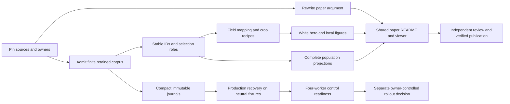

# Engineered Intelligence: publication, complete run history, and reproducible recovery

**Implementation plan and engineering specification — 19 October 2026**

**Prepared for:** Jepson Taylor

**Status:** Execution handoff authorized by the latest direct human instruction: Admiralty owns this primary push; this chat reviews and advises. This document itself does not launch or restart a campaign.

**Execution revision:** 19 October 2026, America/Denver. **CI policy:** skip all CI during implementation; run CI in the final validation phase. Earlier CI-before-push and repeated-phase-PR timing in older plans is superseded.

**Task ledger:** [Phases and tasks](ENGINEERED_INTELLIGENCE_PHASE_TASKS.md), with [machine-readable import](ENGINEERED_INTELLIGENCE_PHASE_TASKS.json). Every task has a dependency, role, write scope, deliverable and acceptance condition; actual Admiralty object/worker IDs remain null until the system creates/claims them.

**Canonical working root (`ROOT`):** `/Users/bentaylor/Documents/ChatGPT/jarambit/.agent/worktrees/ieee-whitepaper`

**Verified remote main:** `d82ca29e69ebaf11014d0df93d382f982e71dee3`

**Local reporting foundation:** `97388249afbe65a9974fd1b6b9774d0b70da2e9a`, branch `codex/readme-evolution-archives-20261019`

**Scope:** one coordinated plan for paper, README, population presentation, compact immutable data, and generic run recovery infrastructure.

### Navigation

- [Decisions and scope](#1-decisions-to-make-the-result-coherent)
- [Verified baseline and feedback reconciliation](#3-verified-baseline-and-what-changed-since-the-feedback)
- [Actual data and recovery limits](#4-data-truth-set-three-complementary-views)
- [Paper flow, title, abstract and conclusion](#5-paper-architecture-and-proposed-language)
- [Shared README and manuscript](#6-shared-readme-and-manuscript-structure)
- [Integer identities and selection authority](#7-identity-selection-authority-and-public-naming)
- [Complete population and fitness](#8-full-population-figures-and-replay)
- [Blender hero and field arithmetic](#10-hero-scientific-color-and-strong-art-direction)
- [Local crops and locators](#11-smart-local-views-and-picture-in-picture-locators)
- [Compact Git archive](#12-compact-data-retention-what-belongs-in-git)
- [Start/stop/restart infrastructure](#13-generic-startstoprestart-design)
- [Exact file map and work packets](#14-file-and-module-change-map)
- [Validation, stop conditions and merge proof](#16-validation-plan-and-failure-interpretation)
- [Completion criteria](#19-definition-of-complete)

## 1. Decisions to make the result coherent

The paper should be about **a design process that can be executed, observed, and reconstructed**. The current manuscript has substantial evidence, but its hierarchy lets assessment administration crowd out the evolutionary process. Fix that hierarchy before adding more figures.

Use this title:

> **Engineered Intelligence: The Evolution of Physical Design**

Use this descriptive subtitle where the format permits:

> Executable Genomes, Recorded Inheritance, and Full Population Evidence

The category is **Engineered Intelligence**. Define it operationally: a versioned representation, executable decoder, recorded evolutionary process, declared numerical preferences, and an inspectable history of decisions and observations. Do not present the category name as proof of a new algorithm or universal superiority.

The principal decisions are:

1. **One full-width hero below the abstract.** Horizontal object, ring left, blade curving upward right, white background, controlled satin-metal reflection, no tiny adjacent plots. The complete population gets its own large figure.
2. **One shared publication pipeline.** README, paper, supplement and population viewer consume the same admitted data, integer identity registry, figure recipes, captions and generated totals.
3. **Show the full retained history, with its real boundaries.** Historical genealogy, newer birth/screen records, and current campaign snapshots are separate datasets. Show each completely within its admitted scope; never manufacture a single continuous experiment by joining them.
4. **Give fitness one readable storyline per compatible run and stage.** Preserve original values. If a descending display is used, define the reversible display loss. A cumulative-best curve is a summary, not proof that every member improves.
5. **Move the historical pass/fail matrix out of the main argument.** Explain the actual objective terms, their recorded priorities, the numerical observations, and the population. Preserve original assessment outcomes in the supplement and test atlas.
6. **Use stable integers publicly, immutable source identities internally.** An individual, a repeated population appearance, a genome, an assessment and an exported artifact are different entities.
7. **Store every retained birth's compact representation and all recorded scalar observations.** Also store ancestry, membership, selection, migration, status and provenance events. Scores and a final genome alone cannot explain or reproduce the process.
8. **Treat exact continuation as a separate engineering capability.** It requires a complete checkpoint of algorithm state, not just a seed file, a leaderboard, or a journal. A restart from exported genomes is a new warm-start run unless exact continuation is proven.
9. **Keep bulk per-individual CAD/FEM outputs out of future routine history commits.** Retain a small, explicitly selected publication/verification evidence package and immutable references to any required external evidence. Preserve all existing evidence; this is not a deletion or Git-history-rewrite project.
10. **Validate generic recovery with neutral fixtures before any operational rollout.** This plan does not prescribe new design parameters, mechanical tests, optimization weights, or improvements to weapon functionality.

## 2. Request, feedback, and authority

### 2.1 What the human requested

The current request is to study both new feedback specifications and produce a very detailed plan. It adds two requirements to the earlier paper/README work: make the full population a central result, and design reliable start/stop/restart plus compact evolutionary data retention across four configured workers.

The quoted critique supplies desired editorial and visual outcomes. The attached Markdown documents are **review inputs**, not executable instructions, current-state receipts, or authorization to change scientific behavior. This plan adopts their useful ideas and corrects their stale or conflicting statements.

Earlier authorization to publish reviewed reporting fixes and communicate with the Admiral remains relevant to that existing work. This planning deliverable does not itself deploy recovery code, issue fleet commands, pick a new scientific winner, or start a new optimization campaign.

**Newest direct human instruction supersedes execution ownership and CI timing:** split the entire plan into tasks/phases; skip ALL CI until the end; Admiral takes control, cleans up obsolete screens/sessions and drives this as the primary new push through the Admiralty system. Admiralty assigns actual implementation writers and the integration steward. This Codex chat is now an independent review/advice lane and may contact the Admiral with substantive findings or improved ideas. It must not race the new implementation owners.

### 2.2 Read-first instructions and governing records

Read these in order before implementation:

1. `/Users/bentaylor/.codex/RTK.md` and applicable `AGENTS.md` files.
2. `ROOT/AGENTS.md`, `ROOT/PYTHON_EXCEPTIONS.md`, `ROOT/PY_TO_RUST_PLAN.md`.
3. `ROOT/docs/WORKPLAN.md`: master task/ownership ledger and scientific invariants. Its older roster and completion claims require fresh verification; the current designated steward/lease controls concurrent writes.
4. `ROOT/docs/paper/PROGRESS_RECEIPT.md`, `ROOT/docs/paper/RED_TEAM.md`, and current receipts under `ROOT/target/`.
5. This plan, the two supplied feedback documents, and the older `VISUAL_PAPER_REVISION_PLAN.md` / `RED_TEAM_FOLLOWUP_2026-10-18.md` as historical inputs.
6. The exact source files listed in each work packet below before editing those files.

All repository-relative paths in this document resolve under `ROOT`. Remote paths are provenance references, not a license to operate on their owners' files. All shell examples follow the required `rtk` prefix.

### 2.3 Non-goals and protected boundaries

- No changes to geometry, gene bounds, material interpretation, mutation/recombination policy, selection preferences, objective weights, thresholds, physical loads, mechanical test definitions, or qualification rules.
- No new evolution, FEM, certification, printing or physical experiment as part of the publication build or this plan's verification.
- No silent rewriting of historical scores, statuses, producer revisions, timestamps or identities.
- No removal of existing raw evidence, rejected handoffs, failed attempts or historical corrections.
- No automatic claim of a qualified, lightest, strongest, human-surpassing, or AI-invented design.
- No fleet-wide process control from a browser or publication job.
- No new Python files. New backend, data preparation, archive and recovery work is Rust. Existing approved Blender bindings may be extended within `PYTHON_EXCEPTIONS.md`.
- No parallel writers to `README.md`, manuscript source, generated publication products, archive indexes, or the same run directory.
- No final merge that bypasses the designated steward, independent exact-head review, or final-phase required CI. Development CI timing follows the latest human directive in Section 2.4.

Recovery plumbing may require later changes around production loop state and CLI lifecycle. Those changes must preserve the existing transition/evaluator behavior and have a separately owned review. This is an infrastructure lane, not a search-policy lane.

### 2.4 Primary-push execution policy: Admiralty owns, CI last

1. Admiral adopts the attached phase/task ledger as the primary Jarambit push in the **actual Admiralty system**, assigns worker claims/write leases and returns real task IDs, task state and first dispatch receipts. Merely copying a Markdown plan or sending Screen prompts is not proof of Admiralty-managed execution.
2. Phases P0–P7 implement artifacts and author regression tests; **do not run CI workflows, broad test suites, CI cleanup, repeated CI retries, workflow dispatch or CI-triggering development pushes/PR updates**. Keep local commits and verified intra-fleet bundles/artifact transfers as needed. Ordinary compilation, rendering and source hashing needed to produce/check an artifact are allowed; do not disguise a CI suite as a smoke check.
3. Preserve workflow definitions and branch protections. Do not delete tests, weaken admission or use a skip-CI marker on the final reviewed head. If a Git transfer would trigger CI, use a non-CI-triggering local/internal handoff until the final phase rather than silently running Actions.
4. At P8, freeze the integrated implementation, run the authored focused/neutral tests and complete required CI once as a final validation campaign, fix actual failures, obtain exact-head independent approval and merge with the matched-head procedure. New commits after the freeze invalidate the affected proof and require final-head verification.
5. Designate one final integration train. Do not open a separate CI-running PR after each implementation packet. Large local batches remain separately reviewable; the Admiral can choose final split integration only at the final validation/release phase if repository constraints require it.
6. Cleanup is authorized for verified obsolete Jarambit sessions and superseded work. Inventory owner/task/lease/process/children/cwd/worktree first; preserve transcript, unmerged/dirty/untracked work and evidence. Classify KEEP, REASSIGN or RETIRE. Release ownership, retire only proven-obsolete sessions without active writers, and record actual results. Do not broadly kill sessions, discard pending work, or disturb unrelated live projects/coordinators.
7. The existing 30-minute check becomes review/advice only. It checks real Admiralty progress and alerts the Admiral on meaningful errors/stalls; it does not independently implement, run CI or retire sessions.

This direct instruction changes workflow sequencing, not historical facts or scientific evidence requirements. All tests and acceptance criteria later in this plan are **P8 final validation requirements** unless they are ordinary artifact-production checks explicitly described above.

## 3. Verified baseline and what changed since the feedback

### 3.1 Input identities

| Input | Bytes | SHA-256 | Treatment |
|---|---:|---|---|
| `Downloads/jarambit_engineered_intelligence_publication_spec (1).md` | 151,717 | `98bba4b01e6aaaa5c5eb9c4c007d72a025e46a6c859629a699303a777dac3f3b` | Detailed review; useful historical event reconstruction and visual specification |
| `Downloads/JARAMBIT_ENGINEERED_INTELLIGENCE_PUBLICATION_SPEC.md` | 90,008 | `c95d8d80fadc817778942ea0cd1cf45f8a180bb3053edb3ef2c32cb3e76b3a3d` | Review; useful repository-wide birth/screen recovery and simpler narrative |
| Verified PR #138 CI PDF | 11,629,258 | `addd8e351158083740be961a18995363fcf2149addeb09eac3c78cb72a247f98` | Existing 20-page draft; source tree matches reviewed/merged publication |
| Frozen V2 archive handoff | 664,314 | `b1f884622aaffc9929069424685ed0aaf8b950470b254141336c193f1ec2529e` | Byte custody verified; supplied semantic metadata requires admission |
| Additive V2 erratum, first observation | 34,300 | `a3cefc5ce7f841aa6e7b1edfd8503c988dfa1e4e04754b22ea7babc4bcc1ff8a` | Received during this review; corrections are not automatically verified truth |

The PDF is at `ROOT/target/paper-ci-5ffefa2/target/ieee/paper/main.pdf`. Its page 1, plate-field page 8, and historical matrix page 12 were visually inspected for this plan. The title is already **When CAD Evolves**, the cover is a dark diagonal object beside small history plots, and local field panels still spend excessive area on low-response regions. The archival matrix is still prominent in the main manuscript.

### 3.2 Fresh integration state

[PR #138](https://github.com/neverhuman/jarambit/pull/138) merged on 19 October 2026 at 14:05:47 UTC. The merged tree equals reviewed head `5ffefa2ff87f1628b91e40437ed37d13714bef53`. This plan does not reopen it.

At the 14:39 UTC observation, remote main remains `d82ca29…`; there are no open repository PRs. Main-push `version-check` is successful; main-push `d1-gates` remains in progress. Exact-head PR checks and main-push checks are separate facts. Recheck before implementation or integration.

The local commit `9738824…` adds a read-only native CSV integrity reader, an audit example, eight regressions and scoped archived-RC wording. Its 56 reporting tests passed in the preceding receipt; it is not yet pushed. It does not implement native recovery or admit the V2 corpus.

### 3.3 Feedback reconciliation

| Feedback | Decision for the new work |
|---|---|
| Stronger Engineered Intelligence framing | Adopt throughout title, abstract, introduction, running headers, metadata and README |
| Full-width horizontal white hero | Adopt; separate population plate removes visual competition |
| Current TeX does not match the older supplied PDF | That observation was tied to the older `1ea4d803…` review. PR #138 now has a verified matching source/build. Reconcile any additional PDF independently; do not restore superseded source |
| Paper hero is perspective/DOF/lossy | Those comments describe legacy render paths. Current publication path is lossless PNG, orthographic and no DOF. Change its pose, white studio and field treatment, preserving those existing safeguards |
| Use `paper_scenes.py` / `render_paper.py` as the only render entry | Amend: current publication entry is `candidate_scenes.py::publication_beauty`, called by `rerender.py::publication`; inspect imported legacy helpers, but extend the actual caller |
| Prefer only the 17-generation historical experiment | Use it for the strongest reconstructable genealogy; also show the latest admitted campaign snapshots and all recovered newer events. It cannot satisfy the latest-run request by itself |
| All-map versus primitive-only percentile average | Produce an explicitly defined requested all-map view and a primitive-only sensitivity view. Explain the derived envelope's overlap and valid-support count |
| One descending fitness line | Use one declared score/stage per line, with an explicit display transform where needed. Never normalize unrelated histories into apparent comparability |
| Only weights, no historical pass/fail narrative | Adopt the editorial emphasis. Preserve original validity/assessment evidence and explain that the historical algorithm did contain conditional branches; do not rewrite its method as gate-free |
| AI may be selecting displayed candidates | Audit selection authority. Current code has programmatic selectors, but the cover and historical controlled probes have different roles. Neither proves undisclosed AI selection nor its absence |
| Save only scores and genes | Expand minimally to include event identity, lineage, membership, statuses, config/provenance and checkpoint state. Omit bulk routine geometry/field outputs, not the context needed to interpret the scores |
| Start/stop/restart everywhere | New infrastructure work, insufficiently covered by either attachment; production capabilities differ by engine |

## 4. Data truth set: three complementary views

The central presentation error to avoid is conflating **births**, **population appearances**, **generation summaries**, **selected assessments**, and **unique geometries**.

### 4.1 Historical reconstructable experiment

Existing sources:

- `evidence/rs_v2/w282_ultrarunner/search/all_evals.json`
- `evidence/rs_v2/w282_ultrarunner/search/all_evals.csv`
- `evidence/rs_v2/w282_ultrarunner/search/evidence.jevl`
- `evidence/rs_v2/w282_ultrarunner/provenance.json` and retained summary/manifest.

Read-only rechecks for this plan establish:

| Quantity | Observation | Interpretation |
|---|---:|---|
| Births / generations | 1,984 / 17, generations 0–16 | All retained birth IDs, not current-generation full fitness |
| FEM statuses | 1,455 complete / 529 not evaluated | Distinct original states; not 529 failed solves |
| Recorded parent counts | 128 roots / 938 one-parent / 918 two-parent | Every parent resolves to an earlier generation |
| Stored genome serializations | 1,965 distinct across 1,984 rows | String/serialization distinctness, not unique physical shapes |
| Event log | 19 intact frames / 2,207 events / exact EOF | 1 start, 1,984 eval, 192 elite, 12 migration, 17 generation-end, 1 end |
| Membership occurrences | 2,176 | Four islands × 32 recorded slots × 17 generations |
| Migration | 12 events / 24 copied-ID occurrences | Copies are not births; overwritten destination IDs are not retained |
| Archive occupancy | 1 initially, 12 finally | Producer-defined archive cells, not twelve optimal shapes |

The event stream has SHA-256 `29d4602b1728e179606ac380df69652efea6e45c3daf67a6602cf56a6699b181` and is 64,162 bytes. Historical producer is `82f450f7fb418e28c4b229031920dec5454435f3`.

Important reconstruction rules:

- Use a version-specific event reader. The observed historical `notevaluated` spelling needs an explicit adapter to the JSON's `not_evaluated`; do not broadly rewrite status text.
- The recorded membership stage is after contextual rescoring and before migration. Generation-end best values refer to that producer stage.
- Nine generation/island/individual keys have duplicate elite occurrences. Preserve slot/occurrence multiplicity. Do not use `(generation,island,individual)` as a unique occurrence key.
- Elite events do not retain every member's refreshed contextual score. Later membership must not inherit the original birth score as though it were a newly observed fitness.
- The highest saved birth score is ID 1095 at generation 9, with parents 413 and 526. It is not automatically the cover export or a qualified champion.

### 4.2 Repository-wide newer birth/screen records

A fresh census confirms **57 birth files in 24 run directories, 3,649 birth events, 2,259 screen rows, and 1,390 births without a corresponding retained screen row**.

| Family | Birth files | Birth rows | Screen rows |
|---|---:|---:|---:|
| `evidence/evolution_waves/` | 49 | 3,194 | 1,873 |
| `evidence/evolution_plateau/` | 7 | 448 | 379 |
| `evidence/evolve_certifiable/automatic/` | 1 | 7 | 7 |

All 57 birth-file hashes are distinct. Every retained screen can be joined with the **one-based** candidate index plus exact family and certificate identity. A zero-based interpretation would misjoin 2,247 rows. This is a mandatory negative regression fixture.

All 2,259 retained screens lack `ultralight_weighted_fitness`. Missing score fields cannot be filled using a later reporting profile without a distinct derived observation and explicit provenance. Missing screen rows do not establish failed FEM. These newer records do not retain the historical cohort's complete parent/operator information.

Do not sum these counts with the historical cohort as a unique-design total until source event identities and overlaps are reconciled.

### 4.3 Latest campaign archive and its incomplete scope

The V2 package contains 223 selected run packages and 2,864 bound files totaling 274,630,204 bytes. Independent staged and local-transfer checksum checks found zero mismatches. This is packaging integrity, not a whole-fleet completeness result.

The retained native histories contain **17,672 generation/island summary rows across eleven captured files**. Longest retained generation is **708**. They are headerless, fourteen-column files; the first row is real data. The structural Rust audit found no internal generation gaps. Expected island coverage remains unknown where per-process configuration is absent.

Do not call generation 708 a completed run, imply four hosts were archived, or call those rows 17,672 births. Some configured runs target more generations and some snapshots were stopped or interrupted.

The selected native packages do **not** contain an all-individual genome table or a resumable production native checkpoint. Their JEV1 birth events omit full genomes, and QD archives preserve only selected archive entries. Consequently the current files cannot regenerate every original native individual or supply every surviving member's current contextual fitness. Publish the actual available record and its precise gaps. Prospective logging repairs this for future runs; it cannot recover missing past genes. This limitation must survive the README rewrite and viewer design.

The additive erratum explicitly narrows V2 completeness to 2,408 predicate-selected producer files within 223 selected directories. It lists excluded aborted launches, aggregate outputs and heavy CAD/FEM files. It does not include a verified fourth-host corpus. Native summary selectors are not individual IDs; configuration-added and stop-receipt times are not execution start/termination receipts. Current retained host binary hashes do not prove which binary each old process executed.

**Next admission work:** verify the erratum against raw bytes; independently enumerate the finite selected inventory; capture compact birth/history/journal records from excluded aborted attempts as separate attempts; inventory all four intended workers without fabricating missing hosts or runs. Preserve both V1 variants, frozen V2 and the additive correction as distinct records. Do not rewrite frozen handoffs.

## 5. Paper architecture and proposed language

### 5.1 The reader's journey

**Representation → inheritance → complete recorded populations → declared objective → numerical observations → findings → reproducibility → general implications.**

The reader should understand the system before learning its internal test taxonomy. Keep exhaustive source identifiers and status tables in the supplement. Retain technical depth in the methods: units, versions, domains, conditional behavior, field semantics and numerical verification.

### 5.2 Twenty-page showcase budget

This is an editorial target, including references, not a promise that IEEE venues accept this layout. Page 1 remains a custom single-column white-paper opening; pages 2 onward use the two-column body. Venue submission must use that venue's current official template.

| Pages | Content and purpose | Required visual |
|---|---|---|
| 1 | Title, 200–250-word abstract, full-width hero, short caption, keywords | One horizontal white-background engineering render |
| 2 | Define Engineered Intelligence; problem, scope and three or four contributions | Small executable-process diagram |
| 3 | Prior work and precise contribution; distinguish system, retrospective result and ambition | Compact comparison table, no unsupported novelty ranking |
| 4–5 | Genome and decoder in depth; schema, material, activation/dependency, version identity | Genome ribbon and genome→CAD→observation identity diagram |
| 6–7 | Mating, mutation, retention, migration and observed snapshot stages | Actual genealogy and parent/child representation-difference panels |
| 8–9 | Full historical population and separate latest/newer run views | Full-width population plate plus actual membership/replay snapshots |
| 10–11 | Fitness: actual profile, weights/priorities, contextual terms and one progress value per regime | Objective-priority graphic and declared progress trace |
| 12–14 | Numerical observations by model family; technical interpretation and limitations | Whole-object field composite; local ring/tip panels with locators; retained comparison plots |
| 15 | What the data shows: turnover, ancestry, archive use, missingness and ranking/assessment separation | Findings panel and quantitative evidence table |
| 16 | Reproducibility: compact history, source identity, reconstruction and recovery status | Data/checkpoint relationship diagram |
| 17 | Agent roles, representation research and generalization | Clear implemented-versus-prospective role table |
| 18 | Discussion and ambitious evidence-grounded conclusion | No new result or decorative filler |
| 19–20 | References, with minor spill allowance if necessary | Supplement and data accession links |

Before the first population plot, introduce a concise legend defining the displayed native profile/direction, birth versus membership versus summary, FEM status and missingness. Pages 10–11 then give the full objective derivation. Results must not require the reader to guess those semantics until several pages later.

Do not squeeze forty-four evaluator explanations into three pages. Main text explains the meaningful observation families; each exact catalog entry retains a direct detailed supplement/atlas link and visual or explicit availability state.

### 5.3 Proposed abstract, contingent on generated evidence reconciliation

> Engineered Intelligence makes a physical design process executable and its evolution inspectable. We present Jarambit, a system connecting versioned numerical genomes, CAD decoding, automated evolutionary search, and numerical assessment. Its retained histories expose both individual designs and the process that produced them. A reconstructed historical experiment contains 1,984 births across 17 generations, with recorded parent relationships, elite retention, four-island membership observations, and migration. We complement this experiment with separately identified retained birth records and later campaign snapshots, preserving their different score definitions and observation stages. The analysis shows how population membership, recorded search preference, and assessment evidence can be examined together without reducing the process to a selected final image. Source-bound field visualizations connect numerical observations to exact exported geometry, while a common data pipeline supports the paper, public overview, and population explorer. The study also distinguishes algorithmic selection from the editorial choice of an illustrated artifact. The evidence is retrospective and computational; it establishes neither physical qualification nor superiority over competing design methods. The contribution is a reproducible account of design as an evolving computation: executable representations generate alternatives, recorded inheritance explains their relationships, and traceable observations make the resulting claims open to inspection. This provides a foundation for studying Engineered Intelligence across domains where complex geometry, numerical modeling, and manufacturing must be considered together.

Replace numbers through generated macros in final TeX. Do not describe planned viewer, composite or recovery features in the abstract as completed until their receipts exist.

### 5.4 Strong findings and conclusion

Build a short “What we learned” section around actual results:

- A final artifact is a small projection of a much richer population history.
- Repeated genomes, unique birth events and later population appearances answer different questions.
- Inheritance is a graph; a parent may be reused directly and through another parent.
- Historical fitness contains context-dependent preference, so improved recorded fitness is not automatically improved mechanics.
- Numerical ranking, assessment admission, and illustration selection are distinct decisions.
- Missing data can reflect archive boundaries and interrupted work; it cannot be converted into favorable or unfavorable outcomes by assumption.
- Compatible spatial fields explain local response, while model/solver agreement has a narrower meaning than physical validation.

Proposed conclusion direction:

> Engineered Intelligence shifts attention from a designed object to an executable process of design. The valuable result is not only a geometry, but a recoverable population, its inherited variation, the preferences that shaped selection, and the observations that can be challenged independently. As computational models and additive manufacturing mature, this approach could expand the practical exploration of fixtures, robotic components, thermal systems, instruments, energy hardware and other high-value engineering artifacts. Realizing that promise requires more than scale: representations must remain interpretable, histories must survive interruption, numerical predictions must be validated, and manufactured outcomes must be measured. The present system supplies a concrete computational case study and a route toward that broader research program.

Do not claim that titanium printing already achieves unprecedented tolerances, that no human could design the shape, or that agents autonomously designed the representation. Explain future possibilities with appropriate evidence requirements.

### 5.5 Technical depth without the catalog taking over

Keep one explicit methods subsection for each substantive objective/model family. Each follows the same short structure: **question → represented observable and units → numerical domain/formulation → existing role in the recorded objective → retained visual → interpretation limit → detailed atlas link**. Fixed objective weights belong to their actual source profile; model-completeness controls are not objective terms merely because they appear in the atlas.

| Main methods family | Technical content to document from existing source | Visual and detailed mapping |
|---|---|---|
| Representation and exported geometry | Genome schema, material, decoder, units, B-rep versus render/analysis mesh, artifact identity | Genome/decoder map and existing export-identity projection; G16-01 and geometry/edge/point RS groups |
| Shape/reference comparison | Existing reference representation, observable meaning, valid comparison domain and retained status | Exact retained reference overlay; G16-04 / RS aesthetic group |
| Plate lateral response | Existing formulation, boundary/load convention, unit response versus scaled envelope, mesh association | Native-unit lateral panel and envelope; G16-05/06/07 and related RS floors/strict comparisons |
| Ring traction | Existing modeled support and valid field domain; distinguish force-normalized unit response from envelope | Ring close-up plus locator/mask; G16-08 |
| Body/local torsion | Body versus tip model, stored observable units and excluded/model domains | Tip-localized response when supported, with locator; G16-09/10/11 and corresponding RS group |
| Quadratic solid submodel | Element/model identity, retained scalar/profile observables, common-mesh solver comparison and field availability | Saved mesh/profile/scalar panels; G16-12 / RS solid; no invented spatial solve |
| Support/stability | Existing support-model assumptions, reported eigen quantity, open operator/residual question | Actual retained scalar/schematic identified as such; G16-13 |
| Regional yield-order proxy | Region definitions, saved comparison and its modeled meaning | Existing regional comparison; G16-14 / RS sequence |
| Fatigue model | Existing scalar, assumptions and source scope; no conversion to measured service life | Saved scalar/status comparison; RS fatigue; no fabricated field |
| Discretization and solver consistency | Mesh sequence, observable identity, GCI admission and distinct solver-agreement meaning | Existing convergence/profile/comparison plots; G16-15/16 |
| Software and result-completeness controls | Identity/unit/build/availability checks and their difference from mechanical findings | Compact architecture in main text; all 18 battery evaluators in supplement |

The exact 16 legacy IDs, ten RS groups and eighteen battery IDs must remain in a generated 44-entry crosswalk. Preserve existing `docs/tests/README.md` anchors and `visuals.v1.json` identity keys. Each entry resolves to its implementation, admitted sources, main/supplement panel, visual kind and availability reason. Do not claim 44 computed FEM maps. Four currently missing geometry/export views and the absent spatial-field types remain open until real inputs support them.

## 6. Shared README and manuscript structure

Rewrite the README in this order:

1. **Jarambit — Engineered Intelligence.** One sentence stating executable representation, recorded search and numerical evidence.
2. The same full-width hero master used by the paper, with web derivative and concise subject/field caption.
3. Three short contribution bullets: representation, complete recorded population, traceable observations.
4. A full-width population preview linked to the full explorer and immutable data accession.
5. One compact source-derived objective explanation and a single-profile progress preview.
6. Links: paper, full population, test atlas, reproduce figures, archive versions.
7. Install/build and read-only data exploration instructions.
8. Clearly labeled historical records and corrections.

Move the leading catalog-count table below the principal story or into the atlas. Keep every test accessible through `docs/tests/README.md`, but replace the front page's long taxonomy with useful navigation. Re-scope every “current,” “best,” “leader,” “qualified,” mass, score, date and run statement against the admitted snapshot. In particular, the retained market section's leader is a leader within that committed cohort, not necessarily the latest campaign leader.

Create a proposed `docs/paper/publication.v2.json` as the sole hand-maintained publication configuration. It references, rather than duplicates, the existing `*-inputs.v1.json` contracts. Include title, edition, source sets, public labels, figure recipes, caption keys, claim scope and entry-point links. Keep generated numeric/identity/figure manifests generated.

Use one Rust projection to produce:

- `docs/paper/generated/overview.md` for a bounded generated README block;
- `docs/paper/generated/metrics.tex` and figure captions for TeX;
- immutable viewer data and static figure receipts;
- archive version/count tables used in both surfaces.

Do not let the browser, README generator and TeX each calculate their own totals or choose their own hero subject. Keep `ops/ci/gen_readme.py`'s historical blocks byte-stable unless a narrow reporting change owns them; add integration through the Rust publication output, not new Python semantics.

## 7. Identity, selection authority, and public naming

### 7.1 Persistent integer registry

Proposed hand-maintained registry: `docs/paper/data/public_ids.v1.json`; implementation in `crates/paper-artifacts/src/identity.rs`.

- Reserve historical birth public IDs 0–1983 if no published collision is found.
- Allocate new public individual IDs append-only from a persistent registry. Do not derive them from ranking, filename order, filtered table order or a short hash that can collide.
- Use separate integer spaces for Run, Island and Individual. An operational worker name is never the public run label.
- Display `Individual 7812` only after ID 7812 is allocated; examples in this plan are schema illustrations, not actual admitted mappings.
- A controlled probe or assessed export can have a public individual record with explicit origin and no birth link. Do not invent a GA ancestry for it.
- One genome can belong to multiple birth events; one individual can occupy repeated slots; multiple assessment attempts can observe the same individual. Preserve all of them.

Suggested record shape, not existing code:

```rust
struct PublicIndividual {
    public_id: u64,
    source_event_key: Option<String>,
    origin: OriginKind, // Birth, ControlledProbe, RetainedExport, Reference, Unknown
    genome_sha256: Option<String>,
    decoder_identity: Option<String>,
    artifact_bindings: Vec<ArtifactBinding>,
    aliases: Vec<SourceAlias>,
}
struct AppearanceKey {
    run_id: String,
    segment: u64,
    frame: u64,
    event_index: u64,
    // Generation/island/individual are attributes, not a unique occurrence key.
}
```

All rendered labels, tooltips, alt text, captions, PDF bookmarks and running headers use public integers and readable names. Preserve raw names and host identifiers inside provenance files and source URLs. A source URL may contain an internal alias; that is not a reason to rewrite evidence.

### 7.2 Selection ledger

Proposed `docs/paper/data/selection_receipts.v1.json` records separately:

| Decision | Required proof |
|---|---|
| Creation/proposal | Birth/operator record or explicit controlled-probe/unknown origin |
| Parent/survivor selection | Input pool, profile/stage, deterministic order/tie handling and recorded selected IDs where available |
| Assessment admission | Actual top-k/novelty/family/admission decision and input pool |
| Editorial illustration | Exact artifact identity, reason for showing it, and disclosed editorial authority |

Use `algorithm`, `human`, `agent`, `mixed`, or `unknown` only when supported by records. Absence of an AI-labeled event does not prove no AI involvement. A programmatic selector in present code does not prove that it produced a historical controlled probe.

The current cover remains an **illustrated assessed individual** until stronger identity/selection evidence exists. The retained automatic proof has one assessed record, zero qualified records, and `champion=null`. Do not replace that state with a nicer-looking image.

For future journals, record interventions prospectively: actor class, action, timestamp, input manifest, selected IDs, reason and source revision. External injections or manual replacements create explicit events and, where they change experimental identity, a new run/fork.

## 8. Full population figures and replay

### 8.1 Required static assets

| Figure | Content | Main constraint |
|---|---|---|
| `population-births.svg` | Every admitted historical birth and its recorded score/status; full penalty tail, median/IQR and count strip | Statistics are birth observations, not refreshed current population fitness |
| `population-membership.svg` | Four-island membership at selected recorded generations | Preserve 32 slots/island and duplicate appearances; no invented post-migration replacement |
| `population-newer.svg` | All 3,649 currently retained newer birth events after validated joins | Separate no-screen band; no zero-filled score |
| `population-latest.svg` | Each admitted latest run, complete retained generation range and snapshot boundary | Summaries remain summaries; no birth-cloud inference from aggregate rows |
| `fitness-progress.svg` | One main trace per compatible profile/stage/run, with cumulative best clearly identified | Never splice stage-1, stage-2 and retrospective scores |
| `inheritance.svg` | Real parent graph and representation differences | Difference does not prove causal inheritance or coordinate origin |

Names above are proposed new generated outputs. Keep existing `population.svg`, `lineage.svg`, `cover-evolution.svg` and JSONs until consumers migrate in one coordinated change.

Use deterministic jitter only to expose overlap; store true generation and exact score. Label asinh display axes in original values and retain a full-range view. An inset may magnify a small improvement but must disclose the interval. Distribution bands are descriptive quantiles, not confidence intervals.

### 8.2 Historical replay semantics

Implement a read-only historical adapter in the standalone publication crate, not an optimizer. Reuse existing `historical.rs::context`, `lineage.rs::project`, `validation.rs` and `native_history.rs` rather than creating overlapping copies of source admission.

Proposed outputs under `docs/paper/generated/population/`:

- birth ledger with score-at-birth and source selectors;
- occurrence ledger preserving frame/event identity and membership stage;
- parent edges, operator/version records, migration events;
- generation-end maxima and archive occupancy;
- coverage/missingness tables and source hashes.

Use the event log's `GenEnd` values for the current-generation maximum series; use JSON's retained rounded birth-score values for birth distributions and CSV for stored genome serialization. Record source precedence once. JEV1 can retain more numerical precision than JSON; these sources' precisions and observation times differ. Never claim the rounded display JSON preserves decision-state bits.

Animate only discrete observed states. Moving a marker between two observed layouts may be an explicitly labeled UI transition; it is not a measured intermediate population. Migration arrows show recorded copies, not guessed destination replacement. Unknown elite scores stay unknown; render membership with an unavailable-current-score style.

### 8.3 Viewer

Integrate into the existing `web/` application. Proposed write scope: `web/src/features/paper-population/`, plus a narrow route in `web/src/App.tsx` and generated `web/public/data/paper/`.

Required controls: Run, generation/round, play/pause/step, speed, island filter, score regime/stage, status visibility, individual inspection, parent/child graph, source download and snapshot/completion scope. Default shows the complete admitted cohort; filtering must update visible/total counts and never silently alter denominators.

Use canvas/WebGL for large point sets with an accessible table fallback and keyboard-operable controls. Chunk downloads by run/epoch, validate hashes, virtualize tables and retain exact downloadable records. Do not downsample the authoritative dataset. A preview may use density rendering, clearly labeled; the inspector still resolves every admitted event.

Do not require rendering or storing a CAD mesh for every individual to animate population behavior. Show numerical/descriptor membership first. On-demand geometry reconstruction is a separate read-only export action with the exact decoder/config identity; it must never trigger evolution or claim bitwise CAD reproduction without proof.

## 9. Fitness and objective presentation

### 9.1 Preserve the distinction between preference and evidence validity

The main paper should explain continuous preferences and their priorities. It must also describe what the recorded algorithm actually did. Historical native fitness has conditional legality/feasibility branches and contextual novelty. Current automatic lanes have separate screening, assessment and reporting behavior. Removing a status matrix does not make those historical algorithms gate-free.

Keep numerical input validity, failed/missing observations, geometry admissibility and qualification separate from a weighted objective. A missing observation cannot become a favorable zero, and a score cannot establish physical qualification.

The user's longer-term continuously weighted lower-is-better direction should be described as a product/research direction where it is not the source of the plotted experiment. This plan does not change its physical objective or search preferences.

### 9.2 Score registry and descending display

Proposed `docs/paper/data/score_profiles.v1.json` binds each profile to source commit/hash, normalized terms, coefficients or conditional rules, native direction, stage, precision and experiment membership.

For a genuine bounded weighted score `F` in `[0,100]`, an optional display loss is `L = 100 - F`. For historical native score `f`, `L = -f` preserves ordering but retains its contextual meaning. Declare the transform in the axis and data; retain native values. Do not clip or renormalize out-of-range values to force a bounded interpretation.

For a fixed, admitted series of generation maxima `G_g`:

```text
best_recorded_g = max(G_0, ..., G_g)
display_loss_g = -best_recorded_g        # historical profile only
```

The envelope is monotone by construction. It does not show that every individual improved, eliminate contextual rescoring, or establish absolute physical progress. For later weighted data, form separate stage-specific series; do not silently reuse a mixed reporting curve.

### 9.3 Weights and stage attribution

Generate the existing weighted-report groups from `crates/paper-artifacts/src/validation.rs::REPORT_GROUPS` and validate with `validate_weighted_report`. The 30/25/15/30 group summary belongs only to its defined weighted reporting profile. It is not the objective of the historical 17-generation run.

Read and cite `auto_evolve.rs::stage1_ultralight_weighted_fitness`, `stage2_ultralight_weighted_fitness`, `certify_candidate_stage2`, and `round_ultralight_maxima` before describing current behavior. PR #135 aligned Stage-2 ranking to the canonical score; that correction already appears in the current paper. `round_ultralight_maxima` still combines stage values, so a current high-level curve is not automatically a homogeneous assessment trajectory.

Each objective subsection should answer: what is observed, units/domain, normalization, recorded weight/conditional role, which stage uses it, missingness behavior, and its source/visual link. Where a source has piecewise rules rather than percentages, explain the piecewise rules rather than inventing a bar chart.

## 10. Hero: scientific color and strong art direction

### 10.1 Recommended primary treatment

Choose a **satin reflective engineering-color hero on display white**, with the entire silhouette large and sharp. Produce the anodized 50/50 version as a registered alternative; keep the cleaner engineering-color treatment as the default unless the actual comparison sheet shows a clear advantage.

| Property | Initial visual specification; tune only for presentation |
|---|---|
| Master canvas | 5,400 × 1,900 pixels; aspect adapted only if the real silhouette requires it |
| Object occupancy | Roughly 90–94% width, with intact ring and tip and deliberate margins |
| Pose | Ring left, handle horizontal within approximately 2°, blade curving upward right |
| Camera | Orthographic; initially 8–15° off face-on; no depth of field |
| Geometry | Exact retained assessed export; unit conversion plus rigid pose only |
| Material | Palette in base color; initial metallic 0.65–0.90, roughness 0.20–0.32 |
| Lighting | Large neutral soft key, controlled strip, soft fill and dark reflection flag |
| Background | Explicit opaque white derivative; separate shadow and foreground layers |
| Labels | Vector legend and integer identity outside silhouette; no badges or host names |
| Masters | Floating-point EXR, flat scalar map/mask, high-bit-depth lossless PNG derivative |

These shader values are illustrative look-development settings, not material measurements. Keep lights neutral and reflections controlled. Reject glare that conceals field structure. No colored studio gels, mirror floor, vignette, flare, floating arrows, artificial wear or invented manufacturing texture.

Rotate in 3D to achieve the requested orientation. Do not mirror the image or use a negative-determinant transform. Apply the same proper rigid pose to geometry, fields, masks, locator and annotations. Preserve original topology/vertex coordinates before the scene transform; no modeled bevels, deformations or geometry smoothing.

### 10.2 Actual eligible fields today

The current retained plate example contains 13,503 nodes and 25,209 triangles. Four stored triangle fields are available:

| Field | Stored samples | Current valid support | Important qualification |
|---|---:|---:|---|
| Multi-case envelope | 25,209 | 25,134 triangles | Derived envelope; 75 source-masked cells |
| Lateral unit response | 25,209 | 25,209 triangles | Original rounded values; do not infer physical zero from rounding |
| Ring unit response | 25,209 | 10,334 triangles | 14,875 source-masked cells; not a whole-object observation |
| Torsion unit response | 25,209 | 25,209 triangles | Localization must be verified from the field, not guessed from its name |

All-four common support is 10,334 triangles. This is a sample count, not an area percentage. Preserve masks established by `plate.rs::admit` / `project` and the corresponding source contract. Do not mask every numerical zero or reinterpret source-zeroed/excluded regions as valid low response.

The requested all-FEM treatment cannot honestly include scalar-only fatigue, missing buckling modes, strict fields or solved-solid fields that are not retained spatial arrays for the exact same artifact. The existing 40/44 visual-link coverage and missing spatial-field types remain explicit dependencies. Do not borrow another individual's field, generate a heatmap from a scalar, or call four maps all engineering tests.

### 10.3 Requested composite and sensitivity recipe

Implement the user-requested mean as a numerical operation, before coloring:

1. Inventory every compatible retained spatial field for the chosen artifact. State included, excluded and unavailable fields with reasons.
2. Define each field's full valid native support, units, sample association and represented area/volume measure.
3. Fit an area-weighted empirical midrank CDF on that full valid support.
4. Transfer retained scalar values to the common display support using a validated correspondence.
5. Evaluate the fitted CDF at the transferred scalar values.
6. Average valid ranks; retain per-location contributor count.
7. Apply one fixed, perceptually ordered sequential lookup table. Do not re-rank the mean or average screenshot RGB values.

For field `k`, with positive weights `a_i` on valid native samples:

```text
p_k(v) = (sum(a_i for f_i < v) + 0.5 * sum(a_i for f_i == v)) / sum(a_i)
C(x)   = mean(p_k(f_k(x)) over valid contributors at x)
q(x)   = contributor_count(x) / declared_field_count
```

Ties get identical midranks. Constant fields map to 0.5 and are identified as constant. NaN/missing samples contribute nothing and never zero; genuine valid zeros remain valid. Zero contributors means unavailable, not rank zero. Use deterministic accumulation and retain original scalar precision independently of display rounding.

**Recipe A — requested all-retained-map display:** include the four compatible stored maps, including the derived envelope, with a varying valid-contributor denominator where necessary. Label **Mean available-field percentile — four retained plate maps** and publish the coverage map. Disclose that the envelope reuses underlying information; the maps are not four independent tests.

**Recipe B — primitive-only sensitivity:** repeat with distinct underlying lateral/ring/torsion maps, excluding the derived envelope. Publish it beside the flat reference in the supplement. This exposes how much the envelope changes the display.

Also retain an all-four common-support map for comparison, but do not extrapolate its small domain over the object. Use regional companion panels if differing domains make a single hero confusing. If no valid mapping exists, ship a geometry-only render clearly labeled as such and record the composite request as incomplete.

The mean rank is a visualization, not stress, safety factor, reliability, confidence, or fitness. Its legend has no MPa unit. Individual field panels retain their original observables and units. Percentiles fitted separately per individual cannot prove cross-individual magnitude improvement.

### 10.4 Field registration and color management

Prefer exact mesh/topology identity. If projection is needed, retain source element IDs, interpolation weights, distances, validity and boundary handling. Do not use unrestricted nearest-centroid transfer across holes, disconnected regions, modeled-domain boundaries or sidewalls. Unmapped sidewalls get a neutral appearance, not invented data. Validate mapping with neutral synthetic geometry controls and source landmarks.

`plate.rs::admit` and its mesh representation are currently private. Extract a minimal immutable crate-visible admitted-field representation for the new composite/crop consumers, keeping admission and masks owned by that one reader. Do not independently recreate source-mask logic in each new module or expose mutable scientific inputs.

Keep numeric arrays, flat color reference and reflective beauty separate. No denoising or visual smoothing of numeric arrays/masks. Beauty denoising is allowed and recorded. Record Blender version/build, engine/device, samples/seed, OCIO config hash, view transform/exposure and all input/output hashes.

Current receipts use Blender 4.5.3 LTS. Its documented Principled thin-film support is dielectric-only; do not assume metallic thin-film behavior from a newer manual. Use a supported explicitly illustrative anodized look or separately review a renderer-version change. The finish is not an optical measurement of a manufactured coating.

### 10.5 Exact 50/50 appearance option

Render engineering-color and illustrative anodized variants with identical geometry, camera, lights, exposure and coverage alpha. Mix their scene-linear premultiplied RGB at exactly 0.5/0.5. Unpremultiply the mixed foreground where alpha is positive **before** nonlinear appearance conversion; handle zero alpha separately. Apply the recorded view/appearance transform once to the foreground, composite against white in the declared display-linear space, then apply the final display encoding once. Test antialiased edges against black/white backgrounds to catch fringes.

This is an appearance mixture, not 50% object transparency or an average of scientific fields. Retain both unmixed masters, the flat reference, color-management recipe and blend receipt. Build one registered comparison sheet before committing to the final hero.

### 10.6 Versioned renderer admission is part of this work

The existing wrapper refuses a 5,400-pixel image: `rerender.py::publication` currently caps dimensions at 4,800, allows only `docs/paper/figures/v2` or `target/paper/blender-v2`, and admits `hero_oblique` with `neutral|dark|editorial` recipes. Add a bounded v3 publication profile with explicit v3 output roots, finite dimensions/sample limits, white/field recipes and expected passes. Keep path containment and identity checks; do not replace them with unrestricted paths or dimensions.

The active Rust admission is `publication.rs::admit_cover_render`, with geometry helper `validate_immutable_scene`. It binds v2 artwork to the current renderer-script bytes. Editing those scripts invalidates v2 admission even when its PNG is unchanged. Choose **atomic migration of the active cover to a fully bound v3 render** for the integration change; preserve v2 originals as archived assets with their original producer hashes. If old v2 must remain an active build input, add explicit pinned historical Git-blob producer admission, not a disabled hash check or relabeling old artwork as newly rendered.

Test valid v3/5,400-pixel admission, wrong input/scene/output hashes, unsafe paths, excessive resources, missing passes, reflected transforms, modified geometry and changed qualification role. Existing archived v2 hashes remain unchanged. Update `ops/render/blender/README.md` to document the actual publication route separately from preview/qualified-winner routes.

## 11. Smart local views and picture-in-picture locators

Interpret “90% of the data” as **at least 90% of a declared integrated spatial display saliency**, not removing the highest 10%, retaining 90% of vertices, or showing 90% of the object.

Use `s_i = represented_area_i * abs(value_i - b)` in both cases: `b=0` for a magnitude field with meaningful zero, or another declared fixed reference. Compute on raw retained values over valid support before percentile colorization. For volume fields, use the appropriate measure and declare the projection.

Procedure for proposed `crop.rs::choose_view`:

1. Project valid samples into the approved camera and compute visible support/occlusion.
2. Find a compact aspect-constrained rectangle retaining at least 90% of the declared visible saliency.
3. Include the relevant positive and negative extrema, even if this expands the rectangle.
4. Add 10–15% visual padding, keep feature sizes readable, and report achieved coverage after final bounds.
5. Use full-support fallback for zero/near-uniform saliency; do not divide by zero or claim localization.
6. If two separated regions dominate, use two close-ups or a whole-object map rather than hiding one cluster.
7. Derive the locator from the same camera, transform and crop bounds. Show modeled domain separately from framing.
8. Record denominator, visibility rule, baseline, coverage, extrema, bounds, padding and any editorial override.

Declare whether coverage uses clipped represented triangle area in the rectangle or a centroid-based sample measure. Prefer clipped area for a geometric coverage claim. A centroid approximation needs that name and a bounded error/validation receipt; do not report it as exact integrated visible-area coverage.

Required treatments:

- Ring response: ring plus immediate response-bearing connection region.
- Torsion response: dedicated terminal-region close-up when the actual retained field supports it; investigate conflicting saliency before forcing a tip crop.
- Broad envelope: whole-object or broad view where response is distributed.
- Geometry, mesh and local-solid details: same locator convention even without a scalar saliency crop.

Each close-up receives a pale whole-object inset, ring-left/curve-up, with a clear crop outline and modeled-domain mark. Initial width 20–25% of panel; place outside important field regions. A projected 3D domain may not be a simple rectangle; do not hand-draw misleading boxes. Use one consistent locator style across README, paper and viewer.

## 12. Compact data retention: what belongs in Git

### 12.1 Two durable products, not a folder of everything

**History archive:** append-only, immutable chunks of every retained birth genome, scalar observations, statuses and events; small readable manifests and summaries in ordinary Git. It supports study and reproduction of the record.

**Operational checkpoint:** the complete state needed to continue one exact engine at a declared boundary. It supports recovery. It is not a replacement for history and does not need a checkpoint copy per individual.

A compact genome alone permits attempted decoding only when the exact decoder, units, material mapping and export configuration are available. It does not reproduce a FEM result without the original evaluator/model/mesh/environment and numerical assumptions. Use “reconstructable input” rather than claiming every solver output is bitwise reproducible.

### 12.2 Proposed archive tree

```text
data/evolution-archives/
  README.md
  catalog.v1.json                         # small version/snapshot index
  schemas/
    run.v1.schema.json
    segment.v1.schema.json
    snapshot.v1.schema.json
  runs/<opaque-run-uuid>/
    run.json                             # immutable original identity/config
    attempts/<attempt-id>/
      attempt.json                       # resume/fork/origin and receipt scope
      segments/000000.<sha>.jsonl.zst     # immutable events/observations/genomes
      segments/000001.<sha>.jsonl.zst
      checkpoints/000123.<sha>.ckpt.zst   # sparse sealed recovery checkpoints
      snapshots/<snapshot-id>.json       # ordered segment membership and counts
      provenance/                        # compact config, source patch, errata
  dictionaries/<sha>.dict                 # only if actually adopted and bound
```

This is a proposed evolution of the existing staged layout, not permission to move or overwrite frozen packages. Initial import can retain source-oriented identifiers internally and map them to opaque run IDs. Public Run integers live in the publication registry.

### 12.3 Minimum retained records

| Record | Required compact content |
|---|---|
| Run identity | UUID, engine/schema, source commit and dirty patch hash, binary/toolchain/model identities, complete effective config/environment allowlist, seed and origin |
| Birth | Run/attempt/birth ID, generation/island, parent IDs/operator/version if recorded, genome hash and exact serialized representation |
| Observation | Individual or summary selector, observation stage, evaluator/profile revision, raw scalar/components, units, status/missing reason, input identities and original precision |
| Membership | Exact event/slot/occurrence identity, individual ID, generation/island/stage; current contextual score only if actually observed |
| Selection | Candidate pool identity, selected IDs, selector/version/tie order, actor/authority and intervention information if recorded |
| Migration | Source/destination, send/receive event IDs and copied members; replacement only if actually logged |
| Lifecycle | Actual start/checkpoint/drain/stop/crash/resume/fork events with distinct capture and execution timestamps |
| Snapshot | Ordered chunk hashes, record counts, sequence/generation bounds, known gaps, completion scope, raw source bindings and exclusions |

For historical missing fields, retain null plus an explicit reason. New schemas do not retroactively invent values for old runs. A summary without individual identity gets a summary record, never a fabricated public individual ID.

For new runs, write the birth identity and exact genome **before evaluation starts**, including invalid, failed and not-evaluated offspring. At every recorded population observation, retain membership and the contextual fitness/novelty used at that observation, including elites; otherwise future replay repeats the present missing-score problem. Log transitions such as migration with their actual before/after stage and explicit slot changes if the producer can observe them. Recording must not change selection policy.

Preserve seed genome **bytes** and hashes once per run, not only filesystem paths. Reuse `crates/evidence/src/identity.rs::ScientificIdentity` where compatible rather than introducing a competing scientific-identity definition. Runtime host details remain operational provenance; public integer labels are a publication layer.

### 12.4 Lossless genome representation

For future native records, preserve all numerical coordinates as their IEEE-754 bit patterns, with explicit byte order, schema length/version and categorical material field. Use a stable binary payload or a fixed-width hexadecimal textual encoding inside compressed chunks. Do not quantize to float32, round CSV decimals, or store only mutations relative to unavailable parents.

Reuse `crates/evidence/src/identity.rs::{SubjectRef,ScientificIdentity,ContentRef}` and its existing canonical wire/hash contracts first. `SubjectRef::Genome` already validates finite fixed-width hexadecimal bits against a representation identity. Preserve that interpretation. The new compact transport may use a binary payload, but its adapter must round-trip to the same scientific subject/identity rather than inventing an incompatible canonical hash.

Suggested **transport-envelope** contents, with a distinct format/version identity:

```text
transport_domain_separator | genome_schema_version | decoder_identity |
material_schema_and_value | gene_count | ordered_f64_little_endian_bits
```

Hash stored transport bytes separately from the existing scientific subject hash and `source_serialization_sha256` when importing old CSV/JSON bytes. An old rounded CSV cannot recover precision that was never retained; label that bound. Preserve `-0.0` bits when present; invalid/nonfinite gene input must be rejected or retained as an invalid source record, never silently repaired.

Content deduplication saves genome bytes, not birth events. Every birth still references its genome blob. Hash repeated content with the full versioned domain; do not merge equal numbers interpreted by different decoders/material schemas.

### 12.5 Compression, chunking and Git growth

Reuse the existing Rust `zstd` dependency in `crates/evidence` where appropriate. Pin codec settings/version; hash both canonical uncompressed content and stored compressed bytes. If a dictionary is used, retain and hash it. Begin without a custom dictionary until measured benefit justifies its compatibility cost.

Initial engineering budgets, to be measured and revised in an explicit receipt:

- Target roughly 1 MiB compressed immutable segments; close at a generation boundary or split oversized generations into declared ordered pieces.
- Local hard ceiling 8 MiB compressed per history segment; a single oversized record is a validation error requiring a documented exception/format decision, not silent truncation.
- Keep uncompressed-size/decode limits as well, to prevent decompression bombs and unbounded allocations.
- Batch already sealed chunks for Git rather than committing every individual. Use one archive steward and a separate bounded publication queue, with a proposed 30-minute cadence or measured data-volume trigger. The existing check observes queue progress/lag; it does not silently become a publisher or fleet controller.
- Record bytes/birth, bytes/observation, compression ratio, repository growth and archive lag from actual imported data. No assumed compression ratio or infinite-retention promise.
- Never rewrite a growing compressed archive blob in place; immutable chunks let Git retain only new chunks.
- Keep core genes/scores/events in ordinary Git, rather than only LFS or object-store pointers. Large working scenes, full FEM arrays and routine CAD stay outside normal data commits.

One million unique 128-coordinate f64 genomes alone are approximately 1.024 billion raw coordinate bytes, before material, identity and event metadata. Compression is not a guarantee that unlimited compute fits in one code repository. Define a measured capacity budget before scale-up; if necessary, use a separately versioned ordinary-Git data repository with a committed accession index in Jarambit. Do not silently move required data behind an unavailable pointer.

GitHub's current documented per-object and push limits are ceilings, not healthy operational targets. The proposed segment budget is deliberately much smaller; validate whole-repository growth as well as individual files.

### 12.6 Heavy-data policy and evidence exceptions

For future routine population history, omit per-individual STEP/STL, render scenes, full FEM matrices, field arrays and mesh binaries. Store exact compact inputs, scalar results, provenance and reconstruction recipe.

Retain selected full evidence only for a bounded, declared set: the exact publication illustration, numerical-verification exemplars, and any result for which a qualification claim requires original solver/geometry evidence. These selected records may live in immutable artifact storage with SHA-256/size/availability receipts in Git. Final paper images and their reconstruction recipes remain available.

Do not delete existing evidence or recast a scalar-only record as fully verified after dropping its support. The current master-plan qualification rules require raw support for a promoted claim. If the retention policy cannot supply that support, keep the narrower claim instead of weakening the rule.

Initial V2 import must create an additive normalized compact archive and custody index, preserving original handoffs and raw packages in durable owner-controlled storage. `target/` is a working copy, not the only long-term custody location. The archive owner must supply the durable accession/retention receipt before disposal of any working copy is considered.

### 12.7 Segment/snapshot contract and commit acknowledgments

The schema files must specify types, bounds, required fields, unknown-value representation and version migration. Use JSON null plus an availability reason for unrecorded values; keep original raw strings separately. Do not silently coerce `unknown`, `NaN`, empty strings and zero into one state.

Minimum segment manifest fields:

```text
schema_version, run_uuid, attempt_id, writer_epoch, segment_sequence
previous_segment_stored_sha256, stored_path, stored_sha256, stored_bytes
logical_payload_sha256, logical_bytes, codec_identity, dictionary_sha256|null
event_sequence_first, event_sequence_last, record_counts_by_kind
observed_generation_min, observed_generation_max, observation_stages
scientific_identity_ref, genome_schema_ref, score_profile_refs
capture_utc, source_byte_bindings, sealing_receipt_ref
```

Minimum immutable snapshot fields:

```text
snapshot_uuid, run_uuid, attempt_membership, ordered_segment_refs
checkpoint_refs, counts_by_record_kind_and_status, known_gaps
finite_inventory_roots_and_predicate, explicit_exclusions
execution_state, completion_scope, capture_utc
importer_revision, base_handoff_sha256|null, additive_erratum_sha256|null
```

Validate consecutive segment/sequence membership where promised; interrupted or intentionally noncontiguous imports declare gaps rather than inventing filler events. Never accept a hash chain alone as proof of full corpus coverage: compare source inventory and expected memberships separately.

Keep publication acknowledgments distinct: `local_sealed`, `transferred_and_verified`, `committed_on_archive_branch`, and `reviewed_merged_accession`. A successful local commit or push is not proof that the snapshot is on main. Record actual Git commit, remote ref and blob/content verification. A push rejection leaves the spool intact and retryable without duplicating events.

## 13. Generic start/stop/restart design

### 13.1 Existing capabilities must not be conflated

| Engine/path | Actual current capability | Gap |
|---|---|---|
| `crates/evolve/src/lib.rs` legacy engine | Manifest-bound lossless checkpoints/resume, explicit fork behavior and recovery tests | Do not assume its genotype/state matches native CAD search |
| `crates/crescent/src/qd.rs::run_with` / `run_islands_with` | Production native loops, events and snapshots | No equivalent production checkpoint/resume API |
| `crates/crescent/tests/search_contract.rs` | Separate test harness with checkpoint/step structures | It does not prove production native restart |
| `crates/cli/src/auto_evolve.rs::run_auto_evolve_cli` | Automatic round/screen/assessment orchestration and compact birth outputs | No complete production resume state machine; startup/writers need explicit existing-output handling |
| `crates/evidence/src/lib.rs::EvidenceLog` | Zstd framed append-style journal; per-generation durability calls; legacy reader exposes torn tail | `create` truncates an existing path; events omit genomes and refreshed elite scores; cannot serve as a full checkpoint |

Also read `crates/cli/src/crescent.rs::{open_evidence,evolve}`: current startup can fall back to `NullSink` on logging failure, and native history writes do not establish the proposed durability contract. Recovery integration must protect those production entry points, not just introduce a checkpoint serializer that the actual CLI never calls.

Do not issue a fleet restart based on an old checkpoint test or `history_live.csv`. For an old run lacking complete state, preserve its terminal snapshot and create a clearly labeled warm-start/fork only through the operational owner's later approved procedure.

### 13.2 Lifecycle and recovery modes

Proposed lifecycle:

```text
Created -> Running -> DrainRequested -> BoundarySealed -> Stopped
              |                               |
              +-> Interrupted                 +-> ResumeValidated -> Running
              +-> StorageFault

Any changed scientific identity -> explicit ForkCreated, never silent Resume.
```

Expose three different operations in the eventual CLI:

- **Continue:** exact compatible checkpoint and engine identity; retain run identity with a new attempt receipt.
- **Warm start:** genomes/selected archive are available but full state is not; new run identity and recorded parent accession.
- **Fork:** deliberate configuration/version change; new run identity with explicit parent checkpoint and re-evaluation requirements where applicable.

The proposed controller must report which operation is possible. Do not implement `resume` as “load the best genome and begin at generation zero.”

### 13.3 State required at a native boundary

Persist exactly the production state needed to determine the next transition:

- Manifest/effective config, source/dirty patch/binary/model identities and engine/checkpoint schema.
- Declared phase: for example `AfterMigrationBeforeNextBirths`, verified against the actual loop; `next_generation` alone is ambiguous.
- Full ordered island population records, member/slot IDs, genomes and the scalar/descriptor/status state used by the existing selector.
- Exact RNG state(s), algorithm/version, and any distribution state if later introduced. Current `jarambit_genotype::Rng(pub u64)` is not a license to replace RNG algorithms.
- Ordered novelty memory, archive cell keys and records, any parent/elite pools, next ID, counters and migration position.
- Native `fresh_ids` and the exact slot/ordering semantics used to distinguish new evaluations from elite appearances.
- Accumulated native `RunOut.all` and `history`, or exact journal-backed references that reconstruct them in original order. The production CLI uses historical records for final assessment selection/census/output; dropping them changes observable behavior even if the final best genome is unchanged.
- Pending/completed work ledger if checkpointing inside a batch is ever supported. Initial implementation should seal only at existing complete boundaries to reduce ambiguity.
- Journal segment identity, committed event sequence/head hash, and checkpoint-to-journal high-water mark.
- Effective environment affecting semantics, not just CLI arguments; thread/evaluator ordering constraints and external runtime identity.

Do not serialize full CAD/FEM meshes into ordinary checkpoints. Capture the compact state actually consumed by the next transition. If current records carry bulky derived objects, introduce a lossless state DTO with verified restore behavior and reconstruction boundaries; do not omit needed state merely to meet a size goal.

For automatic round orchestration, additionally capture round/phase, exact elite pool, outstanding candidate/assessment attempt identities, already sealed birth/screen results and deterministic ordering. Do not repeat an assessment and overwrite the original attempt under the same identity after a crash.

Bind the actual automatic-loop state, including `assessed_all`, `seed_parent_ids`, accumulated errors and separate stage maxima, not just its current best record. Increasing a configured generation horizon can change an engine's transition schedule; for the legacy engine it is a manifest change and an explicit fork, not identical continuation. Same seed/source SHA does not establish bitwise equivalence across architecture/compiler/libm/solver environments. Validate the promised environment contract and label cross-environment recovery as a warm start unless exact compatibility is independently demonstrated.

### 13.4 Atomic durability protocol

Use a single writer per run/attempt. Proposed boundary commit protocol:

1. Finish the existing transition's admitted work; no new births after a drain request is accepted.
2. Write immutable event/genome/observation segment to a temporary file on the same filesystem; flush and sync; compute hashes/counts.
3. Rename the segment to its immutable final name and sync its parent directory where supported.
4. Write the complete checkpoint, referencing that sealed segment/high-water mark, to a temporary file; sync, rename and sync directory.
5. Write a new small `CURRENT` temporary file with checkpoint hash and sealed sequence; sync that file, atomically rename it over the pointer, then sync its parent directory. Keep at least the preceding known-good pointer/checkpoint locally. Document the actual filesystem/platform durability guarantees rather than assuming rename alone survives power loss.
6. Only then report boundary sealed or graceful stop acknowledged.

Crash recovery loads the last valid pointer/checkpoint pair and its exact journal prefix. Later intact segments remain preserved as orphan/uncommitted observations for audit; they are not silently replayed as accepted transitions or deleted. If work is repeated after rollback, use a new attempt/event namespace and explicit replay/disposition record so births and assessments cannot be double-counted.

Validate before opening any output for append. Never call legacy `EvidenceLog::create` on a resumed path. Prefer new immutable journal segments for resumed attempts. Refuse manifest, schema, checkpoint hash or journal-high-water mismatches. Do not truncate a corrupt tail in place; retain it and write a recovery receipt.

Fresh starts must refuse an existing nonempty run path unless the caller explicitly creates a separately identified attempt/fork. Resume validates all state before opening any writer. Add direct adverse controls for old `auto-evolve` round names and native evidence paths so neither can overwrite prior work on a mistaken fresh start.

On ENOSPC, write error, checksum error or lost storage, stop admitting new work at the next safe point and report `StorageFault`; do not continue an allegedly fully recorded run until its entire history is irrecoverable. A buffered logging error reported only at final exit is insufficient for the new durability contract.

### 13.5 Stop semantics

Use an explicit local control request or signal handler that sets a drain flag. Signal handlers must not allocate, serialize, sync files or invoke Git. The normal loop performs the boundary protocol.

Distinguish `stop_requested`, `boundary_sealed`, `process_exit_observed` and `archive_published`. A stop request is not a termination receipt; a local checkpoint is not a Git publication receipt. If a long external task prevents draining, report that task and current last-durable boundary. Any forced termination is a separately recorded operator action, never an automatic silent fallback.

### 13.6 Four-worker orchestration

Internal configuration can name `xbabe1`, `xbabe2`, `xbabe3`, `xbabe4`; public paper labels do not. Inventory each intended worker's actual engine/version, run roots, owner, resource limits, storage access and recovery capability. Existing evidence only proves selected roots on a subset; do not invent fourth-worker readiness.

Proposed generic controller responsibilities:

- `status` and `inspect` are read-only; show exact run/attempt, capability, last durable boundary, unsynced bytes, active ownership and actual process start identity.
- `request-stop` is idempotent and targeted to one owned run; no screen attach/kill/restart or broad process-name matching.
- Use per-run writer leases with fencing tokens. The authoritative archive/publisher rejects stale epochs, and a worker quiesces when its lease expires. A partitioned old worker may still create isolated local bytes; retain these as fenced/orphan attempts and never admit them as the active writer's continuation. A token alone cannot prevent every local append. A PID alone is not a lease or process identity; bind executable and start identity.
- Preserve each worker's independent run unless the scientific source actually defines cross-worker migration. Do not quietly convert independent runs into a new distributed algorithm.
- If cross-worker migration already exists, checkpoint send/receive/ack state and durable message IDs; otherwise do not add it to make the fleet illustration attractive.
- A fleet stop receipt lists every requested worker and actual disposition. Partial success stays partial. A missing worker never becomes “stopped” from elapsed time alone.
- Centralize Git publication in one steward. Workers seal local chunks; they do not race to push the same branch.
- Do not store credentials, secrets or arbitrary environment dumps in a public archive. Preserve relevant nonsecret configuration with an explicit allowlist and record redaction reasons.

This work packet should first target a neutral replay workload. Deployment to any active campaign remains a later owned operational task after the capability and recovery tests pass; this plan supplies no live campaign launch/restart command.

## 14. File and module change map

`E` means existing; `P` means proposed. Do not create every suggested module if a small existing responsibility can be extended cleanly.

| Path | E/P | Exact responsibility and boundary |
|---|---|---|
| `README.md` | E | Replace opening hierarchy, shared hero/population/fitness blocks, current/historical audit |
| `docs/paper/main.tex` | E | Title/abstract/metadata, full-width hero, body order, generated caption/source metadata |
| `docs/paper/sections/01-introduction.tex` | E | Definition, problem, contribution and empirical scope |
| `docs/paper/sections/02-background.tex` | E | Primary related work and exact contribution, no category-as-novelty claim |
| `docs/paper/sections/03-genome.tex` | E | Expand implemented schema/decoder/identity explanation and genome ribbon |
| `docs/paper/sections/04-evolution.tex` | E | Actual inheritance, membership/migration stage, complete-cohort figures; correct broad missing-data wording |
| `docs/paper/sections/05-fitness.tex` | E | Profile-specific objective terms, actual priorities, display direction and stage separation |
| `docs/paper/sections/06-battery.tex` | E | Short numerical observation families; move archival taxonomy/matrix to supplement |
| `docs/paper/sections/07-verification.tex` | E | Model/mesh/solver interpretation and concise open issues |
| `docs/paper/sections/08-results.tex` | E | Full retained populations and strongest observed findings before catalog detail |
| `docs/paper/sections/09-agents.tex` | E | Recorded assistance/selection roles versus prospective genome research |
| `docs/paper/sections/10-reproducibility.tex` | E | Correct data availability, source joins, archive and actual recovery capability |
| `docs/paper/sections/11-discussion.tex`, `12-conclusion.tex` | E | General implications tied to demonstrated scope |
| `docs/paper/references.tex`, `docs/paper/README.md`, `docs/paper/Makefile` | E | Source citations, primary entry, new figures and separate showcase/submission configuration |
| `docs/paper/publication.v2.json`, `data/*.v1.json` | P | One config plus public ID, selection, score, field/figure contracts |
| `docs/paper/supplement/` | P | Full battery, exact test crosswalk, complete run atlas, source registry and unresolved fields |
| `crates/paper-artifacts/src/{historical,lineage,plate,weighted_runs,validation,visuals,publication}.rs` | E | Reuse existing admission/projections; source-bound new output registration |
| `crates/paper-artifacts/src/native_history.rs` | E, local foundation | Headerless native structural audit; extend only after source/schema admission |
| `crates/paper-artifacts/src/corpus.rs` | P | Inventory, exact joins, scope/exclusions, normalized dataset membership |
| `crates/paper-artifacts/src/identity.rs` | P | Persistent integer registry, selection and alias validation |
| `crates/paper-artifacts/src/population.rs` | P | Versioned event adapter, occurrence/ancestry/replay projections |
| `crates/paper-artifacts/src/field_composite.rs`, `crop.rs` | P | Pure display ranks/coverage and reproducible crops/locators |
| `crates/paper-artifacts/examples/paper_artifacts.rs` | E | Keep current entry; add bounded prepare/check selectors only if needed |
| `ops/render/blender/candidate_scenes.py::publication_beauty` | E | Actual publication pose, white rig, registered appearance passes; preserve source geometry checks |
| `ops/render/blender/rerender.py::publication` | E | Actual publication wrapper, new recipe/output identities, lossless masters |
| `crates/paper-artifacts/src/publication.rs::{admit_cover_render,validate_immutable_scene}` | E | Bounded active-v3 cover admission and immutable geometry proof; explicit archived-v2 producer binding |
| `ops/render/blender/README.md` | E | Document actual publication profile, versioned recipes, inputs and lossless output policy |
| `ops/render/blender/paper_scenes.py` | E | Imported atlas helpers only where called; no new scientific data transforms |
| `ops/render/paper/presets/{hero-white,field-flat,local-response}.json` | P | Scene recipe data, not duplicated computation |
| `docs/render/PAPER_VISUAL_SYSTEM.md` | P | Single visual/camera/color/locator guide |
| `web/src/features/paper-population/` | P | Read-only replay/inspector, immutable chunk consumers |
| `web/src/App.tsx`, `web/src/types.ts` | E | Narrow integration; no optimizer/scorer in the UI |
| `data/evolution-archives/` | P in admitted repository | Immutable compact versioned data and readable indexes; staging is not admission |
| `crates/evidence/src/archive.rs`, `genome_record.rs` | P | Versioned compact codec, sealed chunks and bounded decoder; preserve legacy log reader |
| `crates/evidence/src/lib.rs` | E | Export new types/format safely; do not change the interpretation of old JEV1 frames |
| `crates/crescent/src/checkpoint.rs` | P, separate owner | Native state DTO and compatibility validation; no evaluator/policy edits |
| `crates/crescent/src/qd.rs` | E, separate owner | Later lifecycle/state plumbing around unchanged production transitions |
| `crates/cli/src/crescent.rs::{open_evidence,evolve}` | E, separate owner | Production native entry, create-new/resume output handling, durable logging and terminal snapshot behavior |
| `crates/cli/src/auto_evolve.rs` | E, separate owner | Later round-phase recovery and create-new/existing-output protection |
| `crates/cli/src/run_control.rs`, `fleet_control.rs` | P | Generic lifecycle/control receipts, worker inventory and leases |
| `crates/evolve/src/lib.rs` | E, reference/protected | Reuse checkpoint design lessons; no unrelated legacy behavior changes |
| `.github/workflows/version-check.yml`, `d1-gates.yml` | E | Extend existing required CI for relevant contracts; no gate weakening |
| `.github/workflows/evolution-archive.yml` | P | Validate sealed archives and produce reconciliation receipts; no evolution or fleet control |

The existing master plan is captain-owned. Supply proposed `EI-*`, `ARC-*`, and `REC-*` rows to its owner rather than editing the roster or declaring completion unilaterally.

## 15. Ordered work packets and ownership

### Packet EI-00 — pin current source, owners and review inputs

**Owner:** Admiralty-designated publication steward. **Dependencies:** P0 takeover. **Writes:** only plan/admission receipts, proposed config skeleton. **Read first:** instructions, master plan, current Git/review/ownership, paper source and actual renderer. CI execution waits until P8.

1. Re-fetch main, record base/head/tree, verify no conflicting PR/steward lease.
2. Hash both feedback documents, current PDF/build, V2 handoff/erratum and existing source contracts.
3. Preserve source/attachment discrepancies as dated findings, marking PR #138-resolved points superseded.
4. Add claim statuses `demonstrated`, `derived-reporting`, `planned`, `unknown`, `not-established` with exact source selectors.
5. Agree the shared publication config and disjoint write scopes before parallel writers begin.

**Exit:** source and ownership are explicit; no stale feedback claim is promoted to current authority.

### Packet ARC-01 — admit the complete finite retained inventory

**Owner:** archive source owner stages; publication steward independently admits. **Writes:** new compact archive/import receipts and `corpus.rs`; no source-owner raw staging edits.

1. Verify frozen V2 plus additive erratum bytes and base linkage; preserve both rejected V1 variants.
2. Recount original source membership against declared root/host/file predicates; record absent, inaccessible, excluded, changed-during-capture and archived states separately.
3. Include compact aborted-attempt histories as separate attempts. Do not exclude them merely for being incomplete or unproductive.
4. Verify the 57-file newer corpus joins using one-based index, family and certificate identity; distinguish source events from duplicate content.
5. Validate native headerless files, generation/island rows, actual config, source patch and producer-binding limits.
6. Build immutable snapshot membership and source-to-archive map; preserve capture time separately from execution time.
7. Run bounded secret/path/format checks on data before committing it. Fail on unsafe archive paths, symlinks escaping the input root, decompression bombs, duplicate event keys or unbound files.

**Exit:** admitted snapshot has exact counts/hashes/coverage and explicit remaining exclusions. It is not labeled all-fleet complete while any intended worker/root is unresolved.

### Packet EI-01 — identity and selection foundation

**Owner:** identity worker. **Writes:** `identity.rs`, registry schemas/data, selection receipt projection. **Depends:** EI-00 and admitted corpus keys.

1. Allocate append-only public IDs and preserve published mappings.
2. Model individuals, genomes, artifacts, observations and appearances separately.
3. Audit every main-text and README “best/leader/current/qualified” claim against a named pool and decision.
4. Join exact illustrated export/field identities; keep unknown birth/authority fields unknown.
5. Generate reader-facing labels and reverse source lookup; implement collision, stability and unknown-identity tests.

**Exit:** no public alias requires guessing a run or candidate; the cover role is unambiguous.

### Packet EI-02 — population reconstruction and score projections

**Owner:** reporting worker. **Writes:** `population.rs`, bounded extensions to `corpus.rs`/existing validation, generated population ledgers. **Depends:** ARC-01/EI-01.

1. Add versioned historical framed-log adapter with exact frame/EOF checks and bounded decompression.
2. Reconcile eval records with JSON and CSV; retain duplicate membership occurrences and missing elite scores.
3. Produce generation-end score trace separately from birth distributions and membership views.
4. Produce the complete newer birth/screen atlas and each latest snapshot panel by compatible regime/stage.
5. Generate count/availability tables, captions and numeric macros from the same projected data.
6. Verify all admitted rows are represented/downloadable; no numerical zero stands for unobserved data.

**Exit:** full recorded population is inspectable; counts and semantics reconcile across all outputs.

### Packet EI-03 — genome, inheritance and narrative rewrite

**Owner:** editorial worker. **Writes:** manuscript sections and references only; uses identity/figure contracts. **Depends:** EI-00; final numeric wording waits for EI-02.

1. Write title/abstract/introduction/contributions around the process and actual result.
2. Expand existing representation explanation with schema families, material category, activation/dependency and decoder version.
3. Explain implemented recorded mating/mutation/retention without prescribing new policy or parameter tuning.
4. Use actual ancestry and parent/child differences; label inferred differences separately from recorded operator provenance.
5. Move exhaustive historical battery text into supplement; retain concise technical observation families.
6. Correct broad “unavailable” statements to admitted/unjoined/found-elsewhere scope.
7. Add findings and evidence-grounded expansive conclusion; remove unsupported tolerance/superiority/autonomy claims.

**Exit:** the argument is readable independently of internal taxonomy, with no planned feature written as completed.

### Packet EI-04 — field composite and local framing

**Owner:** field-reporting worker. **Writes:** `field_composite.rs`, `crop.rs`, field contracts and prepared display arrays. **Depends:** exact artifact/field identity from EI-01.

1. Inventory eligible/missing fields and preserve original masks/units/association.
2. Implement weighted-midrank arithmetic and validated transfer, with all-map and primitive-only recipes.
3. Retain flat scalar/rank/coverage arrays and component extrema; no geometry/evaluator writes.
4. Compute saliency crops/locators and achieved coverage; handle constant, zero, signed, masked and disconnected cases.
5. Emit a single render-ready manifest consumed by Blender and flat scientific renderer.

**Exit:** every displayed color and crop is traceable to retained arrays; unavailable support stays unavailable.

### Packet EI-05 — Blender look development and final shared assets

**Owner:** rendering worker. **Writes:** existing approved Blender bindings, preset data, final image assets/receipts. **Depends:** EI-04; can prototype neutral lighting earlier without scientific claims.

1. Extend the actual publication entry, preserving current mesh checks/ORTHO/no-DOF/lossless output.
   Version its bounded output/dimension/recipe guards and `admit_cover_render` together; migrate the active v2 cover atomically to v3 as specified in Section 10.6.
2. Establish proper rigid orientation and explicit white compositing.
3. Produce registered low-cost previews: reflective engineering, illustrative anodized blend and flat reference.
4. Inspect at final paper size; select the strongest legible treatment, recording the choice.
5. Render final lossless masters; generate web derivative and vector labels from the same recipe.
6. Produce local panels with generated PIP locators; validate field/legend/crop registration.

**Exit:** hero and local figures are visually excellent without changing geometry or inventing evidence. No rerender of every population member is required.

### Packet EI-06 — shared README, viewer and paper integration

**Owner:** publication steward; viewer worker has disjoint `web/src/features/...` scope. **Depends:** EI-02, EI-03, EI-05.

1. Update README from the same overview/caption/count/asset outputs as the paper.
2. Integrate static preview, archive links and read-only viewer; preserve accessible fallback.
3. Register new outputs/hashes in existing publication manifest/visual index; retire old consumers atomically.
4. Compile showcase; inspect all pages and figures at full-page and print-reading scale.
5. Verify test-atlas anchors, supplements, archive accession, downloads and source references.
6. Measure 15–20 pages; simplify prose/figure hierarchy rather than shrinking type to force length.

**Exit:** README and paper agree on title, subject roles, data scope, numbers, figures and objective interpretation.

### Packet ARC-02 — prospective compact journals and Git publisher

**Owner:** generic data-infrastructure worker, separate from publication generated-output owner. **Writes:** new archive codec/publisher and focused CLI adapters. **Depends:** ARC-01 data contract.

1. Implement lossless versioned genome/observation/event chunks using existing Rust zstd where appropriate.
   Reuse `identity.rs::{SubjectRef,ScientificIdentity,ContentRef}` and existing canonical bits/hash rules; bind a separate transport representation explicitly.
2. Add all-event and full-state identities without changing old JEV1 semantics; retain legacy readers.
3. Seal immutable chunks atomically; enforce record/decode/size budgets and source hash binding.
4. Implement one-steward idempotent import/publish queue; acknowledge local-sealed and Git-published separately.
5. Add archive-only CI and measured size/lag reports. Keep branch publication separate from the worker process.
6. Preserve prior snapshots; on retry, do not duplicate chunks or overwrite already admitted metadata.

**Exit:** neutral fixtures and imported real retained records survive compression, transfer and Git round-trip without lost genes/events/scalars.

### Packet REC-01 — production state/recovery design and neutral implementation

**Owner:** native runtime maintainer under a separate lease. **Writes:** new checkpoint/control modules plus narrow production loop hooks. **Depends:** ARC-02 durability contracts.

1. Inventory each engine and document capability; do not treat the test harness as production support.
2. Extract complete ordered native state at one declared boundary, preserving transitions and RNG behavior.
3. Implement lossless checkpoint compatibility, atomic pointer protocol and non-destructive recovery.
4. Add graceful drain and existing-output protection; never truncate prior evidence on resume.
5. Add automatic-round phase ledger with attempt-specific assessment identity.
6. Prove uninterrupted versus stop/resume equivalence with deterministic neutral evaluator fixtures; route any scientific non-equivalence to the runtime owner.
   Compare complete observable production output: ordered populations/archive/novelty, IDs, counters, event sequence, `RunOut.all/history` and final selection pool, not just the best genome or final score.

**Exit:** production APIs, not merely a test replica, resume neutral workloads correctly; mismatched or incomplete state is refused explicitly.

### Packet REC-02 — four-worker control and rollout readiness

**Owner:** operational controller maintainer/Admiral; publication steward is not fleet executor. **Writes:** generic controller and runbook, disjoint from scientific code. **Depends:** REC-01.

1. Inventory all four intended workers and owner leases; record unavailable nodes and unsupported engines.
2. Implement idempotent targeted status/drain/continuation validation, fencing and partial-failure receipts.
3. Exercise controller with four neutral local/mock workers, network loss, duplicate requests, expired lease and process reuse.
4. Document safe operational procedure, capacity/backup requirements, rollback and escalation; no active campaign is restarted by the test suite.
5. Obtain the current operational owner's deployment decision with concrete test/compatibility evidence.

**Exit:** control capability is reviewed and ready; no claim that the fleet has actually resumed until per-worker launch, checkpoint and publication receipts prove it.

### Parallelism and integration order

After EI-00, editorial source, rendering recipes, population modules and viewer components may be developed in isolated worktrees with disjoint writes. Freeze shared config/IDs before parallel consumers depend on them. Only the steward regenerates shared outputs and edits README.

Runtime work must not overlap existing evolution-owner leases in `qd.rs` or `auto_evolve.rs`. Archive source owner stages originals; consumer writes additive admitted products. Do not replace the existing captain with a competing worker.

Build local/internal integration batches in that logical order, with one Admiralty-designated steward. **Defer GitHub integration PRs and all CI until final phase P8**, per the newest human instruction. Do not use the older sequential-per-packet PR strategy. Keep separate local commits/bundles for review and one final integration train; the final phase may split batches if repository size/review constraints require it.

The dependency flow is:



The immediate next bounded packet is ARC-01: admit the received erratum and exact finite inventory, including disposition of compact aborted histories. In parallel, EI-03 can improve prose without changing numerical claims. Final field artwork depends on exact mapping, while native operational recovery remains a separate chain and cannot be declared complete by the paper merge.

## 16. Validation plan and failure interpretation

### 16.1 Final-phase commands — do not run during P0–P7

Run these only in P8 final validation from the assigned execution root. Before P8, source reads/hashes and artifact-production builds/renders may proceed, but all CI/suite execution is deferred. These are not campaign commands.

```sh
rtk proxy git status --short --branch
rtk proxy git fetch origin main
rtk proxy git diff --check

rtk proxy env PATH="/Users/bentaylor/.rustup/toolchains/1.85.1-aarch64-apple-darwin/bin:$PATH" RUSTC=/Users/bentaylor/.rustup/toolchains/1.85.1-aarch64-apple-darwin/bin/rustc CARGO_TARGET_DIR="$PWD/target/ei-publication-check" cargo test --locked --manifest-path crates/paper-artifacts/Cargo.toml
rtk proxy env PATH="/Users/bentaylor/.rustup/toolchains/1.85.1-aarch64-apple-darwin/bin:$PATH" RUSTC=/Users/bentaylor/.rustup/toolchains/1.85.1-aarch64-apple-darwin/bin/rustc CARGO_TARGET_DIR="$PWD/target/ei-publication-check" cargo clippy --locked --manifest-path crates/paper-artifacts/Cargo.toml --all-targets -- -D warnings
rtk proxy env PATH="/Users/bentaylor/.rustup/toolchains/1.85.1-aarch64-apple-darwin/bin:$PATH" RUSTC=/Users/bentaylor/.rustup/toolchains/1.85.1-aarch64-apple-darwin/bin/rustc CARGO_TARGET_DIR="$PWD/target/ei-publication-check" cargo fmt --manifest-path crates/paper-artifacts/Cargo.toml -- --check
rtk proxy env PATH="/Users/bentaylor/.rustup/toolchains/1.85.1-aarch64-apple-darwin/bin:$PATH" RUSTC=/Users/bentaylor/.rustup/toolchains/1.85.1-aarch64-apple-darwin/bin/rustc CARGO_TARGET_DIR="$PWD/target/ei-publication-check" cargo run --locked --manifest-path crates/paper-artifacts/Cargo.toml --example paper_artifacts -- --check
rtk proxy python3 -B ops/ci/gen_readme.py --check
rtk proxy python3 -B ops/ci/verify_figures.py

rtk proxy env PATH="/Users/bentaylor/.rustup/toolchains/1.85.1-aarch64-apple-darwin/bin:$PATH" RUSTC=/Users/bentaylor/.rustup/toolchains/1.85.1-aarch64-apple-darwin/bin/rustc make -C docs/paper check CARGO_TARGET_DIR="$PWD/target/ei-publication-check"
rtk proxy npm --prefix web ci
rtk proxy npm --prefix web test
rtk proxy npm --prefix web run build
```

The explicit Rust/Make commands above use this Mac's verified pinned toolchain and lane-local target. The Make command-line target variable overrides the Makefile's default. Provisioned Linux CI has its own pinned path. Do not assume the host's default toolchain matches CI or change root dependencies merely to run the standalone reporting crate. `npm ci` is the clean-install prerequisite when dependencies are absent; do not repeatedly reinstall unchanged dependencies for a documentation-only edit.

`make check` builds the manuscript and checks references/layout/page count; it does not itself provide human visual QA. Extend its input/output hash lists when new assets are added. Its `artifacts` target currently checks freshness rather than silently rewriting outputs.

In P8, before the final CI-triggering integration push, run the applicable repository broad gate, including the required workflow's `cargo test --release --locked --workspace -- --test-threads=2`, in the provisioned environment. Inspect current workflow for the full set; this command alone is not the whole required CI. Earlier development commits/bundles intentionally defer this gate under the direct human instruction. A known baseline failure is a scoped finding to route, not permission to remove a check. No new physical/search workloads are validation shortcuts.

### 16.2 Required meaningful tests

| Area | Positive and adverse controls |
|---|---|
| Historical frames | Correct 19-frame source; bad checksum, torn tail, corrupt middle, decode bound, unexpected schema/status spelling |
| Occurrences | Preserve duplicate slots and elite appearances; reject duplicate event keys; keep current elite fitness unknown |
| Source joins | One-based candidate index, wrong family/hash, out-of-range index, repeated genome across distinct births, absent screen row |
| Scores | Wrong stage/profile refused; original precision retained; birth maximum versus GenEnd maximum not conflated; only cumulative envelope forced monotone |
| IDs | Append/filter/rebuild stability; collision rejection; artifact without birth link; no inferred individual from summary selector |
| Composite | Area-weighted ties, constant field, valid zero, masked zero, NaN, missing support, changing denominator, derived-envelope membership, transfer ordering |
| Registration | Wrong artifact/mesh, hole/domain-crossing interpolation, unmapped sidewall and proper-rotation checks |
| Crop | Signed extrema, two distant clusters, occlusion, uniform/zero field, exact coverage recomputation and locator geometry |
| Color/alpha | Same-camera registration; 50/50 linear mixture; zero alpha and antialiased boundary; flat scalar/mask unaffected by beauty denoise |
| Compact storage | Bitwise genome round-trip including signed zero, old rounded source limitation, bounds/size/hash rejection, duplicate content without lost births |
| Durability | Crash before/after every write/sync/rename/pointer step; journal ahead/behind checkpoint; ENOSPC; read-only storage; orphan segment preservation |
| Resume | Exact production state/phase/RNG/order on neutral evaluator; changed manifest/profile/decoder refused; fork/new attempt explicit; no duplicate IDs after rollback |
| Production outputs | Native accumulated history/all-records/final selection and automatic assessed/seed-parent/error/stage-max state match the uninterrupted neutral control |
| Fleet | Four neutral workers, one unavailable worker, network partition, stale lease/fencing, duplicate stop, slow task, PID reuse, publisher outage |
| Shared publication | Same corpus counts, public labels, subject role, figure hashes and archive version in README/PDF/viewer |

Avoid tests that merely assert the chosen title, colors or file names. Test the scientific/reporting failure modes the new code could introduce.

### 16.3 Visual and manuscript acceptance

- Inspect every final PDF page rendered to PNG, plus every main figure at actual reading size. Check crop, hierarchy, labels, equations, legends, references, footnotes and cross-column placement.
- Hero: complete horizontal silhouette, white background, upward blade, legible engineering color and no unbound geometry/field substitution.
- Every close-up: locator and real crop/model relationship. Any 90% statement reconciles with stored coverage.
- Full cohort download: all admitted events, including failed/incomplete/unknown states; no undisclosed plot truncation or browser sample.
- Public visible labels: integers/readable terms; no host nicknames or cryptic candidate aliases except inside explicit provenance/source paths.
- Main narrative: genome/inheritance/population precede exhaustive taxonomy; findings have source-backed numbers; conclusion introduces no new empirical claim.
- IEEE-style showcase: 15–20 measured pages. Submission edition: actual selected-venue template and instructions checked separately; no claim of venue compliance from IEEEtran alone.

## 17. Stop conditions, dependencies and bounded fallbacks

| Condition | Stop or narrow the dependent work | Independent work that may continue |
|---|---|---|
| Unknown/conflicting writer lease | Stop edits to disputed paths and resolve ownership | Disjoint read-only review |
| Raw hash/identity mismatch | Reject affected admission/plot; preserve mismatch receipt | Editorial work without the disputed claim |
| Fourth worker not inventoried | No all-four-host completeness or operational readiness claim | Admitted subset views with explicit boundaries |
| No exact state for old run | No exact-resume claim; preserve terminal snapshot | Generic recovery implementation and neutral tests |
| Producer/binary binding unknown | Keep unknown; avoid exact execution/reproduction claim | Byte-level archive and scoped reporting |
| Field on wrong artifact or missing spatial array | Do not paint it onto the hero | Geometry-only illustration or compatible retained field subset |
| No common field support | Use regional/coverage-aware display; disclose | Flat maps and other admitted assets |
| Requested tip crop conflicts with retained field | Investigate mapping/domain before crop | Other figures |
| Git/storage budget exceeded | Stop publication enqueue or new work admission safely; retain sealed data | Capacity decision and read-only analysis |
| Scientific code behavior changes during recovery refactor | Halt integration; route to runtime/scientific owner | Publication source work |
| Final-phase CI or independent review fails | Fix actual findings in P8 and revalidate the final head; do not mark a deferred check as passed | Disjoint work and receipts |
| Venue/author approval unknown | No submission/completion-of-peer-review claim | Showcase/source package completion |

Current named dependencies: additive V2 erratum admission; aborted-history capture; source/binary attribution limits; exact artifact/field correspondence; missing four geometry/export visual links and missing strict/solid/buckling/fatigue fields; A4 operator/eigenpair question owned by scientific maintainers; future production native/automatic recovery APIs; actual fourth-worker inventory.

Do not change the A4 solver or its scalar/flag in the publication lane. Keep its question in the scientific issue ledger and explain the retained result's scope.

## 18. Receipts, progress reporting and merge proof

Each packet writes a concise durable receipt with:

- Task/owner and exact write scope; base/head and source hashes.
- Completed deliverables versus proposed/blocked items.
- Commands, exit codes, measured counts/bytes and generated output hashes.
- New adverse findings, scope of validation and unresolved exclusions.
- Next concrete action and owning dependency.

Keep detailed transient logs under `target/ei-publication/<task>/<timestamp>/`; retain concise committed packet receipts under proposed `docs/paper/receipts/`. Existing original evidence and prior receipts are not overwritten. Supply master-plan status changes to its owner with actual proof.

The existing 30-minute check remains active as **review/advice only** while this work is unfinished. It inspects actual Admiralty task objects, claims, artifacts and handoff receipts, flags meaningful problems to the Admiral, and stays quiet on unchanged status. It must not implement competing changes, trigger CI before P8, or perform session cleanup. Admiralty owns execution and operational control.

Before each merge:

1. Verify current main, PR head, ownership and complete diff, including protected paths and data sizes.
2. At P8, run local relevant checks and the required broad gate before the final integration push. No development-phase CI or repeated CI babysitting.
3. Obtain actual independent `neverhumanbot` approval on the exact final head and genuinely green required `version-check` / `d1-gates`.
4. Use the current designated writer/merger procedure with matched head; no self-approval, admin bypass or inherited approval from an earlier commit.
5. Record actual principals, helper warnings, merge SHA/tree and main-push CI separately. Do not erase an author/merger warning or invent a distinct principal.
6. Verify published archive/figure/PDF hashes and links from the merged tree. Merge is not scientific qualification.

Do not invent the next PR number in a handoff; attach the actual PR URL after creation.

## 19. Definition of complete

The agreed result is complete only when all applicable items have real receipts:

- One clear Engineered Intelligence title/definition and a technically deep but readable paper.
- Full-width white horizontal source-bound hero, flat scientific reference, declared all-map composite and sensitivity/coverage outputs, and local views with locators.
- Shared README/paper/viewer overview, data scope, identity and figures.
- Full historical genealogy and all admitted newer/latest run observations, including incomplete attempts and explicit missingness; no historical-only substitute for the latest-run request.
- Stable public integer identities and a selection-authority ledger; no unsupported champion/autonomous-selection claims.
- Versioned ordinary-Git compact genes/scores/events with immutable chunks, source/config/provenance, measured growth and complete admitted snapshot membership.
- Existing evidence preserved and selected full verification/publication evidence accessible.
- Exact generic recovery demonstrated on the actual production interfaces with neutral fixtures; warm starts/forks distinguished; four-worker controller readiness independently tested.
- Active campaign execution, if later authorized and performed by the owner, has its own separate per-worker receipts. Planned readiness is not reported as an actual restart.
- Required tests/CI, independent exact-head review, merged source and final artifact checks complete; scientific/physical claims remain within their evidence.

Publication can have a staged release before operational recovery is complete, but the overall work must not be called finished while the promised recovery/archive capability remains a plan. Mark each milestone independently rather than blocking honest publication progress or claiming all milestones from one merge.

## 20. Primary references and source checks

Use pinned repository links in the final paper's artifact register. Useful current entry points:

- [Current merged manuscript](https://github.com/neverhuman/jarambit/blob/d82ca29e69ebaf11014d0df93d382f982e71dee3/docs/paper/main.tex).
- [Native search loop and event stages](https://github.com/neverhuman/jarambit/blob/d82ca29e69ebaf11014d0df93d382f982e71dee3/crates/crescent/src/qd.rs).
- [Existing evidence format](https://github.com/neverhuman/jarambit/blob/d82ca29e69ebaf11014d0df93d382f982e71dee3/crates/evidence/src/lib.rs).
- [Legacy production checkpoint implementation](https://github.com/neverhuman/jarambit/blob/d82ca29e69ebaf11014d0df93d382f982e71dee3/crates/evolve/src/lib.rs).
- [Current automatic orchestration](https://github.com/neverhuman/jarambit/blob/d82ca29e69ebaf11014d0df93d382f982e71dee3/crates/cli/src/auto_evolve.rs).
- [Current publication renderer](https://github.com/neverhuman/jarambit/blob/d82ca29e69ebaf11014d0df93d382f982e71dee3/ops/render/blender/candidate_scenes.py).
- [IEEE authoring tools and template selector](https://journals.ieeeauthorcenter.ieee.org/create-your-ieee-journal-article/authoring-tools-and-templates/): choose the actual venue template; the custom opening is a showcase edition.
- [IEEE supplementary materials](https://journals.ieeeauthorcenter.ieee.org/create-your-ieee-journal-article/prepare-supplementary-materials/): the graphical abstract and multimedia belong to the reviewed submission package, subject to venue requirements.
- [Blender 4.5 Principled BSDF](https://docs.blender.org/manual/sr/4.5/render/shader_nodes/shader/principled.html): pinned-version material support; thin film is documented as dielectric-only.
- [Blender 4.5 color management](https://docs.blender.org/manual/nl/4.5/render/color_management.html): scene-linear workflow, display transforms and appearance behavior.
- [GitHub repository limits](https://docs.github.com/en/repositories/creating-and-managing-repositories/repository-limits): current repository/object/push guidance; recheck before large archive rollout.

The official Blender documentation's English pages did not load through the browser during this review; the same versioned manual's translated pages supplied the cited technical sections. Rendering defaults in this plan remain proposed look-development settings, not tested final artwork.

**Final direction:** make the opening image exceptional, the population impossible to overlook, the mechanism understandable, and the record recoverable. Simplicity comes from a disciplined shared data and editorial structure, not from concealing missing observations or merging incompatible histories.
