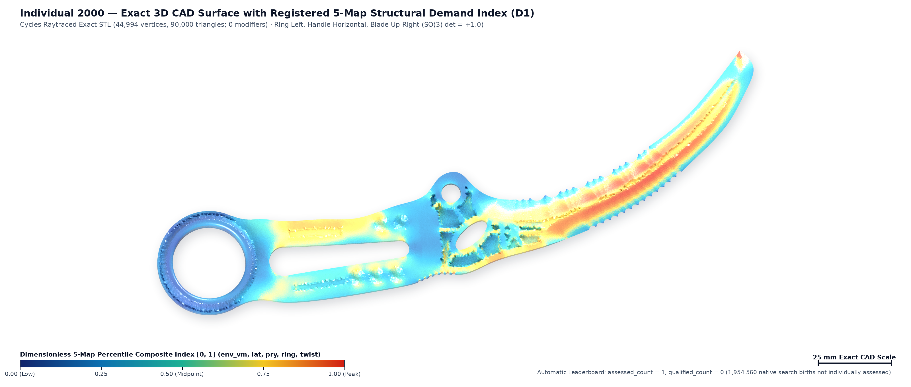
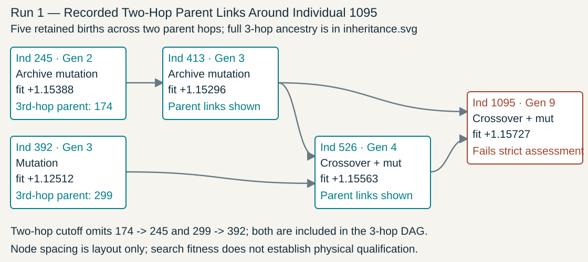

# Engineered Intelligence: Making Physical Design Executable

**Executable Genomes, Recorded Inheritance, and Full Population Evidence.** Research white-paper draft (`docs/paper/main.tex` → [`docs/paper/main.pdf`](main.pdf)). Human author approval and independent scientific review remain pending.

Source baseline: `009f5ac520fa3afe8ed8025230eef604dbb7f922`, with multi-cohort population accession and verification contracts in [`publication.v2.json`](publication.v2.json), [`data/public_ids.v1.json`](data/public_ids.v1.json), [`data/selection_receipts.v1.json`](data/selection_receipts.v1.json), and [`data/score_profiles.v1.json`](data/score_profiles.v1.json). Supplements the [living technical report](../WHITEPAPER.md) and [engineering reference](../ENGINEERING_GATES_AND_EVOLUTION.md).

[Compiled PDF (`main.pdf`)](main.pdf) · [Engineering specification](../PAPER_AND_README_ENGINEERING_SPEC.md) · [Complete test atlas](../tests/README.md) · [All 178 science definitions](../tests/science.md) · [Red-team review](RED_TEAM.md) · [Implementation receipt](IMPLEMENTATION_RECEIPT.md)

## Three-Cohort Population & Mechanics Summary

1. **Cohort 3 — Ten Retained 800-Generation Four-Island Runs (`Run 2`–`Run 11`, superseding legacy staging IDs `Run 37`–`Run 46`):**
   - **1,954,560 complete 146-column birth rows** (`195,456` births per run across `801` generations `0..800`, encoding `17` scalar metrics + `128` numeric `f64` genes + categorical `material`) and **32,040 generation-by-island summary rows**, stored in `200` lossless `.csv.zst` segments (`494,843,141` compressed bytes from **`3,811,896,749` raw CSV bytes**; index `sha256: 66c84ed4cdc943df885da4cdd72d25c0054195d9d8b9a01e1c35b6f3119c38cf`, census receipt `sha256: f56cb191f1e8d4b1c235856d5a4ccbd77f84e648ccf07d843bb17ef2dc08fb56`).
   - **754,236 search-legal evaluations (`38.59%`)**, with per-run legal counts ranging from `70,278` (`35.96%`, `Run 6`) to `80,132` (`41.00%`, `Run 11`), sample mean `75,423.6`, **sample SD (`ddof=1`) `2,936.5539592446717`** (population SD `ddof=0`: `2,785.859694959529`), and median `75,579.0` (`IQR = 2,908.75`).
   - Run-maximum native quality-diversity fitness (`gen800_retained_native_qd_fit`) spans **`1.108949` (`Run 3`) to `1.144033` (`Run 5`)**, with mean `1.124998`, **sample SD (`ddof=1`) `0.012854869375713873`** (population SD `ddof=0`: `0.012195199875360786`), and median `1.120706` (`IQR = 0.020904`).
   - Separate from the 10 completed runs, `11` staged native summary files (`Run 12`–`Run 22`, `17,672` rows, max generation `708`) and `9` aborted attempts (`7` with CSV totaling `216` rows, `2` without CSV) are preserved without pooling. Absent per-birth Stage-2 records across the `1,954,560` native search rows establish missing retained assessments.
2. **Cohort 1 — Historical 17-Generation Genealogy (`Run 1`, `w282_ultrarunner`):**
   - **1,984 retained births** (`1,455` FEM-complete, `529` not evaluated, `446` search-legal, `1,965` distinct serialized gene vectors) and **2,176 island-slot membership occurrences** (`192` elite reappearances, `12` ring migrations at generations 4, 8, and 12) verified directly from `19` binary `JEV1` frames (`2,207` events in `evidence.jevl`, `sha256: 29d4602b...9b181`).
   - Highest native search birth **Individual 1095** (generation 9, `fit = 1.15727`, display loss `-1.15727`) failed its later strict failure-sequence assessment (`cert_pass_all = false`).
3. **Cohort 2 — Intermediate Multi-Stage Screening (`57` Birth Files Across `24` Runs):**
   - **3,649 birth proposals** (`2,259` joined via 1-based candidate index to Stage-1 screening rows + `1,390` preserved in an explicit unscreened observation band; `2,247` 0-based negative-control misjoins rejected).
   - Across `6` admitted ultralight reporting curves (`15` generation summaries, `Run 31`–`Run 36`), **Individual 2002** (`w411c3_r02_p10_c12`) records the highest **retained weighted reporting profile** value **`74.207299`** (display loss `25.792701`, `13/26` legacy flags met, not qualified).
4. **Separately Assessed Controlled Exports (`Individual 2001` & `Individual 2007`) and Automatic Leaderboard (`Individual 2000`):**
   - Separate `W283` controlled exports (not `Run 1` births): **Individual 2001** (`w283_p14_c01`, `sha256: df555734d327afe077ca354764f8fea05e7e574bcaa1964beffb2653e911dffc`) records `W_CAD = -3.878704`, `G1 = 0.6239029999999999`, raster mass **`75.382 g`** (`75.1992 g` 3D solid), and passes **11 of 16** legacy gates (`5` failed: `cert_hunter_260n`, `strict_hunter_260n`, `failure_sequence_1p2`, `twist_tip_only_1p82nm`, `solid_tip_3d_p2_1p82nm`); companion **Individual 2007** (`w283_p10_c02`, `sha256: 6eb44dab69c307a5a90ae1a840fa6450d730718fce48542599999f0d5c2edf1d`) records `W_CAD = -3.964924`, `G1 = 0.6216340416666666`, raster mass **`75.642 g`** (`75.5049 g` 3D solid), and likewise passes **11 of 16** legacy gates (`5` failed). Both fail grouped `RS-v2`.
   - **Individual 2000** (`cert_pipeline_r01_p14_c02`) is the single assessed export in [`evidence/evolve_certifiable/automatic/leaderboard.json`](../../evidence/evolve_certifiable/automatic/leaderboard.json) (`assessed_count = 1`, `qualified_count = 0`, `champion = null`), separate from the 23-subject × 18-evaluator historical battery (`414` cells). It binds exact STEP (`1` solid, `1` shell, `55,698` face tokens), STL (`44,994` vertices, `90,000` triangles), $0.25\,\mathrm{mm}^2$ plate `D1` (`13,503` nodes, `25,209` triangles across **7 retained mesh arrays**: `env_vm`, `lat`, `pry`, `ring`, `twist`, `sf`, `te`; inventoried in [`drafts_p3_p5/D1_PRY_AND_FIELD_COVERAGE_INVENTORY_20261019.json`](drafts_p3_p5/D1_PRY_AND_FIELD_COVERAGE_INVENTORY_20261019.json)), and $P_2$ solid tip submodel (`91,008` tetrahedra, `416,583` DOF; solver agreement `< 0.05%`, 3-level plate GCI refused).

## Format and build

The manuscript uses `IEEEtran` in journal mode, 10 pt, with a custom single-column first page containing title, abstract, and the full-width white-background Cycles raytraced exact-CAD hero ([`figures/fig1_hero_blender_v2.png`](figures/fig1_hero_blender_v2.png)). Remaining pages use two columns. Build and verify from repository root:

```sh
env CARGO_TARGET_DIR="$PWD/target/paper-artifacts" cargo run --release --locked --manifest-path crates/paper-artifacts/Cargo.toml --example publication_v2_audit
make -C docs/paper check CARGO_TARGET_DIR="$PWD/target/paper-artifacts"
```

Output: `docs/paper/main.pdf` and `target/ieee/paper/main.pdf`, source/output SHA-256 lists, tool versions, PDF metadata and logs. The Makefile's check mode verifies 15–20 pages and rejects overfull boxes or unresolved references/citations.

## Source-bound Blender exact-CAD hero and unlit reference plates



The white-background exact-CAD hero ([`figures/fig1_hero_blender_v2.png`](figures/fig1_hero_blender_v2.png), receipt [`drafts_p3_p5/BLENDER_HERO_EXACT_CAD_RECEIPT_20261019.json`](drafts_p3_p5/BLENDER_HERO_EXACT_CAD_RECEIPT_20261019.json)) renders the unmodified `90,000`-triangle STL (`imported_vertices_before_sha256 == imported_vertices_after_sha256 = 3937262f...988e`; `faces_before_sha256 == faces_after_sha256 = 382cf144...4cba`; `0` modifiers) under a proper $\mathrm{SO}(3)$ camera frame ($\det = +1.0$, ring left, handle horizontal, blade curving upward right) colored by the dimensionless 5-map percentile composite index (`env_vm, lat, pry, ring, twist`). Unlit 2D plate reference composites ([`drafts_p3_p5/JR_EI_P4_T01_T02_hero_white_field_composite.png`](drafts_p3_p5/JR_EI_P4_T01_T02_hero_white_field_composite.png)) and $\ge 90\%$ integrated-saliency local crops ([`drafts_p3_p5/JR_EI_P4_T04_fem_saliency_crops_and_locators.png`](drafts_p3_p5/JR_EI_P4_T04_fem_saliency_crops_and_locators.png)) accompany the 4-panel raw field view ([`generated/plate-fields.svg`](generated/plate-fields.svg)). The legacy dark-background titanium study ([`figures/v2/hero_dark.png`](figures/v2/hero_dark.png)) remains preserved and hash-verified.

## Actual retained plate fields


The four-panel numerical figure uses the cover example's original D1 arrays: **13,503 nodes and 25,209 triangles**, with one saved value per triangle. The [field contract](field-inputs.v1.json) freezes source identity, units, producer-source hashes and interpretation. The Rust reader in `crates/paper-artifacts/src/plate.rs` creates [the projection receipt](generated/plate-fields.json), including exact masked cell IDs, units, full-range scales, palette and coordinate transforms. The figure also has a hash manifest checked by the existing figure verifier.

The envelope is already scaled stress (MPa); lateral and ring arrays are unit responses (MPa/N), and torsion is MPa/(N mm). These fields have independent linear legends. No values are clipped, interpolated or smoothed. Gray distinguishes 75 source-zeroed envelope cells and 14,875 source-zeroed ring cells from raw rounded zeros. The original capacity-excluded tip region remains visible in the raw lateral and torsion arrays. A positive stored ring value resolves one cell whose mask membership is ambiguous from rounded coordinates alone; an ambiguous zero would stop generation.

The PDF embeds a 3,600-pixel raster projection (over 500 dpi at publication width) to avoid white seams introduced by some PDF renderers between adjacent vector triangles. The original SVG remains available for cell-level inspection. The cell fills and legend anchors are checked against source values; no lighting or tone mapping is applied to this numerical image.

These are the retained **0.25 mm² plate-level fields**. Exported capacity summaries combine two mesh levels, so the displayed field must not be presented as the limiting capacity mesh, a strict-refinement result or a solid-element field. No full strict, solved solid, buckling-mode or fatigue field is admitted to this publication input set. The manuscript now explains stress recovery and masks alongside G16-05 through G16-12; additional subsection visuals remain outstanding where the necessary observations are absent.

## Actual mesh-study and solver observations


The [verification input contract](verification-inputs.v1.json) binds five saved JSON records, the actual solid mesh bytes and three interpretation sources verified against the original producer revision. The [projection receipt](generated/verification.json) preserves six mesh-level observations, two solver scalar pairs, sixteen original bin maxima, recovery definitions and the original region. The atlas links the relevant G16, RS-v2 and battery explanations to these panels, explicitly identifying the separate assessed example.

The three-level plate study uses maximum areas **0.25, 1 and 4 mm²**, distinct from the two-level certification summary. Its sequence/observable metadata are valid, but neither GCI error estimate is admitted: the yield-order proxy has negative observed order and the lateral sequence is oscillatory. Null estimates stay null; no error bars or extrapolated results are invented. The retained `plate_cst_dkt` projection tag is historical metadata; the manuscript separately describes the T6 in-plane implementation actually used for the assessed cases.

The matched solid comparison uses **91,008 tetrahedra / 416,583 DOF**. Saved nodal-maximum SFs are 0.669 and 0.6693; mean-recovery SFs are 0.726 and 0.7263. Reported relative differences retain their rounded-output basis. A common mesh and close scalar agreement do not establish discretization accuracy or physical validation. The profile panel contains original plate-cell and solid recovered-vertex bin maxima with different recovery/region definitions; it is not a full-field solver comparison or a synthetic 3D heatmap. No new FEM execution occurs during publication generation.

## Actual support, fatigue and refined scalar observations


The [assessment contract](assessment-inputs.v1.json) binds the A4, RS and scorecard records and three interpretation sources, verified against the original kernel revision. The [projection receipt](generated/assessment.json) retains five response/fatigue factors, four certification/strict scalars and all 26 original flags. The flags count overlapping comparisons: this example has ten met G16 comparisons and two met RS groups, and remains unqualified. It is separate from the weighted cohort with thirteen favorable flags.

The supported A4 ratio is lateral-only and uses different regions from the certification multi-case minimum. Their numerical difference does not isolate the effect of support stiffness. The figure labels its two support-model boxes as a schematic and preserves the reported eigenvalue without inventing a mode. The source passes `K_support^-1 G` to `eigsh`; the [SciPy API requires a symmetric/Hermitian operator](https://docs.scipy.org/doc/scipy/reference/generated/scipy.sparse.linalg.eigsh.html). Euclidean symmetry and an eigenpair residual are not established by the retained record. This is an open verification question, not proof that the archived scalar is wrong; see [the author red-team finding](RED_TEAM.md#a4-eigen-operator-contract-open-p1).

The fatigue factor is a model scalar, not a retained fatigue field or measured life. The additional in-plane factor stays explicitly record-only. Certification/strict lateral and torsion values have separate units and are not turned into a convergence estimate. Original scientific code, thresholds, weights and evidence remain unchanged.

The conclusion treats aerospace fixtures, robotics, thermal management, medical-device research, instruments and energy systems as future opportunities. It does not claim that printing titanium establishes unprecedented tolerances or that a simulation qualifies a product. Stronger publication claims need controlled benign research and independent reconstruction evidence.


## The complete retained battery matrix


The [battery figure contract](battery-inputs.v1.json) freezes the corpus manifest and all 23 subject records. The [cell-level projection](generated/battery-matrix.json) preserves each source pointer, original status, kind, solver, evidence path, geometry identity, source-revision field and freshness flag. All 18 evaluator explanations link to their exact-ID matrix column; existing separate assessed-example visuals retain their different subject binding.

This is a categorical map of **221 stored passes, 81 failures and 112 blocked records**, with no incomplete labels. Letters distinguish statuses without relying on color. Three source roles are retained: three native CAD records, one archived-not-on-main record and nineteen genomes. Twenty-one subject records cite source revision `6d18ef8c`; the two w283 records cite `4e54019d`. These copied provenance fields do not establish a homogeneous solver regime or a fresh execution. Seven null evidence-path fields remain null in the ledger.

Four shared build columns account for 92 stored pass references. The `solid.tip` pass label denotes record completeness. Neither the colored cells nor their tally establish independent physical tests, favorable strength, or product qualification. The generated aggregate-count table remains available as `generated/battery.tex`; the article uses the full matrix instead.


## Actual recorded parent links



The [lineage contract](lineage-inputs.v1.json) binds the original w282 population and historical assessment summary. The [node/edge ledger](generated/lineage.json) retains five births, five original parent-ID links, operator/version fields, generation, contextual fitness, FEM status, legality and exact JSON source pointers. It joins the focal historical assessment by ID 1095 and generation 9, preserving `cert_pass_all=false`.

This is a two-parent-hop view. ID 413 is reused directly by ID 1095 and through ID 526. The cutoff omits links from 174 to 245 and 299 to 392, while recording that both referenced births exist in the source. Node placement is illustrative: edge length does not encode time, generation, fitness or inherited geometry. No best-geometry export or current qualification is inferred. Neutral tests preserve unavailable boundary references without inventing source nodes and refuse contradictory chronology, missing in-window parents, duplicates, untyped IDs and changed focal membership.
