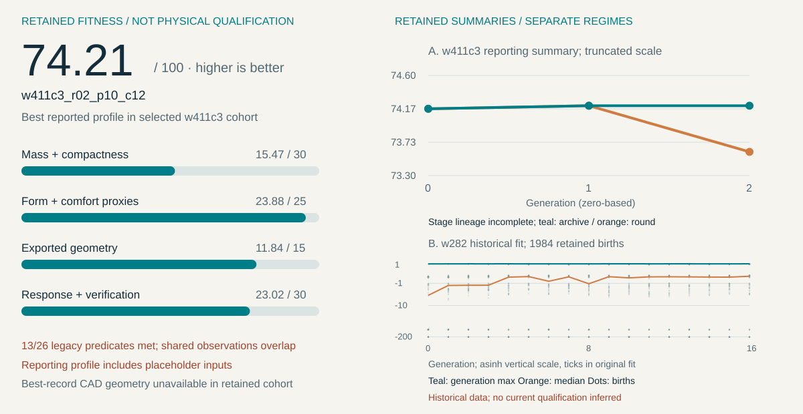
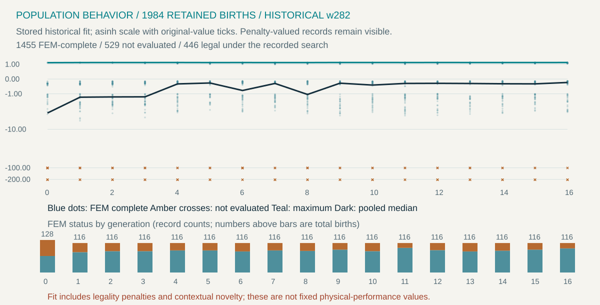
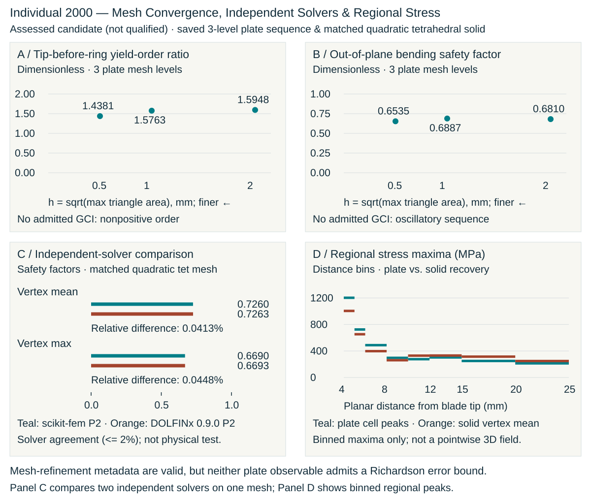
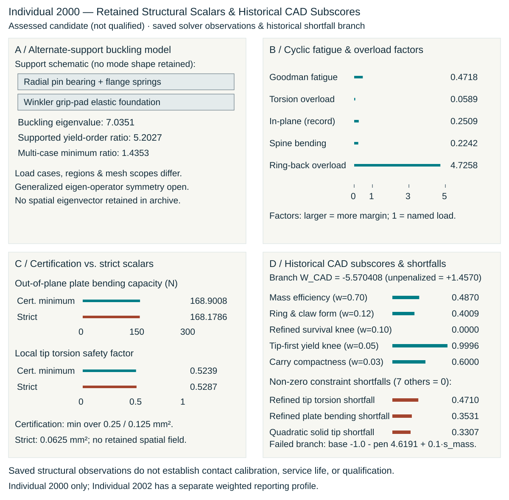
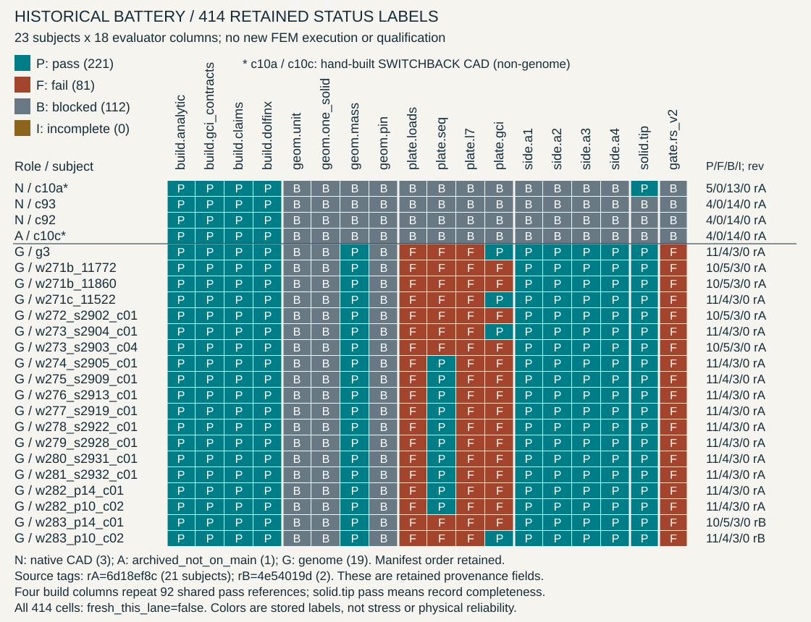

# When CAD Evolves

**Research white-paper draft.** Intelligent CAD, evolutionary search, agent-assisted representation research, and auditable engineering evidence. Human author approval and independent scientific review remain pending.

Source baseline: `009f5ac520fa3afe8ed8025230eef604dbb7f922`, inspected 18 October 2026 (America/Denver). New source package supplements the existing [living technical report](../WHITEPAPER.md) and [engineering reference](../ENGINEERING_GATES_AND_EVOLUTION.md).

[Engineering specification](../PAPER_AND_README_ENGINEERING_SPEC.md) · [Complete test atlas](../tests/README.md) · [All 178 science definitions](../tests/science.md) · [Red-team review](RED_TEAM.md) · [Implementation receipt](IMPLEMENTATION_RECEIPT.md)

The related-work section compares executable/learned CAD representations, evolutionary engineering and execution-based program proposals without treating them as a shared benchmark. The [primary-reference review](REFERENCE_REVIEW.md) records the four added sources, verified metadata, supported claims and review depth. DOLFINx's methods preprint and archived software version are identified separately. This is a targeted source check; independent reconstruction and scientific review remain pending.

## Format and build

The manuscript uses `IEEEtran` in journal mode, 10 pt, with a custom single-column first page containing title, abstract, then the Blender render beside actual evolution data. Index terms follow the figure. Remaining pages use two columns. This is an **IEEE-style white paper**, not an unmodified venue submission template. A formal submission needs a selected venue's current template, verified authorship, disclosure, references and supported research contribution. No IEEE acceptance, DOI or badge is claimed. [IEEE Access guidance](https://ieeeaccess.ieee.org/authors/submission-guidelines/).

Dependencies: Rust 1.85.1, locked Cargo dependencies, LuaLaTeX, IEEEtran, TeX Gyre fonts, librsvg `rsvg-convert`, Poppler `pdfinfo`/`pdftoppm`, ripgrep `rg`, `make`, and `shasum`. Build from repository root. The public recipe uses plain tools; RTK is an optional local wrapper:

```sh
env CARGO_TARGET_DIR="$PWD/target/paper-artifacts" cargo run --locked --manifest-path crates/paper-artifacts/Cargo.toml --example paper_artifacts
make -C docs/paper check CARGO_TARGET_DIR="$PWD/target/paper-artifacts"
```

Output: `target/ieee/paper/main.pdf`, source/output SHA-256 lists, tool versions, PDF metadata and logs. The Makefile's check mode verifies 15–20 pages and rejects overfull boxes or unresolved references/citations. The legacy pinned Pandoc target remains separate and unchanged. Byte-identical PDF reproduction across toolchain versions is not claimed.

The PDF embeds lossless PNG projections of the generated SVG figures: 3,600 pixels for full-width figures and 2,400 pixels for the narrow cover plot. This avoids duplicate transparency-group dictionary keys encountered when this LuaLaTeX version imports librsvg PDF output, and triangle-edge seams in dense fields. Original SVGs and numerical projections remain inspectable and bound to source receipts. The new field and verification SVGs carry cell/observation IDs. Raster/output hashes accompany the PDF; no data values change during this display conversion.

## Evidence contract

`crates/paper-artifacts/src/publication.rs` generates the explanatory atlas, complete frozen science index, vector figures, numerical macros, summary and hash manifest. `--check` performs no writes. It reads existing evidence without changing it and invokes no CAD, FEM, evolutionary or physical test.

Before publishing, the reader checks that the selected score and label agree with the final retained Hall of Fame, matching Stage-2 identities agree, objective arithmetic reconciles within recorded rounding, and all 26 predicate flags agree with their tally and failed-ID list. These are reporting-consistency checks; they do not establish equivalence between screening and assessment stages or validate the underlying mechanics.

The `version-check` workflow explicitly tests this standalone Cargo workspace, checks generated freshness, and builds the new manuscript. A successful new-paper build is configured to upload `ieee-paper-<commit SHA>` with its PDF and build receipts. This artifact is separate from the older publication PDFs and is available only after that workflow succeeds.



The selected w411c3 cohort reports best fitness **74.207299**, higher is better, with placeholder inputs and no qualified design. Its best CAD geometry and full round populations are absent. The reporting producer can substitute assessment values for screening values; point-level stage lineage is incomplete. This figure now appears in the results section, preserving the recorded profile and short summaries without asserting one homogeneous objective-convergence experiment. The historical inset uses a different score regime.



The w282 plot contains **1,984 retained births: 1,455 FEM-complete and 529 not evaluated**. Blue dots and amber crosses distinguish these states; stacked bars show their per-generation counts. Its original score includes legality-dependent penalties and contextual novelty and is not `W_ULTRALIGHT_v1`. The highest stored score belongs to ID 1095, which did not pass its later strict assessment. The producer reports that GA passers did not beat the baseline; the named exported examples were controlled probes under the historical model. Source membership, original producer, status composition and the assessment join appear in [summary.json](generated/summary.json); input/output hashes appear in [manifest.json](generated/manifest.json).

## Manuscript flow

The opening shows the exact assessed export `cert_pipeline_r01_p14_c02` beside the historical w282 population and its stored search maxima. These are different cohorts. The render is an assessed example, not a best-design identity claim or a qualified product. The body develops intelligent design and related work; gene/decoder/CAD identity; evolution and population semantics; actual weighted fitness with individual G16 and RS-v2 subsections; all 18 battery evaluators; numerical verification and assurance; retained results; prospective agents; reproducibility; manufacturing limits; and an expansive civilian-use conclusion.

## Source-bound Blender cover

[Frozen figure inputs](figure-inputs.v1.json) bind the original STL, assessment and status records. The new lossless [master](figures/v2/hero_dark.png), [scene recipe](figures/v2/hero_dark.scene.json) and [render receipt](figures/v2/hero_dark.manifest.json) preserve the exact export and its original flat face normals. Visible export faceting is retained; the illustrative titanium shader is not evidence of a printed surface. The Rust publication reader checks the render's input/output hashes, subject identity and before/after imported-mesh digests before publishing. CI builds from the committed master and does not run Blender.

Three 1,200-pixel/48-sample lighting proofs preceded the selected 3,600 × 2,800-pixel/256-sample master (Cycles CPU, four threads, seed 42, denoising, AgX). Proofs and logs remain under `target/paper/blender-v2`. To reproduce with the pinned Blender 4.5.3 executable supplied through `BLENDER`:

```sh
python3 -B ops/render/blender/rerender.py --profile publication --output-root docs/paper/figures/v2 --recipe dark --width 3600 --height 2800 --samples 256
```

The publication profile requires an explicit isolated output root and applies no typography overlay, clipping, mesh modification or depth of field. The profile extends the existing `rerender.py`/`candidate_scenes.py` bindings. Archived assets, their hashed `render_paper.py`/`paper_scenes.py` sources, and legacy defaults are preserved byte-for-byte.

## Actual retained plate fields


The four-panel numerical figure uses the cover example's original D1 arrays: **13,503 nodes and 25,209 triangles**, with one saved value per triangle. The [field contract](field-inputs.v1.json) freezes source identity, units, producer-source hashes and interpretation. The Rust reader in `crates/paper-artifacts/src/plate.rs` creates [the projection receipt](generated/plate-fields.json), including exact masked cell IDs, units, full-range scales, palette and coordinate transforms. The figure also has a hash manifest checked by the existing figure verifier.

The envelope is already scaled stress (MPa); lateral and ring arrays are unit responses (MPa/N), and torsion is MPa/(N mm). These fields have independent linear legends. No values are clipped, interpolated or smoothed. Gray distinguishes 75 source-zeroed envelope cells and 14,875 source-zeroed ring cells from raw rounded zeros. The original capacity-excluded tip region remains visible in the raw lateral and torsion arrays. A positive stored ring value resolves one cell whose mask membership is ambiguous from rounded coordinates alone; an ambiguous zero would stop generation.

The PDF embeds a 3,600-pixel raster projection (over 500 dpi at publication width) to avoid white seams introduced by some PDF renderers between adjacent vector triangles. The original SVG remains available for cell-level inspection. The cell fills and legend anchors are checked against source values; no lighting or tone mapping is applied to this numerical image.

These are the retained **0.25 mm² plate-level fields**. Exported capacity summaries combine two mesh levels, so the displayed field must not be presented as the limiting capacity mesh, a strict-refinement result or a solid-element field. No full strict, solved solid, buckling-mode or fatigue field is admitted to this publication input set. The manuscript now explains stress recovery and masks alongside G16-05 through G16-12; additional subsection visuals remain outstanding where the necessary observations are absent.

## Actual mesh-study and solver observations



The [verification input contract](verification-inputs.v1.json) binds five saved JSON records, the actual solid mesh bytes and three interpretation sources verified against the original producer revision. The [projection receipt](generated/verification.json) preserves six mesh-level observations, two solver scalar pairs, sixteen original bin maxima, recovery definitions and the original region. The atlas links the relevant G16, RS-v2 and battery explanations to these panels, explicitly identifying the separate assessed example.

The three-level plate study uses maximum areas **0.25, 1 and 4 mm²**, distinct from the two-level certification summary. Its sequence/observable metadata are valid, but neither GCI error estimate is admitted: the yield-order proxy has negative observed order and the lateral sequence is oscillatory. Null estimates stay null; no error bars or extrapolated results are invented. The retained `plate_cst_dkt` projection tag is historical metadata; the manuscript separately describes the T6 in-plane implementation actually used for the assessed cases.

The matched solid comparison uses **91,008 tetrahedra / 416,583 DOF**. Saved nodal-maximum SFs are 0.669 and 0.6693; mean-recovery SFs are 0.726 and 0.7263. Reported relative differences retain their rounded-output basis. A common mesh and close scalar agreement do not establish discretization accuracy or physical validation. The profile panel contains original plate-cell and solid recovered-vertex bin maxima with different recovery/region definitions; it is not a full-field solver comparison or a synthetic 3D heatmap. No new FEM execution occurs during publication generation.

## Actual support, fatigue and refined scalar observations



The [assessment contract](assessment-inputs.v1.json) binds the A4, RS and scorecard records and three interpretation sources, verified against the original kernel revision. The [projection receipt](generated/assessment.json) retains five response/fatigue factors, four certification/strict scalars and all 26 original flags. The flags count overlapping comparisons: this example has ten met G16 comparisons and two met RS groups, and remains unqualified. It is separate from the weighted cohort with thirteen favorable flags.

The supported A4 ratio is lateral-only and uses different regions from the certification multi-case minimum. Their numerical difference does not isolate the effect of support stiffness. The figure labels its two support-model boxes as a schematic and preserves the reported eigenvalue without inventing a mode. The source passes `K_support^-1 G` to `eigsh`; the [SciPy API requires a symmetric/Hermitian operator](https://docs.scipy.org/doc/scipy/reference/generated/scipy.sparse.linalg.eigsh.html). Euclidean symmetry and an eigenpair residual are not established by the retained record. This is an open verification question, not proof that the archived scalar is wrong; see [the author red-team finding](RED_TEAM.md#a4-eigen-operator-contract-open-p1).

The fatigue factor is a model scalar, not a retained fatigue field or measured life. The additional in-plane factor stays explicitly record-only. Certification/strict lateral and torsion values have separate units and are not turned into a convergence estimate. Original scientific code, thresholds, weights and evidence remain unchanged.

The conclusion treats aerospace fixtures, robotics, thermal management, medical-device research, instruments and energy systems as future opportunities. It does not claim that printing titanium establishes unprecedented tolerances or that a simulation qualifies a product. Stronger publication claims need controlled benign research and independent reconstruction evidence.


## The complete retained battery matrix



The [battery figure contract](battery-inputs.v1.json) freezes the corpus manifest and all 23 subject records. The [cell-level projection](generated/battery-matrix.json) preserves each source pointer, original status, kind, solver, evidence path, geometry identity, source-revision field and freshness flag. All 18 evaluator explanations link to their exact-ID matrix column; existing separate assessed-example visuals retain their different subject binding.

This is a categorical map of **221 stored passes, 81 failures and 112 blocked records**, with no incomplete labels. Letters distinguish statuses without relying on color. Three source roles are retained: three native CAD records, one archived-not-on-main record and nineteen genomes. Twenty-one subject records cite source revision `6d18ef8c`; the two w283 records cite `4e54019d`. These copied provenance fields do not establish a homogeneous solver regime or a fresh execution. Seven null evidence-path fields remain null in the ledger.

Four shared build columns account for 92 stored pass references. The `solid.tip` pass label denotes record completeness. Neither the colored cells nor their tally establish independent physical tests, favorable strength, or product qualification. The generated aggregate-count table remains available as `generated/battery.tex`; the article uses the full matrix instead.
