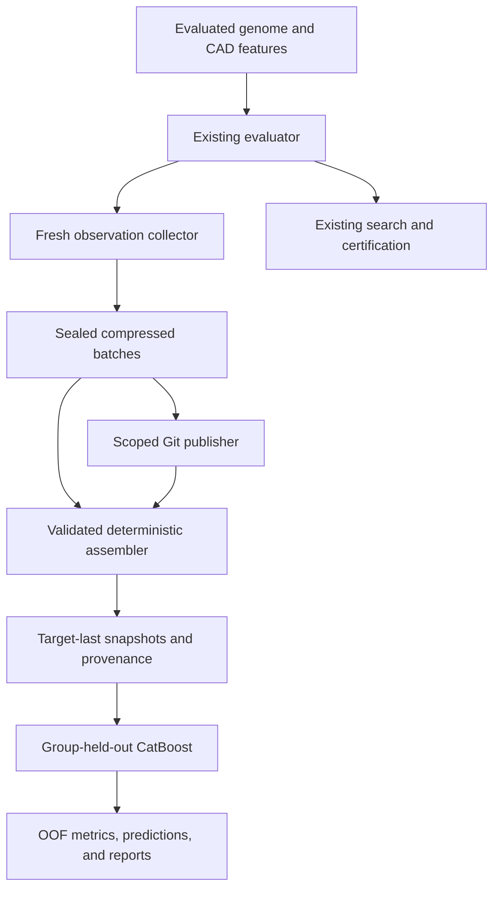

# Jarambit regression dataset factory: engineering specification

**Prepared:** October 20, 2026 (America/Denver)

**Repository inspected:** `neverhuman/jarambit`

**Inspection baseline:** `49dc71f88339ac4270014f7c8ec0e38e740071cc`

**Purpose:** turn every paid evaluation into reusable, versioned supervised-learning observations, measure predictive lift honestly, and preserve the original engineering evidence.

## 1. Decision and intended result

Build an observational data plane alongside evolution. Record the evaluated genome, inexpensive CAD-derived features, evaluator identity, and every measured scalar outcome once. Seal append-only compressed micro-shards while the search runs. Aggregate those shards into reproducible, single-target regression tables. Run CatBoost on deterministic group-held-out folds, with **the final column always the target**, and retain predictions and baseline comparisons.

The important asset is the observation corpus. Hundreds of target/feature/fidelity views can be generated from it without running the expensive simulation again. Do not copy every observation into hundreds of files in the solver hot path. Do not make one enormous shared CSV the source of truth. Do not equate retained population appearances with fresh evaluations.

The initial implementation accompanying this specification provides a usable vertical slice:

- Automatic collection in `crescent-evolve`, `crescent-smoke`, and `auto-evolve` Stage 1.
- 128 evaluated genome coordinates, one material category, and 35 pre-solve CAD measurements/descriptors: **164 predictor columns**.
- **26 individually typed search-FEM outcomes**, each eligible to produce its own target-last dataset. Several are related by formulas and must not be advertised as 26 independent physical phenomena.
- Zstandard JSONL shards with SHA-256 receipts; exact repeat handling; deterministic snapshots; target-last enforcement.
- Five-fold, whole-run-held-out CatBoost CLI evaluation under Rust orchestration; out-of-fold Pearson r, R², RMSE, MAE, and lift against a training-fold mean baseline.
- A scoped Git publisher, a CI workflow, and timer/service templates for operators to deploy.

This slice does not establish real-data lift. No historical corpus is silently reinterpreted or manufactured. The full-scale features below are explicitly separated from what is implemented: Stage-2 and solid-FEM import, historical archive adapters, scalable external sorting, richer ancestry splits, uncertainty intervals, and production service deployment remain follow-up work.

## 2. Repository findings that determine the design

| Existing path | Observed behavior | Consequence |
|---|---|---|
| `crates/crescent/src/genome.rs` | Current genome has 128 coordinates, 40 spline offsets, named geometry/machining parameters, and material; loaders also know 90- and 117-coordinate historical layouts | Preserve exact evaluated coordinates and original schema; never infer that every historical CSV uses the current parameter semantics |
| `crates/crescent/src/pheno.rs` | Builds outline, holes, thickness field, areas, material-dependent mass, removed-volume components, and feature counts | Rich predictors already exist before FEM; reuse them instead of recomputing a second CAD model |
| `crates/crescent/src/qd.rs::evaluate` | Builds phenotype, aesthetic result, gate rejections, descriptors, and optional FEM | Best native observation boundary; failed/pre-screened evaluations still deserve records |
| `qd::eval_batch_with` | Attaches parents/operator metadata to fresh evaluation results, then sorts by ID | Observe completed batches here or immediately after their return, before elite reuse or selection |
| `qd::run_with` / `run_islands_with` | Reuses elites and migrants; maintains population history and all-record views | Population records cannot be treated as independent training samples |
| `crates/crescent/src/record.rs` | Typed `NotEvaluated`, `Failed`, `Incomplete`, `Complete` FEM statuses; display serialization rounds scalars | Preserve these semantics; collect directly from full-precision values, not rounded report JSON |
| `crates/evidence/src/lib.rs` | Durable generation-framed event log, manifests, parent IDs; `Event::Eval` contains fitness/mass/status but no full genome or FEM vector | Keep the existing log intact; a separate dataset stream is required |
| `crates/cli/src/crescent.rs` | Starts searches and writes live/final reports and selected certification outputs | Own the collection lifecycle and error propagation here |
| `crates/cli/src/auto_evolve.rs` | Stage-1 evaluator may return no survivor; selected candidates receive later independent assessment | Observe before filtering; Stage-2 selection must be recorded separately to expose selection bias |
| `crates/evolve/src/lib.rs` | Older genotype/Monte Carlo lane, checkpoint and resume contracts | Requires its own adapter/schema; must not be merged with crescent records by column position |
| `artifacts/versioned-evolution-archives-gen800-population-v1/` | Compressed archived population CSVs with manifests/hashes | Valuable historical source, but schema/producer/precision/duplicates need explicit admission before training |
| `crates/paper-artifacts/src/population.rs`, `native_history.rs` | Reporting distinguishes native runs, appearances, historical cohorts and incomplete evidence | Reuse provenance concepts; reporting totals are not dataset admission rules |
| `.github/workflows/d1-gates.yml` | Required release-mode workspace tests, CLI lint gate, D1 smoke, export regeneration | Add a dataset job without weakening existing engineering gates |
| `ops/ci/RUNNERS.md` | Local runner labels `self-hosted`, `xbabe`, `general`; capability labels narrow placement | New CI follows this routing and resource-control policy |
| `AGENTS.md` | New backend/CLI/CI/compute code must be Rust; generated certification inputs remain stable | Rust implementation; official CatBoost executable as an external trainer; no new Python files |

The existing compressed archives are a foundation, not proof that a high-quality learning table already exists. In particular, the observed corpus includes repeated appearances, selective assessment, different score semantics, and potentially different evaluator revisions. A large row count does not fix those problems.

## 3. Architecture and data flow



The collector observes; it has no authority to certify a candidate or alter a fitness value. Learning results initially remain advisory. A future surrogate-assisted search experiment must be separately approved and evaluated against equal simulation budgets.

### 3.1 Three storage layers

1. **Local collection:** under each run output, `regression/run-*/`, or under an explicit shared `JARAMBIT_REGRESSION_ROOT` spool. One compressed batch per completed search batch; one per Stage-1 observation in the initial `auto-evolve` adapter. Receipts mark committed data. No Git access or network is needed by the solver.
2. **Git-visible durable batches:** `datasets/regression/batches/<batch>/`. Immutable compressed records and receipts, provenance documents, registry and training policy. Only a separate publisher writes here.
3. **Derived snapshots and reports:** `out/regression-*` locally and `target/regression-ci/<attempt>/` in CI. Each snapshot has a feature-only matrix plus last target, row metadata, and a manifest. Full models and large derived matrices are artifacts, not repeated main-branch source files.

For millions of rows, keep Git as the catalog/control plane and retain large shards in the project's approved artifact store, using content-addressed references. The initial publisher deliberately caps a batch at 64 MiB compressed and never installs Git LFS or introduces a new external data service implicitly.

### 3.2 Exact initial paths

| Path | Status | Responsibility |
|---|---|---|
| `crates/datasets/Cargo.toml` | Added | Rust package and `jarambit-datasets` executable |
| `crates/datasets/src/lib.rs` | Added | Record, feature, outcome and registry contracts; identity checks |
| `crates/datasets/src/store.rs` | Added | Atomic immutable writes, compressed batches, receipts, verification |
| `crates/datasets/src/assemble.rs` | Added | Strict projection, duplicate/conflict handling, snapshots, checksums |
| `crates/datasets/src/cv.rs` | Added | Group splitting, bounded CatBoost subprocesses, OOF metrics/reports |
| `crates/datasets/src/main.rs` | Added | Ingest, assemble, check, CV, suite and Git-publish commands |
| `crates/datasets/tests/contracts.rs` | Added | Integrity, target-last, duplicates, splits, metrics and real CatBoost control |
| `crates/cli/src/regression.rs` | Added | Crescent feature/outcome adapter and collector lifecycle |
| `crates/crescent/src/qd.rs` | Changed | Fallible fresh-batch observer entry points; old APIs retain no-op wrappers |
| `crates/crescent/tests/search_contract.rs` | Changed | Observer coverage, error propagation and search-parity controls |
| `crates/cli/src/crescent.rs` | Changed | Automatic durable collection in smoke/evolve CLI paths |
| `crates/cli/src/auto_evolve.rs` | Changed | Observe evaluated Stage-1 results before survivor filtering |
| `crates/cli/src/main.rs` | Changed | `regression-registry` command |
| `Cargo.toml`, `Cargo.lock`, `crates/cli/Cargo.toml` | Changed | Register workspace package and dependency |
| `datasets/regression/registry.v1.json` | Added | Generated current feature/target allowlist |
| `datasets/regression/cv.v1.json` | Added | Fixed k-fold training policy |
| `datasets/regression/catboost.lock.json` | Added | CatBoost version, URL and checksum |
| `datasets/regression/batches/` | Added, initially empty | Future sealed observations; no fabricated empirical data |
| `datasets/regression/README.md` | Added | Operator commands, semantics and current limits |
| `.github/workflows/regression-datasets.yml` | Added | Contract checks, CatBoost control and corpus evaluation |
| `ops/datasets/jarambit-regression-publish.service`, `jarambit-regression-publish.timer` | Added templates | Periodic collection publication |
| `ops/datasets/regression-publish.env.example` | Added template | Explicit spool, checkout, branch and batch scope |
| `docs/specs/REGRESSION_DATASET_FACTORY.md` | Added | This design, extensions, gates and rollout |

## 4. What constitutes one observation

Use **one actual evaluation attempt of one evaluated design under one evaluator context**. Do not use a population slot, champion appearance, plot point, file name, or an accumulated score as the unit.

Keep distinct identities:

| Identity | Meaning | Initial representation |
|---|---|---|
| `run_id` | Collection session, distinct even if seed/config repeats | Unique run directory identifier |
| `evaluation_id` | Evaluation within session | Generation plus evaluation ID |
| `design_id` | Exact evaluated genotype and material under the feature-schema contract | SHA-256 of full-precision serialized coordinates/material |
| `context_id` | Evaluator implementation/configuration and feature semantics | SHA-256 of producer binary, registry, requirement set, FEM area, effective-context inputs |
| `group_id` | Unit that must stay wholly in a fold | Entire run initially |
| `feature_schema` | Meaning/order/type of available predictors | `crescent_pre_solve_v1` |
| `snapshot_id` | Exact training-table realization | SHA-256 of its manifest |

A design hash is not a specimen identity and is not a certificate. The same genome under another evaluator revision or geometry dependency belongs to another context. A repeat evaluation can remain in the raw record stream while a deterministic target snapshot deduplicates it.

### 4.1 Initial record contract

```json
{
  "schema": 1,
  "run_id": "run-EXAMPLE",
  "evaluation_id": "g3-e217",
  "design_id": "FULL_SHA256",
  "group_id": "run-EXAMPLE",
  "generation": 3,
  "parents": ["115", "149"],
  "context_id": "FULL_SHA256",
  "feature_schema": "crescent_pre_solve_v1",
  "features": {
    "gene.cp00": 0.0,
    "gene.cp01": 0.125,
    "material": "Ti6Al4V"
  },
  "outcomes": {
    "lat20": {"status": "not_evaluated"},
    "fat_sf": {"status": "failed"}
  }
}
```

This is an abbreviated structural example, not an empirical observation and not a complete feature row. The generated registry is authoritative. Production rows contain all declared predictors.

Outcome states are `observed` with a finite value, `not_evaluated`, `failed`, and `non_finite`. A genuine numeric zero remains zero. Missing does not mean failure, failed does not mean zero, and a timeout does not mean a poor physical measurement. The Stage-1 prefilter can reject a proposal before `qd::evaluate`; its birth remains in the existing birth file, but it is not counted as an evaluation record by the initial adapter.

### 4.2 Expanded provenance contract for subsequent adapters

Add fields through a new schema version, rather than mutating v1 interpretation:

- Full source commit, source-tree/diff digest, build flags, compiler/toolchain and executable digest.
- Named evaluator and semantic version, solver build/container digest, requirement-set content hash, material-table hash and calibration hash.
- CAD artifact checksum and feature-extractor version; geometry validity and extraction status.
- Mesh checksum, element family, mesh sizing and convergence configuration.
- Load-case/fixture identity, units, tolerance and uncertainty model, replicate ID and random seed.
- Start/end timestamps, wall time, peak memory, convergence/residual diagnostics and exit reason.
- Parent design hashes and the resolved ancestry-component identifier; cross-run seeding references.
- Source-file hashes and JSON pointers/row locators when importing existing evidence.
- Stage-2 selection rule and selection probability where sampling permits it.
- Exact measurement status per target, including censored/bounded measurements when appropriate.

Do not promote these fields into predictors merely because they are present. Most are provenance, split metadata, or diagnostics. The initial collector hashes its producer binary and context document; it does not claim the richer scientific-admission identity already exists.

## 5. Feature strategy: capture useful structure without target leakage

Use an explicit allowlist. A recursive walk over every number in a report is unsuitable: that would put targets, gate margins and target-derived scores into the features.

### 5.1 Four feature tiers

| Tier | Contents | Availability | Intended use |
|---|---|---|---|
| F0 genome | Every evaluated coordinate, categorical choices, activity flags, material inputs | Before CAD/solve | Universal minimum-cost model; initial implementation includes raw coordinates/material |
| F1 CAD geometry | Deterministic measurements of the evaluated shape | Before target simulation | Primary higher-quality surrogate features; initial implementation reuses scalar CAD summaries already in `Rec` |
| F2 prescribed analysis setup | Material properties, fixture/load inputs, mesh prescription | Before target simulation | Conditional models across explicitly compatible scenarios |
| F3 lower-fidelity results | Outcomes from a cheaper completed analysis | After cheap analysis, before expensive target | Separate cascaded-fidelity task; never mix into the F0/F1 leaderboard |

Keep F0, F0+F1, and F0+F1+F2 as explicit ablation views. An F3 model answers a different operational question and must report the additional feature-acquisition cost.

### 5.2 Genome encoding

The current crescent vector contains 40 control-point offsets plus 88 named coordinates. Retain physical values with original precision. CatBoost does not require an arbitrary 0–1 rescaling of every numeric coordinate. The initial feature names are `gene.cp00` through `gene.cp39`, followed by `gene.<name>` from `genome::NAMES`, then `material` as categorical.

For the next registry revision:

- Annotate every coordinate with its true unit, bounds, type, whether repaired/clamped, and controlling feature switch. The initial registry conservatively labels raw coordinate units `native_genome_unit`; it does not falsely declare every value to be millimetres.
- Add explicit presence/activity flags for optional machining families. Distinguish an inactive feature from an active feature with a numeric zero.
- Preserve original and evaluated/repaired genome in raw provenance; train on the evaluated one.
- Use sin/cos pairs for periodic angles only where periodic equivalence is actually valid. Some bounded orientation parameters are not full-circle variables.
- Represent discrete counts as counts and material/category choices as categorical columns. Do not label arbitrary material IDs as ordered magnitudes.
- Keep version-specific adapters for 90, 117, 128, and older non-crescent genomes. Use documented defaults only when the historical loader and producer semantics are established.
- Avoid learned encoders in the first release. A learned embedding adds train/test separation and versioning requirements and can be evaluated later against a transparent baseline.

### 5.3 Initial CAD predictors

The v1 implementation reuses twelve scalar measurements already available in `Rec`:

| Feature | Meaning |
|---|---|
| `cad.mass_g`, `cad.blank_g` | Evaluated and blank mass |
| `cad.stock_mm` | Finished stock thickness |
| `cad.grip_mm` | Grip length |
| `cad.holder_length_mm`, `cad.holder_width_mm`, `cad.holder_angle_deg` | Fitted holder box |
| `cad.min_web_mm` | Minimum retained web |
| `cad.window_count`, `cad.window_area_mm2` | Through-window geometry |
| `cad.perforation_count`, `cad.perforation_area_mm2` | Perforation geometry |

It also retains seven removed-volume components, `cad.removed_0_mm3` through `cad.removed_6_mm3`, and sixteen existing geometry descriptors. These are pre-solve shape summaries. It deliberately excludes novelty, fitness, legal/aesthetic pass flags, solver-derived peak locations, and every sibling test result from the input matrix.

### 5.4 High-value next CAD features

Implement `crates/datasets/src/features/geometry.rs` or a geometry-owned extractor returning a typed DTO. Extract once during phenotype construction and attach a feature vector; do not rebuild the phenotype once per target.

1. Global shape: volume, surface area, bounding-box spans, centroid, principal inertias, compactness, projected areas, material occupancy fraction and connected-component counts.
2. Thickness: min/5th/25th/50th/75th/95th/max quantiles, area-weighted mean/variance, active-area fraction, connected thin-region area, gradients, minimum ligament and distance-to-boundary summaries.
3. Fixed section stations: cross-sectional area, centroid, principal second moments, polar-moment proxy, section moduli and thickness summaries at predeclared normalized positions. Fixed stations must be geometric definitions, not locations selected using the target stress field.
4. Surface/curve geometry: signed-curvature histograms, area/perimeter ratios, hole and pocket areas, dimensionless aspect ratios, ligament distributions, transition-radius summaries and normalized geodesic distances.
5. Connectivity: material-path counts, bottleneck-width summaries, topology/holes, through-feature and pocket adjacency. Version any skeletonization tolerance.
6. Material/setup: density, elastic modulus, Poisson ratio, yield model and temperature as declared inputs, with units and source identity.
7. Dimensionless groups: thickness-to-span, removed-to-blank volume, hole-to-local-width, inertia normalized by bounding-box scale; use only relationships defined before observing the target.

Prototype F1 additions against the same immutable folds. Retain a feature only when it improves OOF prediction or coverage enough to justify extraction cost. Numerical correlations alone do not establish causal mechanisms.

### 5.5 Leakage rules

- Never train a capacity target from its own safety factor, threshold margin, pass flag, score component or algebraically transformed sibling.
- Never use final fitness or selected/not-selected status in the primary surrogate.
- Never use target-dependent mesh refinement, residuals, stress hotspots or post-solve geometry measurements as if available before the solve.
- Never use design label, file path, individual number, generation, host or run ID as a primary feature. These can encode selection and chronology.
- For a mass-prediction view, remove mass, volume×density and direct deterministic equivalents. The initial registry does not create mass targets.
- For a multi-fidelity view, specify exactly which cheap tests are run before prediction, include their cost, and split at design/family level across all fidelities.
- Do not globally fit imputers, target transforms, feature selection, categorical encoders or PCA before splitting. Fit on training data only; material category strings are passed directly to CatBoost.

## 6. Build many datasets from meaningful target definitions

A dataset key is `(target semantic identity, units, evaluator/fidelity context, feature view, eligibility policy, split protocol)`. A new file name or normalized copy of the same measurement is not a new independent task.

### 6.1 Initial target catalog

All initial targets are explicitly **search plate-FEM** observations. The initial catalog is:

| Target group | Fields | Units |
|---|---|---|
| Nominal capacities | `lat20`, `pry20`, `ring20`, `twist20_nmm` | N or N·mm as named |
| Robust capacities | `lat_rob`, `ring_rob` | N |
| Derived safety factors | `sf_hiker`, `sf_hunter`, `sf_ring` | Dimensionless |
| Sequence result | `seq_ratio` | Dimensionless |
| Torsion summaries | `twist_joint_nmm`, `twist_sf`, `twist_body_joint_nmm`, `twist_hand_joint_nmm`, `twist_body_sf`, `twist_tipzone_joint_nmm`, `twist_tipzone_sf` | N·mm or dimensionless |
| Additional structural cases | `hm_twist_nmm`, `hm_tip_inplane_n`, `hm_spine_n`, `hm_ringback_n` | N·mm or N |
| Additional derived factors | `hm_twist_sf`, `hm_tip_inplane_sf`, `hm_spine_sf`, `hm_ringback_sf`, `fat_sf` | Dimensionless |

Predicting these values is a software-surrogate task. It does not validate the physical correctness of the underlying solver, demonstrate prototype performance, or relax an engineering requirement.

### 6.2 Next target families

| Family | Source boundary to instrument | Eligibility and caveat |
|---|---|---|
| Unbiased plate FEM | `fem::run_unbiased`, certification aggregation in `crates/cli/src/crescent.rs` | Preserve mesh resolution and bias removal; do not pool with search-scaled results |
| Multi-resolution convergence | `crates/crescent/src/gci.rs`, `examples/plate_gci_probe.rs` | Record each mesh and convergence metric; same design group spans all meshes |
| Solid FEM | `crates/physics/src/solid_tet10.rs`, existing solid receipts in `fem_solid/` | Require original mesh/solver identity and successful solve; no blanket JSON numeric flattening |
| CAD/export geometry tests | `crates/crescent/src/cad_ingest.rs`, `export.rs`, `step_export.rs`, `battery.rs` | Scalar measurable outputs only; validity failures remain statuses |
| Independent Stage-2 assessment | `crates/cli/src/auto_evolve.rs` assessment output, `score_cad.rs` | Attach after verified receipt; track which Stage-1 candidates were selected |
| Older Monte Carlo lane | `crates/evolve/src/lib.rs` after fresh `eval_batch` scoring; `crates/monte_carlo/src/stats.rs` | Separate genotype/feature schema, seed/sampling precision and status contract |
| Numerical cost and reliability | Bounded solver launcher completion | Runtime, iterations, residuals and memory are separate operational targets, not structural truth |
| Manufacturing/physical tests | Future specimen/test receipt adapter | Specimen/batch grouped splits, measurement uncertainty and censorship; never infer physical values from simulation |

Do not convert binary engineering pass/fail predicates into continuous regression targets merely to increase the count. Store them for a separate classification/reliability evaluation. The assurance catalog's software-control tests are not hundreds of new physical regression targets.

### 6.3 Eligibility per target

Accept a row only when its target is observed and finite, its unit/fidelity contract is known, its predictors meet the selected view, and its input identity is valid. A candidate that fails another test remains eligible for this target if this test genuinely produced a measurement. Avoid survivor-only corpora.

Preserve exclusions with reasons: `not_evaluated`, `solver_failed`, `non_finite`, `incompatible_context`, `unknown_schema`, `unverified_source`, `duplicate`, and `repeat_conflict`. Initial manifests report missing-target exclusions and duplicate counts; richer per-reason accounting is a v2 requirement.

## 7. Durable collection and crash behavior

### 7.1 Initial online contract

For each completed fresh batch:

1. Construct typed records from values already computed.
2. Validate identities, feature values and outcome statuses.
3. Serialize deterministic JSONL and compress at Zstandard level 3.
4. Compute SHA-256 of compressed bytes.
5. Write a temporary file in the same directory, flush and synchronize it.
6. Publish the immutable segment with no-clobber semantics.
7. Synchronize the containing directory.
8. Publish a receipt containing schema, row count, segment basename and checksum.

The receipt is the commit marker. Readers consume only receipt-backed segments. A crash before the receipt leaves an orphan segment that is not admitted. A crash before a completed batch is sealed can lose that in-flight batch; the system does not claim per-evaluation durability for the batch-based crescent loop. The Stage-1 adapter seals individual evaluated results.

Concurrent workers never append to the same CSV. Identical content is idempotent. Different bytes at the same immutable path are an error. An observer failure returns a visible CLI error; it is not swallowed, and no complete-dataset claim is made.

### 7.2 Scale implementation beyond v1

For long searches, a single JSON document per candidate would create too many filesystem objects. Use a bounded per-worker buffer or recorder channel with explicit backpressure, then seal shards around 8–32 MiB uncompressed or every generation, whichever comes first. Preserve deterministic row ordering inside a shard if byte-for-byte replay is required.

Measure collector CPU time, compression time, bytes/observation, fsync latency and queue depth. Target collection overhead below 1% of wall time for typical expensive evaluations, but measure this rather than asserting it. For very cheap evaluations, allow a larger durability window with an explicit loss bound.

Use a monotonic batch sequence and a run completion manifest in v2. Finalize expected/completed attempts, statuses, byte totals, terminal generation and whether the run ended normally. An interrupted run can still provide valid completed observations while remaining incomplete as a run.

## 8. Assembly, deduplication and reproducibility

### 8.1 Initial deterministic assembler

- Enumerate sealed receipts in sorted order; refuse symlinks in the input tree.
- Validate receipt shape, checksum, decompressed size, newline termination and row count.
- Validate records and select only the requested feature schema.
- Check `(run_id, evaluation_id)` conflicts.
- Partition by evaluator context before considering targets.
- Project the registry's ordered predictor allowlist; all undeclared fields stay outside the model.
- Select finite observed targets only.
- Deduplicate repeated exact design IDs within context/target. If repeated feature/target bytes differ, fail for investigation rather than choosing the most favorable result.
- Write only feature columns followed by the literal last column `target`.
- Write row metadata separately in exactly the same row order.
- Publish the manifest last, with CSV and metadata hashes, registry identity, source receipts, target definition and coverage counts.

CSV values are restricted to a simple validated dialect; categorical values cannot contain delimiters/newlines/quotes. Numeric missing predictors are `NaN`, categorical missing predictors use a fixed sentinel, and target values are never missing. The snapshot reader independently verifies the header and hashes before training.

### 8.2 Nondeterministic repeats

The initial conflict policy is appropriate for deterministic same-context search measurements. A stochastic simulator needs a different, explicitly versioned policy: keep replicate ID and seed, group all replicates by design, model individual outcomes or aggregate them with mean/variance/count, and document which target is being learned. Never silently average contradicting deterministic observations.

### 8.3 Current bounded implementation

The initial assembler materializes validated records in memory and refuses more than **50,000 unique observations per invocation**. A shard is limited to 64 MiB decompressed and 100,000 rows; writers and readers enforce the same limits. The suite caps its number of context/target snapshots at 64. These are visible resource limits, not sampling policies.

This is intentionally not the million-row archival importer. Partition initial invocations and keep unprocessed shards durable. Before collecting millions of new records, implement streaming/external-sort assembly as described next; do not remove the bounds and hope memory is sufficient.

### 8.4 Million-row implementation plan

Add `crates/datasets/src/{external_sort,columnar,index,compact}.rs`:

1. Stream each shard through a bounded decoder and typed validator.
2. Write sorted runs keyed by context, design hash, evaluation ID, with fixed memory budget (for example 256 MiB).
3. Merge sorted runs while checking identity conflicts and replicate policy.
4. Emit one shared feature table and a sparse long-form observation table in Arrow/Parquet, partitioned by schema/context.
5. Retain the canonical observation record and receipt as the scientific source; columnar files are verified derivatives.
6. Materialize target-last CSV only for selected benchmark snapshots; avoid duplicating the whole feature matrix 26 times during archival storage.
7. Produce content-hashed manifests with exact row indexes, exclusion tables and deterministic sampling definitions when an explicit benchmark subset is requested.
8. Resume compaction from sealed intermediate runs; never delete input shards until derivative hashes and remote durability are verified.

Select Arrow/Parquet crate versions through the repository's dependency review and pin Cargo.lock. Do not introduce a database service for the initial workflow. SQLite can later serve a rebuildable local index, with a single writer, while immutable shards remain authoritative.

## 9. Validation splits that test actual generalization

### 9.1 Why shuffled rows are insufficient

Evolution generates near-duplicates, descendants, migrants and repeated elites. Random row splitting can put almost the same design on both sides and produce a misleading correlation. The main leaderboard therefore needs a group-aware protocol and additional chronology/out-of-distribution checks.

### 9.2 Initial split

The current collector sets `group_id = run_id`. The Rust splitter sorts groups by descending size, uses a seed-hashed identity for deterministic tie-breaking, and greedily assigns each whole group to the currently smallest fold. It never examines target values.

Defaults: `k=5`, at least 200 unique eligible rows, at least five groups, and at least 20 held-out rows in every fold. If these conditions fail, publish `insufficient_data` with a reason. Do not silently fall back to random row CV or reduce k.

This is **run-held-out validation**, not proof of independence between all ancestry families. Cross-run reuse of the same parents can still make it optimistic. Exact designs are deduplicated first, but near-identical descendants are not automatically clustered by v1.

### 9.3 Required stronger protocols

| Protocol | Groups / boundary | Question answered |
|---|---|---|
| Exact-design grouped | Design identity across repeats, loads, meshes and fidelities | Can the model predict another unseen design rather than memorize replicas? |
| Ancestry-family grouped | Resolved seed-family/component across runs | Does it generalize beyond a particular family? |
| Leave-run/wave-out | Entire runs or waves; document shared seeds | Does it transfer to another search trajectory? |
| Forward generation/wave | Train only on earlier allowed observations; hold later blocks | Would this have helped at the time the decisions were made? |
| Leave-material/topology-out | Material or geometric family | Does it extrapolate into the intended novelty regime? |
| Frozen final holdout | Immutable future runs/physical specimens | Confirmatory evaluation after feature/model selection |

Ancestry union-find can collapse an evolutionary population into a single connected component because of crossover and migration. Report that honestly. Do not split a connected component just to obtain five folds. Use independently seeded runs or a clearly labeled temporal evaluation when lineage cannot supply enough independent groups.

Freeze split assignments as an artifact and reuse them for feature ablations and model comparisons. Add a geometric nearest-neighbor audit across train/test using genome and CAD distances; report near-duplicate overlap. Training/test distances must not be used to select favorable split seeds.

### 9.4 Post-selection and multiple comparisons

Selecting the best of many target/feature views on the same folds overstates evidence. Record all registered tasks and results, including negative lift. Use discovery CV to prioritize, then confirm promising tasks on held-out future runs. Confidence intervals should resample groups or runs, not individual correlated rows. Adjust discovery claims for multiple testing or clearly label them exploratory. Do not interpret a collection of high r-values as proof of a useful search policy.

## 10. CatBoost protocol and the requested r-value

**Define `r` as Pearson correlation between observed targets and held-out predictions.** Do not use the word r to mean R², absolute correlation or an in-sample fit score. Negative r remains negative.

For every fold, fit on outer training data and predict the outer held-out data. Concatenate exactly one held-out prediction per admitted row and compute pooled metrics. Report the per-fold metrics alongside them: pooled correlation can conceal poor transfer in individual folds.

### 10.1 Initial trainer

The repository remains Rust for new code. `jarambit-datasets` invokes the official CatBoost CPU CLI. The workflow pins CatBoost 1.2.10 and its Linux x86-64 asset SHA-256 in `catboost.lock.json`. This does not add Python training or inference code.

Fixed protocol: 500 trees, depth 6, learning rate 0.05, RMSE loss, fixed seed, CPU execution, two threads by default. The runner accepts a bounded config: at most 5,000 iterations, depth 10, eight threads, and 2–20 folds. CPU training reduces GPU nondeterminism and fits the existing general-runner policy.

CatBoost defaults to a first-column label when no column-description file is provided. Therefore the runner always writes a complete column-description file and explicitly marks **index `n_features` as `Label`**. Categorical feature indexes come from the registry. The CSV is converted into internal tab-delimited train/test pools, preserving the final-column contract.

### 10.2 Holdout protection

The outer validation fold is never passed as `--test-set` during fit. The initial protocol uses fixed iterations; it has no test-driven early stopping or hyperparameter selection. Even the calc input's target cells are replaced with dummy zeros, and true targets are only used by the Rust metric computation.

If early stopping or hyperparameter tuning is introduced, it must use an inner split within the outer training groups. Every candidate must pay the same declared tuning budget, and the outer folds must remain untouched until evaluation.

### 10.3 Metrics

Let held-out labels be `y_i`, predictions `p_i`, and `b_i` the mean label of the training portion of the fold containing row i.

- `pearson_r = sum((y_i-y_mean)(p_i-p_mean)) / sqrt(sum((y_i-y_mean)^2) sum((p_i-p_mean)^2))`.
- `r2 = 1 - sum((y_i-p_i)^2) / sum((y_i-y_mean)^2)`.
- `rmse = sqrt(mean((y_i-p_i)^2))`.
- `mae = mean(abs(y_i-p_i))`.
- `baseline_rmse = sqrt(mean((y_i-b_i)^2))`.
- `rmse_lift = 1 - rmse / baseline_rmse`. Positive means lower error than the fold-trained constant baseline; report percent as 100 times this value.

The baseline never uses held-out labels. R² uses the conventional pooled variance denominator and is not substituted for the fold-baseline lift calculation. A model can have r=1 and terrible RMSE if it is systematically miscalibrated; the tests cover that case.

For constant labels, Pearson r and R² are undefined; for constant predictions, r is undefined; for zero baseline error, relative lift is undefined. Use JSON `null` plus the applicable status/reason, never a fabricated zero/one. Nonfinite predictions or malformed output are infrastructure failures, not low scores.

### 10.4 Additional recommended baselines and diagnostics

After the first complete corpus exists, add ridge/linear regression with fold-local preprocessing, a simple geometry-only engineering baseline where already justified, and nearest-neighbor regression. These reveal whether CatBoost is learning more than an easy formula or local interpolation.

Add residual distributions, worst-group error, error by geometry regime and missingness, prediction calibration slope/intercept, and group-bootstrap confidence intervals. Suggested discovery thresholds may prioritize tasks (for example positive lift in at least four of five folds), but should not become a certification or merge gate. Initially all honest empirical results, including negative lift, are reportable.

## 11. CI behavior and reporting

The new workflow runs on relevant pull requests, main pushes, data-branch pushes and manual dispatch. It preserves existing required checks and uses the approved local runner labels and bounded wrapper.

### 11.1 Jobs in the initial workflow

1. Build the Rust CLI and dataset package with the locked workspace.
2. Run dataset contracts and strict Clippy for the new package.
3. Run the fresh-batch observer/search-parity tests.
4. Generate the registry and compare it against the committed version, detecting stale schema declarations.
5. Download and verify the pinned CatBoost binary.
6. Run the explicitly selected real-CatBoost synthetic software control; absence of the executable is an error in this gate.
7. Assemble committed sealed batches and evaluate eligible snapshots.
8. Append human-readable results to the Actions step summary and upload manifests, folds, OOF predictions, reports and logs for 30 days.

No committed corpus means an explicit “no empirical lift measured” message. A target with too few valid rows/groups receives `insufficient_data`; a corrupt shard or malformed prediction fails CI. Statistical underperformance does not hide the result or turn a correct collector into a broken build.

### 11.2 Report layout

The first table must show target, fidelity/context, rows, groups, r, R², RMSE, baseline RMSE, percent lift, positive-lift fold count and status. Show input coverage and excluded counts adjacent to predictive quality. Include evaluator/feature/split identities so numbers from incompatible tasks cannot be compared accidentally.

The initial JSON report contains snapshot and CatBoost hashes, fixed config, row/group counts, pooled and per-fold metrics, split/OOF hashes and a scope statement. The snapshot manifest identifies context and target units. The initial Markdown summary includes fidelity, units, context, missing-target and duplicate counts alongside the metric table. Undefined metrics are printed as `undefined`; JSON retains nulls with explicit reasons.

Publish predictions as `oof.csv` with row index, fold, target, prediction and training-fold mean. Join row index to `rows.json` for analysis. Never add those metadata columns to the model's predictor matrix.

### 11.3 Compute budgets

Initial workflow ceiling: 60 minutes. CatBoost child processes have a per-command timeout; thread count is bounded. Large/new contexts should be partitioned into separate CI matrix jobs before exceeding 64 views or 50,000 observations. Do not allow an accidental source/data explosion to allocate unbounded workers.

For the scaled version, identify changed snapshot hashes, cache only complete reports keyed by data/registry/split/trainer/config, and never reuse a stale prediction file. A separate nightly/full run can evaluate all admitted snapshots; PR jobs should evaluate changed or representative contexts plus contracts. Any cap/sampling policy must be printed in the report.

## 12. Git publication and automatic operation

### 12.1 Initial publisher

`jarambit-datasets publish SPOOL CHECKOUT BRANCH BATCH_ID` requires a clean, dedicated checkout already on a branch named `data/regression-*`. It verifies sealed records, enforces a compressed-byte budget, copies content-addressed data/provenance, stages only its batch directory, commits only that path, and performs a normal push to the same dedicated branch.

It does not commit per individual, stage the whole repository, amend an existing evidence commit, force-push, merge main, or silently rebase an operator's work. Normal repeated publication of identical bytes produces no extra commit. Rejected pushes and conflicting immutable files remain errors.

### 12.2 Operating model

Give each host a separate data branch and publisher checkout. The search owns its local spool; the publisher reads completed receipts. Use a narrowly scoped service account and the existing Git credential mechanism. Do not embed tokens in code, data manifests or unit files.

The service/timer examples run every 15 minutes and are intentionally not installed by this PR. Operators provision the binary, readable spool, clean checkout, branch, credentials and resource limits first. Rotate batch/spool scope before the 64 MiB compressed publication cap. The initial publisher copies raw records into Git; sustained high-volume collection requires the artifact-store/manifest policy before making the main repository much larger.

When a data branch is ready for review, open a data PR. CI evaluates it and provides the report; maintainers review provenance and coverage, then use the repository's normal rebase/squash policy. The initial publisher does not automatically create or merge data PRs. GitHub automation for that can be added with a dedicated App token and reviewed batch summary after the first operational cycle.

### 12.3 Failure recovery

| Failure | Required behavior |
|---|---|
| Worker crash before sealing | Retain previously sealed batches; do not claim missing in-flight evaluations |
| Orphan segment without receipt | Ignore for ingestion; audit/reconcile separately |
| Receipt checksum mismatch | Fail ingestion; retain original bytes for diagnosis |
| Full disk / permission error | Propagate collection error; never silently disable collection |
| Publisher dirty worktree | Refuse to stage anything |
| Rejected push | Preserve local commit; report failure; reconcile on the dedicated branch |
| Immutable content conflict | Stop, retain both source locations, diagnose identity error |
| CI timeout | No complete evaluation report; preserve logs/artifacts |
| Too few groups or constant target | Explicit non-complete statistical status; no invented r-value |
| New evaluator binary/context | New dataset partition; no automatic old/new score pooling |

The initial service is periodic publication, not a deployment to any xbabe host. CI activation happens after the source branch is pushed and GitHub schedules its jobs. No claim of a live collector on existing research runs should be made until a new binary is deployed and its first sealed receipt is observed.

## 13. Historical backfill without fabricating compatibility

Implement a read-only importer in `crates/datasets/src/import/{population_csv,rec_json,cad_receipts}.rs`.

1. Inventory each archive manifest, schema, capture boundary, original producer revision and checksum. Verify compressed segments against their manifest before decompression.
2. Recover the exact header once; later headerless segments inherit it only from that verified manifest.
3. Distinguish original births from appearances and re-evaluations. If ancestry/evaluation identity is missing, record uncertainty; do not invent parents or fresh-evaluation counts.
4. Read raw genotype values exactly as stored. Record historical CSV precision. Do not pretend six-decimal exports recover original floating-point values.
5. Import only explicitly measured targets with known units and context. Missing report fields remain unknown.
6. Give historical feature extraction its own schema. If CAD is rebuilt under today's geometry engine, label it as recomputed-current features paired with historical labels, not original pre-solve features. Prefer rebuilding under the pinned producer source/container.
7. Keep scoring/evaluator epochs separate until an explicit compatibility study authorizes pooling.
8. Generate an admission/coverage report before running ML: source rows, unique designs, duplicates, missing targets, unresolved identities, groups and precision limits.
9. Begin with a bounded, checksum-complete subset to validate the adapter, then scale through external-sort assembly.

Backfilling the ten archived native runs could produce substantial usable data, but the precise number of eligible unique observations must be measured by the importer. The README's approximately 1.95 million native plotted observations are not automatically 1.95 million independent regression rows. This specification does not claim those archives have been ingested.

## 14. Improving dataset quality during the search

The goal is informative coverage, not just many rows or many files. Retain the ordinary search distribution, then deliberately collect a separate, labeled exploration cohort:

- Independent seeds/runs spanning allowed genome regions.
- A predeclared random or space-filling sample of valid designs for unbiased assessment.
- Diverse non-champions and near-boundary designs, with selection rules logged.
- Paired low/high-fidelity measurements on a budgeted sample, not only the current winner.
- Replicates for stochastic or numerically sensitive evaluations.
- Region/material/fidelity coverage tables and target distributions.

Keep exploration acquisition policy and probability in provenance. If sampling weights are used, distinguish design-balanced, attempt-balanced and deployment-distribution estimands. The initial v1 assembler deduplicates exact designs; it does not perform importance weighting.

Once a frozen evaluation protocol exists, model uncertainty can prioritize additional evaluations. Evaluate that as a separate active-learning/search policy against uniform/diversity sampling at equal solver cost. A high cross-validated r-value alone does not demonstrate better evolutionary search, especially near an optimum or outside the training envelope.

## 15. Acceptance tests and invariants

| Area | Required evidence |
|---|---|
| Record semantics | Finite zero retained; missing/failed/nonfinite distinct; unknown schema/invalid identities rejected |
| Feature contract | Exactly registered order/types; no target/sibling results/IDs in predictors; wrong target header rejected |
| Durability | Identical retry is idempotent; conflicting content refuses; torn/missing receipt is not admitted |
| Integrity | Corrupted compressed data, wrong row count and CSV/metadata tampering fail |
| Fresh coverage | Observer sees each fresh ID once, including initial/last birth batches; elites and migrants do not add rows |
| Search parity | Same seed/config yields identical history and scored genomes with a no-op/recording observer |
| Error propagation | Disk-full observer failure produces a visible error; no silent data-loss success |
| Deduplication | Exact repeats collapse; conflicting same-context repeats fail rather than cherry-pick |
| Splitting | Group never crosses folds; every admitted row receives one OOF prediction; deterministic assignment |
| Metrics | Known r/R²/RMSE cases; perfect correlation with bad calibration; constant labels/predictions; nonfinite prediction rejection |
| Trainer | Real pinned CatBoost runs; held-out labels never reach fit; prediction header/count checked; timeout produces failure |
| Publisher | Clean scoped branch; only expected batch paths staged; repeated batch no extra commit; non-fast-forward fails |
| Historical import | Source hashes, header/precision/producer identity and exclusion accounting checked |
| Scale | Bounded memory, bounded decompression, deterministic external merge, no silent sampling |

The initial PR implements the core contracts and real CatBoost control. End-to-end service deployment, historical importer and large-scale behavior require their own acceptance runs. Existing D1/RS-v2/scientific gates remain authoritative and unchanged.

## 16. Delivery sequence

| Milestone | Deliverable | Completion criteria |
|---|---|---|
| M0 — implemented slice | Search capture, 164 predictors/26 outcomes, immutable assembly, CatBoost CV, publisher and CI | Focused tests pass; full gate is reported honestly; PR reviewed |
| M1 — production activation | Deploy binary and one publisher on an approved host | Fresh receipt observed, source identity checked, one data push and CI artifact produced |
| M2 — clean pilot corpus | At least five independent eligible runs with enough rows/groups | Coverage report plus honest OOF results; no minimum lift required |
| M3 — fidelity expansion | Stage-2/solid/unbiased adapters and provenance v2 | Separate semantic targets, verified source receipts and correct selection accounting |
| M4 — historical and scale | Verified archive importer, external sorting, columnar derivatives | Million-row bounded-memory rehearsal, exact row accounting and reproducible snapshot hashes |
| M5 — stronger evidence | Family/temporal holdouts, feature ablations, group confidence intervals | Future-run confirmation of promising discovery targets |
| M6 — useful search integration | Separately gated surrogate-assisted acquisition | Improved held-out search utility per equal solver budget; original certification still required |

Do not gate M0 on an artificially high r-value. Data quality and honest evaluation precede predictive success. Keep schema changes and model-policy changes separate from solver/scoring changes so their effects remain reviewable.

## 17. Recommended KPIs

Report five categories together:

1. **Capture:** fresh evaluated attempts observed / expected, completed batch count, failed writes, dropped/in-flight attempts, collection overhead, compressed bytes per observation.
2. **Dataset quality:** unique designs, independent groups, source/evaluator coverage, missing-target rates, duplicate/conflict rates, schema/precision distribution, feature missingness and constant features.
3. **Predictability:** OOF Pearson r, R², RMSE/MAE in physical units, baseline-relative lift, per-group performance, confidence interval and future-run confirmation.
4. **Cost:** feature extraction cost, training/prediction time, disk/network growth and CI runtime.
5. **Downstream value:** expensive evaluations saved at equal quality, probability of missing an acceptable candidate, search gain per fixed budget, and distance of selected candidates from the training support.

Keep a target leaderboard and a coverage table. Do not rank solely by r, and do not compare RMSE in different units directly. For correlated target families, summarize the underlying measurement family as well as individual tasks.

## 18. References and scope of evidence

Repository observations are grounded in the inspection baseline linked below. Proposed architecture, feature choices and rollout are engineering recommendations, not claims already demonstrated by the project.

- [Repository at inspection baseline](https://github.com/neverhuman/jarambit/tree/49dc71f88339ac4270014f7c8ec0e38e740071cc)
- [Crescent genome](https://github.com/neverhuman/jarambit/blob/49dc71f88339ac4270014f7c8ec0e38e740071cc/crates/crescent/src/genome.rs)
- [Crescent evaluator and evolution loop](https://github.com/neverhuman/jarambit/blob/49dc71f88339ac4270014f7c8ec0e38e740071cc/crates/crescent/src/qd.rs)
- [Evidence event contract](https://github.com/neverhuman/jarambit/blob/49dc71f88339ac4270014f7c8ec0e38e740071cc/crates/evidence/src/lib.rs)
- [CatBoost CLI model application](https://catboost.ai/docs/en/concepts/cli-reference_calc-model)
- [CatBoost column-description format](https://catboost.ai/docs/en/concepts/input-data_column-descfile)
- [CatBoost CLI cross-validation](https://catboost.ai/docs/en/concepts/cli-reference_cross-validation)
- [CatBoost release v1.2.10](https://github.com/catboost/catboost/releases/tag/v1.2.10)
- [GroupKFold documentation](https://scikit-learn.org/stable/modules/generated/sklearn.model_selection.GroupKFold.html)
- [Cross-validation and grouped/temporal evaluation](https://scikit-learn.org/stable/modules/cross_validation.html)

The official CatBoost documentation is the source for CLI and column-description behavior. Grouped validation guidance motivates separating correlated observations; the implementation uses its own deterministic Rust splitter rather than calling scikit-learn. Source links do not imply these libraries were added to the Rust codebase.
