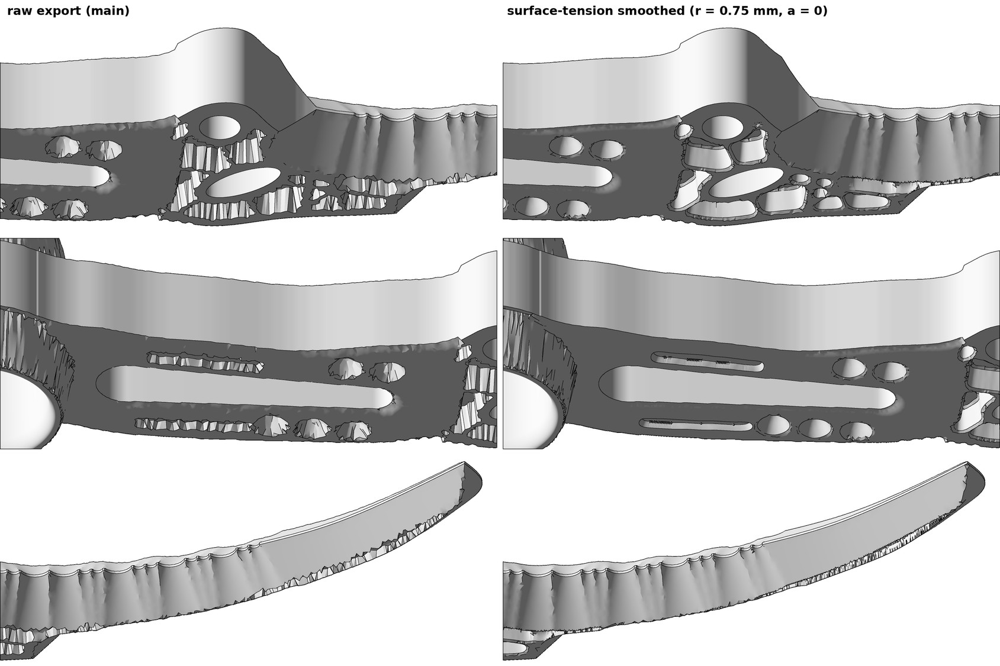

# Surface-tension pocket smoothing

Research lane for the v2.3.0 release. The leading design, `w406t3_r01_p10_c16`, had jagged, chipped
walls on its weight-saving pockets: isogrid cells, lattice dimples, handle flutes and blade fuller.
This lane smooths those walls **without moving the knife's outer shape**. It then re-scores the
smoothed CAD with the complete Stage-2 evaluator.

The code is `crates/crescent/src/pocket_smooth.rs`. It is switched on by `JARAMBIT_POCKET_SMOOTH`:
`on` gives the chosen setting, r = 0.75 mm and a = 0. It is **off by default**, and with it unset
every export is byte-identical to v2.2.1.

**Result.** At r = 0.75 mm the leading design keeps its outline, mass (83.21 g vs 83.22 g) and
B-rep, and every pocket keeps its removed volume, depth and rib widths. Chipped outlines become
clean curves: dimples become circles, flutes become clean slots, and isogrid cells get rounded
corners. The complete Stage-2 re-assessment of the smoothed CAD gives
**`W_ULTRALIGHT_v1` = 80.370405**, against 80.299390 as exported (+0.071015). Battery 14/18; not
qualified.



## Why the earlier smoothing showed no difference

The exporter writes a height field over a fixed planform. Each pocket is a removal depth
`D = base − th`, and it reached the CAD through the 0.25 mm thickness raster by nearest-cell
lookup. A pocket wall was therefore a vertical step along a 0.25 mm staircase. The export CDT
(about 0.7 mm triangles) cut straight across those steps, and that is what renders as chipped
walls.

The Taubin mesh smoother of the smoothing ladder (variant B before v2.3.1) pins every vertex on an edge sharper than 30°. Those
are exactly the chipped walls. Its largest displacement at the declared setting was 0.214 mm, so
the chipping stayed.

## What we do instead: oil in a chipped pit

Each pocket is treated as a basin that a liquid would fill. Basins are found as a watershed:
connected components of `D > 0.02 mm`, merged across gaps narrower than r/2. Inside each basin
the depth evolves for time `T = r²/2`:

    D_t = |∇D| div(∇D/|∇D|) + λ_b |∇D|        (a = 0, level-set curvature motion)

`λ_b` is a per-basin pressure that keeps the basin's removed volume (its oil volume) constant.
Every depth contour shortens like a 2-D droplet of fixed area. That means:

- chips and spikes go first, because their curvature is highest;
- a chipped circle becomes a clean circle;
- straight rib edges stay straight, and corners round to a radius of about r;
- walls keep their steepness, so ribs keep their width and the I-beam webs are not thinned.

A film parameter `a` blends toward graph mean-curvature flow of a liquid surface; `a = 1` gives
walls a meniscus. An optional film phase `w` adds a fillet of width w after the line-tension
flow. Both stay available, but neither is the default (see the comparison below).

**Never moves:** the planform and through-holes, the grind faces, the bore collar, raised
features (the ring collar), the brand pad, and a 1 mm rim of unpocketed material along the
outline and holes.

**Never deepens:** no basin may end deeper than its own deepest original point. The volume
constraint therefore widens a thin groove instead of drilling it toward the minimum web.

**Export mesh:** the exporter reads `th = base − D` by bilinear interpolation. It adds CDT
vertices in three rows along every wall (depth contours at 8, 50 and 92 % of the local wall
height), plus vertex pairs straddling the grind boundary. Triangle edges then follow each wall
instead of cutting across it.

## Bugs found on the way (all fixed, with regression tests)

1. **The ring collar lost ~55 mm³.** Raised cells (raw raster thicker than the base) were
   evolving, so the exporter replaced them with `base − d`. They are now fixed.
2. **A 1 mm³ blade dash drilled 1.40 → 3.19 mm deep at r = 1.** The volume constraint moved
   every contour of a V-groove outward, which is a vertical shift. That dash became the new D1
   lateral weak point (205.9 → 201.8 N). Basins are now capped at their own original floor.
3. **NaN grind-edge vertices.** Far from an edge the grind law is unbounded, so the crossing
   is now found by bisection on the sign of `grind − base`.
4. **Shard-like walls in oblique views.** Contour vertices taken from every 0.25 mm depth level
   interleaved across a 0.25 mm wall. They are replaced by three independent rows per wall.

## Settings tried

| Setting | Visual result | Stage-2 F |
|---|---|---|
| Taubin mesh smoothing (ladder L1–L9) | no visible change in the pockets: walls are pinned | 75.06–75.34 (B-rep withheld) |
| graph flow a = 1, r = 0.5–2 (first draft) | rounded, but depth spreads into the ribs; ribs vanish at r ≥ 2 | 80.161219 (r = 0.75) |
| line tension a = 0, r = 0.5 | clean outlines, shapes kept (triangles stay triangles) | 80.164307 |
| **line tension a = 0, r = 0.75** | **clean outlines, cells rounded, ribs intact** | **80.370405** |
| line tension a = 0, r = 1.0 | rounder cells, small triangles become circles | 80.308595 |
| line tension a = 0, r = 1.5 / 2.0 | blobs; small pockets merge | 80.158645 / 78.275029 |
| meniscus w = 0.3 / 0.5 mm (after a = 0) | flutes blur, wall triangulation less regular | not scored |

## Complete Stage-2 re-assessment (`score_cad.py`, pinned solver environment)

Every run below scored the full design: export, STEP check, D1 plate battery, GCI, side reports,
the 3D solid-tip submodel (skfem + DOLFINx) and `W_ULTRALIGHT_v1`. Nothing is withheld. The
receipt pins the sha256 of every STL, STEP, D1 field file and scorecard.

| Setting | F | ΔF | 3D mass (g) | Tip SF max / avg | Hunter lateral cert / strict (N) | Seq ratio | Battery |
|---|---:|---:|---:|---|---|---:|---:|
| as exported (re-run) | 80.299390 | — | 83.2231 | 0.6823 / 0.7569 | 181.5 / 182.2 | 1.29 | 14/18 |
| r = 0.5 | 80.164307 | −0.135083 | 83.2178 | 0.6353 / 0.6645 | 181.7 / 182.4 | 1.45 | 15/18 |
| **r = 0.75 (on)** | **80.370405** | **+0.071015** | 83.2089 | 0.7024 / 0.7511 | 181.8 / 182.5 | 1.50 | 14/18 |
| r = 1.0 | 80.308595 | +0.009205 | 83.2070 | 0.6811 / 0.7237 | 181.9 / 182.5 | 1.55 | 14/18 |
| r = 1.5 | 80.158645 | −0.140745 | 83.1869 | 0.6275 / 0.6751 | 182.2 / 182.7 | 1.51 | 14/18 |
| r = 2.0 | 78.275029 | −2.024361 | 83.2001 | unmeasured (scored 0) | 182.3 / 182.8 | 1.53 | 13/18 |
| r = 0.75, a = 1 | 80.161219 | −0.138171 | 83.2629 | 0.6349 / 0.6752 | 182.2 / 182.7 | 1.62 | 14/18 |

**What changes and what does not:**

- **F** moves almost entirely through the 3D solid-tip nodal maximum. That value changes
  non-monotonically with r. We read it as the sensitivity of a nodal maximum near the fuller end
  to the local triangulation, not as a structural trend; skfem and DOLFINx agree within 0.08 % in
  every measured case.
- **Unchanged within 3 %:** mass, lateral, ring, body-twist and fatigue. The CAD/B-rep objective
  keeps its 5 points.
- **Volume:** every basin's removed volume is preserved to rounding. The exported volume changes
  by −3.19 mm³ (−0.017 %) at r = 0.75.
- **Cost:** about 40 % more export triangles (STL 21.2 vs 15.3 MB, STEP 86.7 vs 53.4 MB). The tip
  submodel roughly doubles (177,984 vs 91,008 tetrahedra), and a full Stage-2 run took about three
  hours instead of 35 minutes.

**Geometry (r = 0.75, removal-depth contours, 14 basins):** contour length at 0.1 / 0.5 / 1 / 2 mm
depth goes from 913 / 1034 / 627 / 270 mm to 821 / 801 / 512 / 211 mm. A chipped outline is
longer than a smooth one at the same enclosed area. The flow takes 2.8 s for this design.

## Current best design at the chosen setting (v2.4.0)

The continuous evolution of 2026-10-24 produced a better design, `ec3i042_r01_p10_c56` (island i042 on xbabe3, seeded
with `ec1i012_r04_p10_c101`, 80.594628, from which it differs in 3 genes; 19 of 129 genes differ from `w406t3_r01_p10_c16`,
mostly slightly). Following the owner's rule, only the winner's smoothed result is reported, and only at the chosen setting
(r = 0.75 mm, a = 0). To save time, a smoothed run started whenever a design became the live #1; runs of earlier
leaders are not used, and those still running when a better design appeared were stopped. Both runs are complete Stage-2 assessments at v2.3.1 (49bb0ce3), the
evaluator of the winner's island:

| Setting | F | ΔF | 3D mass (g) | Tip SF max / avg | Hunter lateral cert / strict (N) | Seq ratio | Battery |
|---|---:|---:|---:|---|---|---:|---:|
| as exported (re-run) | 80.623796 | — | 83.5536 | 0.6886 / 0.7380 | 201.0 / 197.9 | 1.18 | 13/18 |
| **r = 0.75 (on)** | **80.561227** | **−0.062569** | 83.5582 | 0.6450 / 0.6818 | 201.1 / 199.9 | 1.34 | 14/18 |

- The re-run reproduces the island's score exactly, and its STL and STEP match the island's export apart from the label
  written into their headers.
- Smoothing gains 0.069 points (failure sequence +0.053, strict hunter +0.015, hunter lateral +0.001, fatigue +0.001)
  and loses 0.131 on the 3D solid-tip objective (nodal maximum 0.6886 → 0.6450, average 0.7380 → 0.6818) and 0.001 on
  mass. Unlike on `w406t3_r01_p10_c16`, the tip average falls too, so we do not attribute this to triangulation; the
  setting was chosen on `w406t3_r01_p10_c16` and is not tuned for this design. The DOLFINx cross-check agrees
  (`verified`, relative error 0.0000 / 0.0003). Mass changes by +0.005 g and the exported volume by +1.04 mm³; the
  CAD/B-rep objective keeps its 5 points. 15 basins; 1.69 s.
- **Volume:** 14 of the 15 basins keep their removed volume exactly. The smallest, a 15-cell 0.216 mm³ sliver at
  x ≈ 135 mm where the blade taper starts (outside the paper's guard and handle windows), flattens to 0.017 mm³
  (deepest point 1.39 → 0.10 mm), so `worst_basin_volume_error` is 0.92 and the total removed volume falls by 0.20 mm³
  (0.014 %).
- On xbabe3, alongside evolution islands, the smoothed assessment took 83 min and the raw one 26.5 min (peak RSS
  13.2 / 5.4 GB).
- `results/ec3i042_r01_p10_c56/` holds the receipt, scores, chosen-run master scorecard and smoothing report. The paper's
  pocket figures render this subject (`make -C docs/paper pocket-figures`; `POCKET_SUBJECT` selects another receipt).

## Reproduce

```sh
# smoothing on (chosen setting) for any export or Stage-2 run
JARAMBIT_POCKET_SMOOTH=on target/release/examples/export_step GENOME.csv OUT/prefix LABEL
JARAMBIT_POCKET_SMOOTH=on JARAMBIT_SOLVER_PYTHON=/path/to/fem-pinned/python \
  python3 ops/ci/score_cad.py --genome GENOME.csv --label LABEL --out-dir NEW_DIR

# geometry probe: flow metrics, exporter-law volume check, depth maps, state maps
target/release/examples/pocket_smooth_probe GENOME.csv NEW_DIR --window guard=74,-24,128,14 r=0.75

# paper figures (stacked hero, black-and-white raw vs smoothed, morphology views)
make -C docs/paper pocket-figures
```

Parameters (`key=value`, comma-separated): `r` (mm, default 0.75), `a` (film slope scale,
default 0), `w` (meniscus width mm, default 0), `h` (grid mm, 0.25/k, default 0.125), `grow`
(mm, default 0.5), `mesh` (CDT wall vertex spacing mm, default 0.3; 0 = none), `rim` (mm,
default 1.0) and `vp` (volume preservation, default 1). An invalid setting aborts the export
(fail closed). Unknown keys are refused.

## Files

- `results/ec3i042_r01_p10_c56/` — the same files for the current best design (as exported and r = 0.75 mm).
- `results/w406t3_r01_p10_c16/` — `RECEIPT.json` (inputs, settings, sha256 of every external
  STL/STEP/D1/scorecard, fitness per run), `scores.json` (`W_ULTRALIGHT_v1` objective breakdown
  per run), the master scorecard of the chosen run and its smoothing report.
- `figures/` — exploration figures: depth maps, crops, black-and-white comparisons.

Nothing in this lane is a qualification claim. No design passes all 26 legacy gates, and physical
performance remains unestablished.
