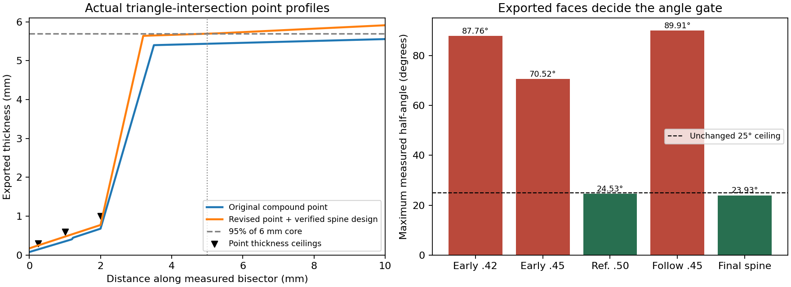

# RSV2-07 compound-section and planform study

The accepted `critical_fem_3` prototype reaches native-plate spine SF 1.084736 at certification and 1.024579 on the strict mesh, while passing exported sharpness and point profile. Its human-max twist SF is 0.431361 / 0.447217 (certification / strict), still below 1.0. Spine closes on the three specified fine meshes; human-max twist closure remains open.

This is a reproducible construction prototype, not an all-gate qualification. This study does not change production geometry, gate evaluators, numerical exclusions, loads or thresholds. A seed must be used with its recorded compound law; loading its CSV in the production CLI does not apply that law.

Validated 158 invocations with one executable SHA-256 `f030573242778a4a700c0751c1afd0e3d51b617ec14e8a4ce121e5d2b349b70b`, CPUs 14,15 and CARGO_BUILD_JOBS=2. The deterministic search retained 114 complete coarse evaluations, 104 passing the native geometric predicate. A finite search supplies observations, not a global optimum or infeasibility theorem. The later targeted probes add ten strict-only and nine four-level comparisons; the full invocation count includes validation replays.

The construction keeps a straight bevel to distance d0 and blends into the stock web by d1. Point shape 3 reaches 94% of core thickness at 3.2 mm and 95% at 5.2 mm; the elliptical variant permits thicker cheeks away from the measured bisector. Native spine-start and bounded blade-root control-point offsets redistribute the spine load. No stock or genome bound is increased.

The native predicate means clamp-domain + rs_v2 + aesthetics + empty gates::check; it does not establish structural legality. Sharpness and point profile below were measured on exported triangles by the unchanged certification code. The same compound thickness function feeds the export and every FEM solve. The original field mass is not the prototype mass; export volume is retained instead.

| Candidate | Cert HM twist | Strict HM twist | Cert HM spine | Strict HM spine | Strict ring-back | Strict tip-zone | Sharp / point |
| --- | ---: | ---: | ---: | ---: | ---: | ---: | --- |
| fine_0 (baseline) | 0.239714 | 0.284026 | 0.616858 | 0.580823 | 6.796506 | 2.528144 | pass / pass |
| fine_1 (export_3) | 0.327318 | 0.381597 | 0.698762 | 0.604381 | 6.816446 | 3.396628 | pass / pass |
| fine_2 (follow_export_5) | 0.437383 | 0.380385 | 0.935710 | 0.961167 | 6.784177 | 3.385847 | pass / pass |
| endpoint_fine_0 (endpoint_export_0) | 0.412839 | 0.427479 | 1.001785 | 0.988986 | 6.745988 | 3.805032 | pass / pass |
| hotspot_fine_0 (hotspot_export_0) | 0.376513 | 0.445111 | 0.995668 | 1.041424 | 6.782158 | 3.961977 | pass / pass |
| critical_fem_3 (critical_export_1) | 0.431361 | 0.447217 | 1.084736 | 1.024579 | 6.787636 | 3.980725 | pass / pass |

Certification columns are min(0.25,0.125 mm²), and strict columns are the separate 0.0625 mm² solve. All target SF thresholds remain 1.0. Body twist must be divided by 8.9010989011 to compare it to the human-max torque. The reported human-max twist uses the complete eligible region, including the governing 4–15 mm tip annulus.

| Candidate | Max apex mm | Max half-angle deg | Point t0.25 / t1 / t2 mm | Taper lower bound mm | Strict lateral N | Strict fatigue | Strict sequence |
| --- | ---: | ---: | --- | ---: | ---: | ---: | ---: |
| fine_0 | 0.095434 | 18.550465 | 0.148172 / 0.352723 / 0.680000 | 10.000000 | 287.909911 | 0.804226 | 0.565464 |
| fine_1 | 0.195142 | 24.526638 | 0.250000 / 0.475000 / 0.775000 | 5.200000 | 320.970377 | 0.896575 | 0.690482 |
| fine_2 | 0.195145 | 23.981470 | 0.250000 / 0.475000 / 0.775000 | 5.200000 | 317.442638 | 0.886720 | 0.653157 |
| endpoint_fine_0 | 0.195142 | 24.065454 | 0.250000 / 0.475000 / 0.775000 | 5.200000 | 322.722765 | 0.901470 | 0.594401 |
| hotspot_fine_0 | 0.195144 | 24.076133 | 0.250000 / 0.475000 / 0.775000 | 5.200000 | 325.086470 | 0.908072 | 0.692674 |
| critical_fem_3 | 0.195145 | 23.931704 | 0.250000 / 0.475000 / 0.775000 | 5.200000 | 324.388159 | 0.906122 | 0.723861 |

| Candidate | Strict body / HM requirement | Twist peak radius mm | Peak width / thickness mm | Required/current twist capacity | Required/current spine capacity | Spine hotspot x / y mm |
| --- | ---: | ---: | --- | ---: | ---: | --- |
| fine_0 | 1.527039 | 4.001648 | 8.450000 / 5.412051 | 3.520803 | 1.721695 | 107.820946 / -11.637703 |
| fine_1 | 1.443538 | 4.001648 | 8.450000 / 5.664063 | 2.620569 | 1.654586 | 107.820946 / -11.637703 |
| fine_2 | 1.505423 | 4.010409 | 9.350000 / 5.572297 | 2.628913 | 1.040402 | 107.808919 / -11.636019 |
| endpoint_fine_0 | 1.757216 | 4.794431 | 9.750000 / 5.733924 | 2.339296 | 1.011137 | 107.807097 / -11.635765 |
| hotspot_fine_0 | 1.723751 | 4.051022 | 9.200000 / 5.684986 | 2.246631 | 0.960223 | 157.028067 / -9.861161 |
| critical_fem_3 | 1.402122 | 4.023533 | 8.950000 / 5.673623 | 2.236050 | 0.976010 | 150.222863 / -5.459975 |

The reciprocal SF columns compare required/current capacity; values above 1 quantify observed deficits. They do not predict a local thickness change that would provide those factors. Changing a section redistributes stress, and the retained peak locations show which region governs each solve.


The unchanged native certification-integrity suite passed 14/14 tests with faer, CPUs 14,15 and two build jobs/test threads. Per-invocation verification checks the executable, source digests, CPU affinity, mesh areas, native baseline reproduction, and human-max/fatigue identities.



No independent P2 solid, DOLFINx cross-check, GCI adjudication, support/buckling battery or manufacturing qualification is supplied by this study. The existing bore collar exceeds the flat stock thickness; this unresolved construction issue is inherited from the audited model. Passing these exported edge measurements does not resolve that issue or establish 16/16 + 10/10.

Raw results, per-level peak locations, source provenance and invocation hashes remain in `target/rsv2-07/v3/`. The root-level exploratory attempts and `superseded-build/` are excluded because their harness versions overlapped. Only the hashed v3 run is used above. Compact receipts and canonical 128-gene seeds are in `results/validation.json` and `results/*.csv`.

Reproduce from the repository root (use a fresh or archived v3 evidence destination):

```sh
bash experiments/rsv2_07/build.sh
taskset -c 14,15 env CARGO_BUILD_JOBS=2 python3 experiments/rsv2_07/search.py
taskset -c 14,15 env CARGO_BUILD_JOBS=2 python3 experiments/rsv2_07/refine.py
taskset -c 14,15 env CARGO_BUILD_JOBS=2 python3 experiments/rsv2_07/endpoints.py
taskset -c 14,15 env CARGO_BUILD_JOBS=2 python3 experiments/rsv2_07/closure.py
taskset -c 14,15 env CARGO_BUILD_JOBS=2 python3 experiments/rsv2_07/hotspot.py
taskset -c 14,15 env CARGO_BUILD_JOBS=2 python3 experiments/rsv2_07/critical.py
taskset -c 14,15 env CARGO_BUILD_JOBS=2 python3 experiments/rsv2_07/web.py
taskset -c 14,15 env CARGO_BUILD_JOBS=2 python3 experiments/rsv2_07/plot.py
taskset -c 14,15 env CARGO_BUILD_JOBS=2 python3 experiments/rsv2_07/report.py
taskset -c 14,15 env CARGO_BUILD_JOBS=2 python3 experiments/rsv2_07/save_cad.py
taskset -c 14,15 env CARGO_BUILD_JOBS=2 python3 experiments/rsv2_07/report.py
```

During the run another process committed and rebased this checkout. The only recorded tracked-source drift is `crates/cli/src/auto_evolve.rs`, which is outside the standalone harness dependency graph. All compiled study sources, requirements and the evaluated executable remain identical to the build snapshot. `target/rsv2-07/workspace_drift.json` preserves both commit identities and old/new digests; the original provenance is retained.

The retained full-precision facets are in `prototype.mesh.json`; the STL is a viewing copy. Each CAD replay matches the measured vertex/triangle census and volume; hashes and construction settings are in `results/cad_manifest.json`.

- [critical_fem_3 prototype.stl](../../target/rsv2-07/cad/critical_fem_3/prototype.stl)
- [critical_fem_3 prototype.mesh.json](../../target/rsv2-07/cad/critical_fem_3/prototype.mesh.json)
